# 3：机器学习任务攻略 🧭

在本节课中，我们将学习如何系统地分析和解决机器学习任务中常见的问题。课程将围绕一个核心攻略展开，帮助你诊断模型在训练和测试阶段表现不佳的原因，并提供相应的解决策略。

## 课程概述

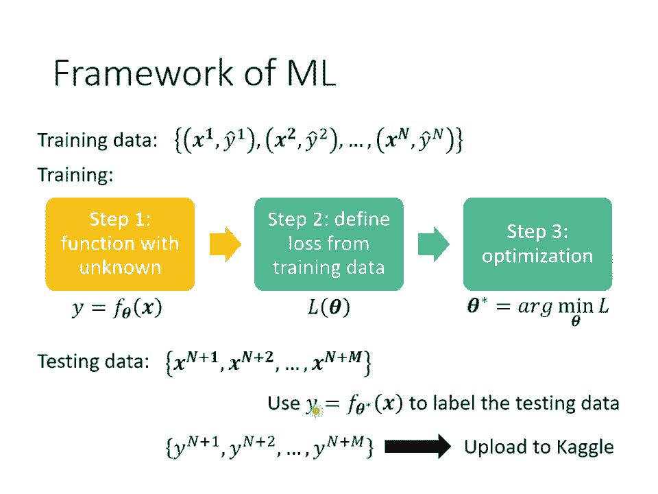

机器学习任务通常遵循一个通用流程：使用包含输入X和输出Y的训练数据来训练模型，然后在只有输入X的测试数据上进行预测和评估。本攻略旨在帮助你在此流程中，当模型表现不理想时，能够有条理地定位问题并找到改进方向。

## 诊断与解决流程总览

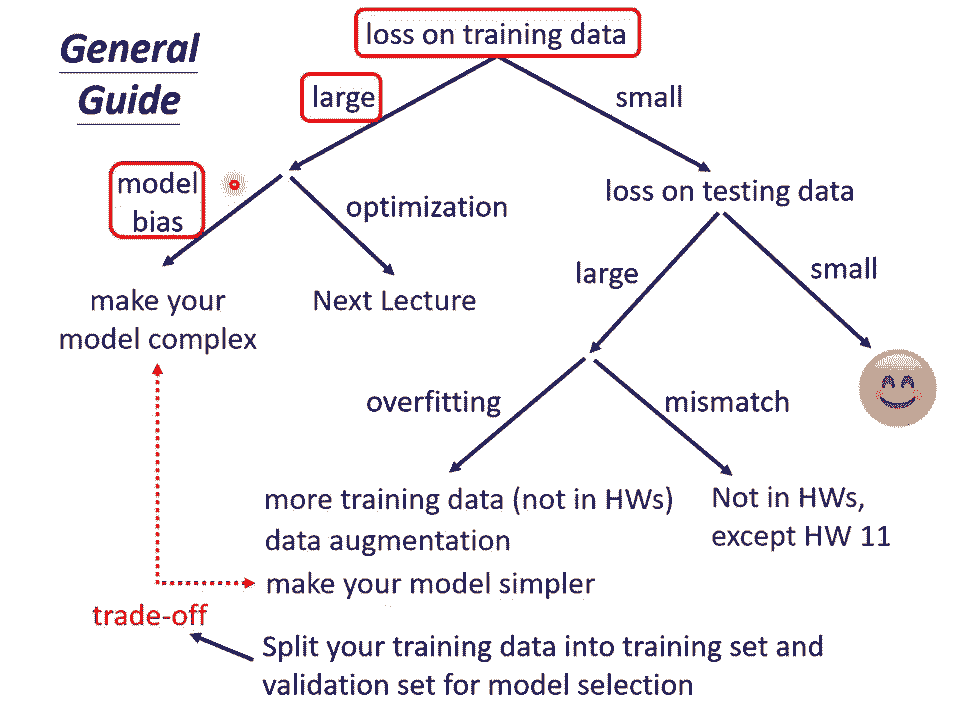

当你在测试集（例如Kaggle排行榜）上的结果不满意时，不应直接针对测试集进行调整。正确的做法是遵循一个系统的诊断流程。

首先，你需要检查模型在**训练数据**上的损失（Loss）。这是所有诊断的起点。

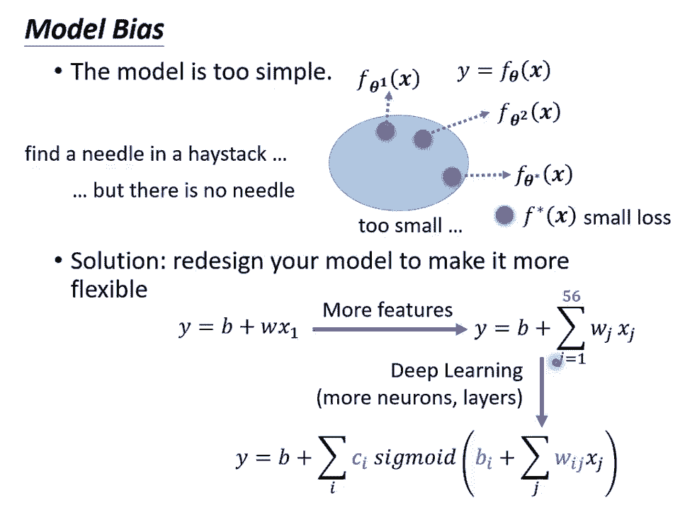

### 第一步：检查训练损失

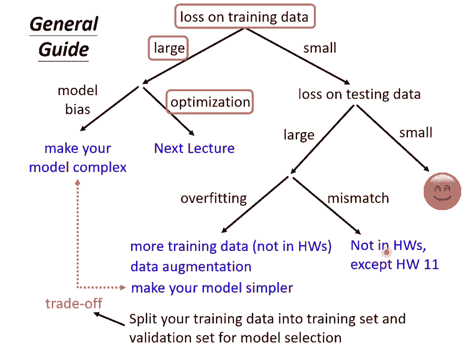

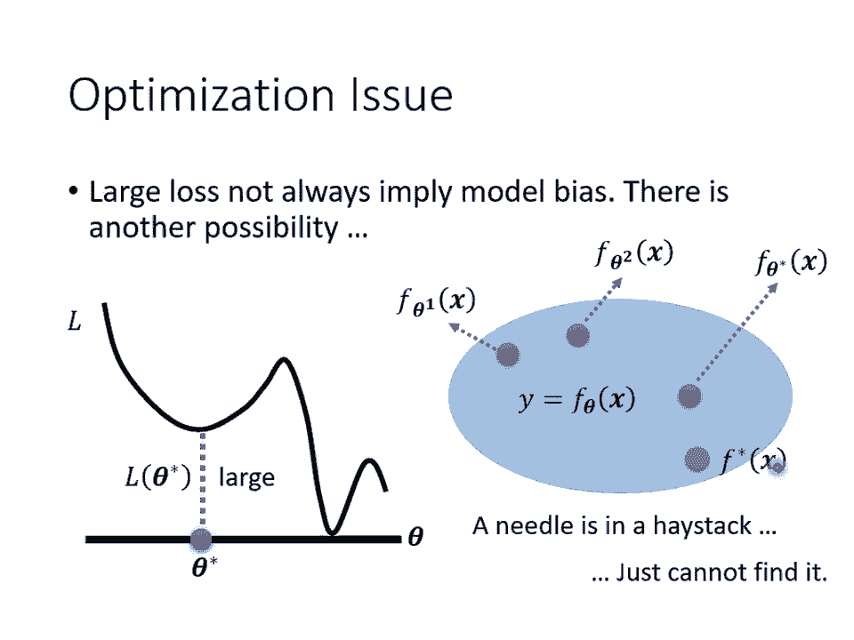

如果训练损失很大，说明模型在训练数据上就没有学好。这通常由两个原因导致：模型偏差（Model Bias）或优化失败（Optimization Issue）。

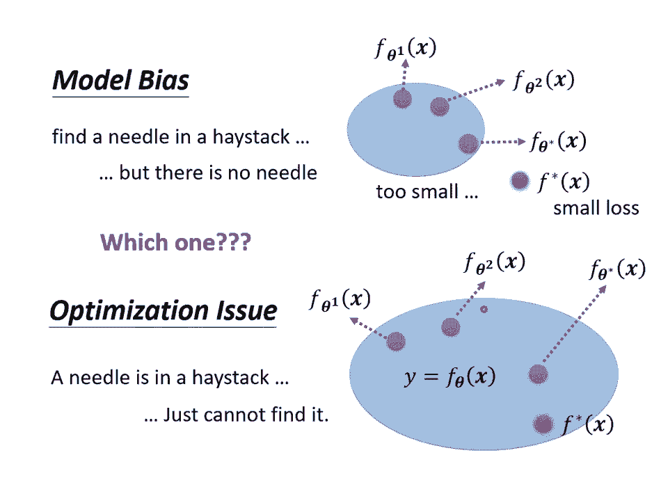

#### 情况一：模型偏差 (Model Bias)

模型偏差意味着你的模型过于简单，其函数集合中根本不包含能够有效拟合数据的函数。

**核心概念**：你的模型是一个带参数θ的函数：`f_θ(x)`。通过调整θ，你可以得到一系列函数，构成一个函数集合。如果这个集合太小，其中可能没有一个函数的损失足够低。

**解决方案**：
*   增加输入特征（Feature）。
*   使用更复杂的模型（例如，增加网络层数或神经元数量）。
*   采用深度学习（Deep Learning）来增加模型弹性。

#### 情况二：优化失败 (Optimization Issue)

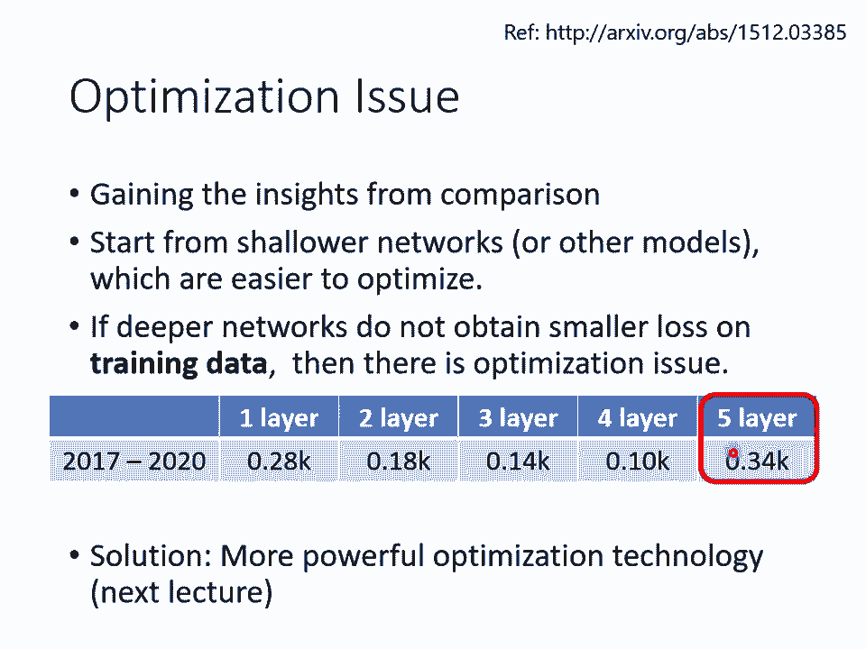

优化失败意味着你的模型函数集合中**存在**表现好的函数，但梯度下降（Gradient Descent）等优化算法没能找到它。

**核心概念**：虽然存在一个参数θ*使得 `f_θ*(x)` 的损失很低，但优化过程卡在了局部最小值（Local Minima）或其他不利位置，最终找到的参数θ’ 对应的损失仍然很高。

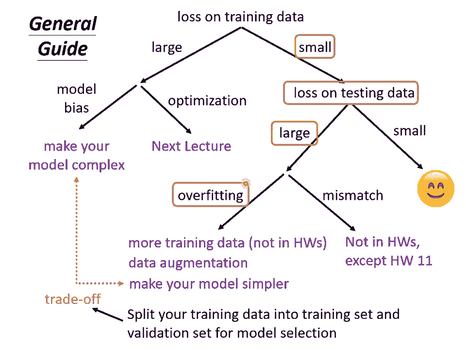

**如何判断是模型偏差还是优化失败？**
一个有效的方法是进行**模型对比**。
1.  先训练一个较简单的模型（例如线性模型或浅层网络）。这些模型通常更容易优化。
2.  再训练一个更复杂的模型（例如深层网络）。
3.  如果复杂模型在训练集上的损失**反而高于**简单模型，那么很可能是优化出了问题。因为复杂模型的函数集合包含了简单模型的集合，理论上其性能下限不应比简单模型差。

**解决方案**：需要改进优化过程（例如，调整学习率、使用更好的优化器）。这部分内容将在后续课程中详细讲解。

---

上一节我们介绍了如何诊断和解决训练损失大的问题。接下来，我们假设训练损失已经足够小，来看看测试阶段的问题。

### 第二步：检查测试损失

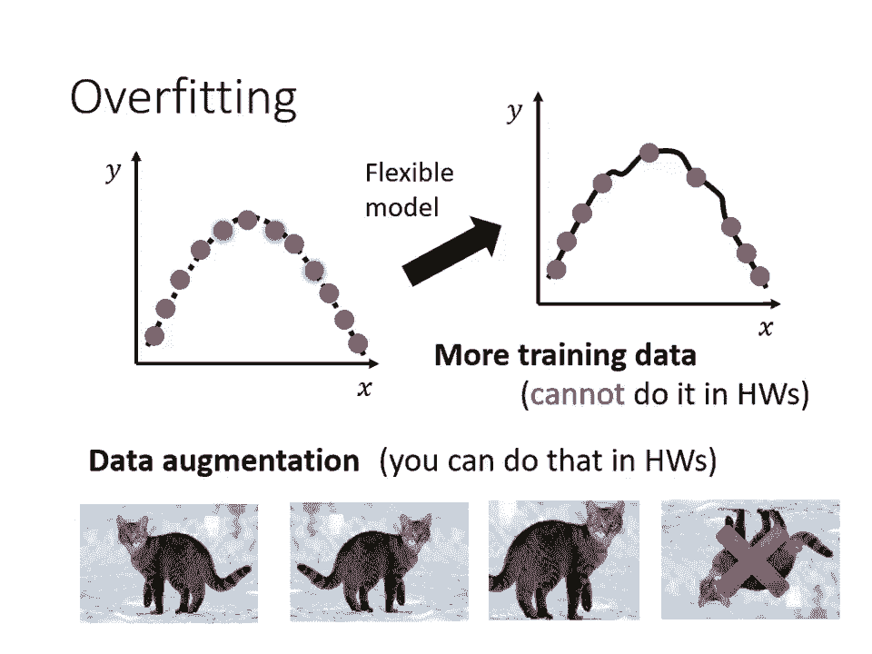

当训练损失很小，但测试损失很大时，你很可能遇到了**过拟合（Overfitting）**。

**过拟合的原因**：模型过于复杂（弹性太大），它不仅仅学到了数据中的普遍规律，还“记住”了训练数据中的噪声和特定细节。这导致它在训练集上表现完美，但在未见过的测试数据上表现糟糕。

**想象一个例子**：真实规律是一个二次曲线（虚线），训练数据（蓝点）是从曲线上采样得到的。一个非常复杂的模型可能会产生一条穿过所有蓝点但形状古怪的曲线（绿色实线），它在训练点上误差为0，但在测试点（橙点）上误差很大。

**解决过拟合的方法**：
以下是几种常用的解决过拟合的策略：

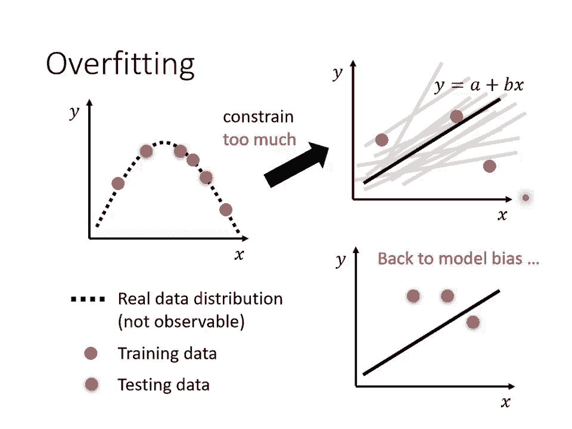

*   **增加训练数据**：这是最有效的方法。更多的数据可以限制模型的“自由发挥”，迫使它学习更通用的模式。
*   **数据增强 (Data Augmentation)**：在不能收集新数据时（如作业要求），可以根据领域知识对现有数据进行变换来创造新样本（例如，对图像进行左右翻转、裁剪）。
*   **给模型增加限制 (Reduce Model Complexity)**：
    *   使用更少的参数。
    *   共享参数（例如，使用卷积神经网络CNN而非全连接网络Fully Connected）。
    *   使用更少的特征。
    *   **正则化 (Regularization)**：如L1/L2正则化，直接在损失函数中惩罚大的参数值。
    *   **早停 (Early Stopping)**：在训练损失停止下降前停止训练。

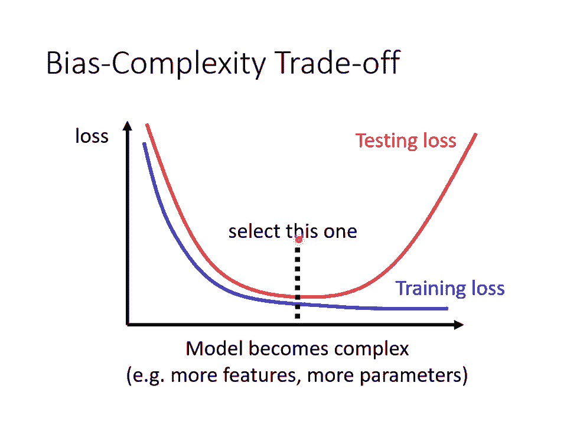

**注意**：限制模型需要适度。如果限制过强（例如强制使用线性模型去拟合非线性数据），又会回到**模型偏差**的问题上，导致模型能力不足。

---

在解决了过拟合问题后，我们需要选择一个合适的模型。这引出了模型选择与评估的重要原则。

### 模型选择与交叉验证

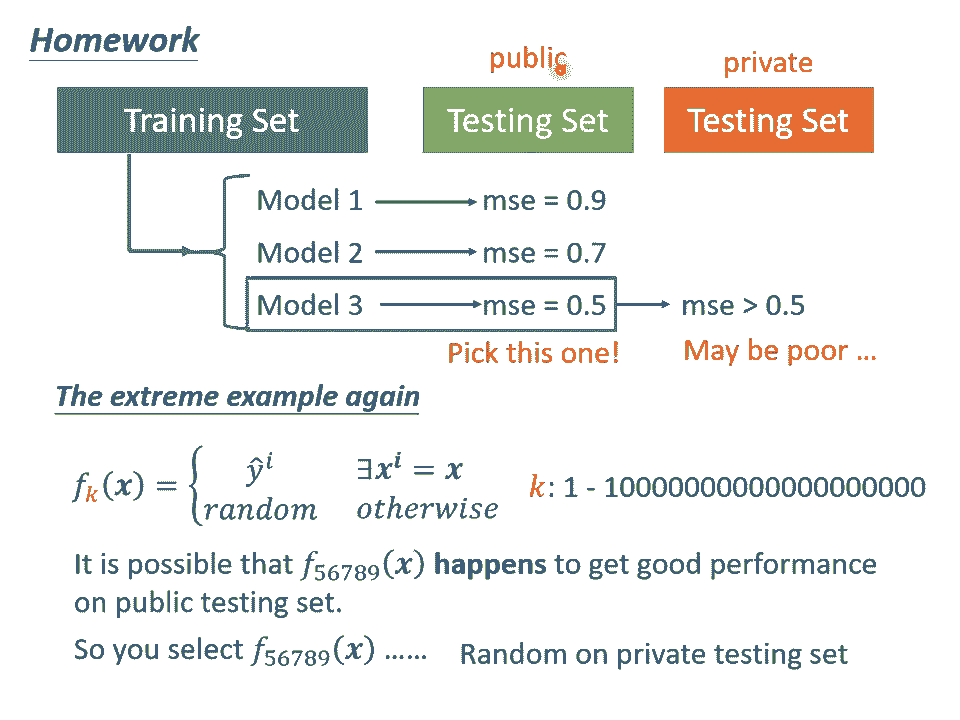

模型复杂度与误差之间存在一个权衡。随着模型变复杂，训练误差会持续下降，但测试误差会先下降后上升（出现过拟合）。我们的目标是选择一个在测试集上误差最小的“中庸”模型。

**关键问题**：如何选择这个模型？**绝对不要**根据公开测试集（Public Test Set）上的分数直接选择模型！

**为什么？** 因为这会导致你“过拟合”公开测试集。即使是一个糟糕的模型，只要尝试次数足够多，也有可能在公开测试集上偶然得到一个好分数。但这并不能保证它在最终私有测试集（Private Test Set）上表现好，可能导致最终排名暴跌。

**正确的做法是使用验证集 (Validation Set)**：
1.  将原始训练数据划分为两部分：训练集（Training Set）和验证集（Validation Set）。课程代码中通常按90%/10%划分。
2.  用训练集训练模型，用验证集评估模型表现。
3.  根据验证集上的分数来选择最佳模型。
4.  将选出的最佳模型在整个训练集（训练集+验证集）上重新训练，然后用于最终的测试集预测。

**为了更稳定地评估**，可以使用 **N折交叉验证 (N-fold Cross Validation)**：
1.  将训练数据平均分成N份。
2.  依次将其中一份作为验证集，其余N-1份作为训练集，进行N次训练和验证。
3.  计算每个模型在这N次验证中的平均分数，选择平均分数最高的模型。
4.  用该模型在全部训练数据上重新训练，用于测试。

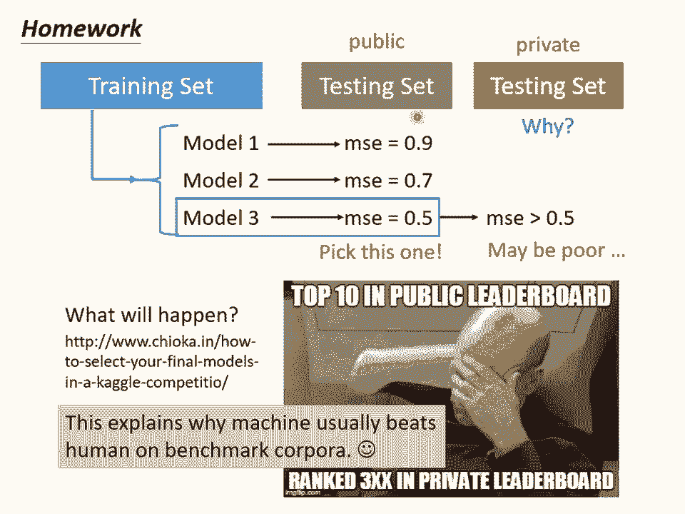

---

除了上述常见问题，还有一种特殊状况需要注意。

### 不匹配问题 (Mismatch)

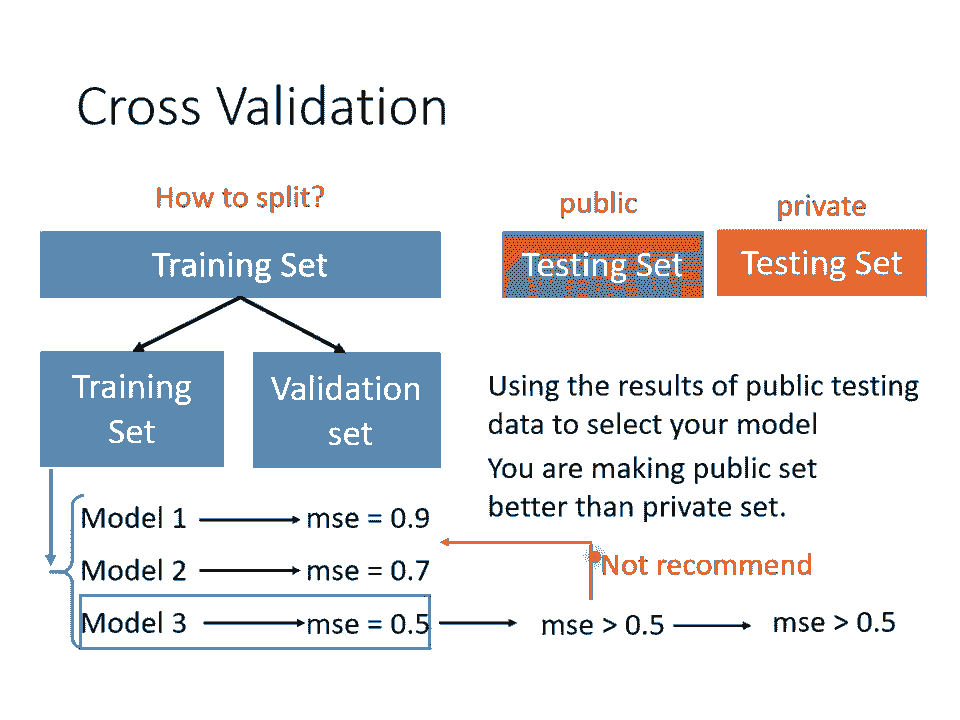

不匹配是指训练数据和测试数据来自**不同的分布**。例如，用2020年的视频观看数据训练，预测2021年的数据，由于社会背景变化（如疫情），分布可能截然不同。

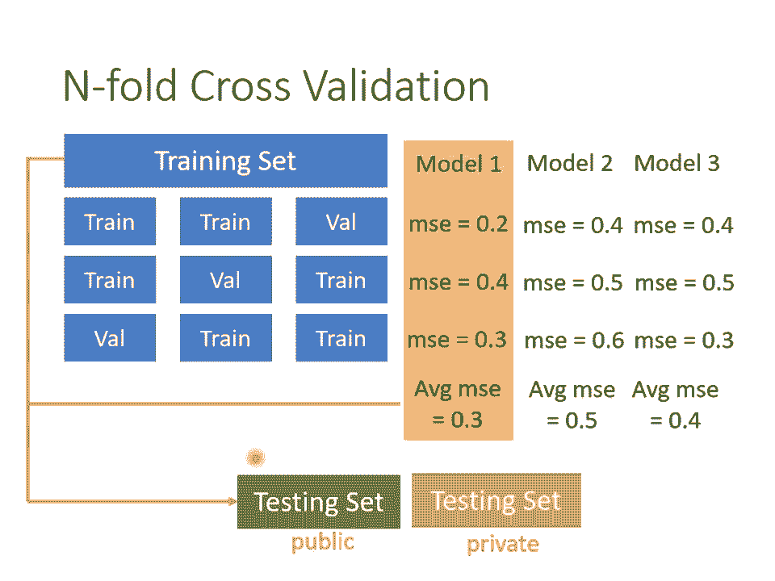

**与过拟合的区别**：对于不匹配问题，单纯增加更多训练数据（如果仍来自旧分布）并无帮助。

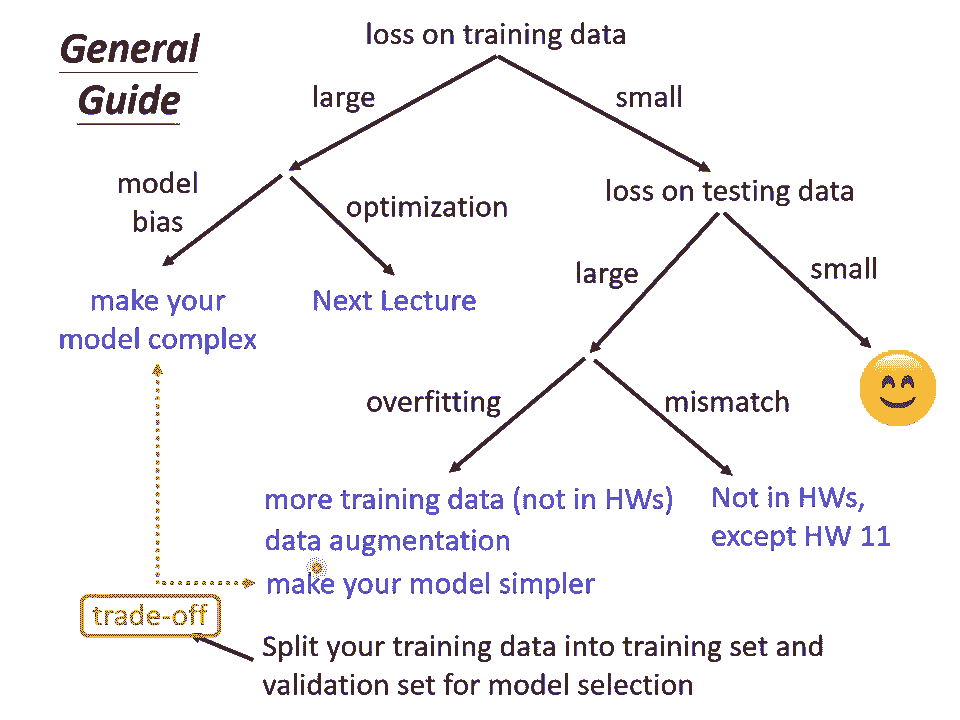

**解决方案**：需要深入理解数据产生过程，并采用专门处理领域自适应（Domain Adaptation）或分布偏移（Distribution Shift）的技术。这将在后续相关作业中探讨。

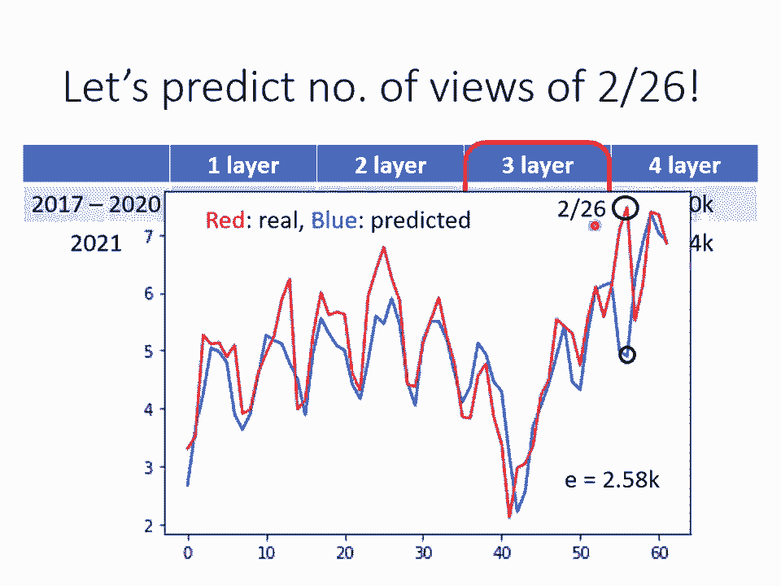

## 课程总结

本节课我们一起学习了机器学习任务的通用诊断攻略：
1.  **首要检查训练损失**：若训练损失大，需判断是**模型偏差**（增加模型复杂度）还是**优化失败**（改进优化算法）。
2.  **再检查测试损失**：若训练损失小但测试损失大，可能是**过拟合**。可通过增加数据、数据增强、正则化、降低模型复杂度等方法解决。
3.  **正确进行模型选择**：使用**验证集**或**交叉验证**来选择模型，避免根据公开测试集分数做决策，以防止过拟合公开测试集。
4.  **留意不匹配问题**：当训练与测试数据分布不同时，需采用特殊处理方法。

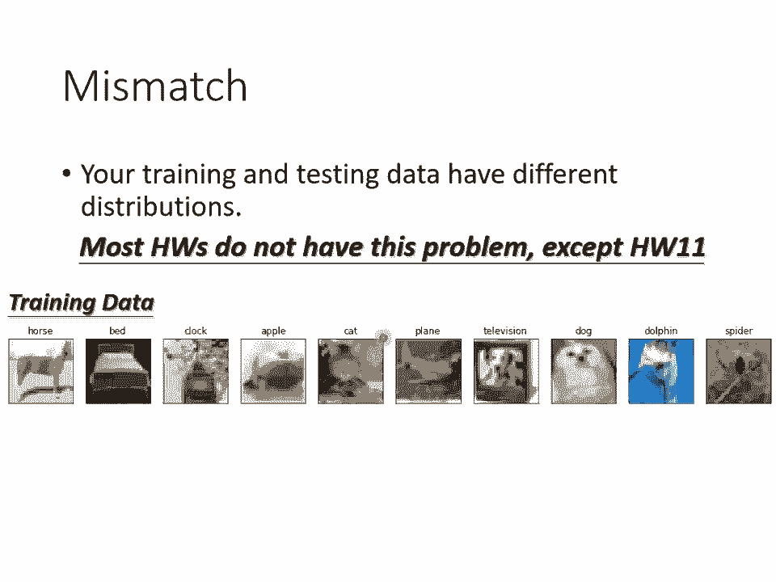

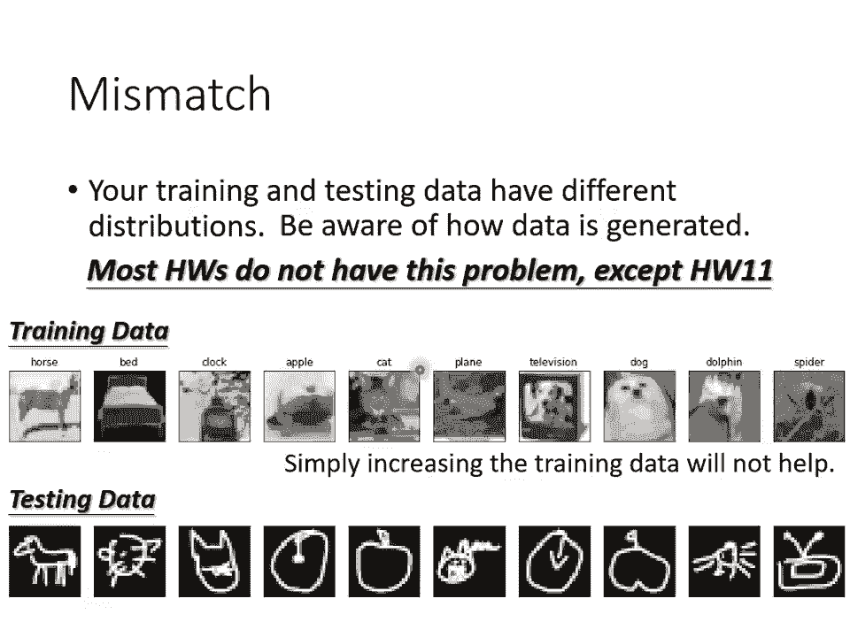

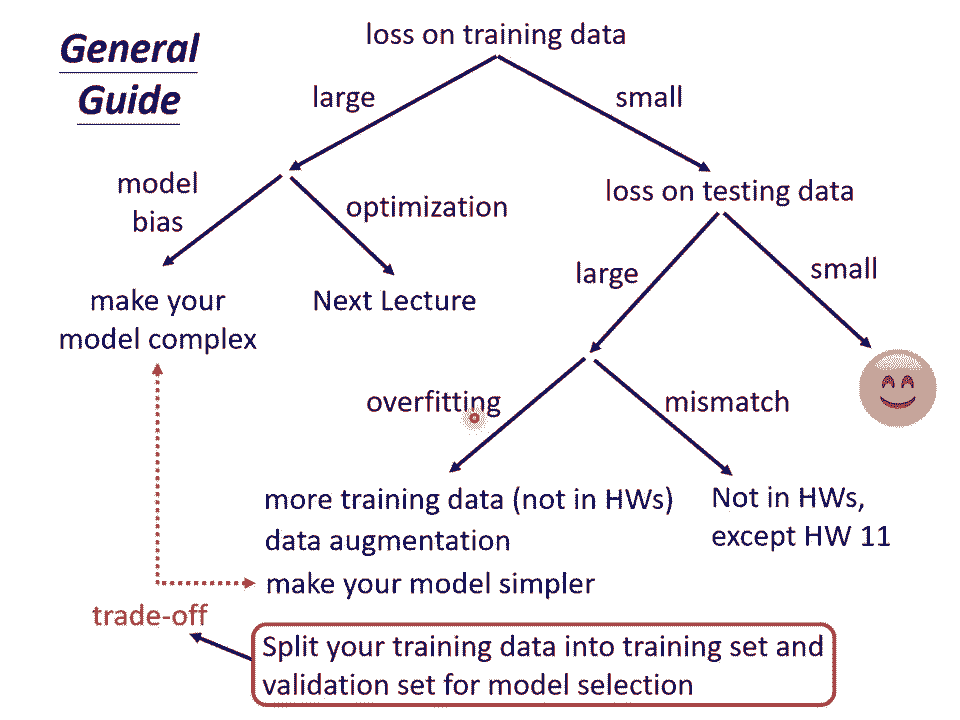

这套“攻略”旨在帮助你建立系统化的问题排查思路，从而更有效地提升机器学习模型的性能。