# 4：L3.1 - 网络训练1：局部最小值与鞍点 🧠

在本节课中，我们将要学习当优化过程失败时，如何分析和应对。具体来说，我们会探讨梯度下降法为何会停止更新，以及如何区分局部最小值和鞍点，并了解在训练深度神经网络时，哪种情况更为常见。

## 📉 优化失败的原因

在训练神经网络时，你可能会发现损失函数不再下降，即使你对当前的损失值并不满意。有时，模型甚至从一开始就无法有效训练，损失值居高不下。这通常是因为优化过程遇到了问题。

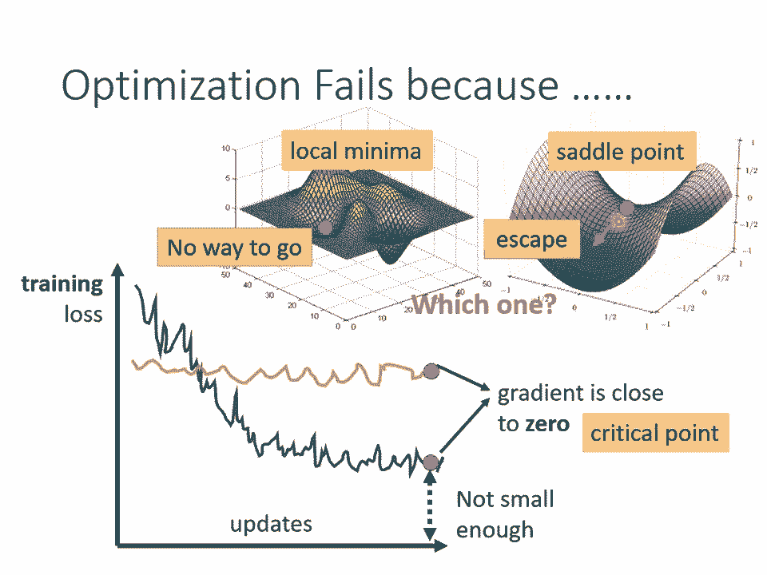

一个常见的猜想是，优化过程停在了一个梯度为零的点。当参数对损失函数的梯度为零时，梯度下降法就无法再更新参数，训练便会停滞，损失值自然不再下降。

## 🎯 临界点：局部最小值与鞍点

当梯度为零时，人们最先想到的可能是局部最小值。然而，梯度为零的点统称为**临界点**，它不仅仅包括局部最小值，还包括**鞍点**。

鞍点是指在某个方向上是高点，在另一个方向上是低点的点，其形状类似于马鞍。在鞍点处，梯度同样为零，但它不是局部最小值。

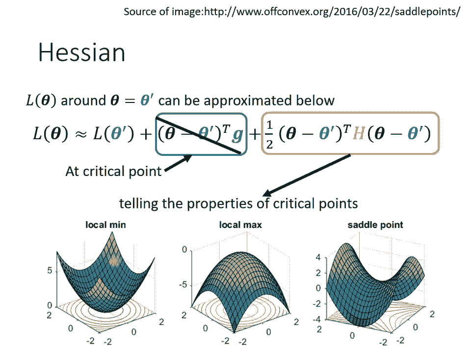

区分当前处于局部最小值还是鞍点非常重要。如果卡在局部最小值，可能意味着没有出路，因为四周的损失值都更高。但如果卡在鞍点，周围可能存在让损失值下降的路径。

## 🔍 如何区分局部最小值与鞍点

要判断一个临界点的类型，我们需要借助损失函数在该点附近的形状信息。虽然无法知道整个损失函数的全貌，但我们可以通过泰勒展开式在特定点附近进行近似。

损失函数 \( L(\theta) \) 在点 \( \theta' \) 附近的近似可以表示为：
\[
L(\theta) \approx L(\theta') + (\theta - \theta')^T g + \frac{1}{2} (\theta - \theta')^T H (\theta - \theta')
\]
其中：
*   \( g \) 是梯度向量（一次微分）。
*   \( H \) 是海森矩阵（二次微分）。

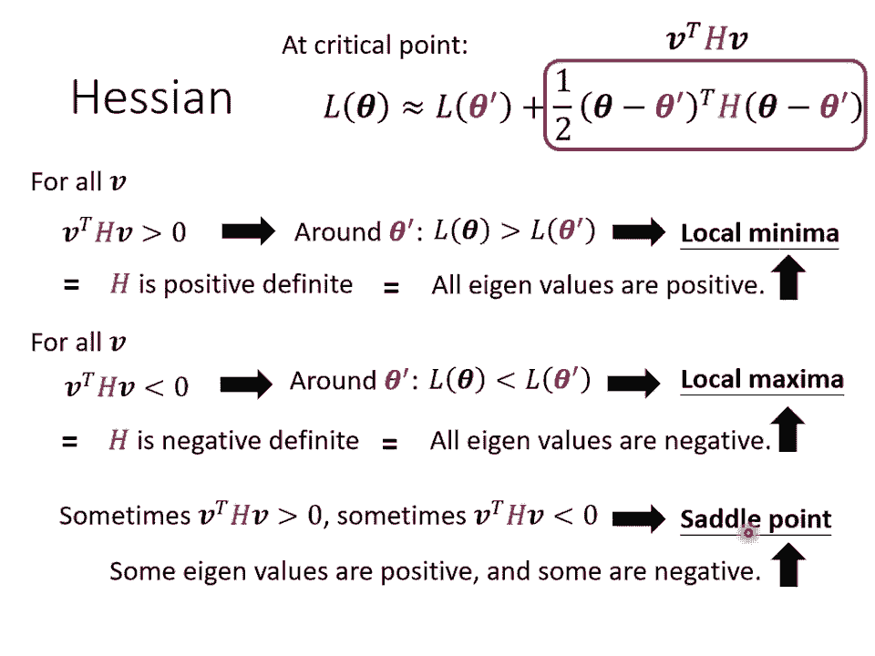

在临界点，梯度 \( g \) 为零向量，因此近似式简化为：
\[
L(\theta) \approx L(\theta') + \frac{1}{2} (\theta - \theta')^T H (\theta - \theta')
\]
我们可以通过分析红色项（即海森矩阵项）来判断该点附近的“地貌”。

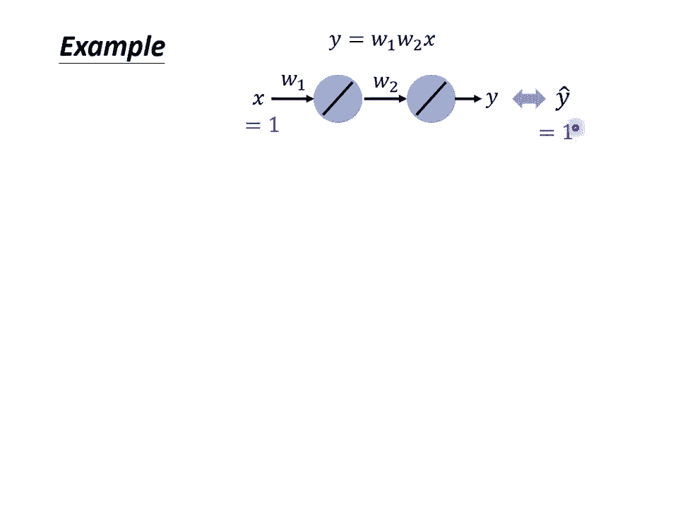

### 基于海森矩阵的判断

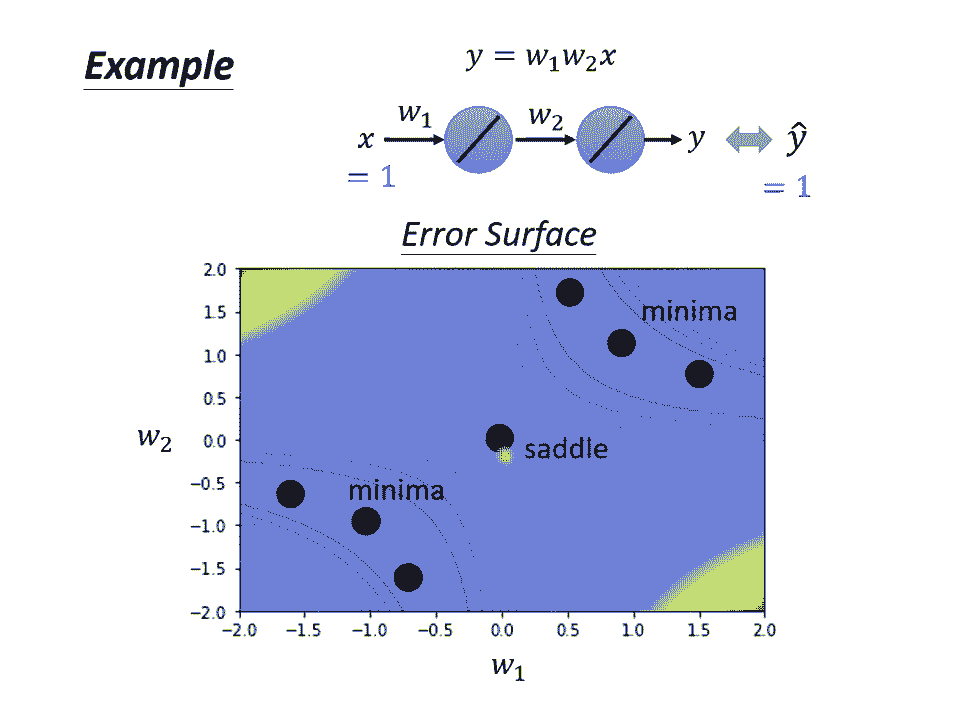

令 \( v = \theta - \theta' \)。我们可以根据二次型 \( v^T H v \) 的值来判断临界点类型：

*   如果对于所有可能的 \( v \)，都有 \( v^T H v > 0 \)，则 \( L(\theta) > L(\theta') \)，说明 \( \theta' \) 是附近的**局部最小值**。
*   如果对于所有可能的 \( v \)，都有 \( v^T H v < 0 \)，则 \( L(\theta) < L(\theta') \)，说明 \( \theta' \) 是附近的**局部最大值**。
*   如果对于不同的 \( v \)，\( v^T H v \) 有时为正，有时为负，则说明 \( \theta' \) 是一个**鞍点**。

在实际操作中，我们不需要测试所有的 \( v \)。线性代数理论告诉我们，可以通过计算海森矩阵 \( H \) 的**特征值**来快速判断：
*   如果所有特征值均为正 → **局部最小值**。
*   如果所有特征值均为负 → **局部最大值**。
*   如果特征值有正有负 → **鞍点**。

## 🧪 实例分析

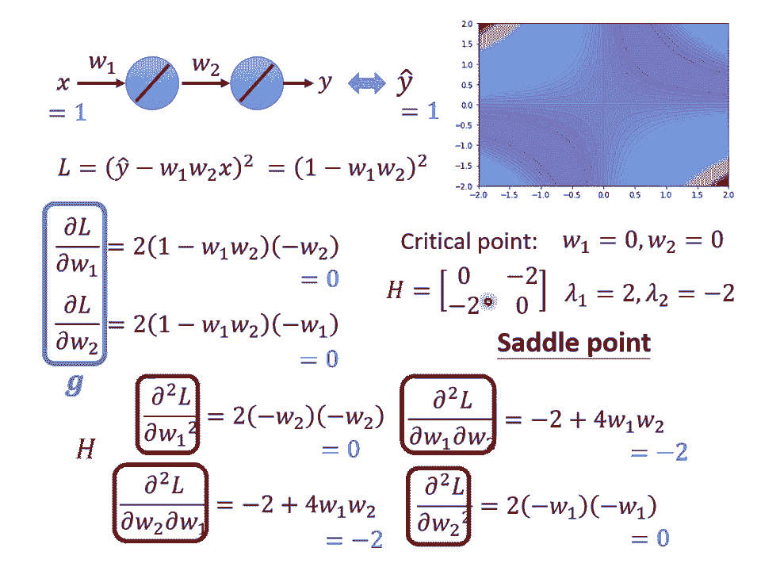

考虑一个极其简单的网络：输入 \( x \)，输出 \( y = w_1 \times w_2 \times x \)。我们只有一笔训练数据 \( (x=1, y=1) \)，因此损失函数为 \( L = (1 - w_1 w_2)^2 \)。

通过计算，我们找到原点 \( (w_1=0, w_2=0) \) 是一个临界点（梯度为零）。计算该点的海森矩阵 \( H \) 并求其特征值，发现特征值为 2 和 -2，一正一负。因此，原点是一个**鞍点**，而非局部最小值。

## 🛤️ 逃离鞍点

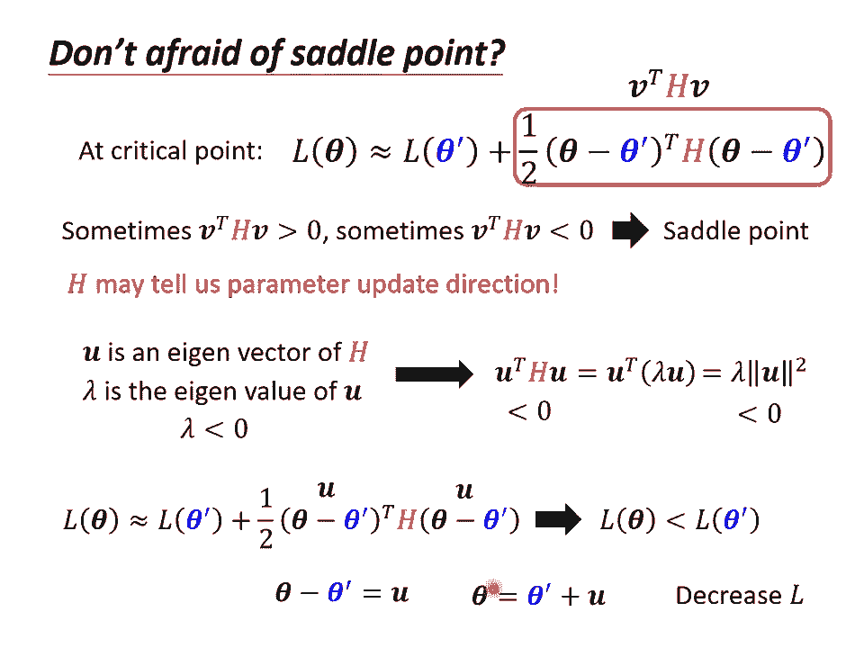

如果确认卡在鞍点，事情并没有那么糟糕。海森矩阵不仅能帮我们诊断，还能指出参数更新的方向。

假设 \( u \) 是海森矩阵 \( H \) 的一个特征向量，对应的特征值为 \( \lambda \)。如果 \( \lambda < 0 \)（负特征值），那么沿着 \( u \) 的方向更新参数（即 \( \theta = \theta' + u \)），根据泰勒展开式，损失值 \( L(\theta) \) 将会小于 \( L(\theta') \)。这意味着我们可以逃离鞍点，继续降低损失。

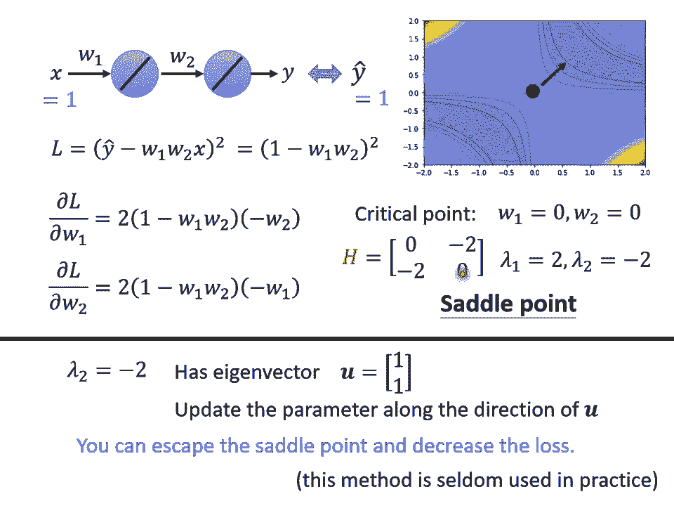

在上面的例子中，海森矩阵有一个特征值 \( \lambda = -2 \)，对应的一个特征向量是 \( u = [1, 1]^T \)。因此，从原点沿着 \( [1, 1] \) 方向更新参数，损失函数值就会下降。

**需要注意的是**：在实际训练中，由于海森矩阵的计算和特征分解开销巨大，几乎没有人直接用这种方法逃离鞍点。后续课程会介绍其他更高效的方法。这里介绍它，是为了说明鞍点并非绝境，理论上存在逃离的路径。

## 🌌 局部最小值真的常见吗？

一个关键问题是：在深度神经网络训练中，局部最小值和鞍点，哪个更常见？

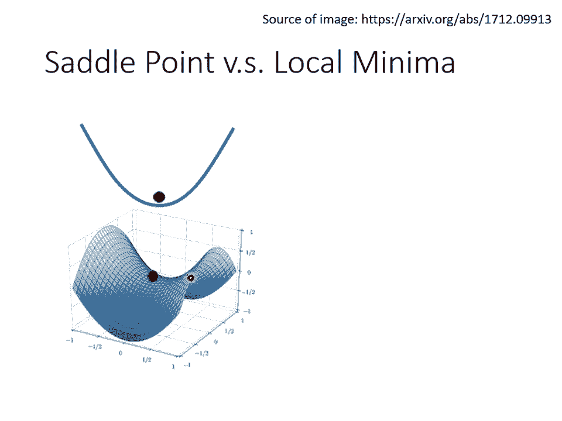

我们可以从一个高维空间的视角来思考。神经网络的参数动辄百万甚至千万，这意味着损失函数曲面处于一个极高维的空间中。在一维或二维空间中看起来是“死胡同”的局部最小值，在更高维度的空间中，可能只是一个鞍点——因为在高维空间里，可能存在更多可以离开的“方向”。

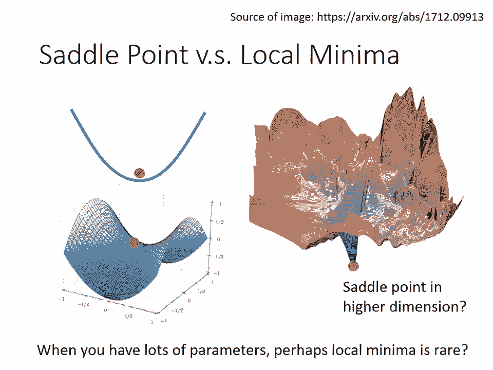

经验证据也支持这一观点。有研究在训练网络后，分析其停止点的海森矩阵特征值，发现即使损失已经很低，特征值中仍然有相当一部分是负的。这意味着在众多参数方向中，仍然存在许多可以让损失下降的路径。因此，**在训练大型神经网络时，真正的局部最小值可能相当罕见，更常见的是鞍点或非常平坦的区域**。

## 📝 本节课总结

在本节课中，我们一起学习了：
1.  优化失败可能是因为梯度为零，停在了**临界点**。
2.  临界点包括**局部最小值**和**鞍点**，鞍点周围可能存在使损失下降的路径。
3.  可以通过计算临界点处的**海森矩阵**及其**特征值**来区分二者：特征值全正为局部最小值，有正有负为鞍点。
4.  理论上，可以利用负特征值对应的特征向量方向来更新参数，从而**逃离鞍点**。
5.  由于神经网络参数空间维度极高，真正的局部最小值可能很少，训练中更常遇到的是**鞍点**。这为优化提供了更多可能性。

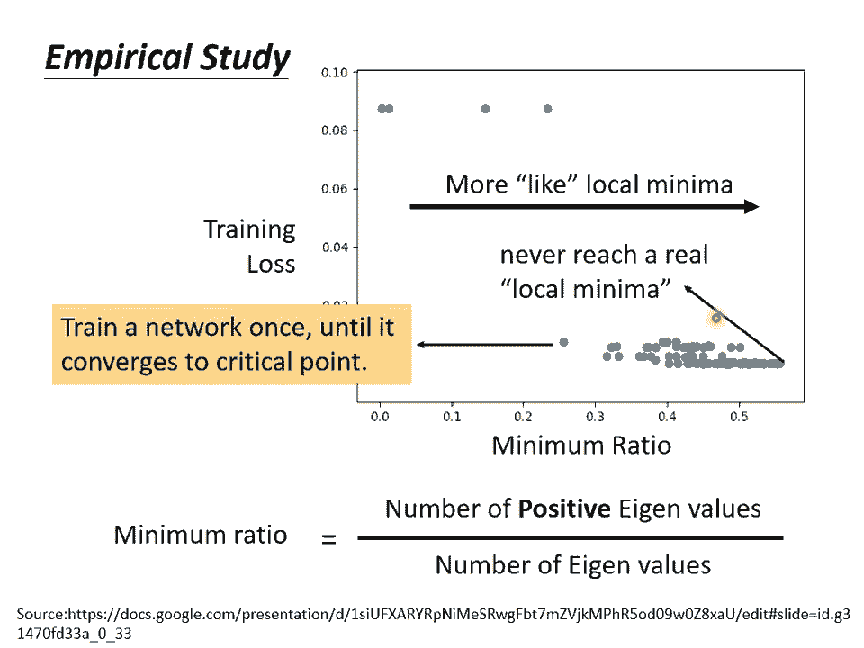

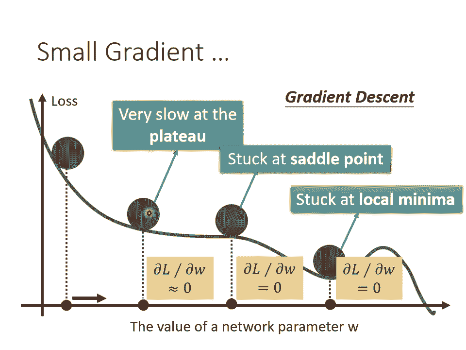

在接下来的课程中，我们将介绍在实际训练中，如何采用更高效的方法来应对优化停滞的问题。