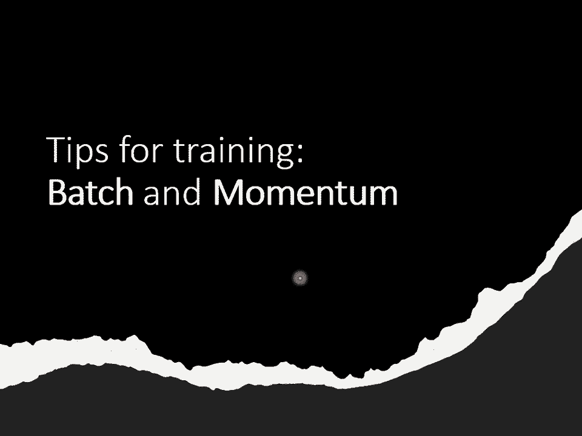
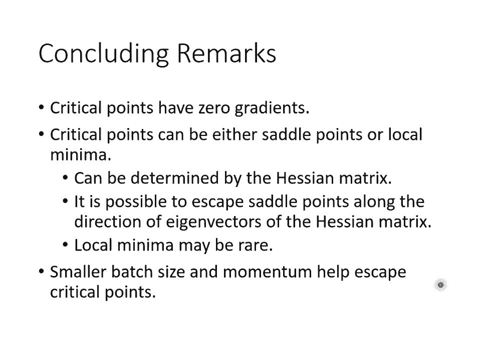

# 5：L3.2 - 网络训练2：批次与动量 🚀

在本节课中，我们将要学习神经网络训练中的两个重要技巧：**批次（Batch）** 与 **动量（Momentum）**。我们将探讨为什么使用批次训练，以及动量如何帮助模型优化过程。

## 概述 📋

我们将首先解释批次训练的概念及其对训练效率的影响，然后介绍动量技术如何帮助模型跳出局部最优解。这两个技巧对于高效、稳定地训练神经网络至关重要。

## 批次（Batch）训练

上一节我们介绍了梯度下降的基本概念，本节中我们来看看批次训练的具体做法。

在实际计算梯度时，我们并非一次性使用所有数据来计算总损失函数 `L` 的梯度。通常的做法是将所有训练数据分成若干组，每组称为一个**批次（Batch）**，每个批次的大小称为 **`batch_size`**。

每次更新参数时，我们只使用一个批次的数据来计算损失 `L` 和梯度，然后更新参数。接着，再使用下一个批次的数据重复此过程。因此，我们不会一次性使用所有数据来计算损失。

我们将所有数据完整遍历一次的过程，称为一个 **`epoch`**。

在划分批次时，一个常见的操作是 **`shuffle`**（打乱）。具体做法是，在每个 `epoch` 开始之前，将数据重新随机分组，使得每个 `epoch` 中批次内的数据组合都不同。

### 为什么要使用批次训练？

我们先解释使用批次的原因，再说明批次对训练带来的帮助。

我们来比较两种极端情况。假设有20笔训练数据：
*   **情况一（无批次或 `batch_size = 20`）**：模型需要看完所有20笔数据，才能计算一次损失和梯度，从而更新一次参数。
*   **情况二（`batch_size = 1`）**：模型每看一笔数据，就能计算一次梯度并更新一次参数。在一个 `epoch` 内，参数会更新20次。但由于每次只基于单笔数据，计算出的梯度噪声（`noise`）较大，更新方向会曲折。

这两种方式各有优劣。情况一更新步长更稳，但“技能冷却时间”长；情况二更新频繁，但每一步不稳定。

### 并行计算的影响

然而，上述比较没有考虑 **GPU并行计算** 的能力。

在并行计算下，计算一个批次梯度的时间并不严格随 `batch_size` 线性增长。对于较小的 `batch_size`（例如1到1000），计算时间可能相差无几。只有当 `batch_size` 极大时，计算时间才会显著增加。

因此，从完成一个 `epoch` 所需的总时间来看，**较大的 `batch_size` 反而可能更高效**，因为它需要更新的次数更少。

### 批次大小对优化结果的影响

有趣的是，**较小的 `batch_size`（噪声更大的梯度）往往在训练和测试中都能带来更好的结果**。

以下是可能的原因：
1.  **有助于逃离局部最优**：每次更新基于不同的批次数据，相当于在略有差异的损失函数曲面上移动。在一个批次上陷入局部最优点时，切换到下一个批次可能提供不同的梯度方向，从而有机会跳出。
2.  **可能找到更“平坦”的最优点**：有观点认为，基于噪声梯度更新时，模型更倾向于收敛到损失函数曲面中宽阔平坦的盆地（`basin`），而不是狭窄陡峭的峡谷（`sharp valley`）。平坦的极小值对训练数据的小变动或训练-测试数据分布的小差异不敏感，因而具有更好的泛化能力。

以下是批次大小的对比总结：

| 特性 | 小批次 (`batch_size` 小) | 大批次 (`batch_size` 大) |
| :--- | :--- | :--- |
| **单次更新速度** | 在并行计算下，与大批次相差不大 | 在并行计算下，与小批次相差不大 |
| **完成一个 epoch 的速度** | 慢 (需要更多次更新) | **快** (需要更少次更新) |
| **梯度噪声** | **大** | 小 |
| **优化效果** | **通常更好** (有助于逃离局部最优) | 可能较差 |
| **泛化能力** | **可能更好** (倾向于平坦最优点) | 可能较差 |

因此，`batch_size` 本身也是一个需要调整的**超参数**。目前也有许多研究致力于结合大小批次的优点。

## 动量（Momentum）

上一节我们介绍了批次训练，本节中我们来看看另一个优化技巧：动量。

动量技术的灵感来源于物理学。想象一个球从斜坡滚下，即使遇到局部最低点或鞍点，由于惯性（动量），它也可能继续前进甚至翻越小坡。动量法旨在将这种惯性概念引入梯度下降中。

### 回顾普通梯度下降

普通的梯度下降（Vanilla Gradient Descent）更新规则如下：

1.  初始化参数 `θ^0`。
2.  计算梯度 `g^0 = ∇L(θ^0)`。
3.  更新参数：`θ^1 = θ^0 - η * g^0`。（`η` 为学习率）
4.  重复步骤2-3。

其更新方向完全由当前点的梯度反方向决定。

### 加入动量的梯度下降

加入动量后，参数的更新方向不再是单纯的当前梯度反方向，而是**当前梯度方向与前一步更新方向的加权组合**。

具体步骤如下：

1.  初始化参数 `θ^0`，并设前一步的更新量 `m^0 = 0`。
2.  计算当前梯度 `g^0 = ∇L(θ^0)`。
3.  计算当前更新方向 `m^1 = λ * m^0 - η * g^0`。（`λ` 为动量系数，通常接近0.9）
4.  更新参数：`θ^1 = θ^0 + m^1`。
5.  重复步骤2-4。

从第二步开始，动量的效果显现。更新方向 `m` 的数学表达式可以展开为：
`m^t = -η * (g^{t-1} + λ * g^{t-2} + λ^2 * g^{t-3} + ...)`
这表明，**带有动量的更新方向，实际上考虑了历史所有梯度的指数加权平均**，而不仅仅是当前梯度。

### 动量的作用

动量的主要作用是：
*   **加速收敛**：在梯度方向一致的区域，动量会累积，使更新速度加快。
*   **帮助穿越局部最优和鞍点**：当梯度接近于零（如局部最优点）时，由于前一步动量的存在，参数更新可能不会立即停止，从而有机会逃离这些“陷阱”。

## 总结 🎯

本节课中我们一起学习了神经网络训练中的两个核心技巧：
1.  **批次训练**：通过将数据分组来更新参数。较小的 `batch_size` 能提供带噪声的梯度，有助于模型优化和泛化，但完成一个 `epoch` 较慢；较大的 `batch_size` 能利用并行计算加速训练，但可能面临优化困境。`batch_size` 是一个重要的超参数。
2.  **动量**：通过将历史更新方向纳入考虑来调整参数更新。它能加速训练并帮助模型跳出局部最优解或鞍点。其更新规则为 `m^t = λ * m^{t-1} - η * ∇L(θ^{t-1})`，`θ^t = θ^{t-1} + m^t`。

合理地结合使用批次训练与动量技术，可以更高效、更稳定地训练深度神经网络。