# 6：L4 - 网络训练3：自动调整学习速率 🎯

在本节课中，我们将要学习一种名为“自适应学习速率”的技术。这项技术的核心思想是：在训练神经网络时，不再为所有参数使用统一的学习速率，而是根据每个参数自身的特点，为其定制不同的学习速率。这能有效解决训练过程中损失函数下降缓慢或停滞的问题，即使我们并未陷入梯度为零的临界点。

---

## 临界点并非唯一障碍

上一节我们介绍了临界点的问题。本节中我们来看看，为什么训练停滞时，问题可能并非出在临界点上。

在训练网络时，我们通常会记录损失值。随着参数更新次数的增加，损失值会逐渐减小，但最终可能停滞不前。此时，很多人会猜测是否到达了梯度为零的临界点。然而，我们需要确认梯度是否真的变得很小。

实际上，在很多情况下，当损失不再下降时，梯度的范数（即梯度向量的大小）并没有变得非常小。损失可能因为参数在误差曲面的两个陡壁间来回震荡而不再减小，但这并不意味着它卡在了局部最小值或鞍点上。

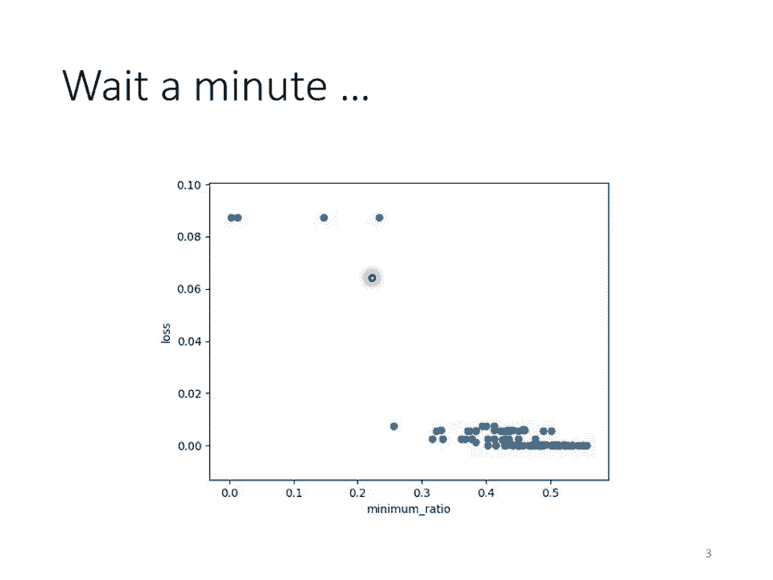

为了强化你的印象，我们有一个作业让你分析训练卡住的原因。多数时候，训练在到达真正的临界点之前就已经停止了。但这不代表临界点不是问题，只是说明我们优化时面临的真正挑战往往是其他原因。

---

## 一个简单的挑战：凸误差曲面

即使是一个简单的凸误差曲面，使用标准的梯度下降法也可能难以优化。

考虑一个只有两个参数的凸误差曲面，其等高线是椭圆形。在横轴方向梯度变化平缓，在纵轴方向梯度变化陡峭。如果我们从一个初始点开始做梯度下降：

*   当学习速率设置过大时，参数会在“峡谷”两侧震荡，损失无法下降。
*   当学习速率设置过小时，在平缓区域参数更新步伐太小，训练进程极其缓慢，甚至永远无法到达最低点。

这个例子表明，即使是简单的凸优化问题，标准的梯度下降法也可能表现不佳。因此，我们需要更好的梯度下降版本。

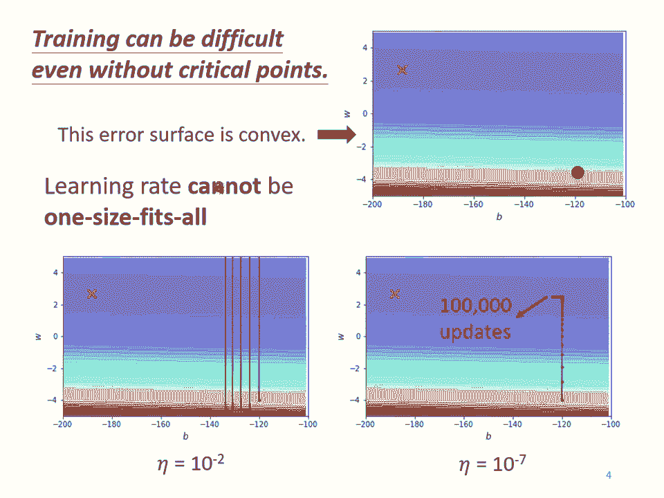

---

## 定制化学习速率的核心思想

那么，如何为每个参数定制不同的学习速率呢？从之前的例子中，我们可以总结出一个大原则：

*   在**梯度较小、较为平坦**的方向上，我们希望**学习速率大一些**，以加快前进速度。
*   在**梯度较大、较为陡峭**的方向上，我们希望**学习速率小一些**，以避免步伐过大而震荡。

如何根据梯度大小自动调整学习速率呢？我们需要修改梯度下降的更新公式。为了简化，我们只关注其中一个参数 \(\theta_i\) 的更新过程（此方法可推广到所有参数）。

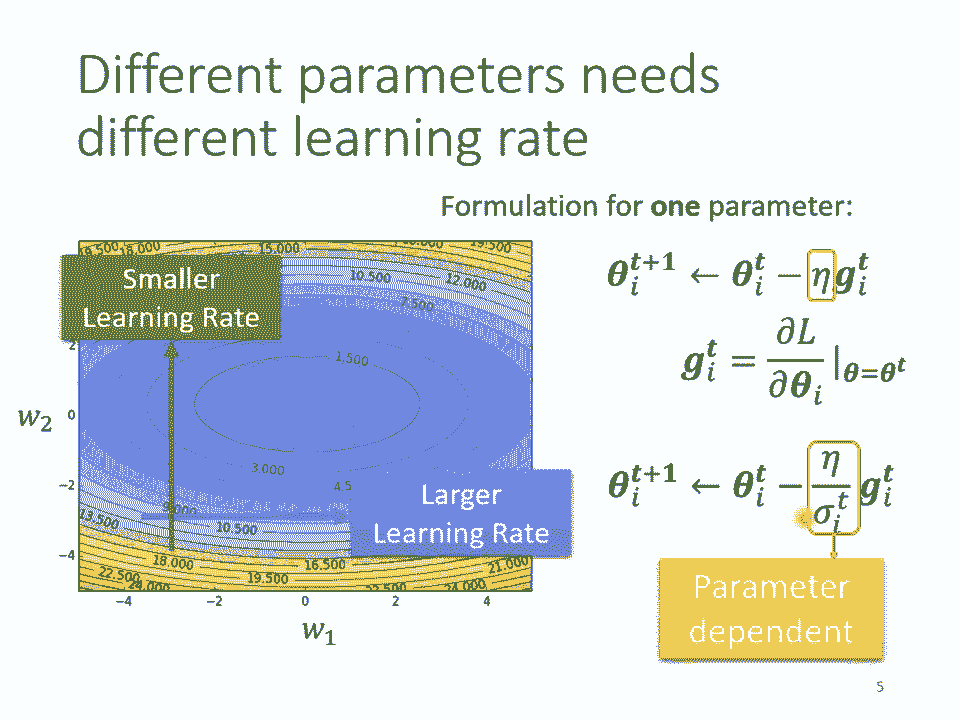

原来的更新公式为：
\[
\theta_i^{t+1} = \theta_i^t - \eta \cdot g_i^t
\]
其中，\(\eta\) 是固定的学习速率，\(g_i^t\) 是第 \(t\) 次迭代时参数 \(\theta_i\) 的梯度。

现在，我们将其修改为：
\[
\theta_i^{t+1} = \theta_i^t - \frac{\eta}{\sigma_i^t} \cdot g_i^t
\]
这里，\(\sigma_i^t\) 是一个与参数 \(i\) 和迭代次数 \(t\) 相关的值。通过将固定的 \(\eta\) 改为 \(\eta / \sigma_i^t\)，我们就得到了一个与参数相关的学习速率。

接下来，我们看看 \(\sigma_i^t\) 有哪些常见的计算方式。

---

## 自适应学习速率方法：Root Mean Square

以下是 Root Mean Square 方法计算 \(\sigma\) 的步骤：

1.  **第一次更新**：\(\sigma_i^0 = \sqrt{(g_i^0)^2} = |g_i^0|\)。此时更新步长完全由 \(\eta\) 决定。
2.  **第二次更新**：\(\sigma_i^1 = \sqrt{\frac{1}{2}[(g_i^0)^2 + (g_i^1)^2]}\)。
3.  **第 t+1 次更新**：\(\sigma_i^t = \sqrt{\frac{1}{t+1} \sum_{k=0}^{t} (g_i^k)^2}\)。

这个方法被用在 **AdaGrad** 优化器中。它的作用机制是：对于梯度一直较小的参数，计算出的 \(\sigma\) 也小，使得有效学习速率 \(\eta/\sigma\) 变大，从而在平缓区域迈出更大步伐；对于梯度一直较大的参数，计算出的 \(\sigma\) 大，使得有效学习速率变小，从而在陡峭区域谨慎更新。

---

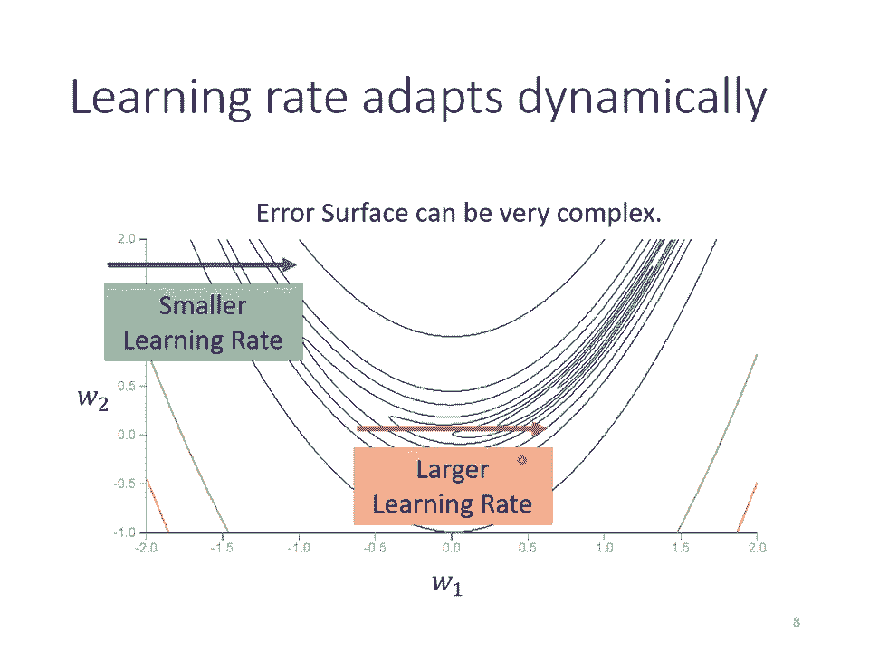

## 动态调整：RMSProp 方法

然而，同一个参数在不同迭代阶段可能需要不同的学习速率。例如，在误差曲面的某一段可能很平缓，需要大学习速率；另一段可能很陡峭，需要小学习速率。Root Mean Square 方法对所有历史梯度一视同仁，反应可能不够灵敏。

因此，有了 **RMSProp** 方法。这是一个颇具传奇性的方法，最初由 Geoffrey Hinton 在课程中提出，并无正式论文。它与 Root Mean Square 的主要区别在于计算 \(\sigma\) 的方式：

RMSProp 引入了衰减因子 \(\alpha\)（一个超参数，通常设为 0.9 或 0.99），其更新公式为：
\[
\sigma_i^t = \sqrt{\alpha \cdot (\sigma_i^{t-1})^2 + (1-\alpha) \cdot (g_i^t)^2}
\]

这个公式的意义是：
*   \(\sigma_i^t\) 由上一时刻的 \(\sigma\) 和当前梯度共同决定。
*   \(\alpha\) 控制了历史梯度信息与当前梯度信息的权重。\(\alpha\) 越小，当前梯度 \(g_i^t\) 的影响越大，算法对最近的变化越敏感。

使用 RMSProp，当参数从平缓区域突然进入陡峭区域时，梯度 \(g\) 变大，\(\sigma\) 能迅速响应变大，从而快速降低学习速率，实现“刹车”；当从陡峭区域进入平缓区域时，\(\sigma\) 也能迅速变小，提高学习速率。

---

## 当今主流：Adam 优化器

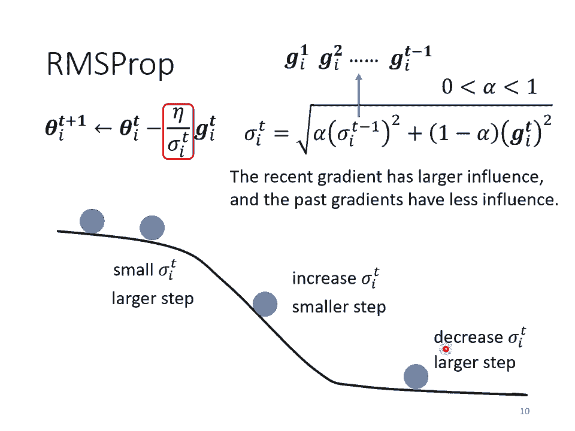

今天最常用的优化策略是 **Adam**，它结合了我们之前讲过的 **动量（Momentum）** 和 **RMSProp** 的思想。

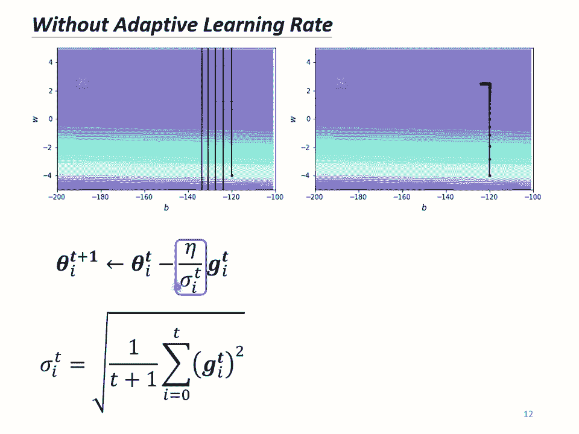

Adam 的算法细节我们不做展开，你可以在 PyTorch 等深度学习框架中直接调用 `torch.optim.Adam`。通常，使用其默认参数就能取得很好的效果，自行调整有时反而会变差。

让我们看看使用自适应学习速率方法（如 AdaGrad）优化之前那个简单凸曲面的效果。经过同样次数的更新，参数能够更接近最低点。这是因为在平缓的横轴方向，梯度小导致 \(\sigma\) 小，从而有效学习速率变大，使得参数能够持续前进。

然而，你可能会观察到路径末端出现“爆炸”的震荡。这是因为在纵轴方向，前期积累了大量小梯度，导致 \(\sigma\) 一直很小，有效学习速率过大，从而步伐过大而“喷出”。但由于喷出后进入梯度大的区域，\(\sigma\) 又会逐渐累积变大，使步伐变小，参数又会被“拉回”峡谷。这个过程会反复，形成衰减震荡。

---

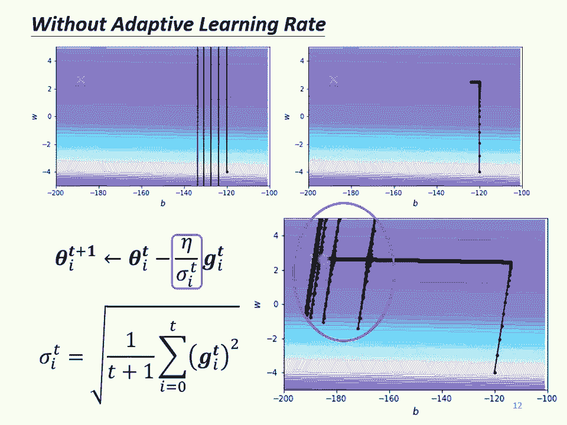

## 学习速率调度

如何解决上述震荡问题呢？一个方法是引入 **学习速率调度**。

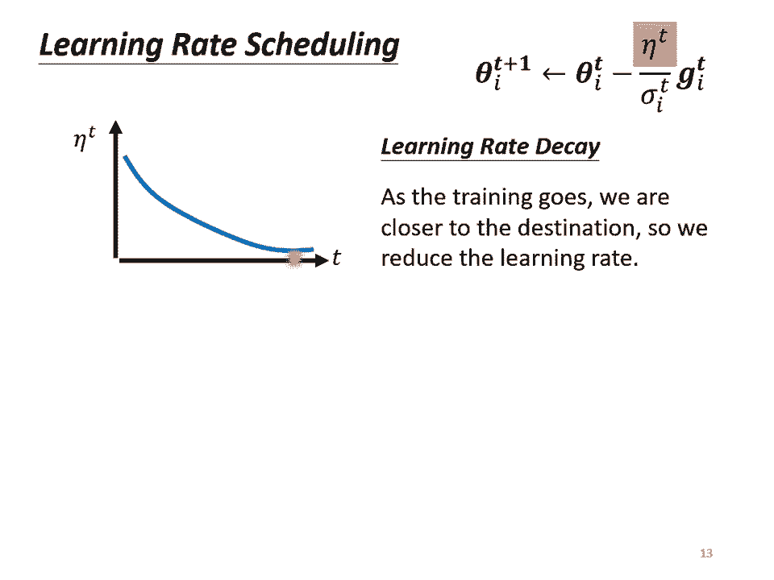

我们之前公式中的 \(\eta\) 是一个常数。学习速率调度的意思是让 \(\eta\) 也随时间变化。最常见的策略是 **学习速率衰减**。

学习速率衰减是合理的：训练初期，参数离最优解远，需要较大步伐快速探索；训练后期，参数接近最优解，需要较小步伐精细调整，避免震荡。通过让 \(\eta\) 随时间减小，可以为参数更新加上“刹车”。

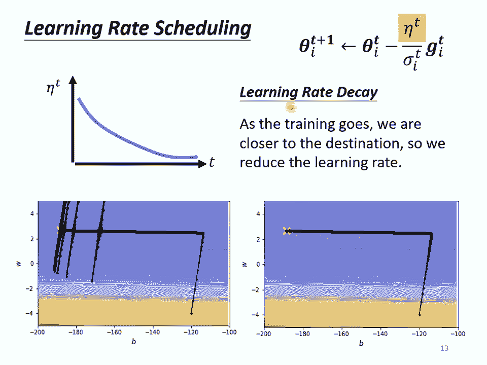

如果为之前的例子加上学习速率衰减，参数就能平稳地走到终点，因为后期的 \(\eta\) 已经变得非常小，抑制了震荡。

除了衰减，另一个非常常用的策略是 **热身**。

热身策略听起来有些反直觉：它让学习速率 **先增大，后减小**。这个“黑科技”出现在许多经典论文中，例如 ResNet 和 Transformer。在训练像 BERT 这样的大型模型时，热身常常是必要的。

为什么需要热身？一个可能的解释是：像 Adam 中计算 \(\sigma\) 这样的统计量，需要积累足够的数据才准确。训练初期，让学习速率较小，可以使参数在初始点附近探索，收集误差曲面的信息（计算更稳定的 \(\sigma\)）。待统计量相对精准后，再提高学习速率快速收敛。

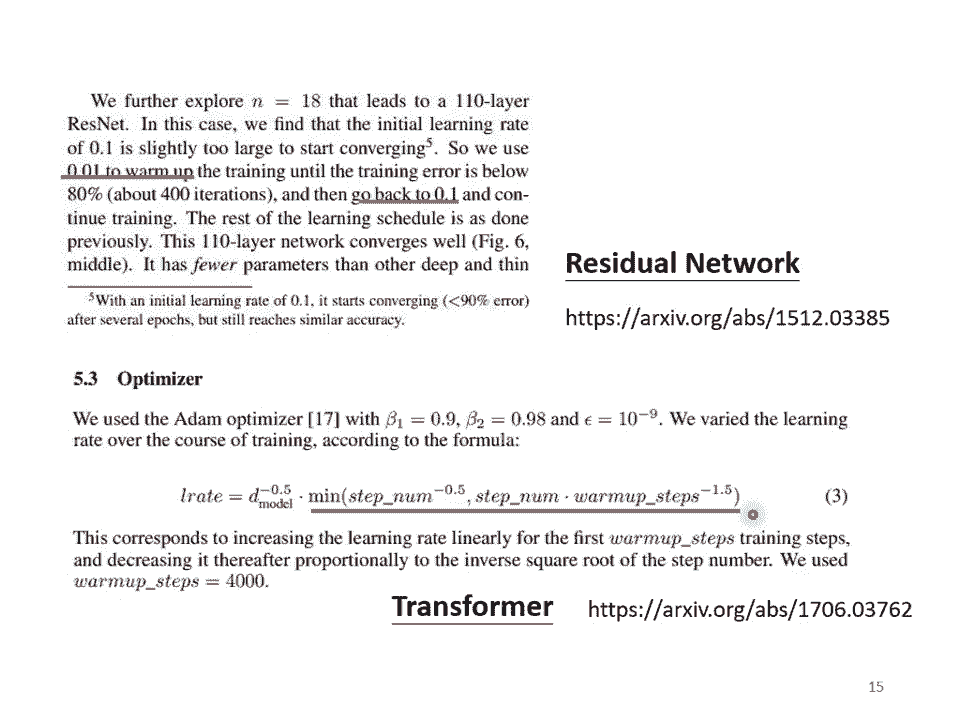

---

## 优化技术总结

本节课中我们一起学习了从原始梯度下降进化而来的完整优化技术。一个现代的优化器通常包含以下组件：

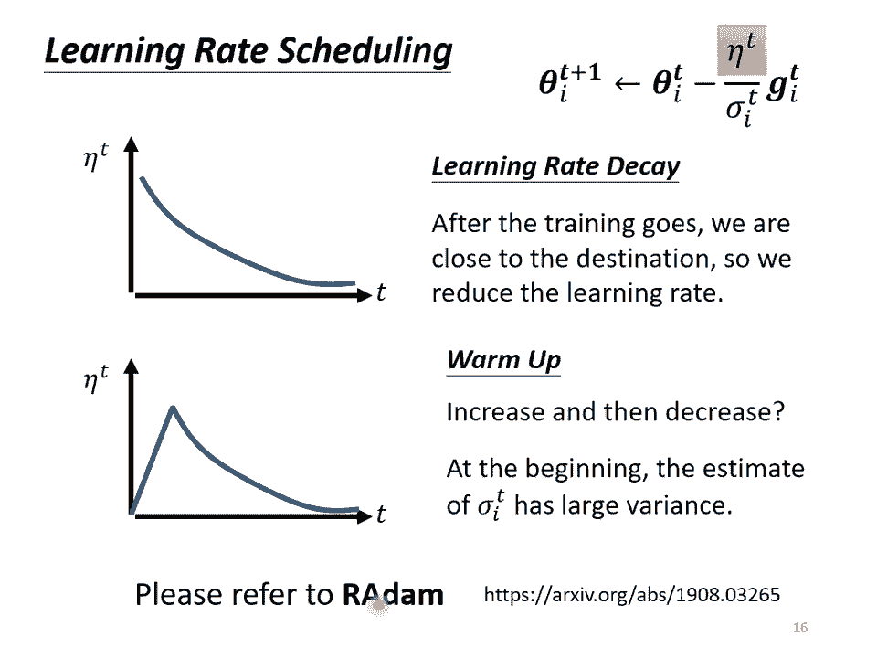

1.  **动量**：更新方向不是仅由当前梯度决定，而是结合了历史梯度的方向，有助于穿越狭窄山谷并减少震荡。
    \[
    m^t = \beta \cdot m^{t-1} + (1-\beta) \cdot g^t
    \]
    参数更新时会使用 \(m^t\) 而非单纯的 \(g^t\)。

2.  **自适应学习速率**：为每个参数计算一个缩放因子 \(\sigma\)（如 RMSProp 的方式），根据梯度大小调整更新步伐。
    \[
    \sigma^t = \sqrt{\alpha \cdot (\sigma^{t-1})^2 + (1-\alpha) \cdot (g^t)^2}
    \]

3.  **学习速率调度**：全局学习速率 \(\eta\) 本身也随时间变化（如衰减或热身）。

**Adam** 优化器就是结合了动量（考虑梯度的方向）和 RMSProp（考虑梯度的大小）的产物，两者不会互相抵消。再加上学习速率调度，就构成了当前最主流的优化方案。

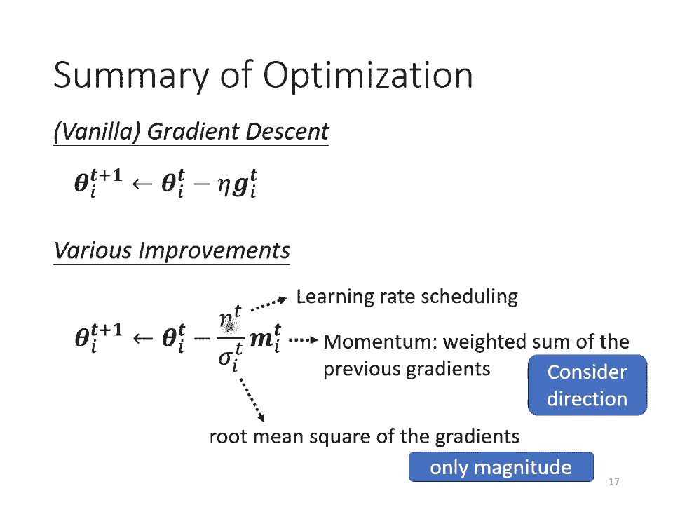

除了 Adam，还有各种变形，其区别主要在于计算动量、\(\sigma\) 或调度策略的方式不同。

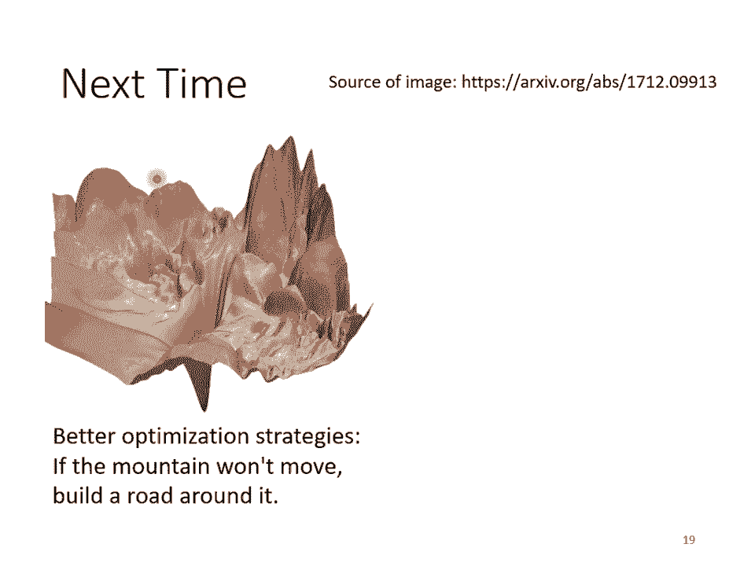

到目前为止，我们学习的是当误差曲面崎岖不平时，如何通过更好的优化算法“绕过山峰”。在接下来的课程中，我们将探讨另一种思路：能否通过改变网络架构（如激活函数）等方式，直接“铲平”误差曲面，让它变得更容易优化。