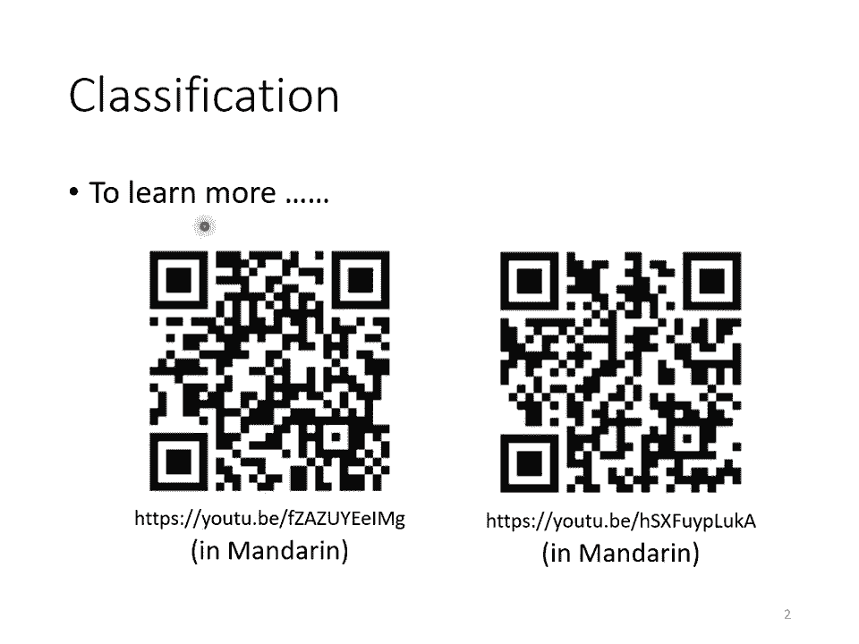
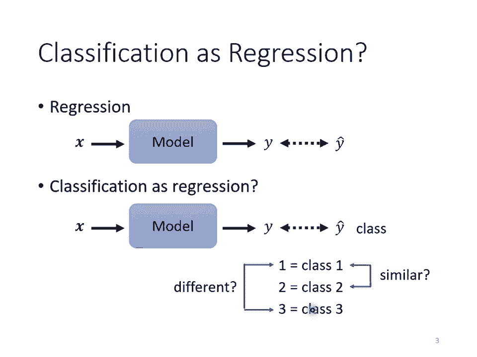
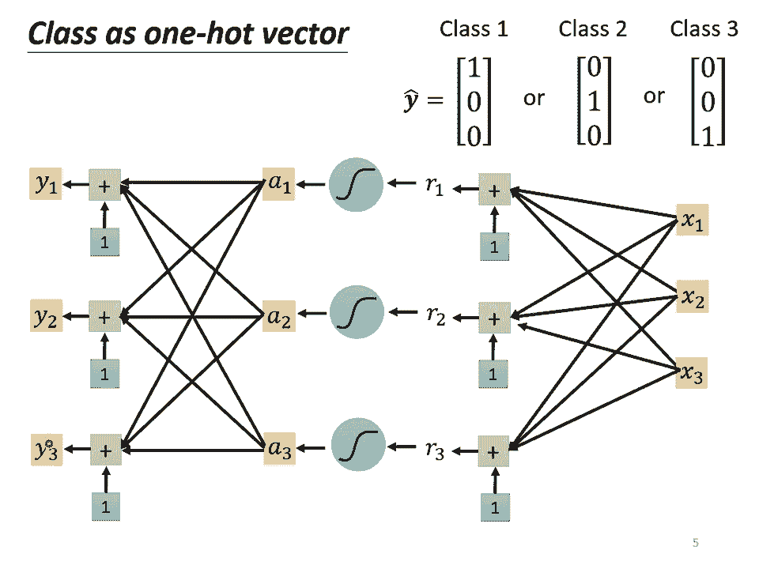
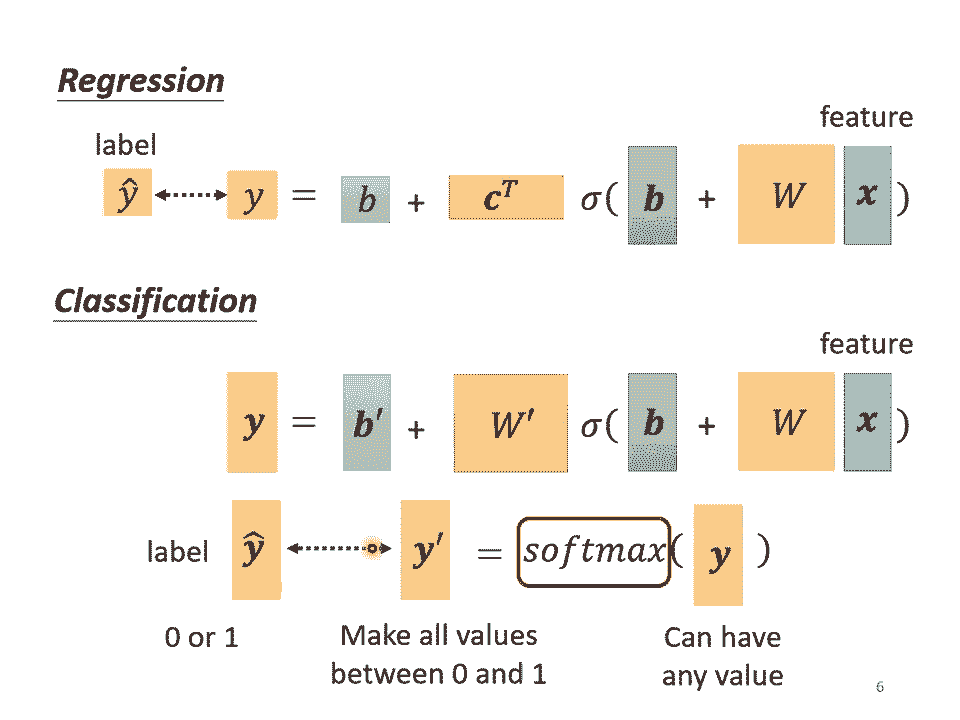
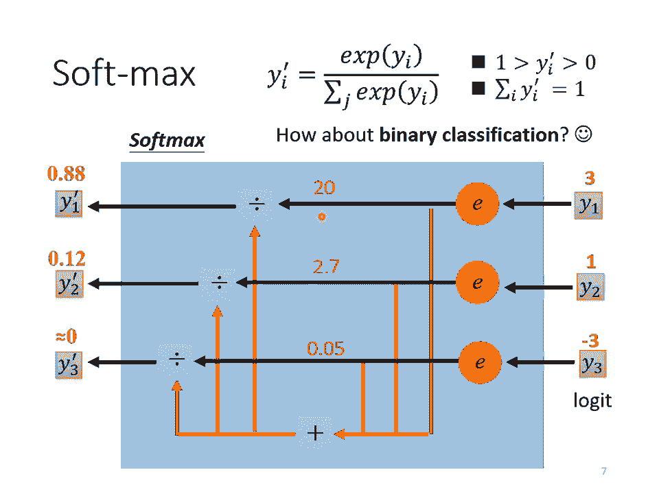
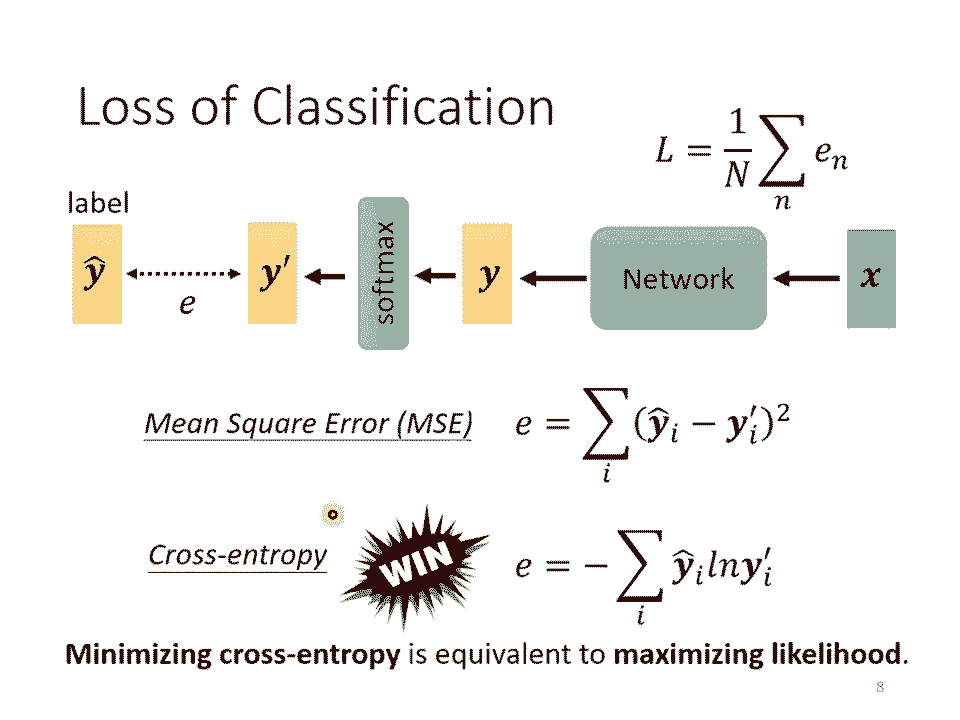
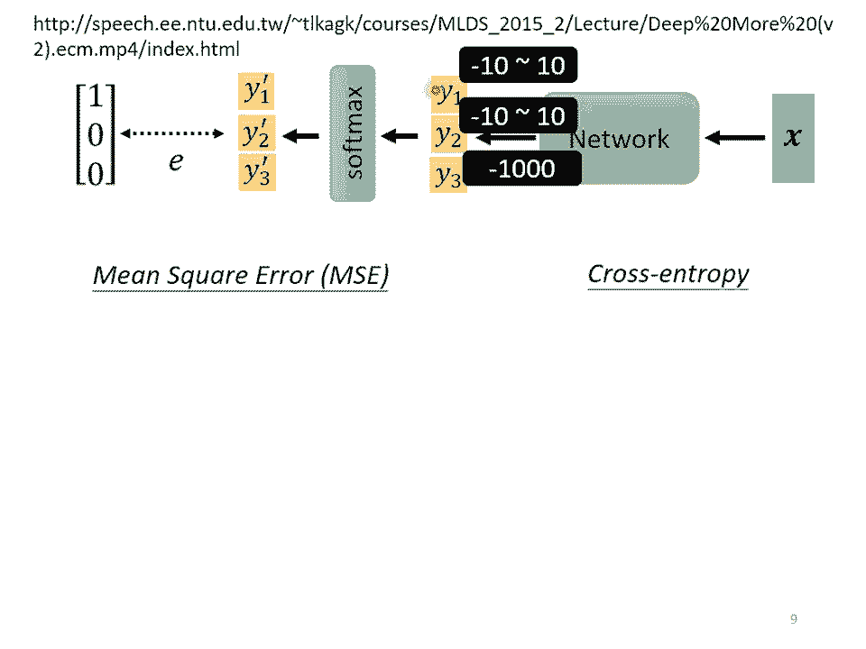
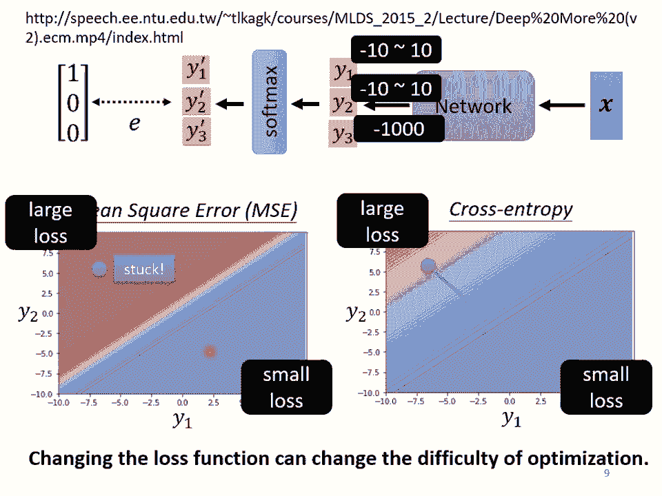

# 7：L5 - 网络训练4：损失函数 📊

在本节课中，我们将学习如何为分类任务设计损失函数。我们将从回归问题出发，探讨将其直接应用于分类的局限性，并介绍更合适的处理方法，包括使用独热编码、Softmax函数以及交叉熵损失。



---

## 从回归到分类 🔄

上一节我们介绍了回归任务，其目标是让模型的输出数值与目标标签尽可能接近。在分类任务中，我们能否也采用类似的方法呢？

一种直观的想法是：将每个类别编号为数字（例如，类别1编号为1，类别2编号为2），然后让模型的输出数值去逼近这个类别编号。这种方法在某些情况下可行，例如当类别本身具有顺序关系时（如预测小学年级）。然而，对于大多数没有内在顺序关系的类别（如猫、狗、汽车），强行赋予数字编号会引入“类别1与类别2更相似”的错误假设，这通常是不合理的。

因此，我们需要一种更好的方式来表示类别。

---

## 使用独热编码表示类别 🔢



为了解决上述问题，在分类任务中更常见的做法是使用**独热编码**来表示类别标签。

以下是独热编码的具体做法：
*   如果有三个类别，标签 `Y_hat` 就是一个三维向量。
*   如果样本属于类别一，则 `Y_hat = [1, 0, 0]`。
*   如果样本属于类别二，则 `Y_hat = [0, 1, 0]`。
*   如果样本属于类别三，则 `Y_hat = [0, 0, 1]`。

使用独热编码后，任意两个不同类别向量之间的距离都是相等的，避免了人为引入的类别相似性假设。



---

## 修改网络以输出向量 🧠

既然我们的目标 `Y_hat` 现在是一个向量，模型的输出 `Y` 也必须是一个相同维度的向量。

从输出单个数值扩展到输出一个向量在原理上并无不同。具体做法是：将网络最后一层的输入，分别乘以三组不同的权重并加上偏置，从而独立地产生三个输出值 `Y1`, `Y2`, `Y3`。

用公式可以表示为：
```
Y1 = (A1 * w11 + A2 * w21 + A3 * w31) + b1
Y2 = (A1 * w12 + A2 * w22 + A3 * w32) + b2
Y3 = (A1 * w13 + A2 * w23 + A3 * w33) + b3
```
其中 `A1, A2, A3` 是上一层的输出，`w` 和 `b` 是待学习的参数。

---



## 引入Softmax函数 📈

在分类任务中，得到输出向量 `Y` 后，我们通常会将其通过一个叫做 **Softmax** 的函数，得到 `Y'`。然后，我们计算 `Y'` 与目标独热编码 `Y_hat` 之间的距离，并使其尽可能接近。

为什么要加上Softmax函数呢？一个简单的解释是：我们的目标 `Y_hat` 中的值只有0和1，而网络的原始输出 `Y` 可以是任意实数。Softmax的作用就是将 `Y` 的每个元素“归一化”到0到1之间，并且所有元素之和为1，使其在形式上与概率分布一致，从而更容易与目标标签进行比较。

Softmax函数的运作方式如下：
1.  对向量 `Y` 的每个元素 `Yi` 计算指数 `exp(Yi)`，确保所有值变为正数。
2.  将所有指数值相加得到总和 `S`。
3.  将每个指数值除以总和 `S`，得到归一化后的值 `Yi'`。

用公式描述为：
```
Yi' = exp(Yi) / Σ_j(exp(Yj))
```



经过Softmax处理后，`Y'` 中的每个值都在0到1之间，且所有值之和为1。此外，Softmax会放大较大值和较小值之间的差距。

**关于二分类的说明**：对于只有两个类别的情况，除了使用Softmax，更常见的做法是使用Sigmoid函数。实际上，在二分类问题上使用Softmax与使用Sigmoid是等价的。

---

## 选择损失函数：交叉熵 vs. 均方误差 ⚖️

现在我们需要计算预测分布 `Y'` 与目标分布 `Y_hat` 之间的距离，这个距离就是损失 `L`。计算距离有多种方法。

一种方法是使用**均方误差**，就像在回归任务中一样，计算两个向量对应元素差值的平方和。最小化均方误差同样可以使 `Y'` 逼近 `Y_hat`。

然而，在分类任务中，一个更常用、更被推荐的方法是**交叉熵**。

交叉熵的公式如下：
```
L = - Σ_i ( Y_hat_i * log(Y'_i) )
```
其中 `i` 遍历向量的所有维度。

当 `Y'` 与 `Y_hat` 完全相同时，交叉熵损失达到最小值（0）。从优化过程的角度看，交叉熵损失比均方误差更适用于分类任务。

---

## 为什么交叉熵更优？ 🎯



我们可以通过一个直观的例子来理解为什么在分类任务中交叉熵通常优于均方误差。

考虑一个三分类问题，目标标签是 `[1, 0, 0]`。我们固定 `Y3` 为一个很小的值（例如-1000），观察 `Y1` 和 `Y2` 变化时，两种损失函数构成的误差曲面有何不同。

以下是两种损失函数误差曲面的关键区别：
*   **交叉熵的误差曲面**：在预测错误（`Y1`小，`Y2`大）的区域，曲面具有明显的斜率（梯度较大）。这意味着即使初始预测很差，模型也能获得有效的梯度信号，快速向正确的方向更新参数。
*   **均方误差的误差曲面**：在预测错误的区域，曲面可能非常平坦（梯度接近于零）。这会导致模型在训练初期更新缓慢甚至停滞，使得训练更加困难。



这个例子表明，损失函数的选择直接影响优化过程的难易程度。交叉熵损失在分类问题上通常能提供更有效的梯度，使训练更稳定、更快速。

**技术细节**：在PyTorch等框架中，`CrossEntropyLoss` 损失函数已经内置了Softmax操作。因此，在使用时，网络的最后一层通常不需要再显式添加Softmax。

---

## 总结 📝

本节课我们一起学习了分类任务中损失函数的设计。
1.  我们首先指出直接将回归方法用于分类的局限性。
2.  接着，引入了**独热编码**来合理表示类别标签。
3.  然后，我们修改网络使其能输出向量，并介绍了 **Softmax函数** 将网络输出转化为概率分布。
4.  最后，我们重点比较了**交叉熵损失**与均方误差损失，并通过误差曲面的分析，理解了为什么交叉熵损失在分类任务中更为常用和有效。



掌握合适的损失函数是成功训练分类模型的关键一步。