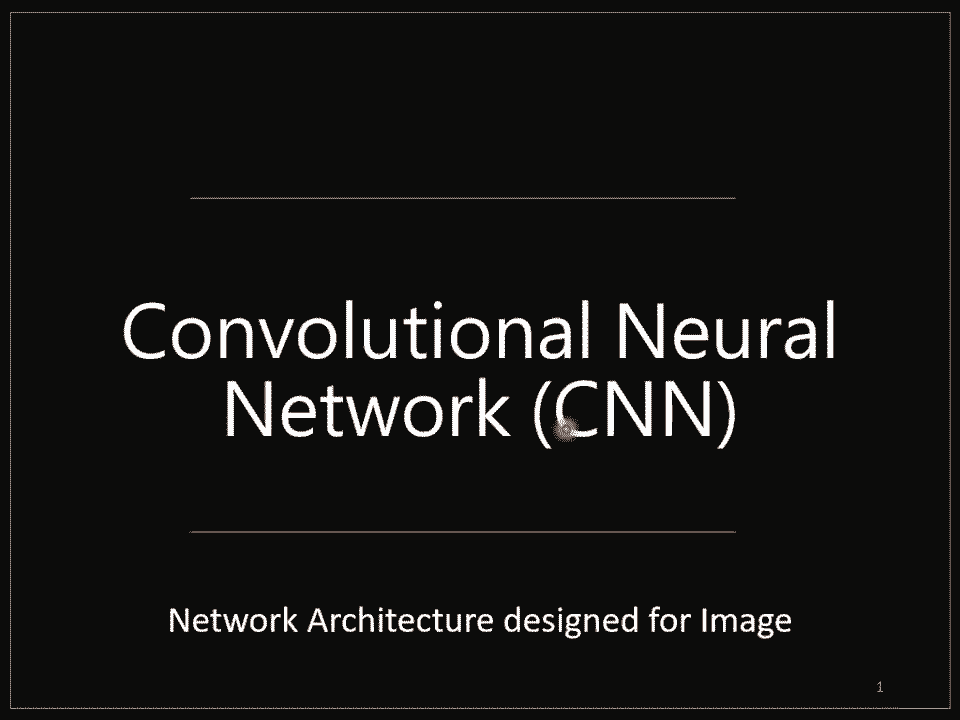
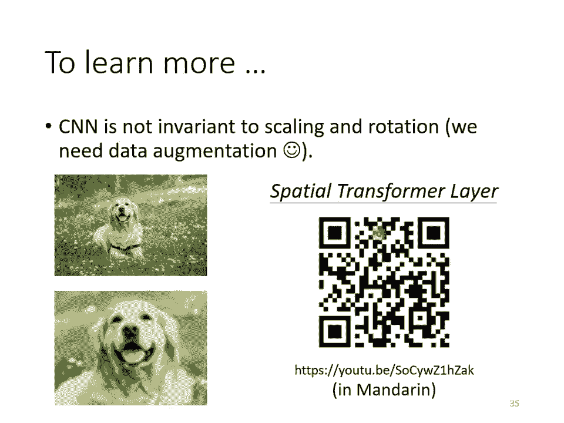

# 8：L7 - 卷积神经网络 🧠

在本节课中，我们将要学习卷积神经网络（CNN）的基本概念、设计思想及其在图像识别等任务中的应用。我们将从两个不同的视角来理解CNN，并探讨其核心组件和简化原理。

---

## 概述

卷积神经网络是一种专门为处理图像数据而设计的神经网络架构。它通过引入“感受野”和“参数共享”等概念，显著减少了模型的参数量，同时保持了强大的特征提取能力。本节课我们将深入探讨CNN的工作原理、设计动机以及实际应用。

---

## 1. 图像分类任务设定

在开始探讨CNN之前，我们首先明确任务目标：图像分类。即给定一张固定大小的图片（例如100x100像素），模型需要判断图片中包含何种物体。

模型的输出是一个“独热编码”向量。例如，如果类别是“猫”，则向量中“猫”对应的维度值为1，其余为0。向量的长度决定了模型能识别的物体种类数量。

模型的最终输出会经过Softmax层，我们通过最小化其与真实标签之间的交叉熵损失来训练模型。

---

## 2. 图像的表示与全连接网络的问题

对计算机而言，一张彩色图像是一个三维张量，其维度为：高度、宽度和通道数（例如RGB三通道）。为了将其输入到神经网络中，我们通常将这个三维张量“拉直”成一个一维向量。

如果使用传统的全连接网络处理这个巨大的输入向量（例如100x100x3=30000维），即使第一层只有1000个神经元，也会产生高达3000万个权重参数。参数过多不仅增加计算负担，更会极大提高模型过拟合的风险。

---

## 3. 针对图像特性的观察与简化

为了解决上述问题，CNN基于对图像特性的两个关键观察进行了架构简化。

### 观察一：重要的模式通常只存在于局部区域

识别一个物体（如“鸟”）通常只需要检测一些关键局部模式（如“鸟嘴”、“眼睛”）。这些模式并不需要查看整张图片，只需关注图片的一小部分区域即可。

**基于此观察的简化：感受野**

我们不再让每个神经元连接整个输入图像，而是规定每个神经元只负责处理输入图像的一个小局部区域，这个区域称为该神经元的“感受野”。

*   **感受野的定义**：例如，一个感受野可以是3x3像素的区域（同时包含所有颜色通道）。神经元只接收该区域内所有像素值组成的向量作为输入。
*   **感受野的排布**：多个感受野可以覆盖整张图片，它们之间可以（且通常）有重叠。通过设定“步长”来控制相邻感受野中心点的移动距离。当感受野超出图像边界时，会进行“填充”（例如补零）。

### 观察二：相同的模式可能出现在图像的不同位置

同一个模式（如“鸟嘴”）可能出现在图像的左上角，也可能出现在右下角。虽然位置不同，但检测该模式的任务是相同的。

**基于此观察的简化：参数共享**

既然不同位置的神经元执行的是相同的检测任务（只是处理的区域不同），我们可以让这些神经元共享同一组权重参数。这极大地减少了参数量。

*   **共享的方式**：在CNN中，这组被共享的参数被称为一个“滤波器”或“卷积核”。同一个滤波器会系统地扫过整张图片的所有位置，在每个位置进行相同的计算，从而检测该模式是否出现。

**感受野与参数共享的结合，就构成了卷积层。** 使用卷积层的神经网络即为卷积神经网络。这种设计为模型引入了更强的“归纳偏好”，使其特别适合图像任务，虽然模型灵活性降低，但过拟合风险也相应减小。

---

## 4. 理解CNN的第二个视角：滤波器与特征图

上述概念可以通过“滤波器”的视角重新表述，这是更常见的CNN讲解方式。

一个卷积层包含多个滤波器。每个滤波器是一个小尺寸的张量（如3x3x通道数）。其作用是检测输入图像中是否存在某种特定的局部模式。

**卷积操作**：滤波器从输入图像的左上角开始，计算其内部数值与当前覆盖的图像区域数值的点积，得到一个标量输出。然后滤波器按照设定的“步长”向右或向下滑动，重复此过程，直至遍历整个图像。这个过程就是“卷积”。

**特征图**：一个滤波器遍历完整张图像后，会生成一个二维数值矩阵，称为该滤波器对应的“特征图”。特征图中的每个值，代表了原始图像对应位置出现该滤波器所检测模式的可能性（激活强度）。如果有64个滤波器，就会得到64张特征图，可以将其视为一张具有64个通道的“新图像”。

**多层堆叠**：卷积层可以多层堆叠。后一层卷积层的输入正是前一层输出的“特征图”。虽然每层的滤波器尺寸可能很小（如3x3），但随着层数加深，深层神经元在原始图像上“看到”的感受野会越来越大，从而能够检测更大、更复杂的模式。

---

## 5. 池化层

卷积神经网络中另一个常用组件是“池化层”，它基于另一个观察：对图像进行下采样（缩小），不会改变我们对图像内容的理解。

**池化的操作**：池化层通常接在卷积层之后，没有需要学习的参数。以“最大池化”为例，它将特征图划分为多个小区域（如2x2），然后从每个区域中选取最大值作为该区域的代表输出。

**池化的作用**：
1.  降低特征图的空间尺寸，从而减少后续层的计算量和参数。
2.  提供一定程度的平移不变性。

需要注意的是，近年来由于计算能力的提升，许多高性能的神经网络架构倾向于减少甚至完全不用池化层，而是全部使用卷积层（通过调整卷积步长来实现下采样）。

---

## 6. 经典CNN架构流程

一个经典的用于图像分类的CNN架构通常遵循以下流程：

1.  **输入层**：接收固定尺寸的图像。
2.  **卷积层 + 激活函数**：提取局部特征，生成特征图。
3.  **池化层**：（可选）对特征图进行下采样。
4.  **重复步骤2和3**：堆叠多个“卷积-池化”组合，以提取多层次的特征。
5.  **展平层**：将最后的特征图拉直成一个一维向量。
6.  **全连接层**：将高级特征映射到样本标记空间。
7.  **输出层**：通过Softmax函数输出每个类别的概率。

---

## 7. CNN的其他应用与思考

CNN的设计思想源于图像特性，但其成功也启发了其他领域的应用。

**围棋AI（AlphaGo）**：棋盘可以被视为一张19x19、具有多个通道（描述棋子状态）的“特殊图像”。围棋中的“模式”（如“征子”、“死活形状”）也具有局部性和平移不变性，因此CNN非常适合用于提取棋盘特征。值得注意的是，AlphaGo的架构中**并未使用池化层**，因为对棋盘进行下采样会丢失关键信息。这说明了网络架构的设计需紧密结合任务特性。

**语音与文本处理**：CNN也可应用于语音识别和自然语言处理。但在这些领域，感受野的设计（如一维卷积）与图像处理中的二维卷积不同，需要根据序列数据的特性进行调整。

**CNN的局限性**：CNN本身对图像的缩放、旋转等变化并不具有内在不变性。例如，一个训练时只见过小狗的CNN，可能无法识别同一只被放大的狗。因此，在实际应用中，通常需要通过**数据增强**（如随机裁剪、旋转训练图像）来让模型学习到这些不变性。

---

## 总结

本节课我们一起学习了卷积神经网络的核心知识。我们了解到CNN通过**感受野**和**参数共享**两大设计，巧妙地利用了图像的局部性与平移不变性，在大幅减少参数量的同时，高效地完成了特征提取。我们从神经元和滤波器两个视角理解了卷积操作的本质，并认识了池化层的作用。最后，我们探讨了CNN在围棋等非图像任务中的应用及其局限性，强调了根据任务特性设计网络架构的重要性。CNN是深度学习在计算机视觉领域取得突破的基石，理解其设计思想对后续学习至关重要。