# 9：L8.1 - 自注意力机制 (Self-attention) 1 🧠

在本节课中，我们将要学习一种重要的神经网络架构——自注意力机制。我们将了解它要解决什么问题，它的输入输出形式，以及它的基本工作原理。

---

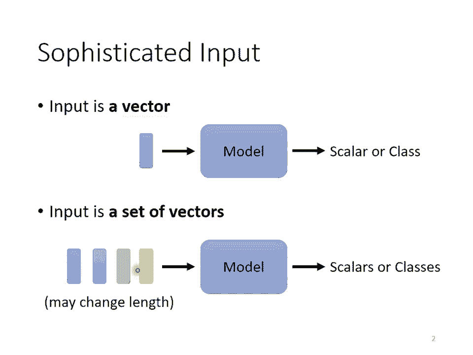

## 概述

到目前为止，我们学习的模型输入通常是一个单一的向量。然而，在自然语言处理、语音识别等更复杂的任务中，模型的输入往往是一系列数量可变的向量。自注意力机制就是为了处理这种“序列”输入而设计的强大工具。

上一节我们介绍了卷积神经网络（CNN），本节中我们来看看另一种常见的架构——自注意力机制。

## 自注意力机制要解决的问题

自注意力机制想要解决的问题是：如何处理输入为一排向量，且向量数目会改变的情况。

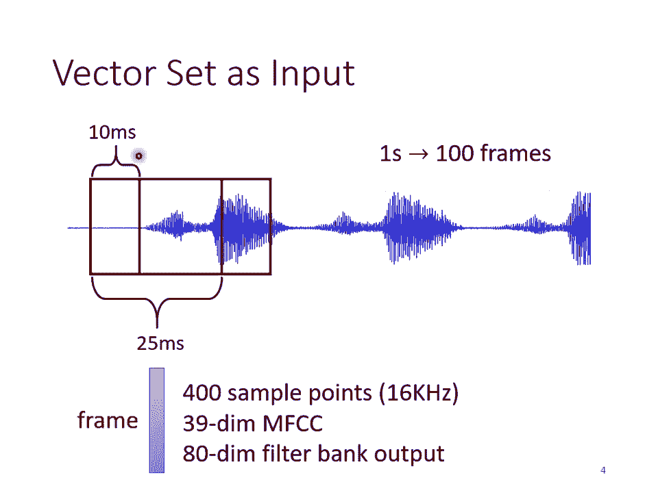

到目前为止，我们的神经网络输入都是一个向量。输出可能是一个数值（回归问题）或一个类别（分类问题）。但如果我们遇到更复杂的问题呢？假设输入是一排向量，而且每次输入的向量数目（序列长度）都可能不同，这时应该如何处理？

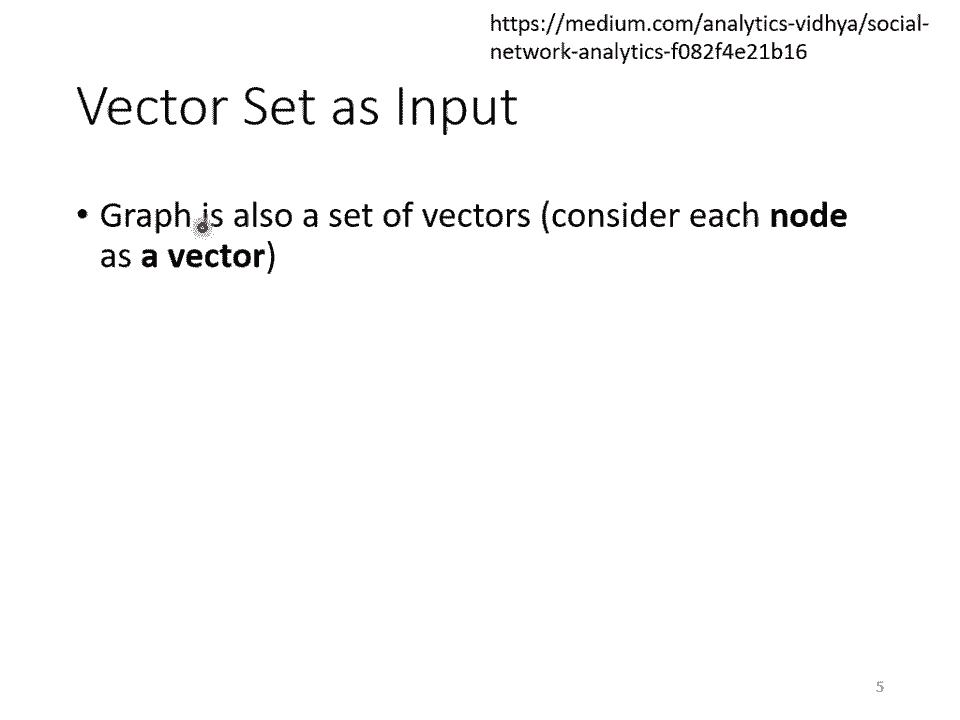

## 序列输入的实例

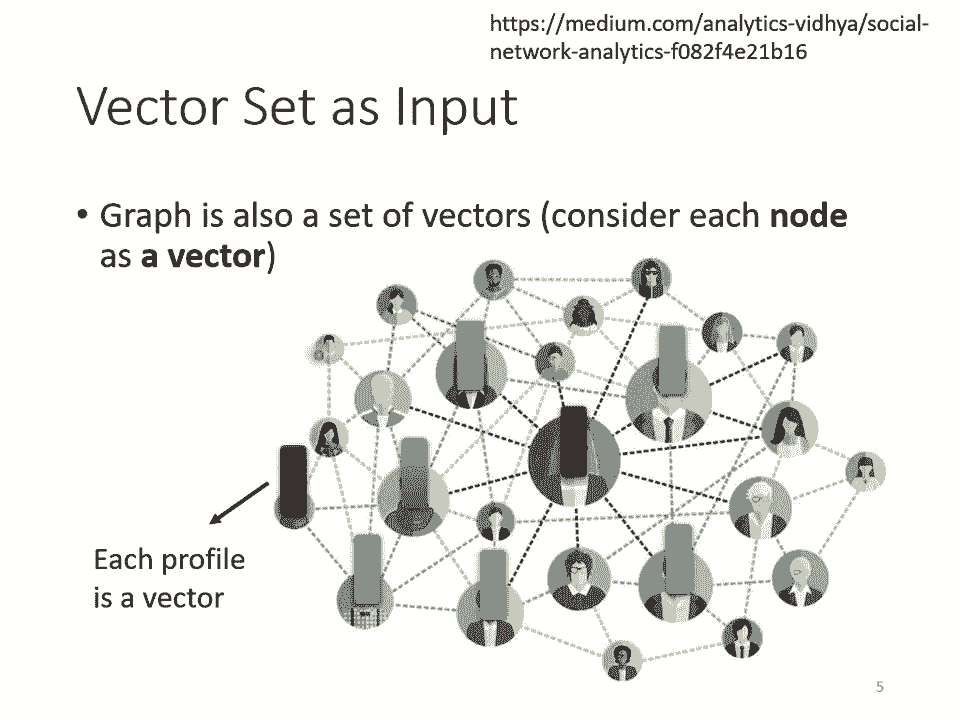

以下是输入为序列，且长度会改变的常见例子：

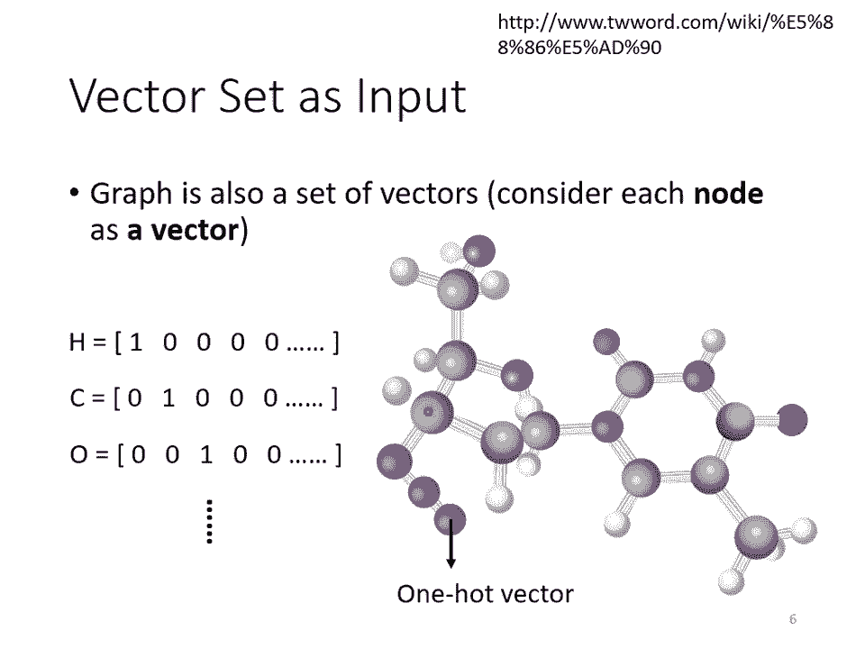

*   **文字处理**：一个句子中的每个词汇可以表示为一个向量。由于句子长度不同，输入模型的向量集合大小每次都不一样。
    *   **词汇向量化方法**：
        *   **One-hot Encoding**：用一个很长的向量表示词汇，向量长度等于词汇总数。例如，在10万词汇的英文中：
            ```python
            apple = [1, 0, 0, 0, ...]
            bag = [0, 1, 0, 0, ...]
            cat = [0, 0, 1, 0, ...]
            ```
            这种方法假设所有词汇彼此无关，缺乏语义信息。
        *   **Word Embedding**：给每个词汇一个有语义信息的向量。语义相近的词（如“cat”和“dog”）在向量空间中的位置也更接近。Word Embedding可以通过预训练模型获得。

*   **语音信号**：一段声音信号可以看作是一排向量。通常，我们会取一个25毫秒的窗口，将其中的信息描述成一个向量（称为一个“frame”）。然后将窗口向右移动10毫秒，得到下一个向量。因此，一秒钟的声音信号约有100个向量，一分钟则有约6000个向量。

*   **图（Graph）**：一个图也可以看作是一堆向量。
    *   **社交网络**：每个节点（人）可以用其个人信息（如性别、年龄等）构成的向量表示。
    *   **分子结构**：分子可以看作一个图，每个原子（节点）可以用one-hot向量表示（如氢=[1,0,0,0]，碳=[0,1,0,0]），整个分子就是一堆向量。

## 序列输出的类型

当输入是一堆向量时，输出可能有三种类型：

1.  **输入与输出数目相同（Sequence Labeling）**：每个输入向量都有一个对应的输出标签。
    *   **实例**：
        *   **文字**：词性标注（POS Tagging），为句子中的每个词汇标注词性（名词、动词等）。
        *   **语音**：为每个声音帧（frame）分类其对应的音标（如作业2）。
        *   **图**：预测社交网络中每个节点是否会购买某个商品。

2.  **整个序列只输出一个标签**：整个输入序列只对应一个输出。
    *   **实例**：
        *   **文字**：情感分析（Sentiment Analysis），判断一段话是正面还是负面。
        *   **语音**：语者辨认（Speaker Recognition），判断一段声音是谁说的。
        *   **图**：预测一个分子是否有毒性。

3.  **由模型决定输出数目（Sequence to Sequence）**：模型自行决定输出标签的数量，输入和输出的序列长度可能不同。
    *   **实例**：机器翻译、语音识别。

本节课我们主要聚焦于第一种类型：输入与输出数目相同的Sequence Labeling问题。

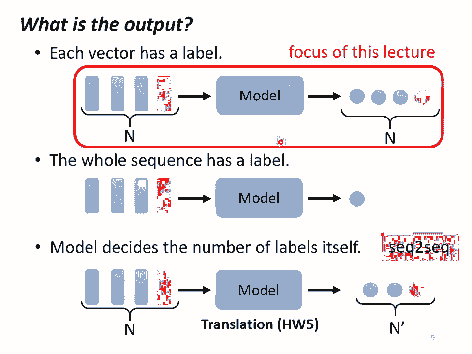

## 解决Sequence Labeling的直觉方法及其局限

一个直觉的想法是使用全连接网络（Fully Connected Network）对每个向量“各个击破”，分别处理。但这样做有明显瑕疵。

例如在词性标注任务中，句子“I saw a saw”包含两个“saw”。对全连接网络而言，相同的输入应产生相同的输出，但它无法区分第一个“saw”是动词，第二个“saw”是名词。

改进方法是让全连接网络考虑上下文（Context）信息，即将当前向量及其前后几个向量拼接起来，再输入网络（如作业2中考虑前后5个frame）。但这种方法仍有局限：

*   如果任务需要考量整个序列的信息才能解决，仅靠固定大小的窗口可能不够。
*   若将窗口开到足以覆盖最长序列，会导致网络参数过多，计算量大且容易过拟合。

因此，我们需要一种能有效考虑整个输入序列信息的方法，这就是自注意力机制。

## 自注意力机制（Self-attention）的运作方式

自注意力机制会接收整个序列的信息，输入几个向量，就输出几个向量。输出的每个向量都是考虑了整个输入序列后才得到的。

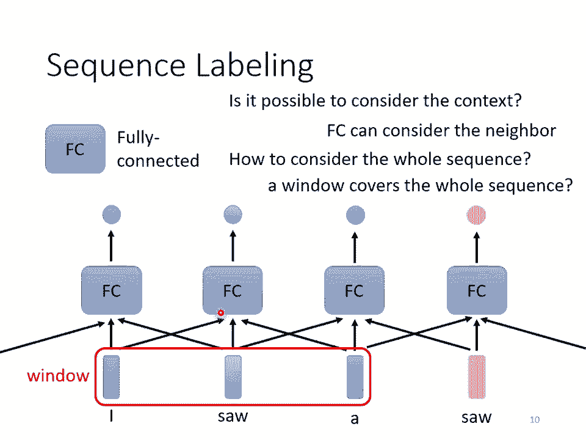

我们可以将考虑了整个序列信息的向量（图中带黑框的向量）输入全连接网络，来决定最终的输出类别或数值。这样，全连接网络在决策时就能基于整个序列的上下文，而非一个有限的窗口。

自注意力层可以多次叠加，与全连接网络交替使用：自注意力处理整个序列的上下文信息，全连接网络专注于处理某个特定位置的资讯。

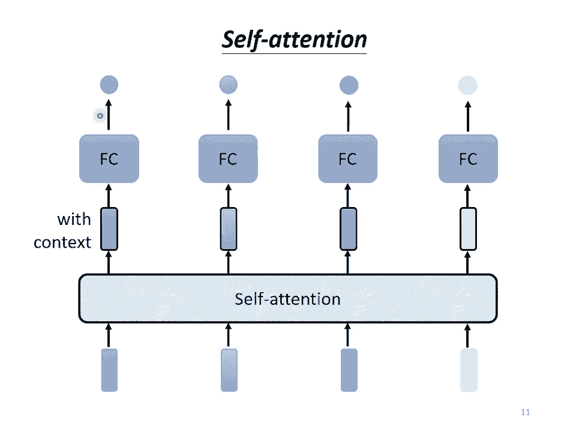

> 最知名的相关论文是《Attention Is All You Need》，其中Google提出了Transformer架构。Transformer中最重要的模块就是自注意力机制。

## 自注意力机制详解

自注意力层的输入是一串向量（用 **a1, a2, ...** 表示），输出是另一串向量（用 **b1, b2, ...** 表示）。每个输出向量 **b** 都是考虑了所有输入向量 **a** 后才生成的。

接下来，我们以生成 **b1** 为例，说明自注意力的计算步骤。生成 **b2, b3, ...** 的过程完全相同。

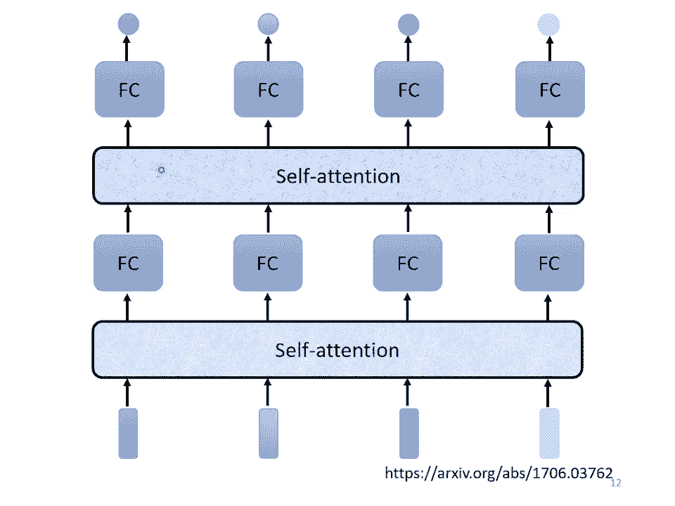

### 步骤1：计算关联性（Attention Score）

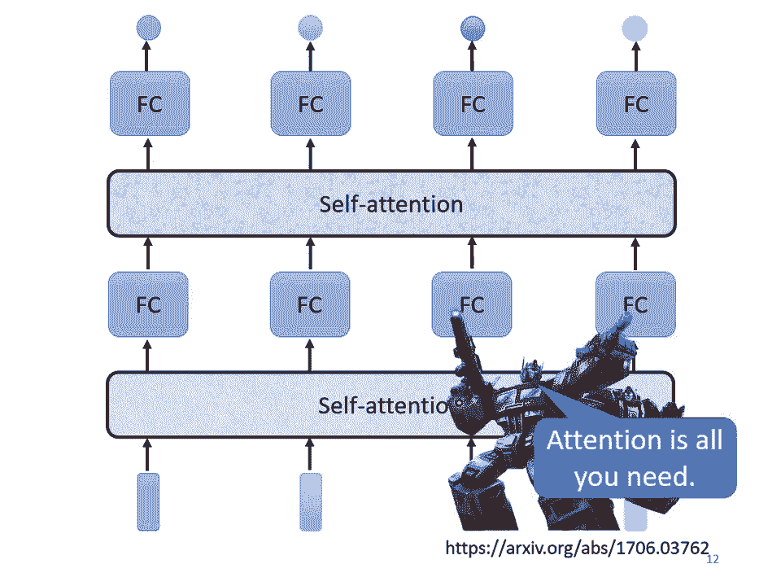

首先，根据 **a1**，找出序列中与 **a1** 相关的其他向量。我们需要一个机制来衡量两个向量之间的关联程度，这个数值用 **α**（阿尔法）表示，称为“注意力分数”。

如何计算两个向量（如 **a1** 和 **a2**）的关联性 **α** 呢？常见的方法是使用“点积注意力（Dot-product Attention）”：

1.  将两个输入向量分别乘以两个不同的矩阵（**WQ** 和 **WK**），得到 **q**（Query，查询向量）和 **k**（Key，键向量）。
    *   **q1 = WQ * a1**
    *   **k2 = WK * a2**
2.  将 **q1** 和 **k2** 做点积（Dot Product），得到关联性分数 **α12**。
    *   **α12 = q1 · k2**

> 还有其他计算关联性的方法，如“加性注意力（Additive Attention）”，但点积注意力是目前最常用、也是Transformer中使用的方法。

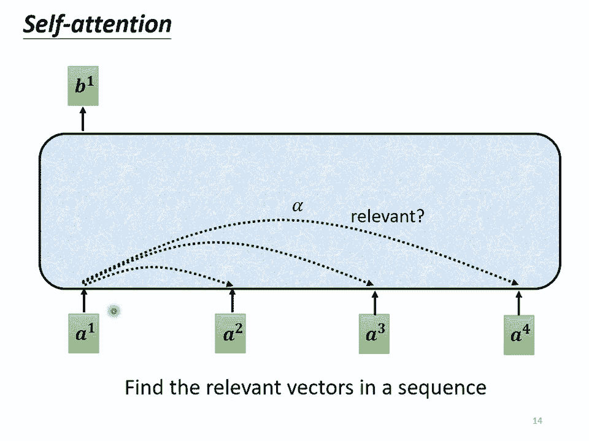

### 步骤2：计算所有关联性并归一化

我们需要计算 **a1** 与序列中所有向量（包括它自己）的关联性。

1.  对序列中每一个向量 **ai**，计算其键向量 **ki = WK * ai**。
2.  用 **a1** 的查询向量 **q1** 与每一个 **ki** 做点积，得到一系列注意力分数 **α1i**。
3.  通常会对这一排分数 **α1i** 进行Softmax操作（或其他如ReLU的归一化方法），将其转化为概率分布，得到归一化后的注意力权重 **α’1i**。
    *   **α’1i = Softmax(α1i)**

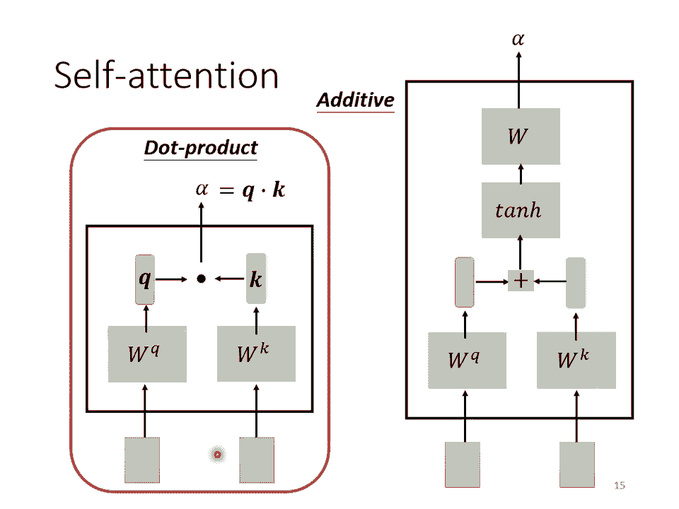

### 步骤3：根据注意力权重抽取信息

现在，我们根据计算出的注意力权重 **α’1i**，从整个序列中抽取重要的信息来生成 **b1**。

1.  将每个输入向量 **ai** 乘以另一个矩阵 **WV**，得到值向量 **vi**。
    *   **vi = WV * ai**
2.  将每个值向量 **vi** 乘以其对应的注意力权重 **α’1i**，然后求和，即得到输出向量 **b1**。
    *   **b1 = Σ (α’1i * vi)**

如果某个向量（如 **a2**）与 **a1** 的关联性很强（**α’12** 很大），那么 **v2** 在求和时所占的比重就很大，生成的 **b1** 就会更接近 **v2** 所包含的信息。

通过这种方式，**b1** 就聚合了整个输入序列中与 **a1** 最相关的信息。同理，可以计算出序列中每个位置对应的输出向量 **b2, b3, ...**。

---

## 总结

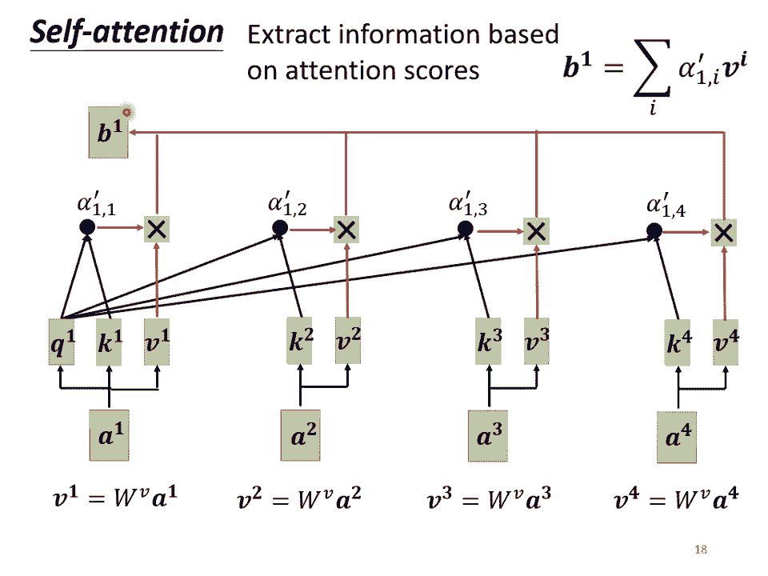

本节课中我们一起学习了自注意力机制的基础知识。我们了解到自注意力机制是为了处理可变长度的序列输入而设计的。它通过计算序列内部所有元素之间的关联性（注意力分数），并根据这些分数动态地聚合整个序列的信息，从而为每个位置生成一个考虑了全局上下文的输出向量。这为解决像词性标注这类需要理解完整句意的序列标注任务提供了强大的工具。在下一节课中，我们将进一步探讨自注意力机制的实现细节和变体。