# 10：L8.2 - 自注意力机制 (Self-attention) 2 🧠

在本节课中，我们将深入学习自注意力机制（Self-attention）的完整计算过程，并从矩阵运算的角度重新理解它。我们还将探讨其进阶版本——多头注意力（Multi-head Self-attention），并了解自注意力机制在语音、图像等不同领域的应用及其与其他神经网络架构（如CNN、RNN）的关系。

---

## 自注意力机制回顾与B2的计算 🔄

上一节我们介绍了如何根据输入序列计算输出B1。本节中，我们来看看如何计算B2。实际上，计算B2与计算B1的操作是完全相同的。

给定一排输入向量（Input Sequence），自注意力机制的目标是产生另一排输出向量（Output Sequence）。计算B2时，我们的主角是A2。

以下是计算B2的步骤：
1.  **生成查询向量（Query）**：将A2通过一个线性变换（乘以矩阵W^Q）得到查询向量Q2。
    `Q2 = A2 * W^Q`
2.  **计算注意力分数（Attention Score）**：用Q2与所有位置的键向量（K1, K2, K3, K4）分别计算内积（dot product），得到四个初始分数。
    `score_2i = Q2 · K_i` (其中 i=1,2,3,4)
3.  **分数归一化（Normalization）**：通常对这四个分数进行softmax操作，使它们的和为1，得到最终的注意力权重α‘。
    `α‘_2i = softmax(score_2i)`
4.  **加权求和得到输出**：将这些权重α‘_21到α‘_24分别乘上对应的值向量（V1到V4），然后求和，即得到输出B2。
    `B2 = α‘_21 * V1 + α‘_22 * V2 + α‘_23 * V3 + α‘_24 * V4`

同理，可以计算出B3和B4。**需要强调的是，B1到B4是同时被计算出来的，而非顺序产生。**

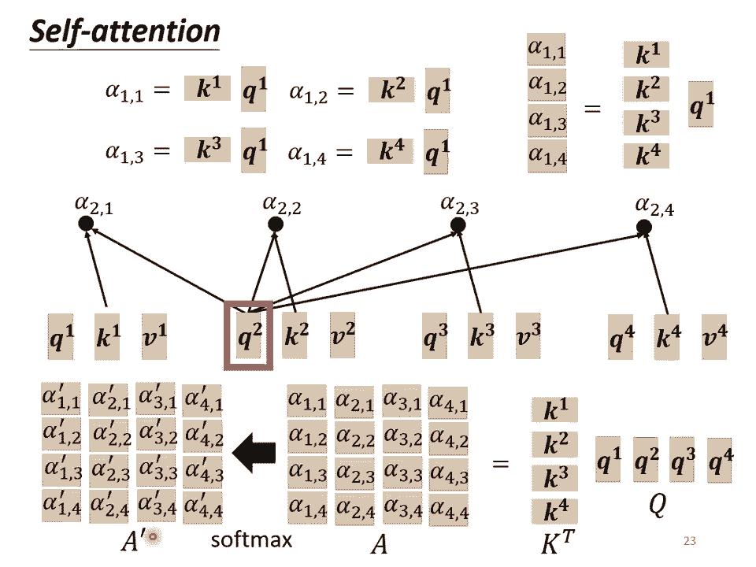

---

## 矩阵运算视角下的自注意力 🧮

上一节我们从向量操作的角度理解了自注意力。本节中，我们从矩阵乘法的角度重新审视整个过程，这有助于理解其高效并行的本质。

### 生成Q、K、V矩阵

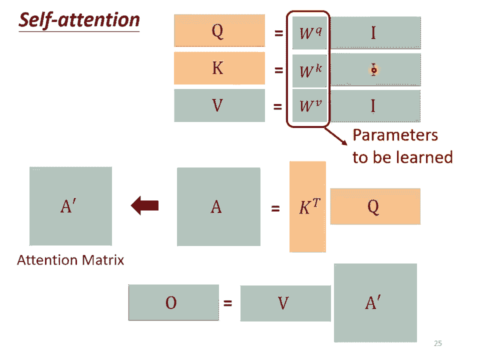

首先，输入序列A1到A4可以拼接成一个矩阵 **I**（Input Matrix）。
`I = [A1, A2, A3, A4]`

通过乘以三个不同的权重矩阵，我们可以一次性得到查询（Q）、键（K）、值（V）三个矩阵：
*   `Q = I * W^Q`
*   `K = I * W^K`
*   `V = I * W^V`
其中，W^Q, W^K, W^V是需要通过训练数据学习得到的参数。

### 计算注意力分数矩阵A

注意力分数可以通过矩阵乘法一次性计算。将K矩阵转置后与Q矩阵相乘，得到注意力分数矩阵 **A**。
`A = K^T * Q`
矩阵A中的每个元素A_ij就代表了第i个位置的键（K_i）与第j个位置的查询（Q_j）之间的相关性分数。

### 归一化与输出计算

对矩阵A的每一列进行softmax操作（或其他归一化方法），得到归一化后的注意力权重矩阵 **A‘**。
`A‘ = softmax(A, axis=0)  # 对每一列进行softmax`
最后，将权重矩阵A‘与值矩阵V相乘，即可得到最终的输出矩阵 **O**（Output Matrix）。
`O = V * A‘`
输出矩阵O的每一列，就是对应的输出向量B1到B4。

**总结这个流程**：`I -> (Q, K, V) -> A = K^T * Q -> A‘ = softmax(A) -> O = V * A‘`
自注意力层中，唯一需要学习的参数就是 **W^Q, W^K, W^V**。

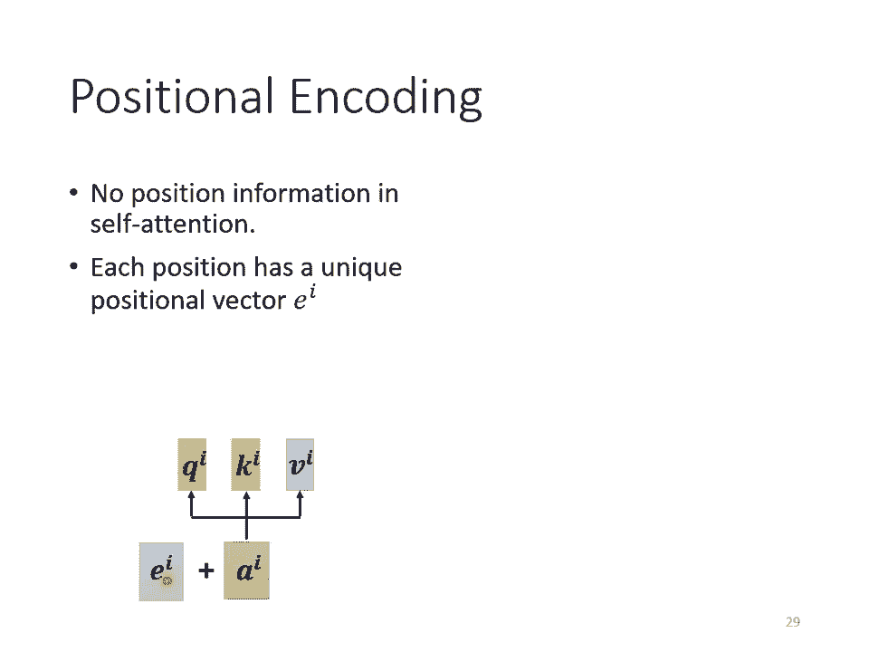

---

## 多头自注意力机制 (Multi-head Self-attention) 👥

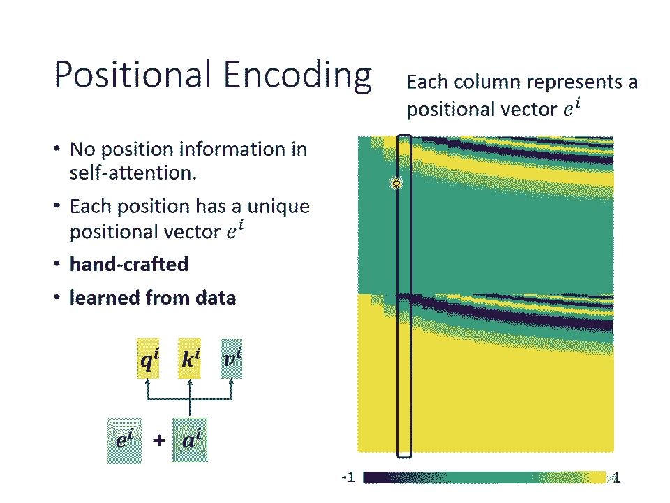

单一的注意力机制可能只捕捉到一种类型的相关性。为了让模型能同时关注输入序列不同子空间或不同方面的信息，我们引入了多头注意力机制。

以下是实现多头注意力的步骤：
1.  **生成多组Q、K、V**：对于输入向量A_i，我们不是只生成一组(Q_i, K_i, V_i)，而是通过不同的线性变换生成多组。例如，对于两个头（head）：
    `Q_i^1 = A_i * W^{Q,1},  K_i^1 = A_i * W^{K,1},  V_i^1 = A_i * W^{V,1}`
    `Q_i^2 = A_i * W^{Q,2},  K_i^2 = A_i * W^{K,2},  V_i^2 = A_i * W^{V,2}`
2.  **分组进行自注意力计算**：每组（每个头）独立进行之前介绍的自注意力计算。
    `head_1 = SelfAttention(Q^1, K^1, V^1)`
    `head_2 = SelfAttention(Q^2, K^2, V^2)`
3.  **合并与最终变换**：将所有头的输出拼接（Concatenate）起来，然后再通过一个线性变换（W^O）得到该位置的最终输出。
    `Output_i = Concat(head_i^1, head_i^2) * W^O`

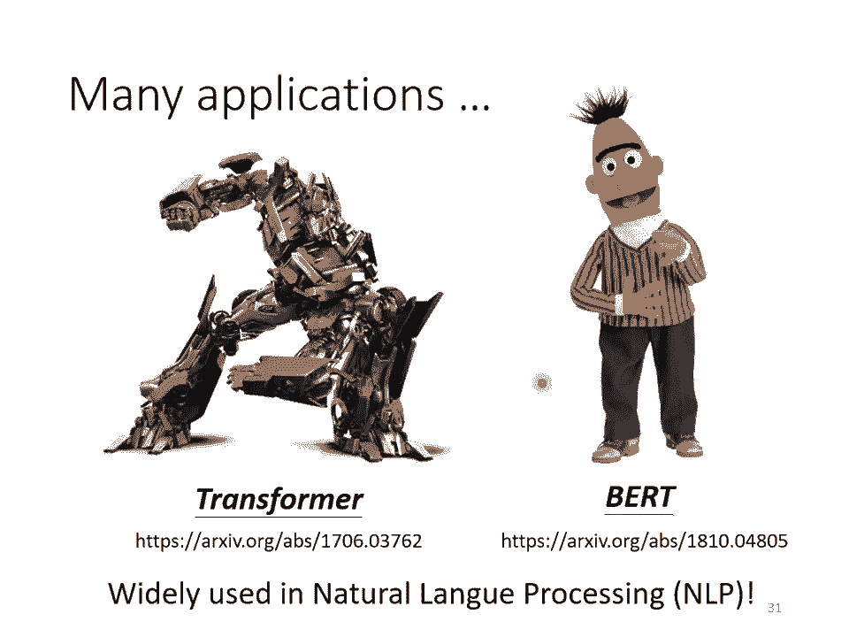

通过多个头，模型可以并行地学习到输入数据在不同表示子空间中的关系。

---

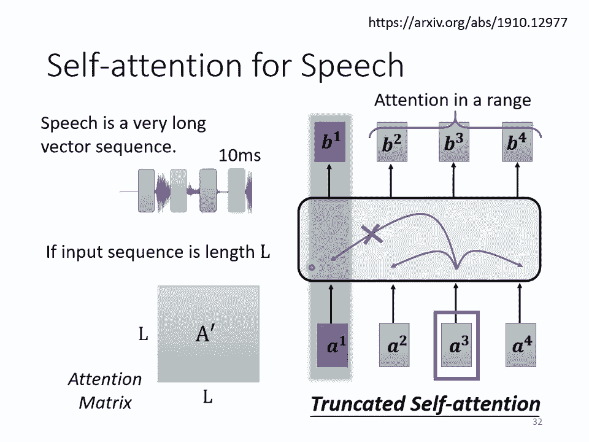

## 位置编码 (Positional Encoding) 📍

到目前为止，自注意力机制本身对输入序列的顺序是不敏感的。无论A1和A4的距离远近，在计算时都被同等对待。但许多任务中，位置信息至关重要（例如，句首的词性可能与其他位置不同）。

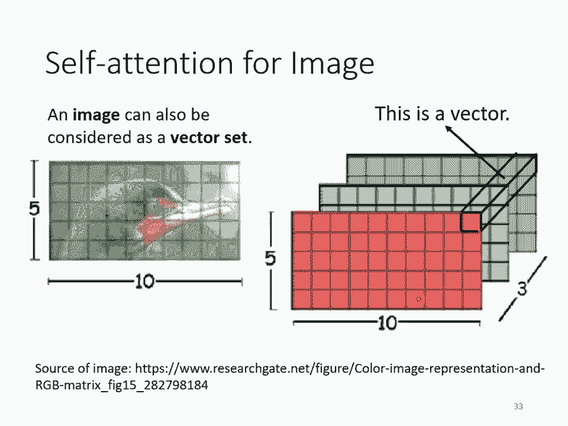

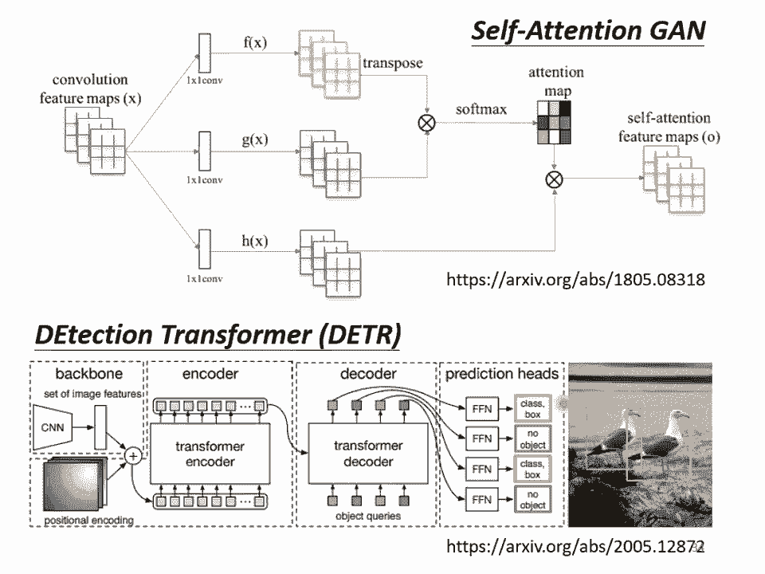

为了解决这个问题，我们引入位置编码。其核心思想是为序列中的每个位置分配一个独特的向量，并将其加到对应的输入向量上。
`A_i‘ = A_i + P_i`
其中，P_i是第i个位置的位置编码向量。

以下是关于位置编码的要点：
*   **经典方法**：在原始Transformer论文《Attention Is All You Need》中，P_i使用正弦和余弦函数生成，是一种人为设定的规则。
*   **可学习的参数**：位置编码也可以作为模型参数的一部分，在训练过程中学习得到。
*   **研究前沿**：如何设计更有效的位置编码仍是一个活跃的研究领域，存在许多不同的方法（如基于RNN生成、FLOATER等）。

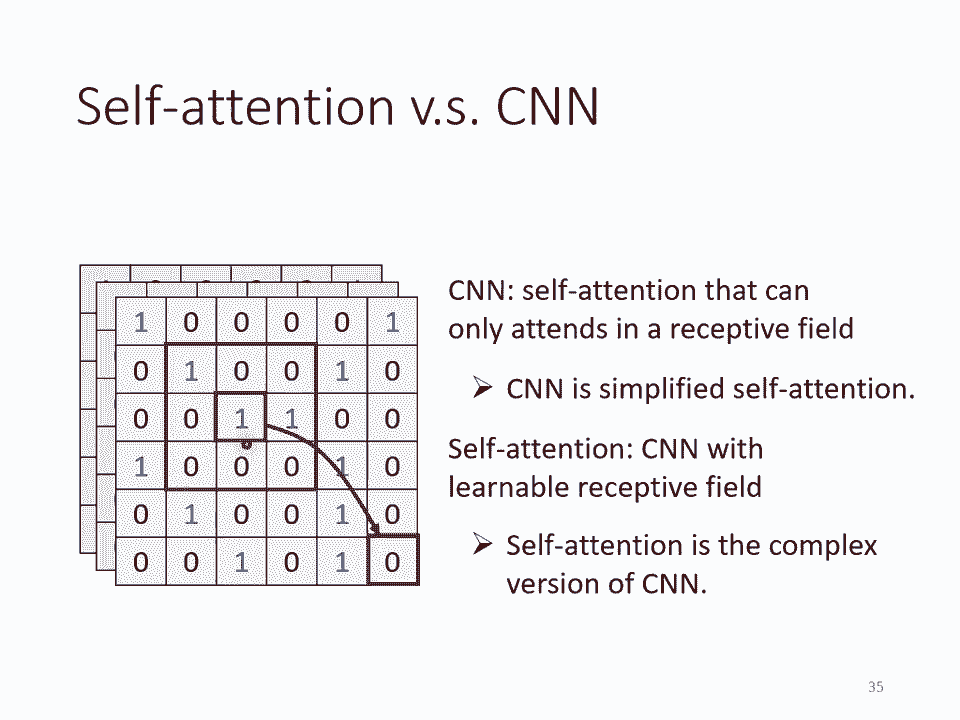

---

## 自注意力机制的应用与比较 🌐

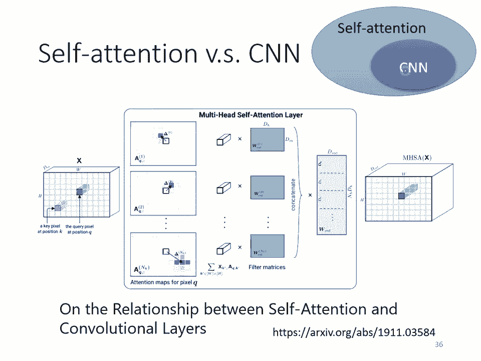

自注意力机制不仅用于自然语言处理（如Transformer、BERT），也广泛应用于其他领域。

### 在语音处理中的应用

语音信号转化为向量序列后可能非常长，导致计算注意力矩阵（复杂度O(L²)）的开销巨大。为此，可以采用**截断自注意力（Truncated Self-Attention）**，即每个位置只与其前后一定窗口内的位置计算注意力，这基于“判断一个音素通常只需局部上下文”的先验知识。

### 在图像处理中的应用

一张图像可以视为一个向量集合（每个像素点是一个RGB向量）。因此，自注意力可以直接应用于图像。这与卷积神经网络（CNN）形成了对比：
*   **CNN**：每个神经元只考虑一个局部感受野（Receptive Field）内的信息，感受野大小和形状是人工设定的。
*   **自注意力**：每个输出位置（像素）可以通过注意力权重考虑图像上任何位置的信息，“感受野”是模型自动学习出来的，范围可以是整张图。

因此，**CNN可以看作是一种简化版的、感受野受限的自注意力**。而自注意力是更灵活的模型，需要更多数据来训练以避免过拟合。实验表明，在小数据量上CNN可能表现更好，而在大数据量上自注意力潜力更大。

### 与循环神经网络（RNN）的比较

RNN也是处理序列数据的经典模型，但其核心区别在于：
*   **并行化能力**：RNN必须按时间步顺序计算，难以并行。而自注意力可以同时计算所有位置的输出，效率更高。
*   **长程依赖**：即使使用双向RNN，最左端的信息也需要通过记忆单元一步步传递到最右端。自注意力则可以直接计算任意两个位置间的关联，更容易捕捉长距离依赖。

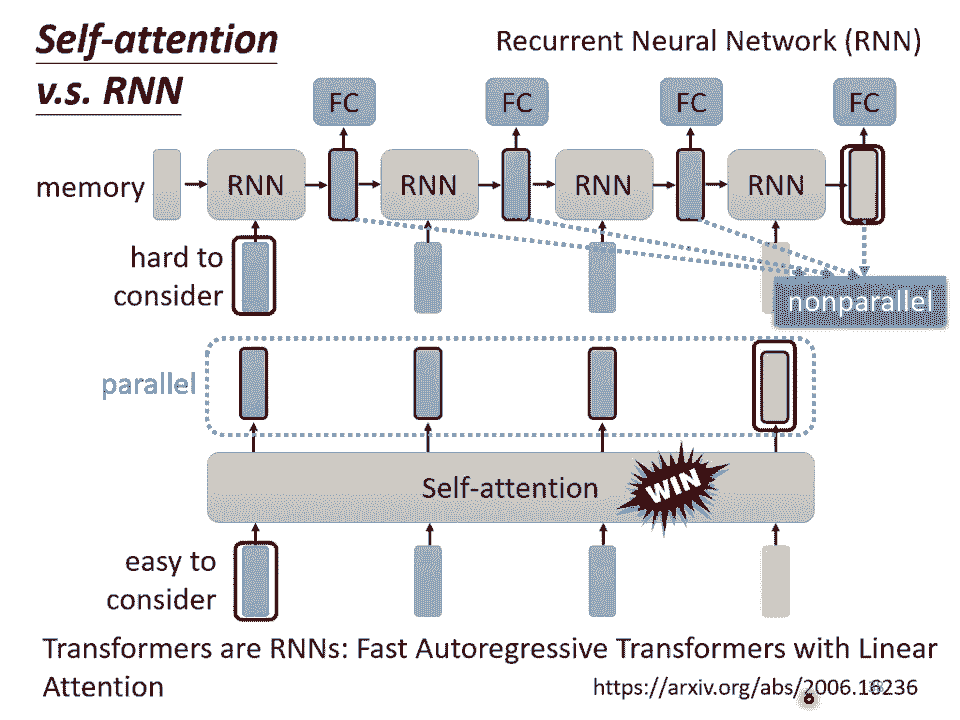

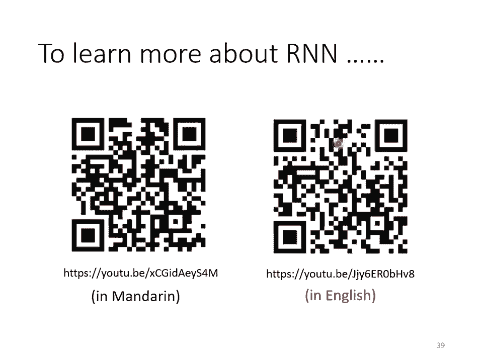

因此，在许多序列任务中，自注意力架构正在逐渐取代RNN。

### 在图神经网络（GNN）中的应用

图（Graph）也可以表示为一组节点向量。将自注意力应用于图时，一个自然的改进是：**只计算有边相连的节点之间的注意力分数**。因为图中的边已经提供了节点间关联性的先验知识，无需模型再去学习不存在的连接。这种结合了图结构信息的自注意力，构成了某一类图神经网络（GNN）的基础。

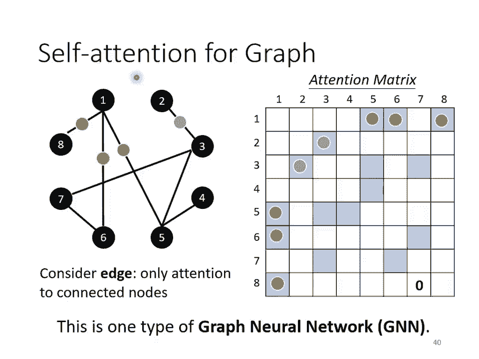

---

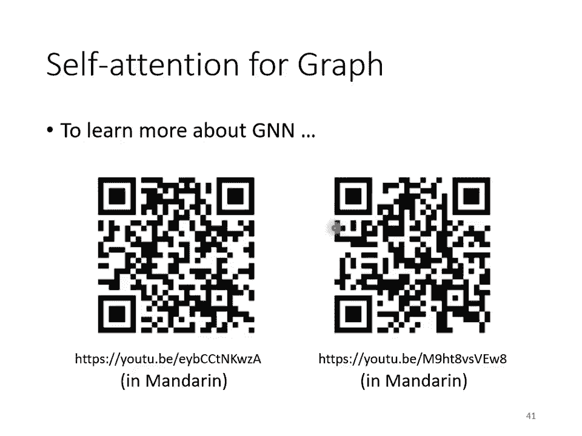

## 总结 📝

本节课我们一起深入学习了自注意力机制：
1.  我们回顾了自注意力计算单个输出（如B2）的详细步骤。
2.  我们从矩阵运算的角度理解了自注意力如何高效并行地计算所有输出，并明确了其可训练参数仅为W^Q, W^K, W^V。
3.  我们介绍了多头注意力机制，它允许模型同时关注输入信息的不同方面。
4.  我们探讨了位置编码的重要性，它为序列注入了顺序信息。
5.  我们拓展了视野，看到自注意力在语音（需处理长序列）、图像（与CNN对比）、以及图结构数据上的应用和变体。
6.  我们比较了自注意力与RNN，突出了其在并行化和处理长程依赖上的优势。

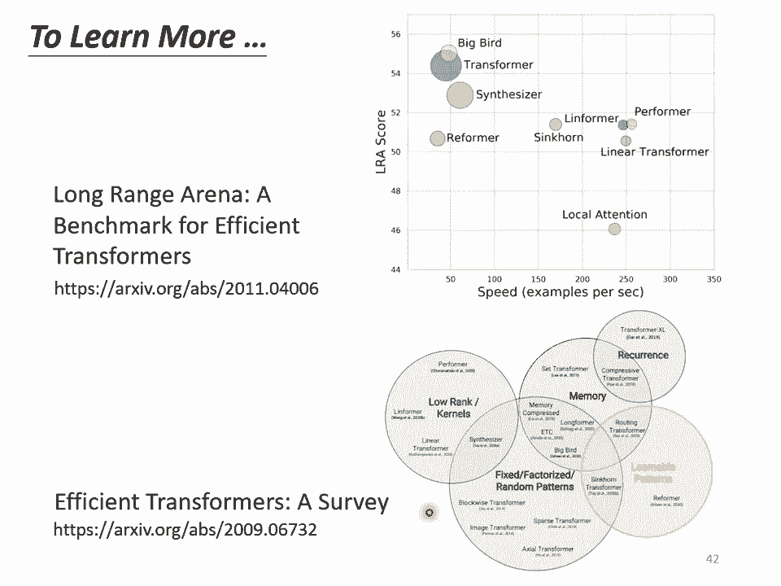

自注意力机制以其强大的序列建模能力和并行计算效率，已成为现代深度学习模型，尤其是Transformer架构的核心组件。