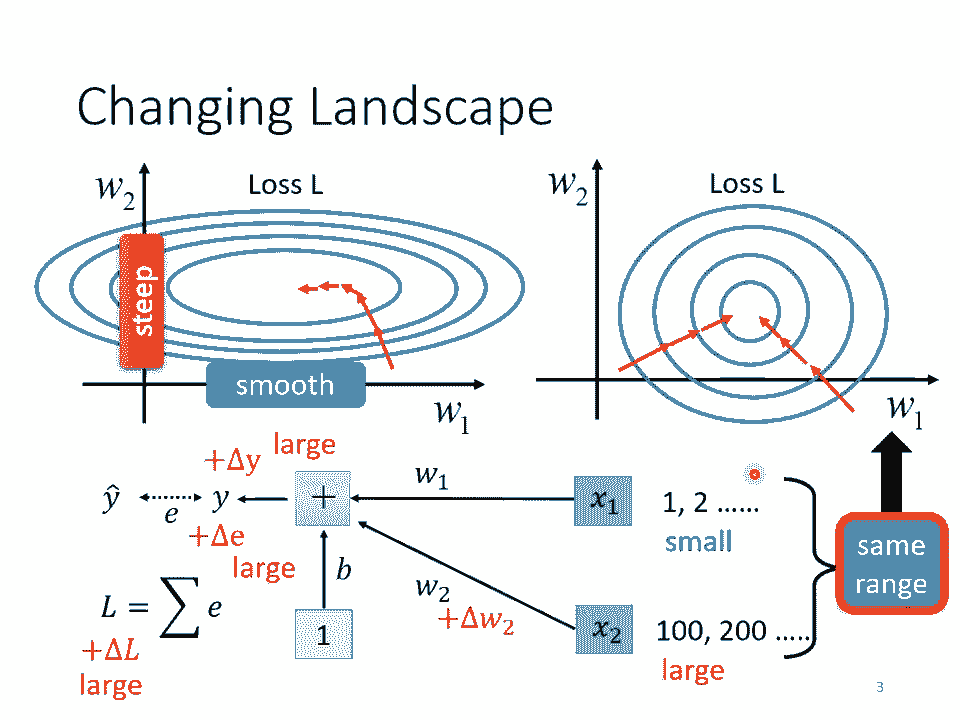
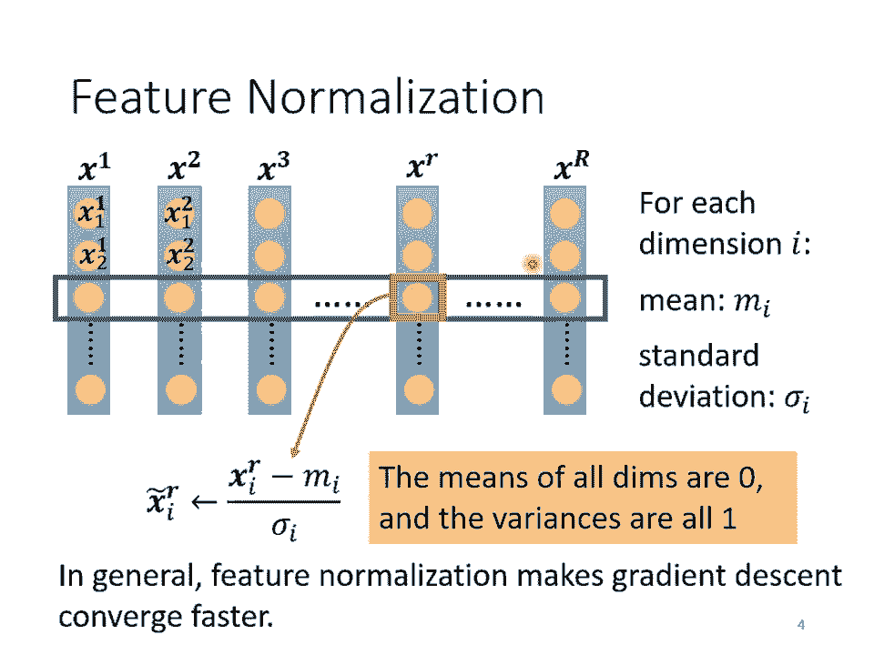
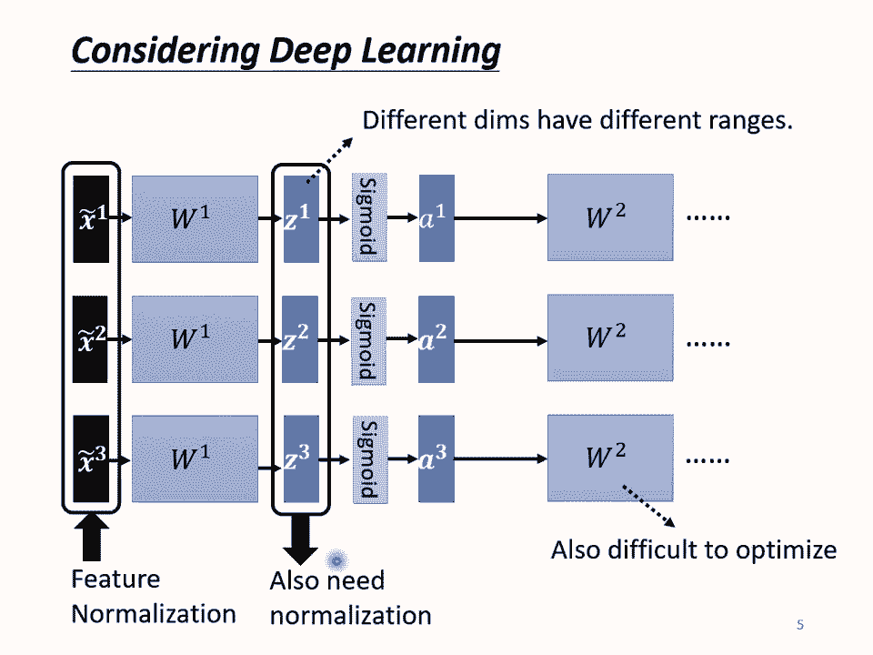
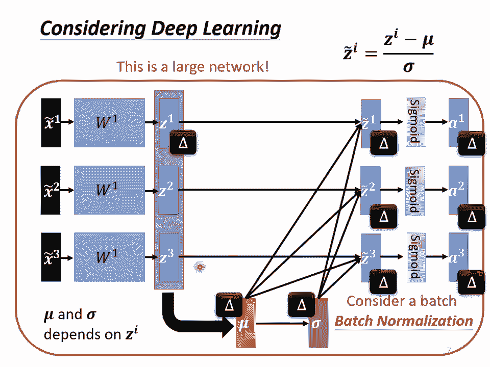
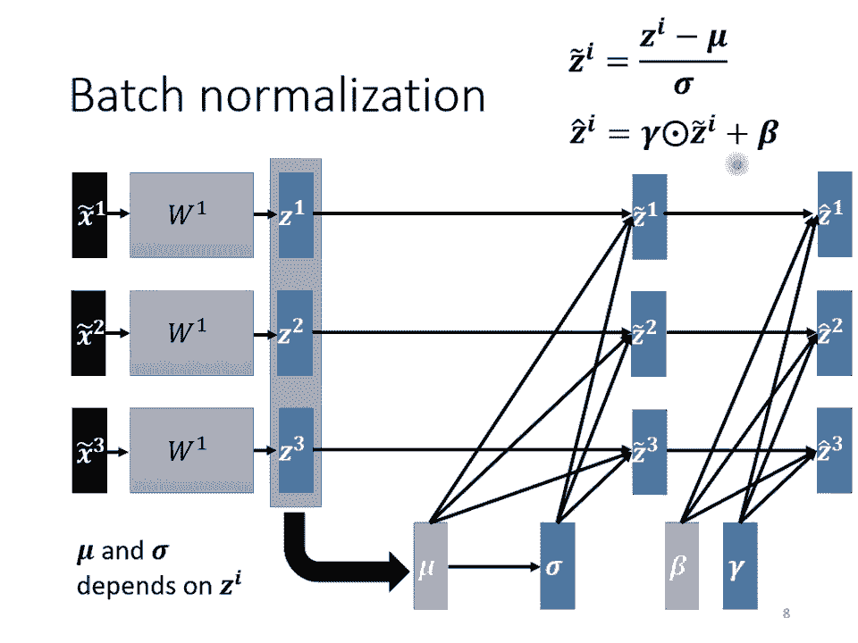
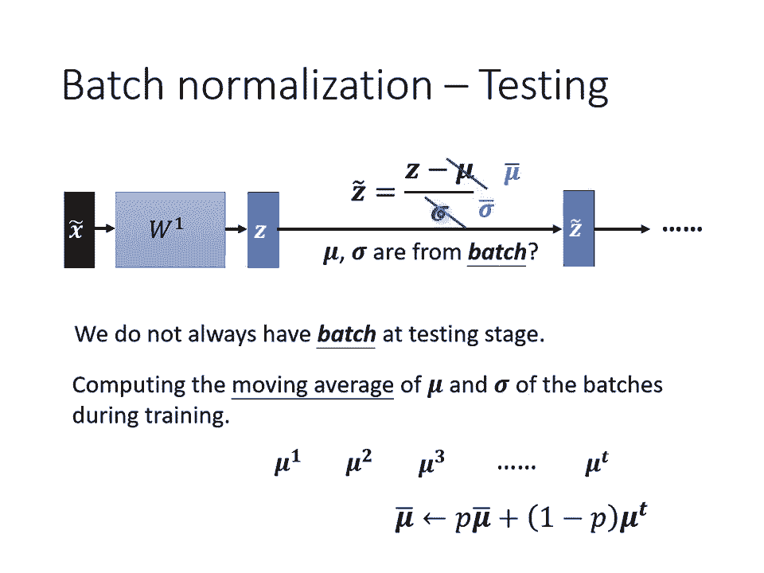
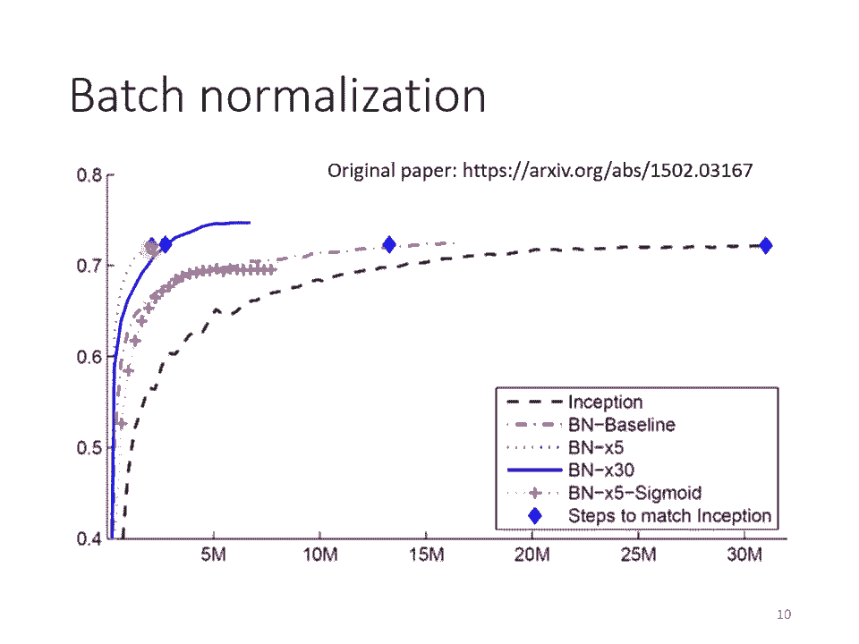
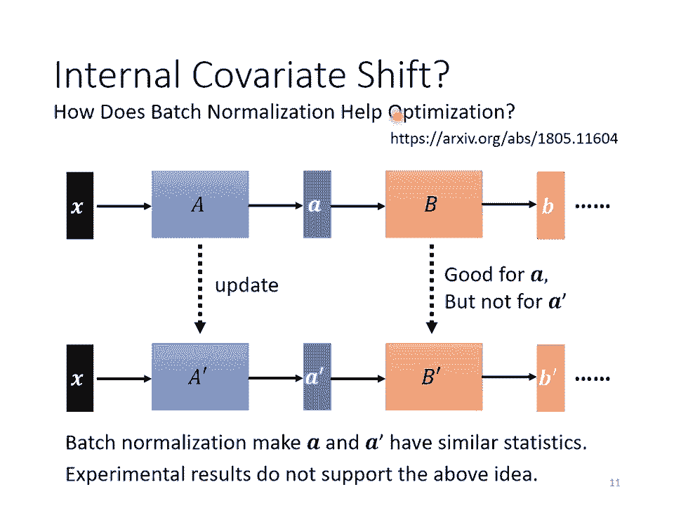
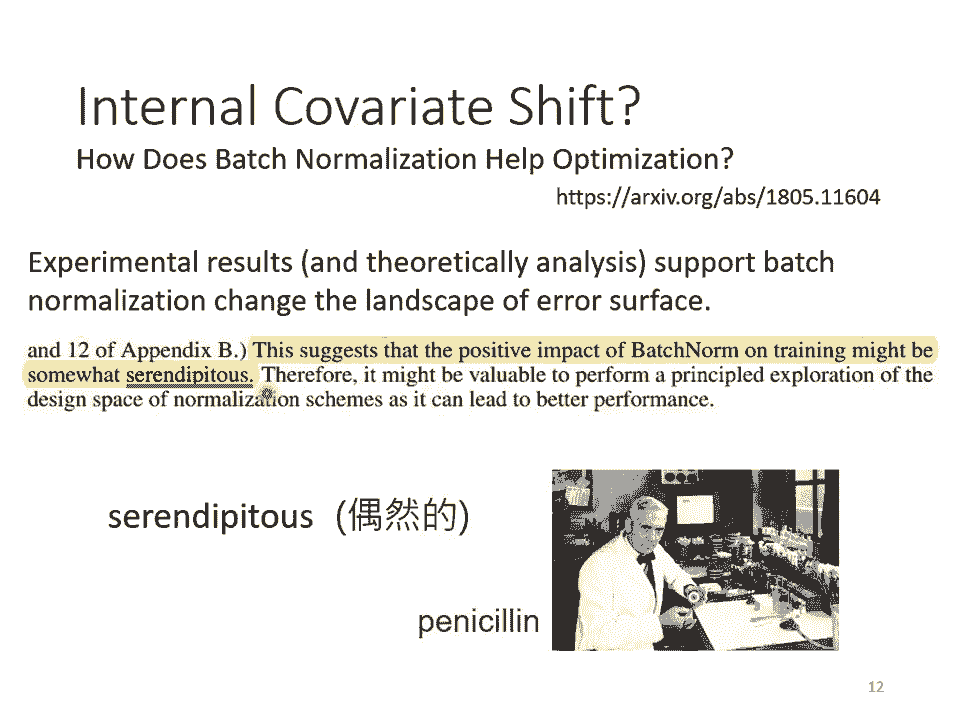
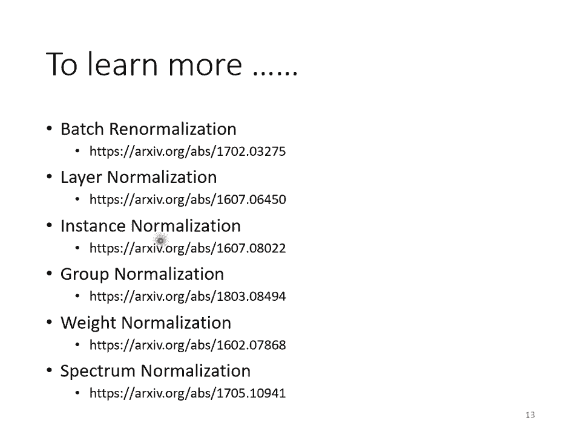

# 11：L10 - 网络训练技巧5：批次标准化（Batch Normalization）简介 🧠

在本节课中，我们将学习一种非常重要的神经网络训练技巧——**批次标准化（Batch Normalization）**。我们将了解它的基本思想、工作原理、具体实现方式，以及它为何能有效提升训练效果。本课程内容与作业3紧密相关，助教的代码中已经包含了批次标准化的实现，学习后你将能更好地理解并运用它。

---

## 📊 概述：为什么需要批次标准化？

在之前的课程中我们讨论过，一个“崎岖”的误差曲面（Error Surface）会让模型训练变得非常困难。即使误差曲面是凸的（Convex），如果不同参数方向上的梯度（斜率）差异巨大，使用固定的学习率也很难有效优化。我们曾通过自适应学习率（如 Adam 等优化器）来应对这个问题。

本节我们将从另一个角度思考：**能否直接改造误差曲面，让它变得更容易训练？** 批次标准化就是基于这个想法的一种技术。

在深入之前，我们首先要问：是什么导致了这种不同方向梯度差异巨大的“难训练”的误差曲面？

---

## 🔍 问题根源：特征尺度差异

考虑一个非常简单的线性模型：

*   输入是 `x1` 和 `x2`。
*   对应的参数是 `w1` 和 `w2`。
*   模型输出为 `y = w1 * x1 + w2 * x2 + b`。
*   损失 `L` 是预测 `y` 与目标 `y_hat` 的差距之和。



**那么，`w1` 的改变如何影响损失 `L` 呢？**

`w1` 的改变会先影响 `y`，再影响误差 `e`，最终影响损失 `L`。当 `w1` 改变量 `Δw1` 固定时，`x1` 的值越小，它对 `y`、`e` 和 `L` 的连锁影响就越小。这意味着在 `w1` 方向上的误差曲面坡度（梯度）很平缓。

反之，如果 `x2` 的值很大，`w2` 的微小变化会因为乘以大的 `x2` 而被放大，导致 `L` 剧烈变化。这意味着在 `w2` 方向上的误差曲面坡度很陡峭。

**核心结论：**
当输入特征（Feature）不同维度（Dimension）的数值范围（Scale）差异很大时，就容易产生这种不同方向坡度差异巨大的误差曲面，从而增加训练难度。

**解决方案思路：**
如果我们能让不同维度的特征拥有相近的数值范围，就可能创造出更“平滑”、更好训练的误差曲面。这种方法统称为**特征标准化（Feature Normalization）**。

---



## 🛠️ 特征标准化（Feature Normalization）的一种方法

以下是特征标准化的一种常见实现方式（通常称为标准化或 Z-Score 归一化）：

假设我们有 `R` 个训练数据的特征向量，将所有向量集合起来。对于第 `i` 个特征维度，我们计算该维度在所有数据上的均值（`μ_i`）和标准差（`σ_i`）。

**标准化公式如下：**

对于第 `r` 个数据的第 `i` 维特征 `x_i^r`，我们将其转换为：
```
x̃_i^r = (x_i^r - μ_i) / σ_i
```
转换后，该维度数据的均值约为 0，标准差约为 1。



**操作流程如下：**
1.  选取所有训练数据。
2.  针对每一个特征维度 `i`，计算该维度在所有数据上的均值 `μ_i` 和标准差 `σ_i`。
3.  对每一个数据点的每一个维度，应用上述公式进行转换。
4.  将转换后的值 `x̃` 放回原数据位置，替换原来的值 `x`。

经过这样的处理，不同特征维度的数值范围就被统一到了相似的尺度上。

---

## 🧩 将标准化融入神经网络：批次标准化（Batch Normalization）

上一节我们介绍了对原始输入特征进行标准化的方法。现在，我们考虑如何将这种思想应用到神经网络的隐藏层。

### 隐藏层输出的标准化

一个神经网络的隐藏层会输出一组值（假设为向量 `z`）。我们可以对某个隐藏层的输出 `z` 也进行标准化，使其均值为 0，方差为 1。这样，输入到下一层的数据尺度就是一致的。

**但这里存在一个关键问题：标准化是一个依赖于整体数据统计量（μ, σ）的过程。**

考虑三个数据样本 `x1, x2, x3` 依次通过网络。如果我们对第一个隐藏层的输出 `z1` 做标准化，我们需要基于**一批数据**来计算 `μ` 和 `σ`。当我们改变 `z1` 的值时，`μ` 和 `σ` 会随之改变，进而影响 `z2`, `z3` 的标准化结果。

这意味着，**在做特征标准化后，不同样本的处理过程不再是独立的，而是相互关联的**。

因此，我们必须将“收集一批特征、计算其 `μ` 和 `σ`”这个过程，视为网络本身的一部分。也就是说，我们有一个“更大的网络”，它一次处理一批（a batch of）输入，内部计算这批数据的统计量，并产生一批标准化后的输出。

### 批处理（Batching）的引入



由于实际训练数据量可能非常庞大（数百万），我们无法一次性将所有数据送入网络计算全局的 `μ` 和 `σ`（GPU 内存无法容纳）。

**实际做法是：**
我们只对一个小批量（Mini-batch）内的数据做标准化。例如，设置批次大小（Batch Size）为 64，那么这个“更大的网络”就一次读入 64 个数据，计算这 64 个数据的 `μ` 和 `σ`，并对它们进行标准化。

**正因为我们只对一个批次内的数据做标准化，所以这项技术被称为批次标准化（Batch Normalization）。**

显然，批次标准化要求批次大小不能太小（比如为 1），否则无法计算有意义的 `μ` 和 `σ`。当批次足够大时，一个批次内的数据分布可以近似代表整个数据集的分布。

### 可学习的缩放与偏移参数（γ 和 β）



在标准的批次标准化中，我们不会直接将标准化后的 `z̃` 送入下一层，而是会进行一个可学习的变换：
```
ẑ = γ ⊙ z̃ + β
```
其中：
*   `⊙` 表示逐元素相乘（Element-wise Multiplication）。
*   `γ` (gamma) 和 `β` (beta) 是网络需要学习的参数向量。

**为什么需要 `γ` 和 `β`？**
强制让隐藏层输出均值为 0、方差为 1 的分布，可能会限制网络的表达能力。加入 `γ` 和 `β` 后，网络可以学习去调整输出的分布。如果它认为原始分布更好，它可以通过学习将 `γ` 设为 1，`β` 设为 0 来恢复；如果需要不同的分布，它可以学习出相应的 `γ` 和 `β`。

**初始值设置：**
通常，我们将 `γ` 初始化为全 1 向量，`β` 初始化为全 0 向量。这样在训练初期，各维度的分布仍然是标准化的。随着训练进行，网络再根据需要慢慢调整 `γ` 和 `β`。

---

## 🧪 测试（推理）阶段的批次标准化

上一节我们详细讲解了训练阶段的批次标准化。在测试（Inference）阶段，我们会遇到一个问题：线上应用通常是一个样本一个样本地处理，无法组成一个批次来计算 `μ` 和 `σ`。



**解决方案：移动平均（Moving Average）**

框架（如 PyTorch）在训练时会自动处理这个问题：
1.  在训练过程中，对每一个批次计算出的 `μ_t` 和 `σ_t`，框架会维护它们的移动平均值 `μ_bar` 和 `σ_bar`。
2.  更新公式通常为：`μ_bar = p * μ_bar + (1 - p) * μ_t`（`σ_bar` 同理），其中 `p` 是一个接近 1 的超参数（例如 0.9）。
3.  在测试阶段，我们不再使用当前批次的统计量，而是直接使用训练过程中积累下来的移动平均值 `μ_bar` 和 `σ_bar` 来进行标准化。

这样，测试时就可以对单个样本进行前向传播了。

---

## 📈 批次标准化的效果

从原始论文中的实验结果可以看到：
*   **训练加速**：使用批次标准化（红色虚线）的网络，其验证集准确率上升速度远快于未使用的网络（黑色虚线），能以更短的时间达到相近的精度。
*   **允许更大的学习率**：因为误差曲面变得更平滑，可以使用更大的学习率（蓝色实线/虚线），进一步加快收敛。但学习率过大也可能导致效果变差，需要小心调整。
*   **稳定训练**：即使对于通常难以训练的 Sigmoid 激活函数，加入批次标准化后也能成功训练（粉色线）；而未加批次标准化的 Sigmoid 网络则根本训练不起来。

---



## 🤔 深入探讨：批次标准化为何有效？

原始论文提出，批次标准化通过减少**内部协变量偏移（Internal Covariate Shift）** 来帮助训练。其观点是：网络深层参数的更新是基于浅层前一时刻的输出来计算梯度的，但参数更新后浅层的输出分布已经改变，这可能导致深层参数的更新方向不再最优。标准化让每一层的输入分布更稳定，从而缓解了这个问题。

然而，后续研究（如论文《How Does Batch Normalization Help Optimization?》）对这一观点提出了挑战。该论文通过实验表明：
1.  无论是否使用批次标准化，网络中间层输出的分布在训练中的变化幅度可能并不大。
2.  即使分布变化大，对训练也不一定有严重伤害。
3.  基于更新前后分布算出的梯度方向其实很接近。

因此，“解决内部协变量偏移”可能不是批次标准化起效的关键原因。

该论文从理论和实验上支持了另一个更直接的观点：**批次标准化最主要的作用是让误差曲面（Loss Landscape）变得更加平滑（Less Rugged），从而简化了优化问题**。作者甚至尝试了其他让误差曲面平滑的方法，得到了与批次标准化相似甚至更好的效果，因此他感叹批次标准化的正面效果某种程度上像是“偶然的发现”（Serendipitous）。

---



## 🌐 其他标准化方法

批次标准化并非唯一的标准化技术，以下是一些其他知名的标准化方法：
*   **层标准化（Layer Normalization）**：针对单个样本的所有特征进行标准化，常用于循环神经网络（RNN）和 Transformer。
*   **实例标准化（Instance Normalization）**：常用于图像风格迁移，对每个样本的每个通道单独进行标准化。
*   **组标准化（Group Normalization）**：将通道分组，然后在每组内进行标准化。
*   **权重标准化（Weight Normalization）**：对网络权重进行标准化，而不是对激活值。

---

## 🎯 总结

本节课我们一起学习了**批次标准化（Batch Normalization）** 这一强大的训练技巧。





1.  **动机**：为了解决因输入特征尺度差异导致的“难训练”的误差曲面问题。
2.  **核心思想**：对神经网络每一层的输入（或激活值）进行标准化，使其均值为0，方差为1，从而平滑误差曲面。
3.  **实现方式**：在训练时，利用小批量数据计算当前层的均值与方差进行标准化，并引入可学习的参数 `γ` 和 `β` 来保持网络表达能力。在测试时，使用训练阶段统计的移动平均值进行标准化。
4.  **主要效果**：能显著加速训练过程，允许使用更大的学习率，并提升训练稳定性。
5.  **生效原因**：主流观点认为其通过平滑误差曲面来简化优化问题，而非最初提出的“减少内部协变量偏移”。


掌握批次标准化将帮助你更有效地训练深度神经网络，尤其是在处理像卷积神经网络（CNN）这类复杂模型时。