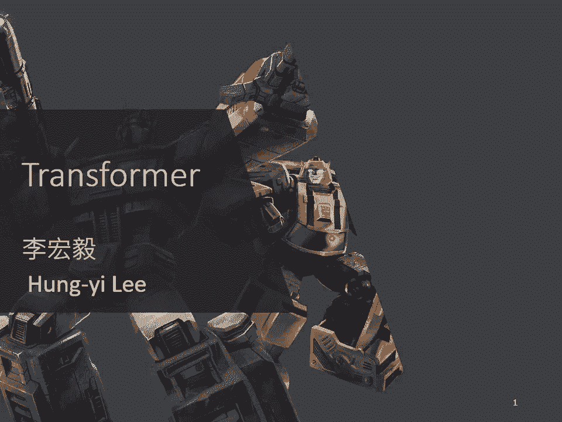
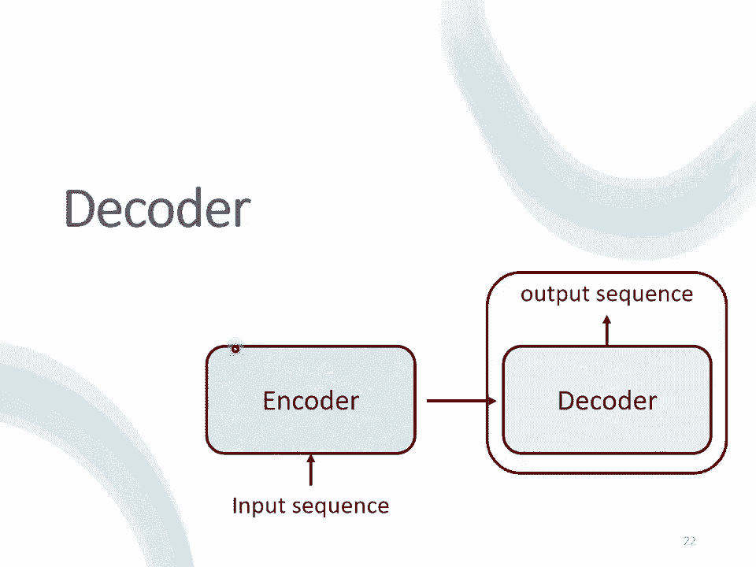

# 12：L11.1 - Transformer 1 🧠

在本节课中，我们将要学习 Transformer 模型的基本概念，特别是其作为序列到序列（Sequence-to-Sequence）模型的核心思想及其在多种任务中的应用。我们将从序列到序列模型的定义开始，逐步深入到 Transformer 的编码器（Encoder）部分。

---

## 序列到序列模型概述

Transformer 是一个序列到序列模型。序列到序列模型的缩写是 Seq2Seq。

序列到序列模型是指输入是一个序列，输出也是一个序列的模型。我们之前讨论过输入是序列的情况，输出有几种可能：一种是输入和输出长度相同；另一种是输出只有一个元素。而作业5的情况是，我们不知道应该输出多长，由机器自己决定输出的长度。

以下是序列到序列模型的一些应用示例。

### 序列到序列模型的应用

以下是需要用到序列到序列模型，即输入是一个序列，输出也是一个序列，但输出长度由机器决定的几种应用场景。

*   **语音识别**：输入是声音信号，输出是语音识别的结果，即对应的文字。输入声音信号的长度与输出文字的长度没有绝对关系，由机器自己决定。
*   **机器翻译**：输入一种语言的句子，输出另一种语言的句子。输入和输出句子的长度关系由机器自己决定。
*   **语音翻译**：输入一种语言的声音信号，直接输出另一种语言的文字。这对于没有文字的语言尤其有用。
*   **聊天机器人**：输入和输出都是文字序列，可以用序列到序列模型来训练。
*   **问答系统**：许多自然语言处理任务都可以看作是问答任务。例如，翻译可以看作是“这段文字的德文翻译是什么？”，摘要可以看作是“这段文字的摘要是什么？”。序列到序列模型可以读取问题与文章，直接输出答案。
*   **文法剖析**：输入一段文字，输出一个代表语法结构的序列（可以转换为树状结构），从而完成语法分析。
*   **多标签分类**：输入一篇文章，输出其所属的多个类别标签。由于每篇文章的标签数量不定，序列到序列模型可以自行决定输出标签的数量。
*   **目标检测**：输入一张图片，输出图片中物体的边界框和类别。这个问题也可以用序列到序列模型来解决。

序列到序列模型是一个功能强大且应用广泛的模型。然而，对于多数特定任务，为其定制专门的模型往往能得到更好的结果。

---

## Transformer 模型简介

现在我们来学习如何实现序列到序列模型。一般的序列到序列模型分为两部分：编码器（Encoder）和解码器（Decoder）。输入一个序列，由编码器处理，再将处理结果传给解码器，由解码器决定输出什么样的序列。

序列到序列模型的起源很早。如今提到序列到序列模型，首先想到的通常是 Transformer。它包含一个编码器架构和一个解码器架构，内部由许多模块组成。

接下来，我们重点讲解编码器的部分。

---

## Transformer 编码器详解

序列到序列模型的编码器，其任务是输入一排向量，输出另一排向量。许多模型都能做到这一点，例如自注意力机制、循环神经网络或卷积神经网络。

在 Transformer 中，编码器使用的是自注意力机制。编码器内部包含许多块（Block），每个块都是输入一排向量，输出一排向量。第一个块的输出作为下一个块的输入，最后一个块输出最终的向量序列。

每个块内部并非神经网络的一层，而是包含好几层操作。在 Transformer 的编码器中，每个块大致做以下事情：

1.  先进行自注意力计算。输入一排向量，通过自注意力机制考虑整个序列的信息，输出另一排向量。
2.  然后，将这排向量输入到一个全连接的前馈神经网络中，再输出一排向量，这排向量就是该块的输出。

实际上，原始 Transformer 的设计更为复杂。具体流程如下：

1.  **自注意力层 + 残差连接**：自注意力层输出向量后，会将其与输入向量直接相加，得到新的输出。这种设计称为残差连接。
2.  **层归一化**：对残差连接的结果进行层归一化。层归一化是对同一个样本特征向量内部的不同维度计算均值和标准差，并进行标准化。
3.  **前馈神经网络**：将归一化后的结果输入全连接前馈网络。
4.  **再次残差连接与层归一化**：将前馈网络的输入与其输出相加（残差连接），然后再进行一次层归一化，最终得到这个块的输出。

此外，在编码器的输入部分，还需要加入位置编码，因为自注意力机制本身不包含位置信息。

原始的 Transformer 编码器块结构可以总结为：**输入 → (位置编码) → 多头自注意力 → 加残差 & 层归一化 → 前馈网络 → 加残差 & 层归一化 → 输出**。这个块会重复 N 次。

需要指出的是，原始 Transformer 的架构并非最优设计。研究人员一直在探索更好的设计，例如调整层归一化的位置，或尝试其他归一化方法。

---

## 本节课总结

本节课中，我们一起学习了序列到序列模型的基本概念及其广泛的应用场景，例如语音识别、机器翻译和问答系统等。接着，我们引入了 Transformer 模型，并详细剖析了其编码器部分的核心架构，包括自注意力层、残差连接、层归一化以及前馈神经网络等关键组件。理解编码器如何将输入序列转化为蕴含丰富信息的向量序列，是掌握 Transformer 工作原理的重要基础。