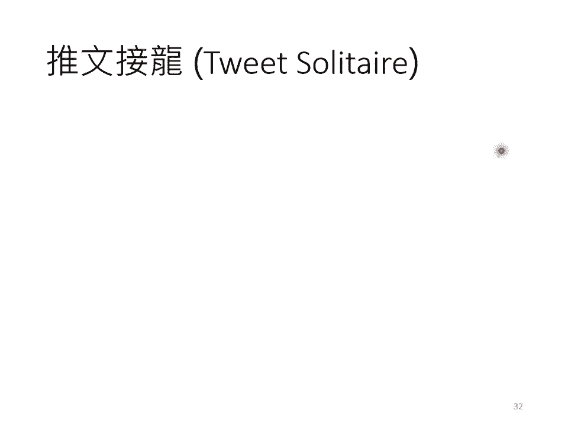
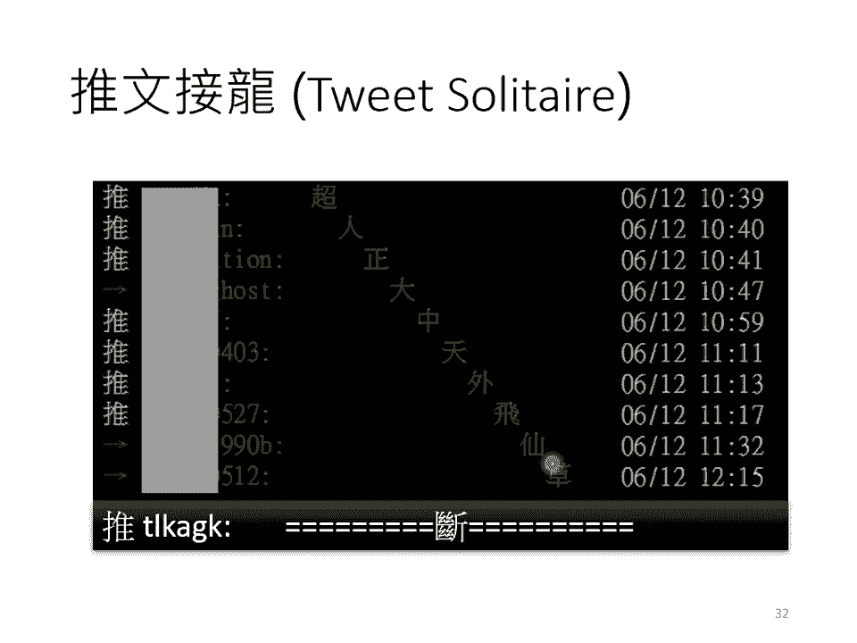
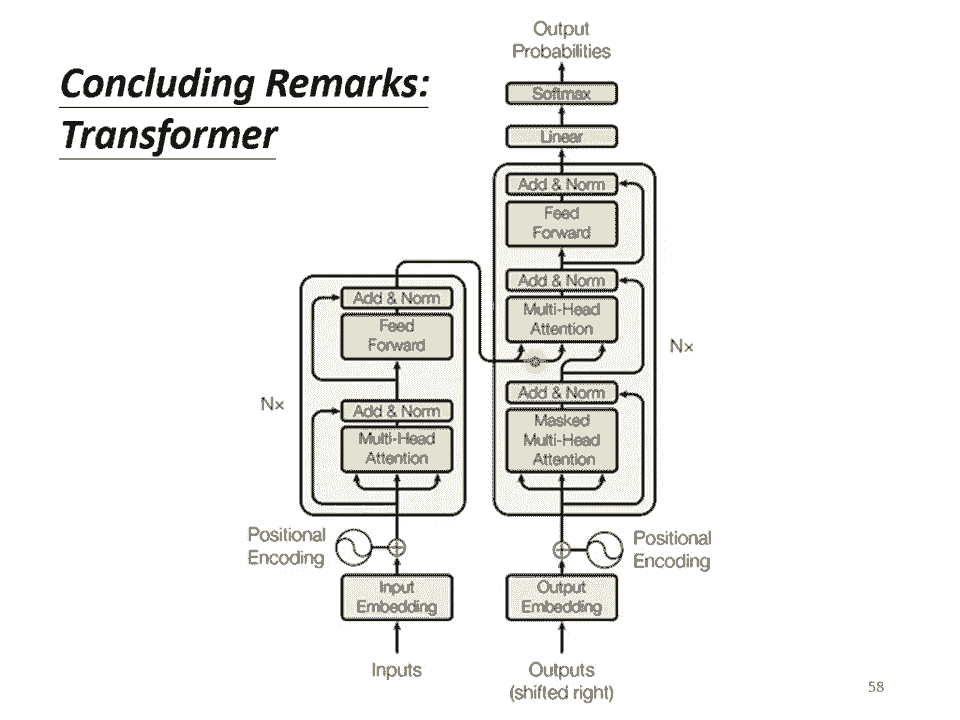

# 13：Transformer 详解 🤖

在本节课中，我们将深入学习 Transformer 模型的核心组成部分——Decoder。我们将详细讲解其工作原理、不同类型、内部结构以及与 Encoder 的交互方式，并介绍相关的训练技巧和挑战。

---

## Decoder 概述

上一节我们介绍了 Encoder，本节中我们来看看 Decoder。Decoder 主要有两种类型，我们将重点介绍更常见的一种——自回归（Auto-Regressive）Decoder，并以语音识别为例进行说明。需要指出的是，其原理与作业中的机器翻译任务完全相同，只是输入和输出的内容不同。

### 自回归 Decoder 的工作原理

语音识别的任务是输入一段声音，输出一串文字。声音信号首先被输入给 Encoder。例如，对机器说“机器学习”，Encoder 会接收这段声音信号并输出一排向量。我们上周详细讲解了 Encoder 的内部复杂结构，如果你忘记了也没关系，只需记住 Encoder 的功能是：输入一个向量序列，输出另一个向量序列。

接下来轮到 Decoder 运作。Decoder 的任务是产生输出，即语音识别的结果。它首先会读取 Encoder 的输出（具体如何读取稍后讲解），然后开始生成文字。

以下是 Decoder 生成文字的具体步骤：

1.  **输入起始符**：首先，需要给 Decoder 输入一个特殊的符号，代表开始。这个符号通常被称为 “Begin of Sentence” 或 BOS。它是一个额外的特殊 Token，在你的词汇表中代表“开始”。
2.  **向量表示**：在自然语言处理任务中，每个 Token（包括起始符）都可以用一个 One-Hot 向量表示，即向量中只有一位是 1，其余都是 0。
3.  **产生输出向量**：Decoder 接收到起始符后，会吐出一个向量。这个向量的长度与你的词汇表大小相同。
    *   **词汇表**：对于中文语音识别，词汇表可能是所有需要输出的中文字符集合，例如常见的 3000 个汉字。对于英文，输出单位可以是字母、单词或更常见的子词。
    *   **概率分布**：在得到最终输出前，通常会经过一个 Softmax 层，因此这个向量中的数值是一个概率分布，所有值加起来总和为 1。
4.  **选择最高分字符**：得到输出向量后，分数最高的那个字符就是 Decoder 的第一个输出。例如，“机”字的分数最高，那么“机”就是第一个输出。
5.  **迭代生成**：接下来，将“机”字作为 Decoder 的新输入（同样用 One-Hot 向量表示）。现在 Decoder 的输入包括起始符和“机”字。根据这两个输入，Decoder 会输出一个新的向量（蓝色向量），并再次选择分数最高的字符作为第二个输出，例如“器”。
6.  **持续过程**：这个过程反复持续。Decoder 会将自己的前一个输出作为下一个时间步的输入，依次生成“学”、“习”等字。
7.  **关键机制**：这里有一个关键机制，我们用红色虚线标出：**Decoder 的输入是它在前一个时间点自己的输出**。这意味着 Decoder 在生成句子时，可能会看到自己之前产生的错误结果，这有可能导致错误传播（Error Propagation）问题，即一步错，步步错。我们稍后会讨论如何处理这个问题。

### Decoder 的内部结构

现在，我们来看一下 Decoder 的内部结构。在 Transformer 中，Decoder 的结构比 Encoder 稍复杂一些。

如果我们把 Decoder 中间部分盖起来，会发现 Encoder 和 Decoder 并没有巨大的差别。两者都包含 Multi-head Attention、Add & Norm、Feed Forward、Add & Norm 等模块，并重复 N 次。

一个显著的不同点是，在 Decoder 的 Multi-head Attention 模块上，**增加了一个 Mask（掩码）**。

*   **标准 Self-Attention**：输出序列中的每个向量（如 B1）在计算时，会关注输入序列（A1 到 A4）中的所有信息。
*   **Masked Self-Attention**：在生成某个输出时，不能关注它“右侧”的输入信息。
    *   生成 B1 时，只能考虑 A1。
    *   生成 B2 时，只能考虑 A1 和 A2。
    *   生成 B3 时，不能考虑 A4。
    *   以此类推。

具体来说，在计算 B2 时，我们只拿第二个位置的 Query (Q2) 去跟第一个位置的 Key (K1) 和第二个位置的 Key (K2) 计算注意力分数，忽略 K3 和 K4。这样，B2 就只包含了 A1 和 A2 的信息。

为什么需要 Masking 呢？这非常直观。回想 Decoder 的运作方式：它的输出是一个一个产生的，先有 A1，再有 A2，然后 A3、A4。在计算 B2 的时刻，未来的 A3 和 A4 根本还不存在，因此自然无法被考虑进来。所以，Decoder 只能考虑已经生成的、位于它左侧的 Token。

---

## 决定输出序列的长度 🔚

Decoder 必须自己决定输出序列的长度，但输入序列的长度并不能直接决定输出序列的长度。在我们目前的机制中，机器不知道何时应该停止。例如，产生“习”之后，它可能继续输出，永不停歇。

这类似于一种“推文接龙”的游戏。为了让这个过程停止，我们需要一个特殊的符号——“结束符”（END）。因此，除了所有中文字符和起始符，你还需要准备一个代表“结束”的特殊符号。在助教的代码中，起始符和结束符可能使用同一个符号，因为它们出现在不同的位置（一个只在输入出现，一个只在输出出现），使用不同符号也完全可以。

我们期待 Decoder 在生成完“习”字后，将“习”作为输入，此时它应该输出“结束符”。这意味着，当 Decoder 看到 Encoder 的输出、起始符以及“机”、“器”、“学”、“习”这些信息后，它知道语音识别结果已经完成，不再需要产生更多词汇。它输出的向量中，“结束符”对应的概率应该是最大的。一旦输出结束符，整个 Decoder 生成序列的过程就结束了。

以上就是自回归 Decoder 的运作方式。

---

## 非自回归 Decoder (NAT) 简介

接下来，我们简要介绍非自回归模型。自回归模型是逐个生成 Token，而非自回归模型则是一次性生成整个句子。

非自回归 Decoder 的运作方式不同：
*   它接收的是一整排的起始符作为输入。
*   然后，它一次性输出一整排 Token，生成整个句子。

这里立即产生一个问题：我们怎么知道该输入多少个起始符（即输出应该多长）呢？有几种方法：
1.  训练一个额外的分类器，读取 Encoder 的输入，输出一个代表 Decoder 应输出长度的数字。
2.  假设一个句子长度的上限（例如 300），输入对应数量的起始符，然后输出对应数量的字，再根据输出的结束符位置截断后面的部分。

非自回归 Decoder 的优点：
1.  **平行化**：自回归 Decoder 需要逐步生成，句子越长，解码步骤越多。而非自回归 Decoder 无论句子多长，通常一个步骤就能产生完整句子，因此速度更快。这个想法是在 Transformer 和 Self-Attention 出现后才变得可行，因为 RNN/LSTM 无法同时产生所有输出。
2.  **可控输出长度**：例如在语音合成中，如果你显式地建模了输出长度，就可以通过调整预测的长度来控制语速（如预测长度除以 2 则语速加倍）。

非自回归 Decoder 目前是一个热门的研究主题，因为尽管它有平行化的巨大优势，但其性能往往不如自回归 Decoder，需要很多技巧才能逼近后者的表现。一个主要挑战是“多模态”问题。如果你想深入了解，可以参考助教补充的内容。

---

## Encoder 与 Decoder 的交互：Cross-Attention 🧲

现在，我们讲解 Encoder 和 Decoder 之间如何传递信息，也就是之前被我们遮住的那一块——**Cross-Attention**。

观察这一块，你会发现有两个输入来自 Encoder，一个输入来自 Decoder。Decoder 通过这里读取 Encoder 的输出。

Cross-Attention 的实际运作过程如下：
1.  Encoder 输入一排向量，输出另一排向量（称为 A1, A2, A3...）。
2.  Decoder 输入起始符，经过 Masked Self-Attention 后得到一个向量。
3.  将该向量通过一个线性变换，得到一个 Query (Q)。
4.  同时，Encoder 的输出向量（A1, A2, A3...）分别产生 Key (K1, K2, K3...) 和 Value (V1, V2, V3...)。
5.  用 Decoder 产生的 Q 与所有 Encoder 产生的 K 计算注意力分数，得到 α1, α2, α3...（通常会经过归一化）。
6.  将这些注意力分数作为权重，对 Encoder 的 V 进行加权求和，得到一个新的向量 V‘。
7.  这个 V‘ 将被送入 Decoder 后续的全连接网络中进行处理。

**核心公式/过程**：
`V‘ = Attention(Q, K, V) = softmax(Q * K^T / sqrt(d_k)) * V`
其中，Q 来自 Decoder，K 和 V 来自 Encoder。

这个过程就是 Cross-Attention：Decoder 通过产生一个 Q，去 Encoder 那边抽取相关信息，作为自己下一步计算的输入。生成后续字符时，过程完全类似。

在原始 Transformer 论文中，Decoder 的每一层都关注 Encoder 的最后一层输出，但这并非固定不变，可以探索不同的连接方式，这本身就是一个研究课题。

---

## Transformer 的训练 🏋️

前面我们讲解了模型在推理时如何工作，现在进入训练部分。

### 训练数据与目标

以语音识别为例，训练需要大量成对的数据：声音信号和对应的文字转录。目标是让 Transformer 学会在听到某段声音时，输出对应的文字。

训练过程类似于一系列分类问题：
1.  我们知道正确答案是“机器学习”四个字。
2.  我们告诉 Decoder，在给定起始符后，它的第一次输出应该尽可能接近“机”的 One-Hot 向量。
3.  接着，在给定起始符和“机”之后，它的输出应该尽可能接近“器”的 One-Hot 向量。
4.  以此类推，直到输出“结束符”。
5.  每个输出位置都会计算一个交叉熵损失，我们希望所有位置的交叉熵损失总和最小化。

**关键点：Teacher Forcing**
在训练时，Decoder 的输入是**真实正确的答案**（Ground Truth）。例如，我们会直接告诉 Decoder：“在已经有起始符和‘机’的情况下，你应该输出‘器’。” 这种在训练时使用真实答案作为下一时间步输入的技术，称为 **Teacher Forcing**。

这带来了一个不匹配：训练时 Decoder 看到了正确答案，但测试时它只能看到自己前一步（可能错误的）输出。这个不匹配称为 **Exposure Bias**，我们稍后会讨论解决方案。

---

## 训练技巧与挑战 ⚙️

以下是训练 Sequence-to-Sequence 模型的一些重要技巧和面临的挑战：

### 1. 复制机制
对于许多任务（如聊天机器人、摘要生成），Decoder 不需要从头创造所有输出，而需要具备从输入中复制部分内容的能力。
*   **例子**：用户说“我是库洛洛”，机器人可以回复“库洛洛你好”，其中“库洛洛”直接从输入复制而来。
*   **实现**：有专门的模型如 Pointer Network、Copying Network 来实现这种机制。

### 2. 引导注意力
对于语音合成、语音识别等任务，我们通常期望模型的注意力是单调从左到右的。如果注意力散乱，结果可能很差。
*   **方法**：可以在训练中加入约束，强制注意力遵循某种模式，例如单调注意力或基于位置的注意力。

### 3. 集束搜索
在推理时，贪婪解码（每一步都选最高分）不一定能得到全局最优的序列。
*   **问题**：可能第一步选了高分但后续结果差，而第一步选一个稍低分的路径反而能得到更好的总体结果。
*   **集束搜索**：一种启发式搜索算法，在每一步保留多个（k个）最有可能的候选序列，而不是只保留一个，从而找到近似最优解。
*   **注意**：集束搜索并非总是有效。对于需要创造力的任务（如故事续写、诗歌生成），加入一些随机性有时反而能产生更自然、更好的结果。语音合成也是一个例子，在解码时加入少量噪声可能合成出更自然的声音。

### 4. 优化目标不匹配
训练时我们最小化交叉熵损失，但评估时通常使用 BLEU 分数等指标。两者并不直接等价。
*   **解决方法**：一种进阶方法是使用强化学习，将 BLEU 分数等评估指标作为奖励，来直接优化生成模型。但这属于较难的方法。

### 5. 解决 Exposure Bias
训练（看到正确答案）和测试（看到自己输出）的不一致可能导致错误传播。
*   **计划采样**：一个直观的解决方法是，在训练时，不要总是给 Decoder 输入正确答案，而是偶尔输入一些它自己上一步生成的（可能错误的）输出，让它学会在遇到错误时如何恢复。这一技术称为 Schedule Sampling。对于 Transformer，有适应其并行化特性的变种方法。

---

## 总结 📚

本节课中，我们一起深入学习了 Transformer 的 Decoder 部分：

1.  我们介绍了**自回归 Decoder** 的工作原理，它逐个生成 Token，并将自己的输出作为下一步的输入。
2.  我们探讨了如何通过**起始符和结束符**来控制序列的生成与终止。
3.  我们简要了解了**非自回归 Decoder** 的概念及其优缺点。
4.  我们详细讲解了连接 Encoder 和 Decoder 的**Cross-Attention 机制**，它是信息传递的桥梁。
5.  我们进入了**训练部分**，解释了如何使用交叉熵损失进行训练，并引入了 **Teacher Forcing** 的概念。
6.  最后，我们讨论了一系列高级**训练技巧与挑战**，包括复制机制、引导注意力、集束搜索、优化目标不匹配以及 Exposure Bias 的解决方案（如计划采样）。

通过这些内容，你应该对 Transformer 的解码过程、训练方式以及面临的实际问题有了全面的认识。理解这些概念是构建和优化现代序列到序列模型的基础。