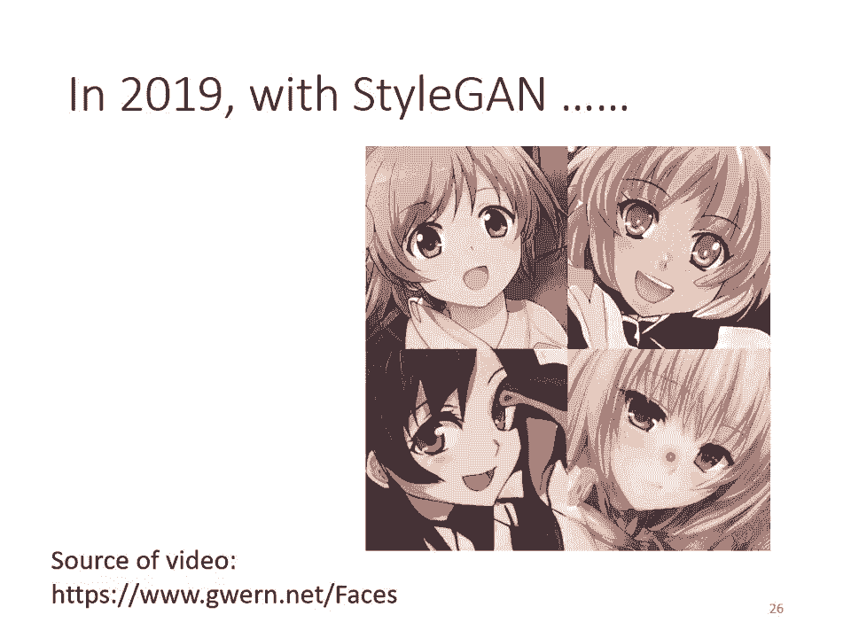
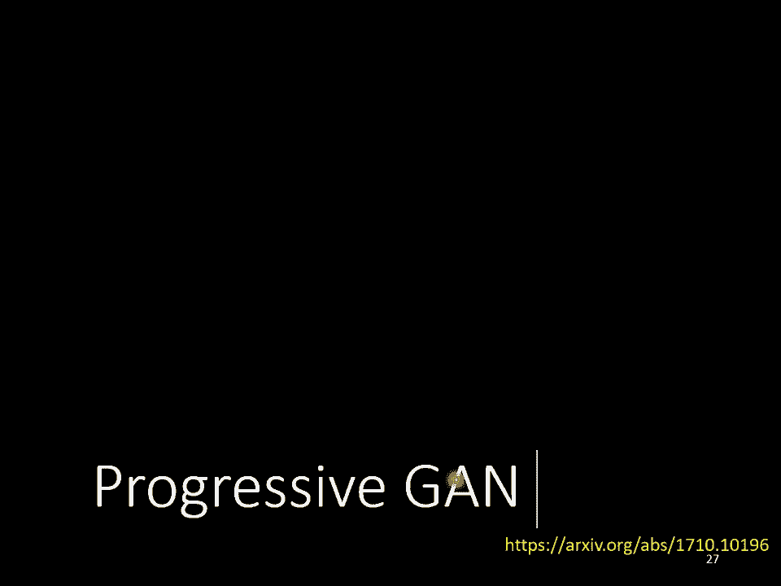
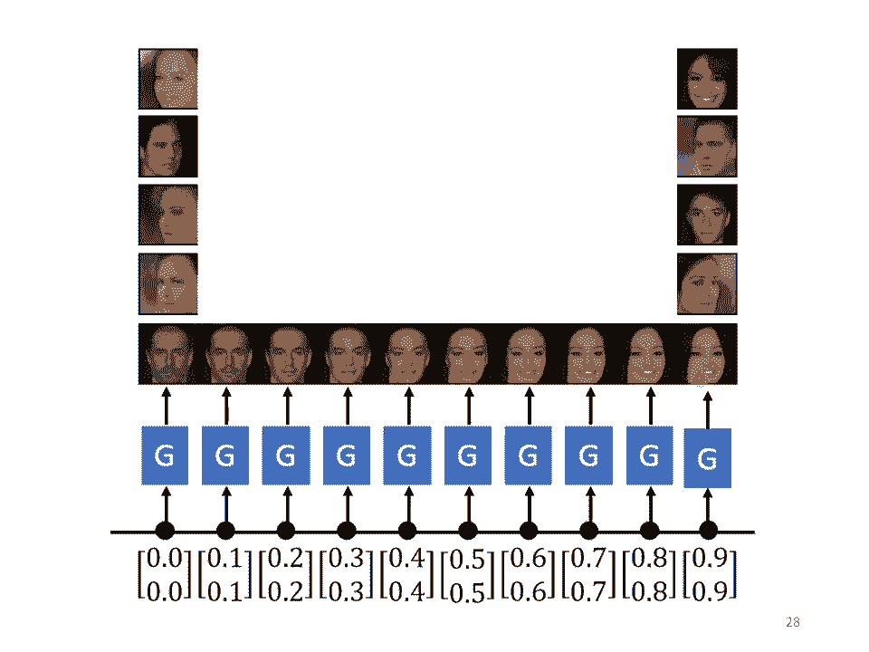
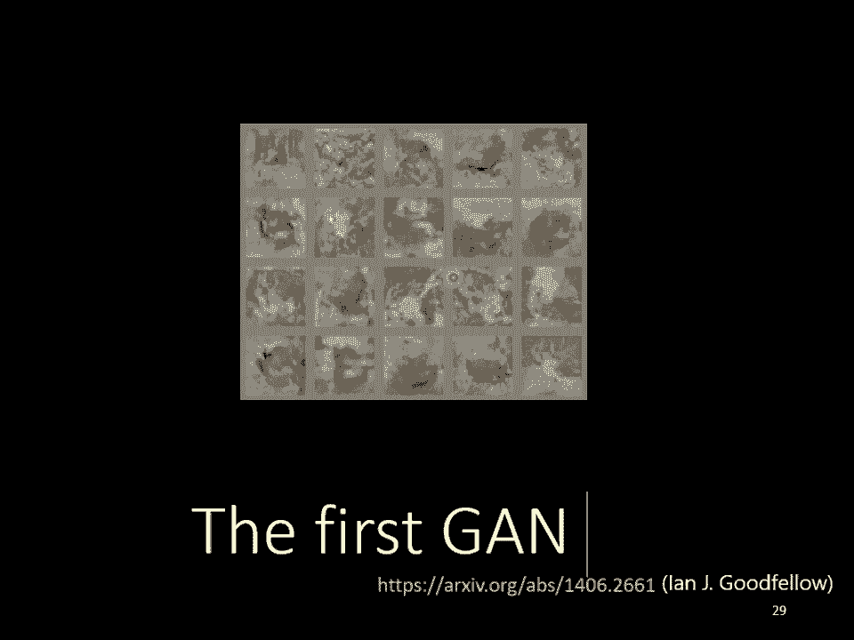

# 14：L12.1 - 生成式对抗网络1：基本概念介绍 🎭

在本节课中，我们将要学习生成式对抗网络的基本概念。我们将了解什么是生成器，为什么需要它，以及它如何与判别器协同工作来生成新的数据，例如图像。

---

## 什么是生成器？

到目前为止，我们学到的网络都是一个函数，给它一个输入 `x`，就可以输出一个 `y`。我们已经学到各种各样的网络架构可以处理不同的 `x` 和 `y`。

接下来我们要进入一个新的主题，这个主题是要把网络当作一个生成器来用。把网络拿来当作生成器使用有什么特别的地方呢？特别的地方是，现在网络的输入会加上一个随机的变量 `z`。这个 `z` 是从某一个分布中采样出来的。

所以现在网络不是只看一个固定的 `x` 得到输出，它是同时看 `x` 和 `z` 得到输出。`z` 特别的地方是，它是不固定的。每一次我们用这个网络的时候，都会随机生成一个 `z`，所以 `z` 每次都不一样。

这个分布必须足够简单。所谓足够简单，意思是我们知道它的式子长什么样子，我们可以从这个分布去做采样。举例来说，这个分布可以是一个高斯分布，也可以是均匀分布。

所以每次有一个 `x` 进来的时候，你都从这个分布里面做一个采样，然后得到一个输出 `y`。随着你采样到的 `z` 不同，`y` 的输出也就不一样。所以这个时候，我们的网络的输出不再是单一一个固定的东西，而变成了一个复杂的分布。这种可以输出一个分布的网络，我们就叫它生成器。

---

## 为什么需要生成器？

在讲怎么训练生成器之前，我们第一个想要回答的问题是，为什么我们需要训练生成器？为什么我们需要生成器？输入 `x` 输出 `y`，这样固定的输入跟输出关系不好吗？为什么需要输出是一个分布呢？

以下就举个例子来说明，为什么输出有时候需要是一个分布。这边举的例子是视频预测，就是给机器一段的影片，然后它要预测接下来会发生什么事情。

如果你用监督学习的方法训练下去，你得到的结果可能会是模糊的，并且会出现错误。例如，在预测小精灵游戏画面时，小精灵走到转角可能会“分裂”。这是因为在训练资料里面，同样的输入（转角），有时小精灵往左转，有时往右转。网络学到的就是“两面对好”，输出一个同时接近向左转和向右转的结果，但这反而是不对的。

一个可能性就是，让机器的输出是有概率的，让它不再是输出单一的输出，让它输出一个概率的分布。当我们的输出是一个分布时，就可以包含多种正确的可能性。

---

## 生成式对抗网络简介

生成式模型其中一个非常知名的就是生成式对抗网络，它的缩写是 **GAN**。我们这堂课主要就是介绍生成式对抗网络。

在 GAN 中，一个特别的地方就是，除了生成器以外，我们还要多训练一个东西，这个东西叫做判别器。

### 判别器的作用

判别器的作用是，它会拿一张图片作为输入，输出一个数值。这个判别器本身也是一个神经网络。它输出一个标量，这个标量越大就代表现在输入的这张图片越像是真实的目标图片（例如真实的二次元人物头像）。

### GAN 的基本概念

GAN 的基本概念可以用一个演化的故事来比喻。生成器就像是枯叶蝶，而判别器就像是它的天敌（例如波波、比比鸟）。生成器的目标是生成足以“骗过”判别器的数据，而判别器的目标是更好地分辨真实数据和生成数据。它们在这种对抗中共同进化，使得生成器产生的数据越来越逼真。

在实际算法中，生成器和判别器是两个神经网络。训练过程分为两步，反复进行：
1.  **固定生成器，训练判别器**：让判别器学会区分真实数据和当前生成器产生的假数据。
2.  **固定判别器，训练生成器**：调整生成器的参数，使其产生的数据能让判别器给出高分（即判别器认为它是真实的）。

---

## 一个例子：生成二次元人物头像

我们举一个例子，让机器生成动画人物的二次元人脸。这是一个无条件生成的例子（先不考虑条件 `x`）。

*   我们的生成器，输入是 `z`，输出是 `y`。
*   输入的 `z` 是一个从正态分布采样出来的低维向量（例如维度为 50 或 100）。
*   生成器输出一个非常高维的向量（例如 64x64x3），整理后就是一张图片。

我们希望不管采样到什么 `z`，输出都是动画人物的人脸。通过 GAN 的训练，生成器能学会将简单的正态分布映射到复杂的人脸图像分布。

---

## GAN 的训练过程演示

以下是训练 GAN 生成二次元人脸的一个可能过程：
*   训练 100 次后：输出看起来是杂乱无章的。
*   训练 1000 次后：机器学会了生成“眼睛”。
*   训练 2000 次后：“嘴巴”出现了。
*   训练 5000 次后：开始有人脸的形状，并且学会了“水汪汪的大眼睛”。
*   训练 10000 次后：形状更清晰，但有些模糊。
*   训练 50000 次后：可以产生出较为完整、多样的人脸图像。

在实际中，如果有更好的资料和更先进的 GAN 变体（如 StyleGAN），可以产生非常逼真、高清的人脸图像，甚至达到“以假乱真”的程度。

---

## GAN 的能力与应用

GAN 不仅可以生成静态图像，还可以通过操作输入向量 `z` 来实现有趣的效果：
*   **插值**：在两个输入向量之间进行插值，可以看到生成图像之间的平滑过渡（例如从严肃到微笑，从左看到右看）。
*   **创造新概念**：有时会生成一些现实中不存在的、融合了多种特征的“幻想”图像。

---

## 总结

本节课中，我们一起学习了生成式对抗网络的基本概念。
*   我们首先介绍了**生成器**，它通过引入随机变量 `z`，使网络能够输出一个分布，而不仅仅是单一值。
*   我们探讨了为什么需要这种能输出分布的模型，特别是在处理具有多种可能正确答案的任务时（如视频预测、绘画、对话）。
*   我们详细讲解了 **GAN** 的框架，包括**生成器**和**判别器**的角色，以及它们之间对抗又合作的训练过程。
*   我们通过生成二次元人物头像的例子，直观地展示了 GAN 的训练步骤和效果。
*   最后，我们了解了 GAN 的强大能力，如图像生成、插值和创造新概念。

GAN 是生成式模型中的一个重要里程碑，为机器“创造”内容打开了大门。在接下来的课程中，我们将更深入地探讨 GAN 的理论细节和其他变体。