# 15：L12.2- 生成式对抗网络2：理论介绍与WGAN 🧠

在本节课中，我们将深入探讨生成式对抗网络的理论基础，并介绍一种重要的改进版本——WGAN。我们将从训练目标出发，解释GAN为何能工作，并分析原始GAN的局限性，最后讲解WGAN如何通过改变距离度量来解决这些问题。

## 训练目标：最小化分布差异 🎯

上一节我们用比喻和实际操作介绍了GAN的运作方式。本节中，我们来看看其背后的理论。首先，我们需要弄清楚训练生成器的目标究竟是什么。

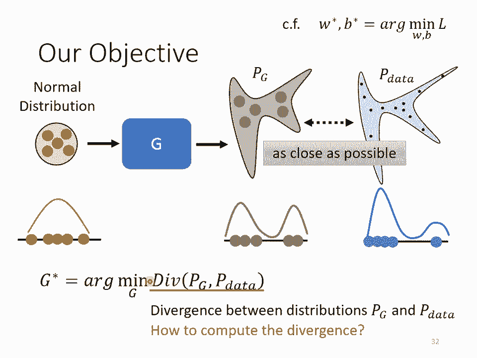

训练神经网络时，我们需要定义一个损失函数，然后通过梯度下降调整参数以最小化该损失函数。在生成问题中，我们想要最小化或最大化的目标是什么呢？

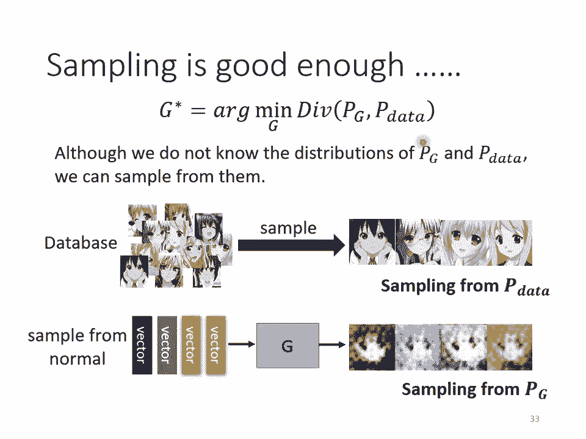

我们有一个生成器G，输入是从简单分布（如正态分布）中采样出的大量向量z，输出会形成一个复杂的分布，我们称之为 **Pg**（生成分布）。
同时，我们有一堆真实的图像数据，它们形成了另一个分布，称之为 **Pdata**（真实数据分布）。
我们的目标是让 **Pg** 和 **Pdata** 越接近越好。

用公式表示，我们的目标是找到一个生成器G，最小化这两个分布之间的差异（Divergence）：
`G* = arg min_G Div(Pg, Pdata)`
其中，Divergence是衡量两个分布相似度的一种度量。Divergence越小，代表两个分布越相近。

然而，我们遇到了一个核心难题：对于这种连续的复杂分布，我们几乎无法直接计算出像KL散度或JS散度这样的Divergence。既然算不出Divergence，我们又该如何寻找一个G来最小化它呢？

## GAN的巧妙解法：通过判别器估算差异 🔄

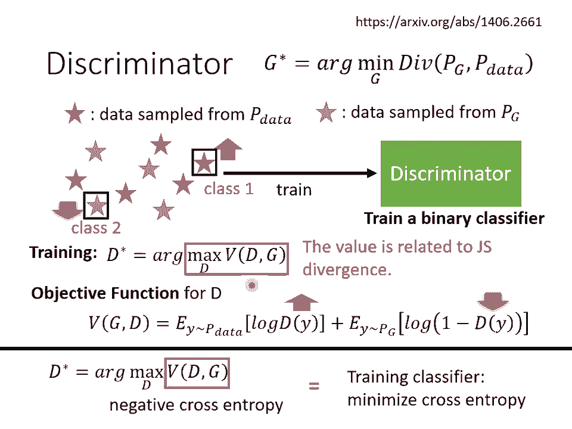

GAN提供了一个巧妙的解决方案，它突破了无法直接计算Divergence的限制。

GAN告诉我们：**只要你知道如何从Pg和Pdata这两个分布中采样样本，就有办法估算出Divergence。** 你不需要知道Pg和Pdata具体的数学形式，只要能采样即可。
*   从Pdata采样：从你的真实图像库中随机抽取图片即可。
*   从Pg采样：从正态分布中采样向量z，输入生成器G，得到生成的图片。

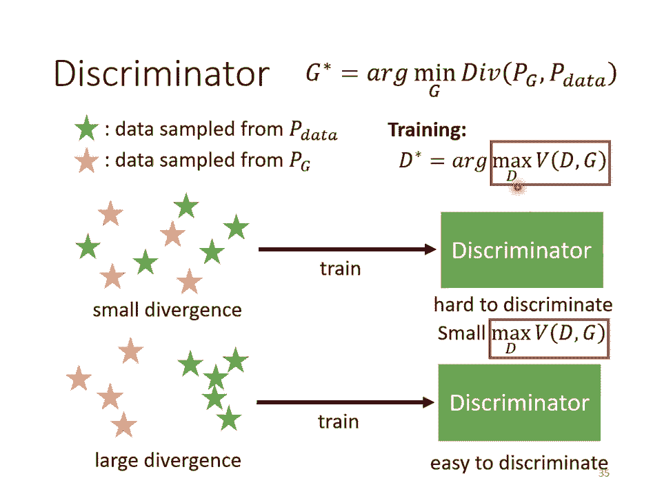

那么，如何通过采样来估算Divergence呢？这就要依靠判别器D的力量。

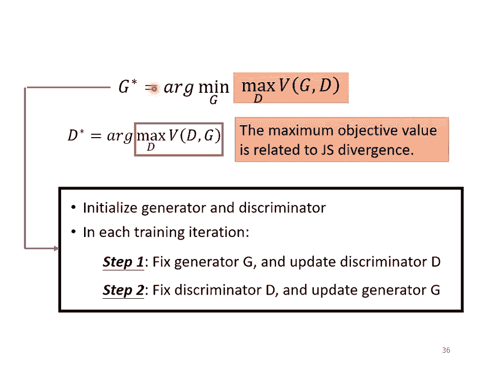

以下是判别器的训练过程：
我们有一大批真实数据（从Pdata采样）和生成数据（从Pg采样）。我们训练一个判别器D，目标是给真实数据打高分，给生成数据打低分。

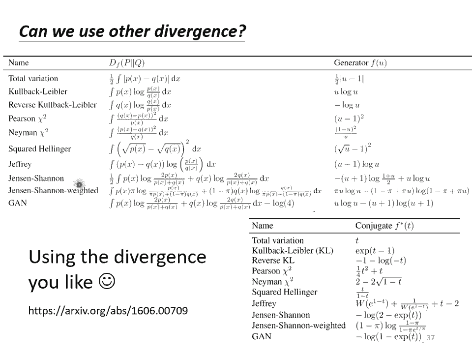

这个过程可以写成一个优化问题。我们要找到一个判别器D，最大化以下目标函数V(G, D)：
`max_D V(D, G) = E_(y~Pdata) [log D(y)] + E_(y~Pg) [log(1 - D(y))]`
*   `E_(y~Pdata) [log D(y)]`：期望真实数据y经过判别器D的输出值D(y)越大越好。
*   `E_(y~Pg) [log(1 - D(y))]`：期望生成数据y经过判别器D的输出值D(y)越小越好。

这个目标函数其实就是**交叉熵取负号**。最大化它等价于在训练一个二元分类器（真实数据为类别1，生成数据为类别2）。

**最神奇的地方在于**：当我们穷举所有可能的判别器D，并找到能使V(D, G)最大的那个D*时，此时的最大值 `max_D V(D, G)` 与 **Pg 和 Pdata 的JS散度（JS Divergence）** 直接相关。
因此，我们虽然无法直接计算JS散度，但通过训练判别器并观察其目标函数的最大值，就可以间接地衡量出两个分布的差异。

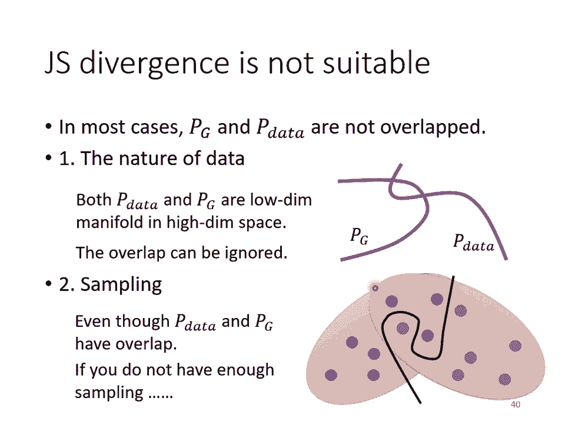

## 生成对抗：一个极小极大问题 ⚔️

现在，我们可以将最初的目标——最小化Pg和Pdata的差异（JS散度）——用判别器的目标函数来替换。于是，生成器G的训练目标变成了：
`min_G max_D V(D, G) = E_(y~Pdata) [log D(y)] + E_(y~Pg) [log(1 - D(y))]`
这是一个**极小极大问题**：对于外层的min_G，我们要找到一个生成器G；对于内层的max_D，在给定G的情况下，我们要找到一个判别器D来最大化V(D, G)。生成器和判别器相互对抗、迭代训练的过程，正是在求解这个优化问题。

## JS散度的问题与WGAN的提出 🚧

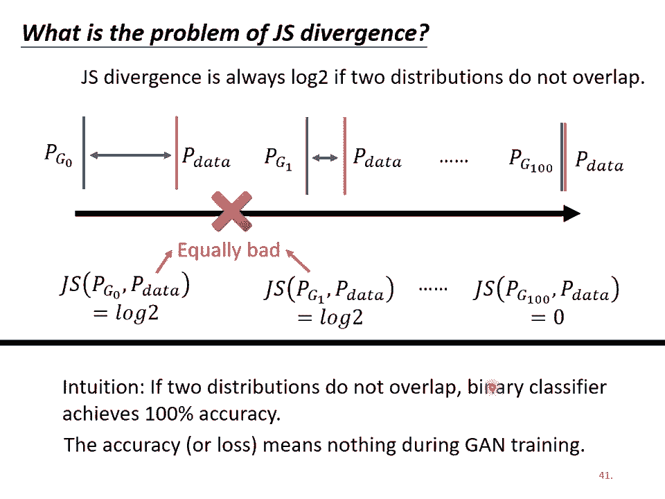

然而，使用JS散度作为衡量标准在实践中存在一个严重问题，导致原始GAN非常难以训练。

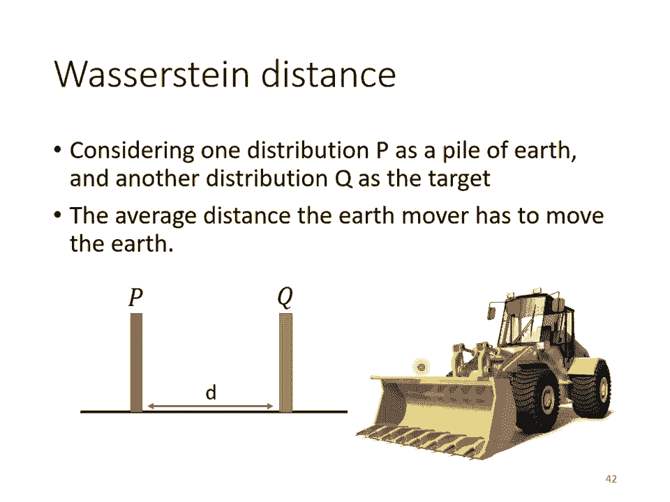

问题的根源在于，在图像生成这类高维空间中，**Pg 和 Pdata 这两个分布往往几乎没有重叠**。原因有二：
1.  图像本质上是高维空间中的低维流形，其分布非常狭窄。两个低维流形在高维空间中，若不重合，其交集几乎可以忽略。
2.  即使两个分布有重叠，由于我们只能通过有限采样来了解它们，如果采样点不够密集，对于判别器来说，这两组点仍然是完全可分离的。

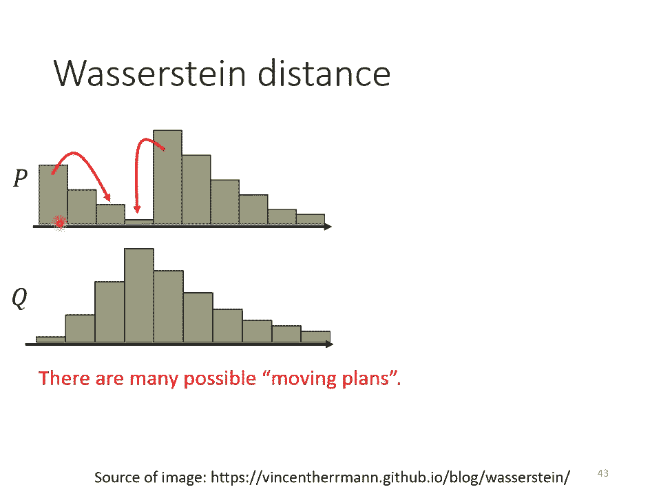

**JS散度在应对两个没有重叠的分布时，会给出一个恒定值 log2**。这意味着，无论你的生成器是让Pg距离Pdata很远（差）还是很近（好），只要它们没有完全重合，JS散度算出来都是同样的值log2。生成器的梯度会消失，无法通过梯度下降有效地更新参数，从而“不知道”该往哪个方向改进。

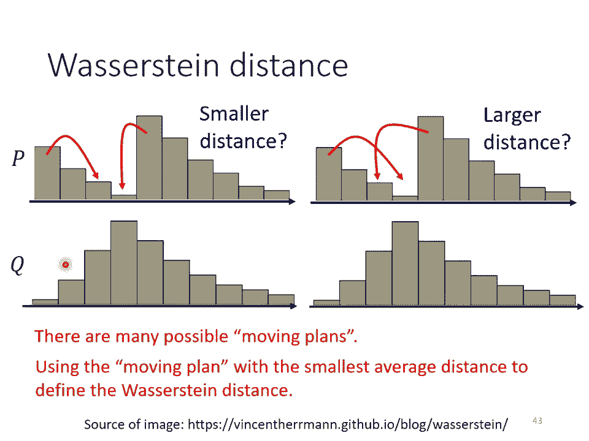

从实践角度看，这导致判别器（作为二元分类器）总能轻易达到接近100%的准确率，其损失值不再包含生成器是否进步的可靠信息。训练者只能靠肉眼观察生成结果来判断训练进程，使得训练过程如同“黑魔法”。

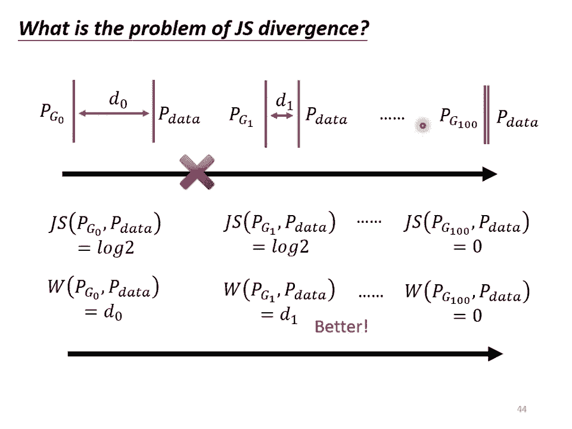

## 解决方案：Wasserstein距离（推土机距离） 🚜

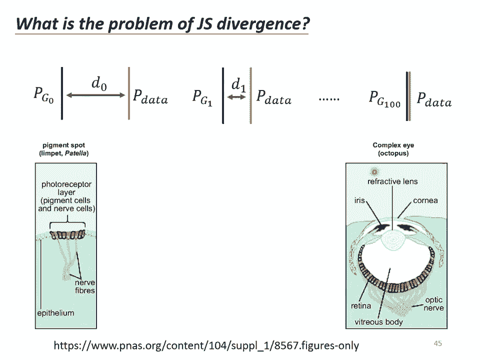

既然JS散度有问题，一个自然的想法是换一种衡量分布差异的方式。WGAN（Wasserstein GAN）提出使用 **Wasserstein距离**（也称Earth-Mover Distance，推土机距离）。

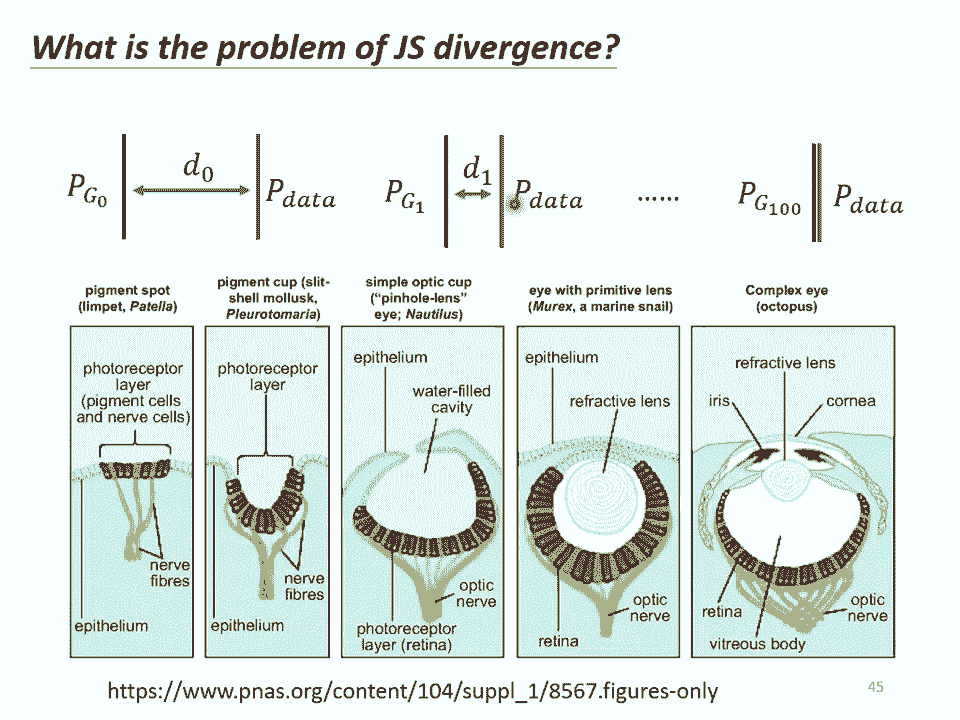

Wasserstein距离的直观理解是：将一个分布P的“土堆”挪动成另一个分布Q的形状，所需移动的“土方”的最小平均距离。
*   如果P和Q是两个相距很远的点分布，W距离就是它们之间的距离D。
*   如果P和Q是两个复杂的分布，则需考虑所有可能的“搬运方案”，并取其中平均移动距离最小的那个方案，其距离即为W距离。

**Wasserstein距离的关键优势在于，即使两个分布没有重叠，它也能提供一个平滑变化的度量值。**
*   当Pg和Pdata距离较远时，W距离较大。
*   当Pg逐渐靠近Pdata时，W距离会平滑地减小。
这为生成器提供了有意义的梯度信号，使其能够逐步改进，解决了JS散度带来的梯度消失问题。

## WGAN的实现：如何计算Wasserstein距离？ ⚙️

那么，如何计算Pg和Pdata之间的Wasserstein距离呢？理论证明，W距离等价于求解以下优化问题：
`W(Pdata, Pg) = max_(D∈1-Lipschitz) { E_(y~Pdata) [D(y)] - E_(y~Pg) [D(y)] }`
与原始GAN的目标函数相比，WGAN的判别器（此时常称为Critic）的目标是：
*   最大化真实数据y的判别器输出D(y)。
*   最小化生成数据y的判别器输出D(y)。
*   同时，判别器D必须满足 **1-Lipschitz连续** 的限制。直观理解，这个限制要求判别器函数足够“平滑”，不能变化剧烈。

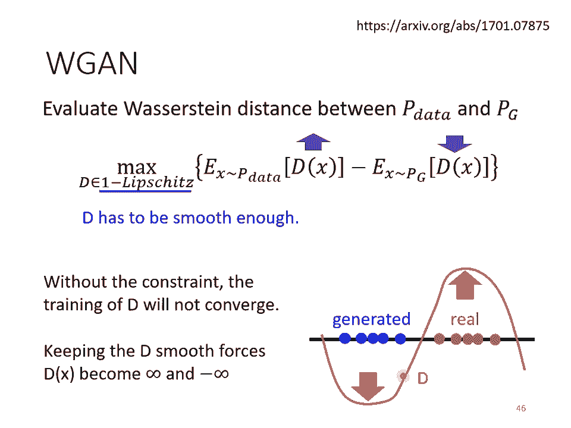

**1-Lipschitz限制至关重要**。如果没有这个限制，判别器会给真实数据输出无限大的正值，给生成数据输出无限大的负值，导致训练无法收敛且无法提供有意义的距离度量。加上平滑限制后，当两个分布距离较远时，判别器的输出差值可以较大（W距离大）；当两个分布较近时，即使它们不重合，判别器的输出差值也会被限制得较小（W距离小），从而真实反映了分布间的“远近”。

如何在实际中实施这个1-Lipschitz限制呢？主要有以下几种方法：
*   **权重裁剪（Weight Clipping）**：原始WGAN论文采用的方法，在参数更新后强制将判别器的权重限制在某个区间[-c, c]内。这是一种简单但较粗糙的近似。
*   **梯度惩罚（Gradient Penalty）**：出自《Improved Training of Wasserstein GANs》。该方法在真实数据和生成数据样本的连线区域中随机采样点，并约束这些点处判别器梯度的范数接近1。
*   **谱归一化（Spectral Normalization）**：一种更严格且有效的方法，通过对判别器每一层权重进行谱范数归一化，来保证其满足Lipschitz约束。这是目前训练高质量GAN的常用技巧。

## 总结 📝

本节课中我们一起学习了：
1.  **GAN的理论目标**是让生成分布Pg逼近真实数据分布Pdata，即最小化二者之间的差异（Divergence）。
2.  **GAN的巧妙之处**在于通过训练一个判别器D来最大化目标函数 `V(D, G)`，而这个最大值与JS散度相关，从而间接地衡量并优化了分布差异。
3.  **原始GAN的缺陷**源于JS散度的特性：当Pg和Pdata没有重叠或重叠很少时，JS散度会饱和（恒为log2），导致生成器梯度消失，训练困难且不稳定。
4.  **WGAN的改进**是用Wasserstein距离替代JS散度。W距离即使在不重叠的分布间也能提供平滑、有意义的梯度，极大地改善了训练的稳定性。
5.  **WGAN的实现**需要优化一个带有1-Lipschitz约束的目标函数，实践中可通过权重裁剪、梯度惩罚或谱归一化等技术来满足该约束。

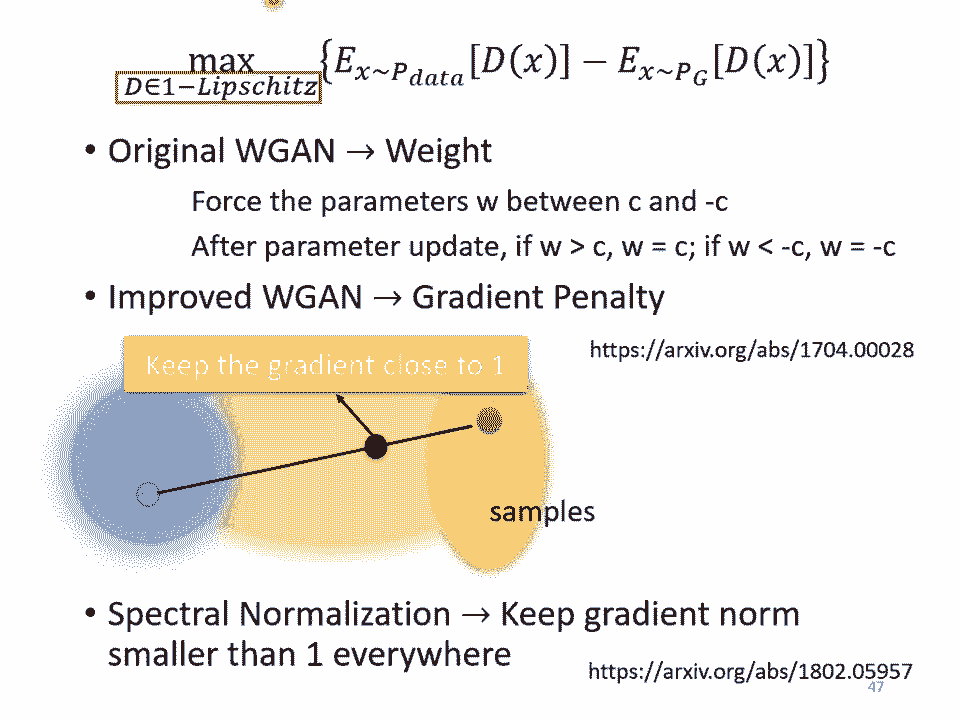

通过理解这些理论，我们不仅明白了GAN为何有效，也清楚了其训练难点及WGAN等改进方法的由来，为实际应用和进一步研究打下了基础。