# 16：L12.3 - 生成式对抗网络3：生成器评估与条件式生成 🧠🎨

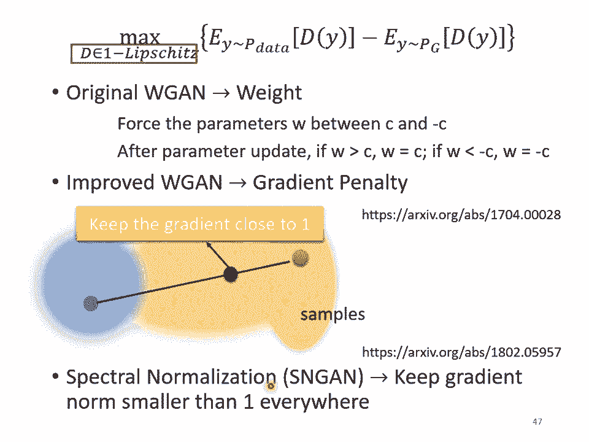

在本节课中，我们将要学习生成式对抗网络的进阶内容，包括如何评估生成器的好坏，以及如何实现条件式生成，让生成器根据特定输入（如文字或图片）来产生对应的输出。

## 一、GAN训练的固有困难

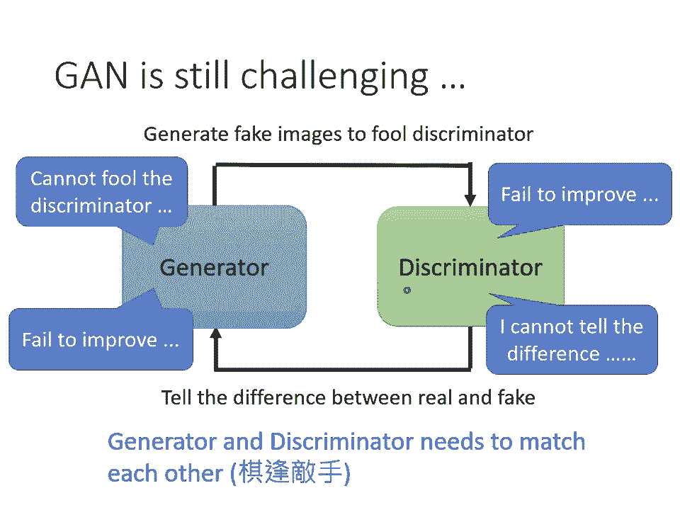

上一节我们介绍了WGAN及其改进。虽然WGAN缓解了训练不稳定的问题，但GAN本质上仍然以难以训练而闻名。

GAN训练困难的根本原因在于生成器和判别器之间的动态博弈关系。判别器的任务是区分真实图片和生成器产生的假图片。生成器的任务则是产生足以骗过判别器的假图片。两者相互砥砺，共同成长。

以下是训练过程中的关键点：

*   只要其中一方训练出现问题而停止进步，另一方也会随之停滞。
*   训练过程是自动的，我们无法在每次迭代中都手动调整超参数，因此只能期望判别器每次的损失都能顺利下降。
*   生成器和判别器必须实力相当，任何一方“放弃比赛”，整个训练过程就会崩溃。

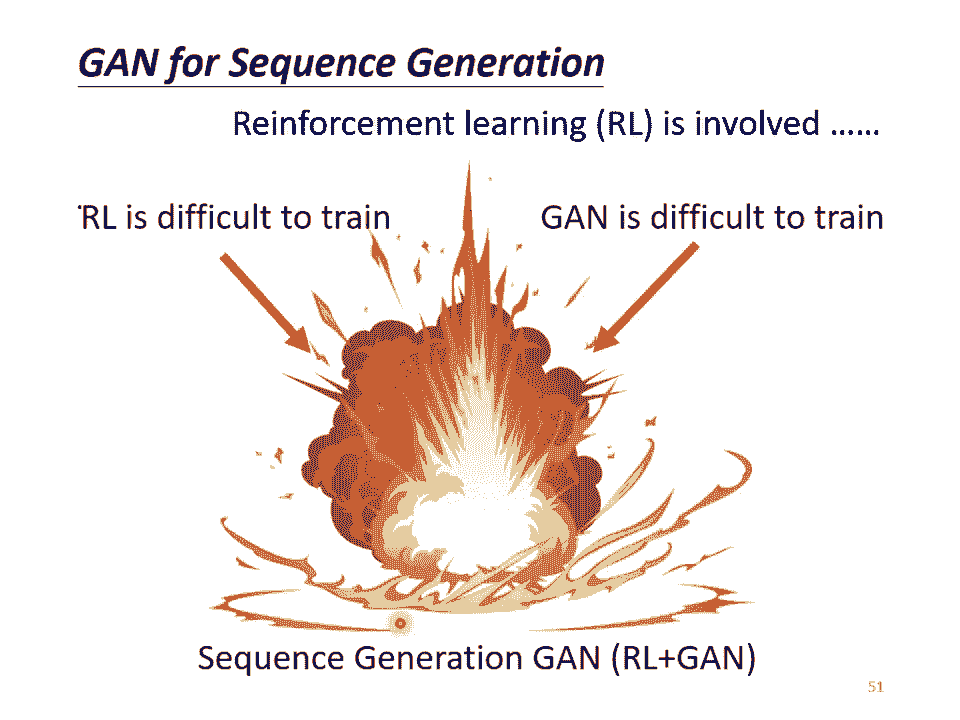

因此，训练GAN仍然不是一件容易的事。不过，由于GAN是一个重要且前沿的技术，我们有必要了解它。网络上存在大量相关的代码和技巧，从实践角度而言，它并没有想象中那么遥不可及。

## 二、用GAN生成文字的挑战

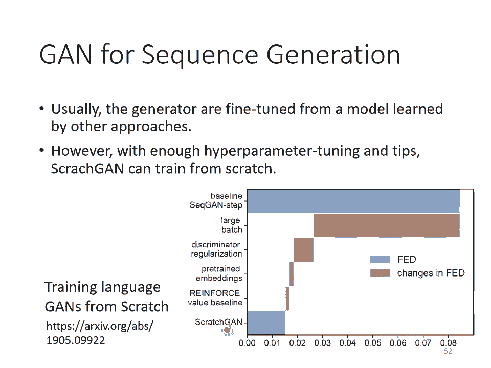

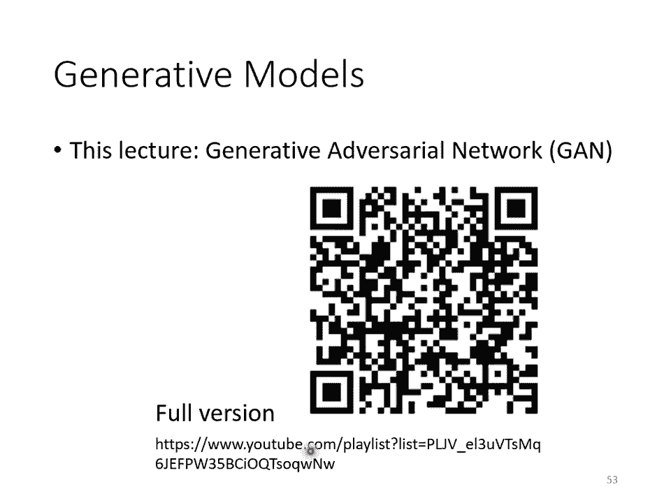

训练GAN最困难的任务之一是生成文字序列。为什么这比生成图像更难？

假设我们用一个序列到序列的解码器作为生成器来产生文字。从高层算法看，似乎与图像生成没有不同：训练一个判别器来区分真实文字和生成文字，生成器则努力骗过判别器。

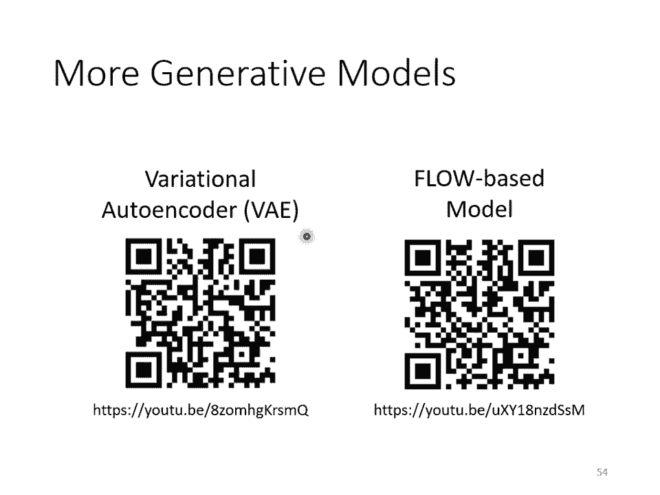

难点在于：我们无法使用梯度下降来训练这个文字生成器。因为当我们微调解码器参数时，其输出的token分布只有微小变化。在选取概率最大的token时，这个最大概率token很可能保持不变。对于判别器而言，输入没有变化，输出分数也就没有变化，导致梯度为零，无法进行有效的梯度下降。

> 注：这里的“token”是生成序列的基本单位，可以是字符、单词等，由任务定义决定。

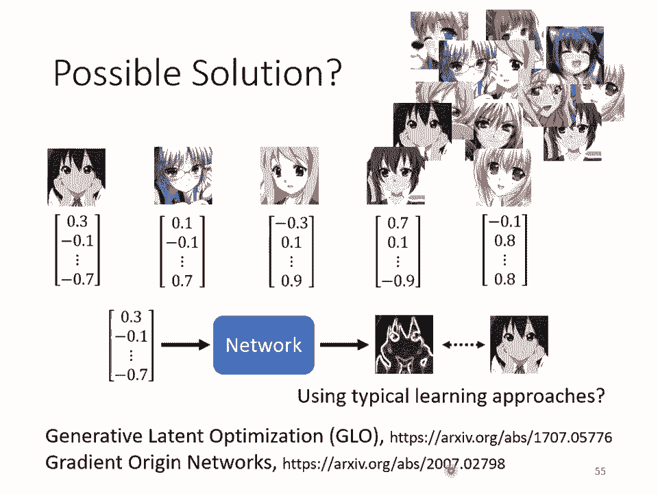

有同学可能会联想到CNN中的最大池化层也可以做梯度下降，为何此处不行？这个问题留给大家思考。

虽然无法直接用梯度下降，但我们可以将其视为强化学习问题来处理。然而，强化学习本身也以难训练闻名，与GAN的难训练特性叠加，使得训练变得极其困难。

## 三、文字生成GAN的突破

很长一段时间内，人们无法成功训练出能生成文字的GAN模型，通常需要先进行预训练。

直到一篇名为《ScratchGAN》的论文出现，它宣称可以直接从随机初始化的参数开始训练文字生成GAN。其成功的关键在于调优了大量超参数并应用了许多技巧，例如：
*   使用Sequence GAN Steps技术。
*   采用非常大的批次大小（通常上千）。
*   对判别器进行正则化。
*   对词嵌入进行预训练。
*   改进强化学习算法。

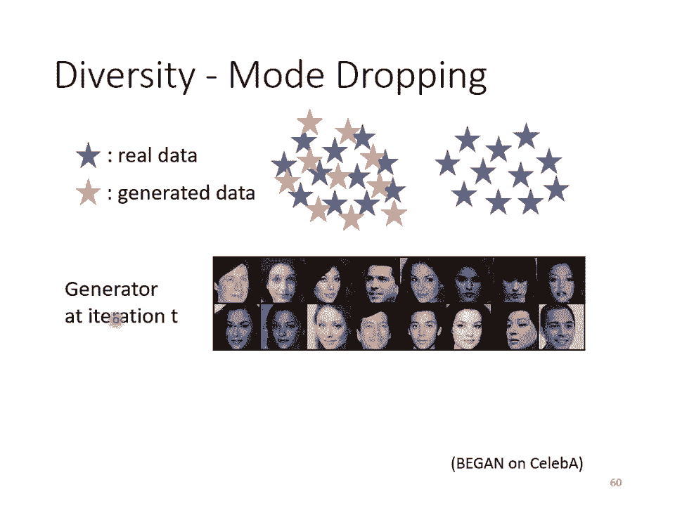

通过这些方法，最终实现了从零开始训练文字生成GAN。

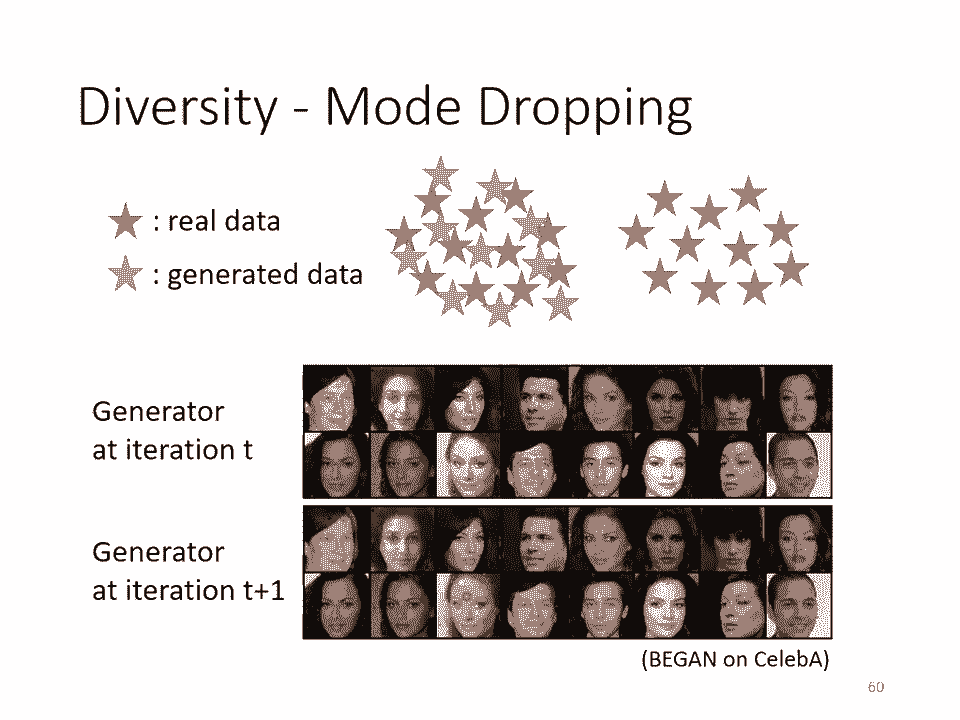

## 四、生成模型的比较

生成模型不止有GAN，还有变分自编码器和基于流的模型等。

本课程选择重点介绍GAN，主要基于以下原因：
*   **性能**：在生成高质量图片方面，GAN通常表现最佳。其他模型往往需要大量调优才能接近GAN的效果。
*   **训练难度**：虽然GAN训练不稳定，但VAE和基于流的模型也有其自身的训练难点（如目标函数平衡困难），训练难度并不亚于GAN。
*   **实用性**：本课程以实务为导向，目标是让大家掌握一种能实际训练生成器的方法。GAN是当前的主流选择。

对于其他生成模型，大家若有兴趣可以自行深入研究。

## 五、生成器的评估方法

评估一个生成器的好坏并非易事。早期研究甚至只能靠人眼观察和主观判断。

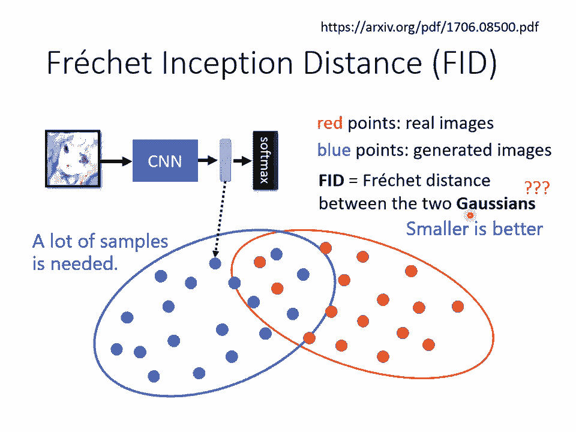

### 1. 针对特定任务的设计
对于特定任务，可以设计专门的评估标准。例如在生成动漫头像的作业中，可以使用人脸检测系统来统计生成图片中检测到的人脸数量。

### 2. 更通用的评估思路
对于更通用的生成任务，一个常见方法是借助一个预训练的图像分类网络。
*   将生成器产生的图片输入分类网络，得到类别概率分布 `P(c|y)`。
*   **质量评估**：单张图片对应的概率分布越集中，说明分类器越肯定其类别，可能意味着图片质量较高。
*   **多样性评估**：将大量生成图片的概率分布进行平均，若平均分布越平坦，说明生成图片的多样性可能越丰富。

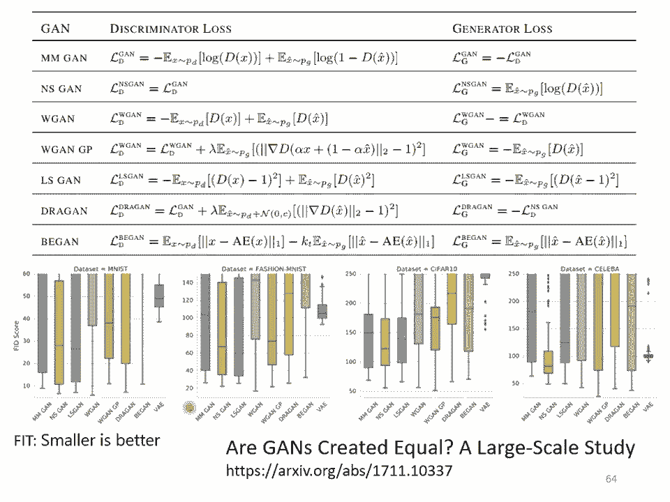

### 3. 模式崩溃与模式丢弃
在训练GAN时，常会遇到两个问题：
*   **模式崩溃**：生成器只产生非常有限的几种样本，多样性严重不足。例如，生成动漫头像时，最终所有输出都变成同一张脸。这是判别器的“盲点”被生成器抓住所致。目前尚无根本性解决方案，BigGAN等顶尖模型也会遇到此问题，常用策略是在崩溃前提前停止训练。
*   **模式丢弃**：生成器只学会了真实数据分布的一部分，而忽略了其他部分。例如，生成的人脸肤色全部偏白，忽略了其他肤色。这个问题更隐蔽，更难被检测。

### 4. 常用评估指标
*   **初始分数**：结合了质量和多样性的评估，值越大越好。但在某些特定领域（如动漫头像）可能不适用，因为分类网络可能将所有输出都识别为“人脸”，无法有效评估多样性。
*   **弗雷歇初始距离**：这是目前更常用的指标。
    1.  分别将真实图片和生成图片输入Inception网络，提取最后一层隐藏层的输出向量。
    2.  假设这两组向量服从高斯分布。
    3.  计算这两个高斯分布之间的弗雷歇距离。
    FID值越小，说明生成图片与真实图片的分布越接近，质量通常越好。在作业中，我们会结合FID和人脸检测数量等多个指标进行综合评估。

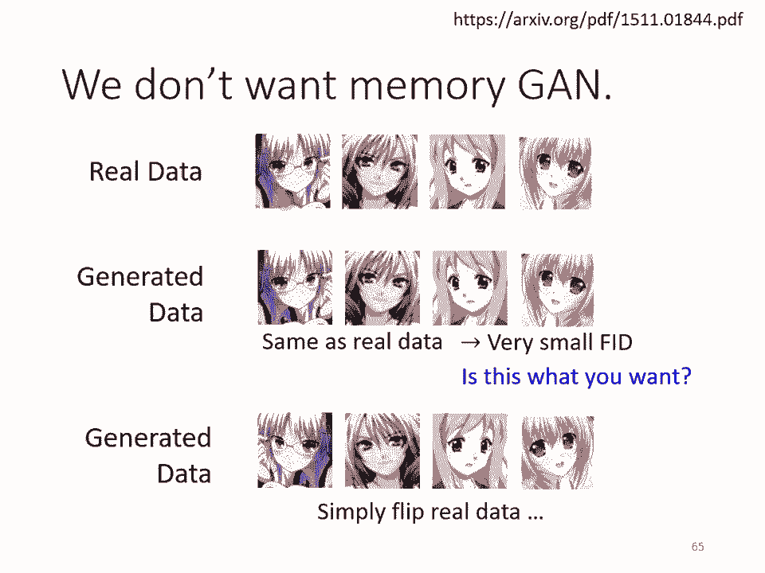

### 5. 评估的固有难题
即使FID分数很好，生成器也可能只是简单地“记忆”并复现了训练数据，或者对训练数据做了简单的变换（如左右翻转），这并非我们想要的“创造性”生成。因此，生成器的评估本身就是一个复杂的研究课题。

## 六、条件式生成

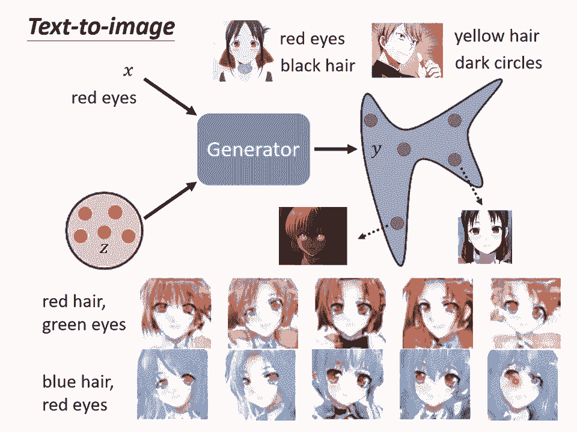

本节我们来看看如何实现条件式生成，即让生成器根据特定条件输入来产生输出。

### 1. 基本概念与应用
条件式生成器的输入除了随机向量 `Z`，还有一个条件 `X`，输出为 `Y`。应用包括：
*   **文字生成图片**：`X` 是一段文字描述，`Y` 是对应的图片。
*   **图片生成图片**：`X` 是一张图片，`Y` 是另一张相关的图片（如图片上色、风格转换、去雾等，这类任务常被称为Image Translation或Pix2Pix）。

### 2. 条件式GAN的结构
如果沿用普通GAN的判别器（只输入图片 `Y`），生成器会学会忽略条件 `X`，只产生清晰的图片来骗过判别器。

因此，条件式GAN的判别器需要同时接收图片 `Y` 和条件 `X` 作为输入。它的任务是判断“`Y` 是否真实，并且 `Y` 是否与 `X` 匹配”。

### 3. 训练数据与技巧
训练条件式GAN需要成对的标注数据。在训练判别器时，不仅需要“真实配对”作为正例、“生成配对”作为负例，通常还需要加入“错误配对”（即真实图片与不匹配的条件乱配）作为负例，这样能帮助判别器更好地学习到“匹配”的概念。

### 4. 监督学习与GAN的结合
对于图片生成图片的任务，如果只用监督学习，模型可能会对同一个输入的不同可能输出求平均，导致结果模糊。如果只用GAN，结果可能更真实但“想象力过于丰富”，添加输入中不存在的内容。因此，文献中最好的做法往往是结合两者：生成器的目标同时是“骗过判别器”和“让输出接近真实配对中的目标图片”。

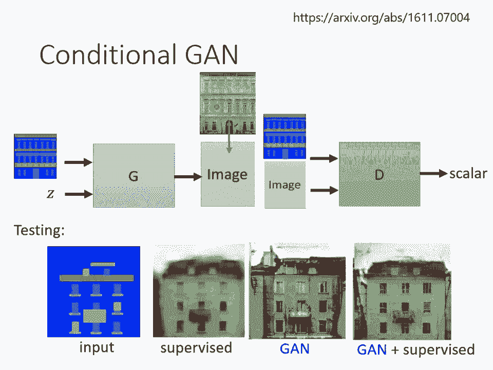

### 5. 其他有趣应用
条件式GAN还有更多创新应用，例如：
*   **声音生成图片**：利用视频中的音画对数据，训练模型根据一段声音生成想象的场景画面。
*   **静态图片生成动态视频**：输入一张人物肖像，生成该人物说话或做表情的动态视频。

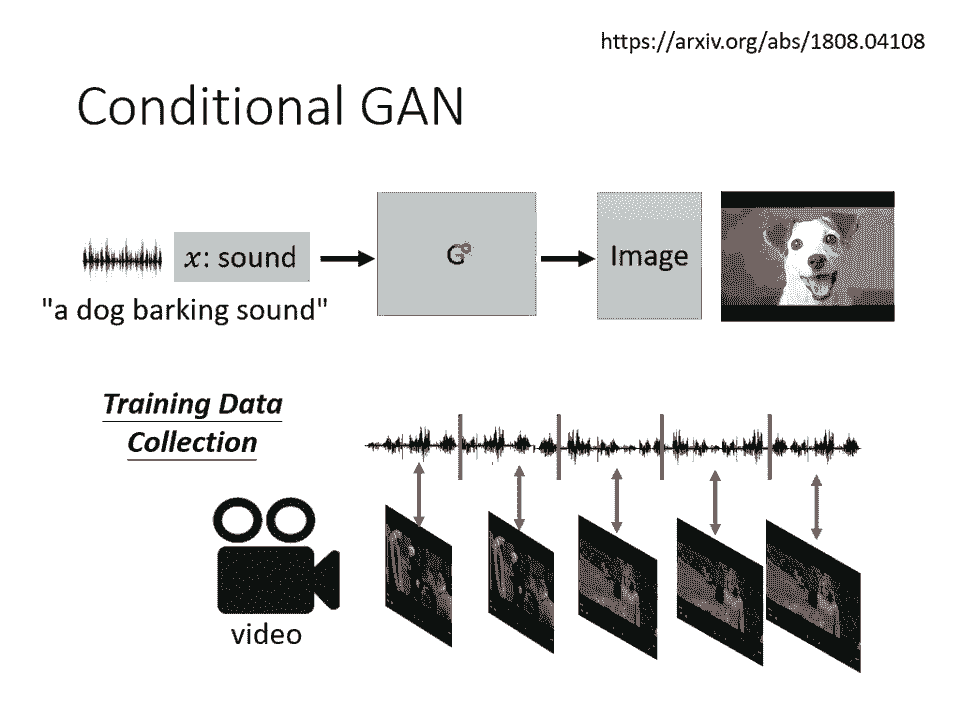

## 总结

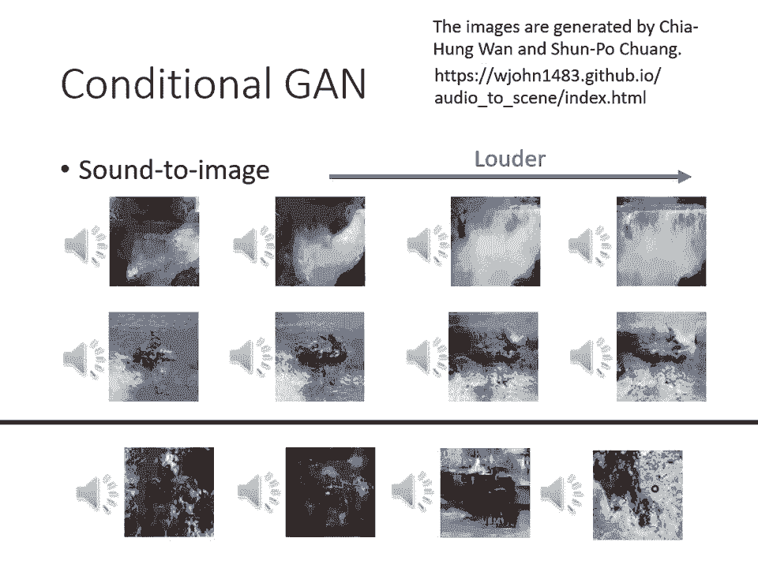

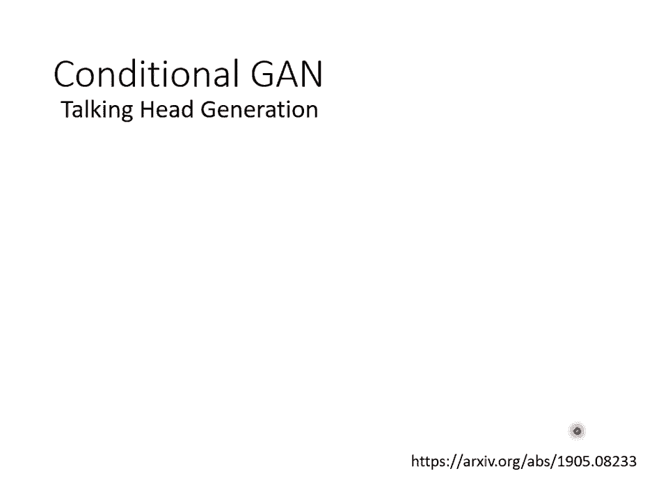

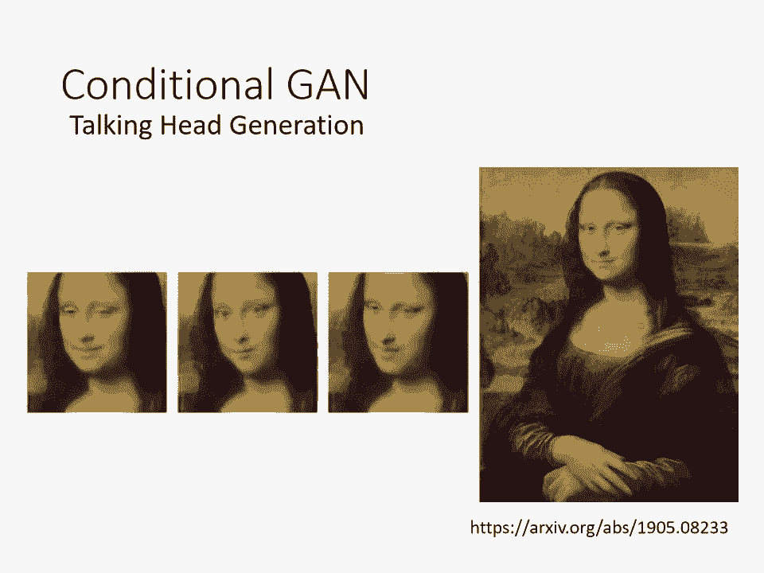

本节课中我们一起学习了生成式对抗网络的进阶内容。我们探讨了GAN训练困难的内在原因，以及用GAN生成文字序列的特殊挑战和突破。我们比较了不同生成模型，并重点介绍了如何评估生成器的性能，包括常用指标FID以及模式崩溃等难题。最后，我们深入了解了条件式生成，学习了如何通过改造判别器结构来实现根据文字或图片等条件输入来控制生成器的输出。这些知识将帮助我们更好地理解、训练和应用GAN这一强大的生成模型。