# 17：L12.4 - 生成式对抗网络4：CycleGAN 🌀

在本节课中，我们将要学习生成式对抗网络（GAN）的一个神奇应用——CycleGAN。我们将探讨如何在没有成对数据（即无监督学习）的情况下，训练网络完成图像风格转换等任务。

## 概述：GAN与无监督学习

我们常常听说GAN可以用于无监督学习。到目前为止，我们讲解的几乎都是监督学习：训练一个网络，输入为X，输出为Y，这需要成对的（X, Y）数据。

然而，你可能会遇到一种情况：我们有一堆X（例如真人照片），也有一堆Y（例如二次元头像），但X和Y之间是不成对的。这种没有成对标注的数据，我们称之为无标签数据。

关于如何使用这些无标签数据进行半监督学习，在作业3和作业5中提供了两个例子。如果你有兴趣，可以体验一下半监督学习能带来多大的帮助。

但是，无论是作业3的伪标签法，还是作业5的回译法，这些方法或多或少都需要一些成对数据作为起点。例如，伪标签法需要先训练一个模型来生成伪标签；回译法也需要一个回译模型。如果一开始就没有任何成对数据，这些方法就难以启动。

那么，什么时候会完全没有成对数据呢？一个典型的例子是图像风格转换。

## 图像风格转换的挑战 🖼️➡️🎨

假设我们要训练一个深度神经网络，将X域（例如真人照片）的图像转换成Y域（例如二次元头像）的图像。在这个任务中，我们可能没有任何成对的训练数据。因为要获得成对数据，意味着需要为每个真人（例如新垣结衣）拍摄照片，并请画师绘制对应的二次元版本，这显然成本极高。

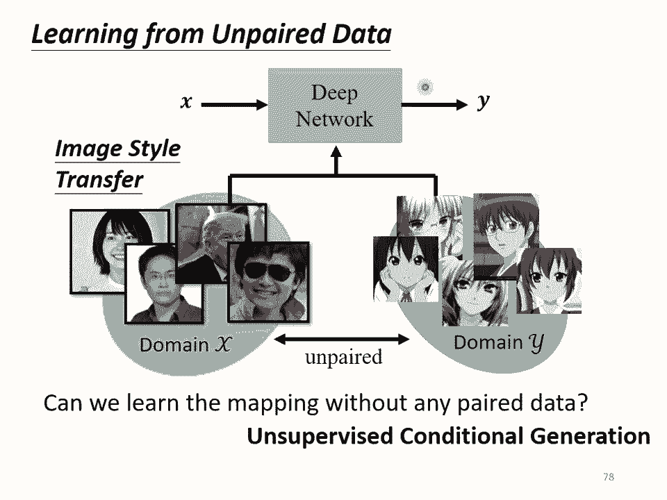

在这种情况下，我们是否还能训练一个网络，输入X并产生对应的Y呢？这就是GAN可以发挥作用的地方。接下来，我们将看看如何在完全没有成对数据的情况下进行学习。

## 从无条件生成到风格转换

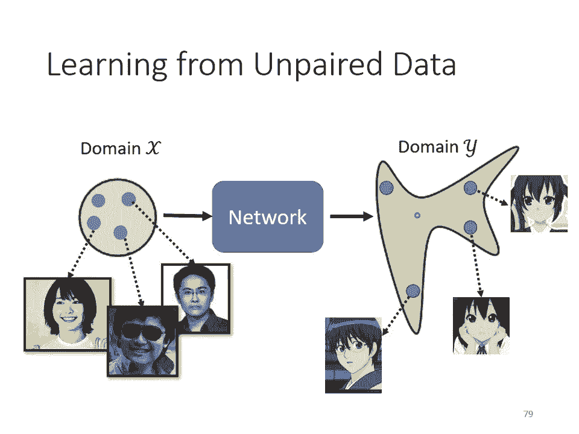

回顾我们之前讲过的无条件生成模型架构：

生成器（Generator）的输入是一个高斯分布，输出是一个复杂分布（如图像）。现在，我们转换一下思路：我们不把输入看作高斯分布，而是看作X域图像的分布；输出则看作Y域图像的分布。

我们能否训练这样一个生成器，输入X域图像的分布，输出Y域图像的分布呢？如果可以，问题就解决了——我们就得到了一个能将X域图像转换成Y域图像的模型。

乍看之下，这似乎不难。我们完全可以套用原始GAN的想法。在原始GAN中，我们从高斯分布采样一个向量，输入生成器。我们说过，输入不一定来自高斯分布，任何可采样的分布都可以。我们选择高斯分布只是因为其公式已知且易于采样。

现在，如果输入是X域的分布，我们只需要改为从X域采样即可。这很容易做到：从真人照片库中随机挑选一张照片出来，这就是一个采样点。将这张照片输入生成器，让它产生另一张图片。

如何确保输出是Y域的分布呢？这就需要引入一个判别器（Discriminator）。这个判别器看过很多Y域的图（二次元头像），因此它能分辨一张图是否属于Y域。看到Y域的图就给高分，看到非Y域的图就给低分。

这样看来，似乎和原始GAN的训练没什么不同。如果你想在作业中尝试，只需记得将生成器的输入采样方式，从高斯分布采样改为从真人照片库中采样。

## 直接套用GAN的不足

然而，仔细想想，仅仅套用原始GAN来训练生成器和判别器是不够的。问题在于：判别器的任务是让生成器输出一张Y域的图。生成器确实可能学会输出Y域的图，但它输出的Y域图，一定要和输入有关吗？

网络没有任何约束要求生成器必须建立输入与输出的关联。生成器可能完全无视输入，无论输入什么，它都输出一张看起来像二次元人物的图片。只要这张图能骗过判别器，训练目标就达成了。但这并不是我们想要的——我们希望输出的二次元头像与输入的真实照片在内容上保持一致。

那么，如何解决这个问题？如何强化输入与输出之间的关系呢？

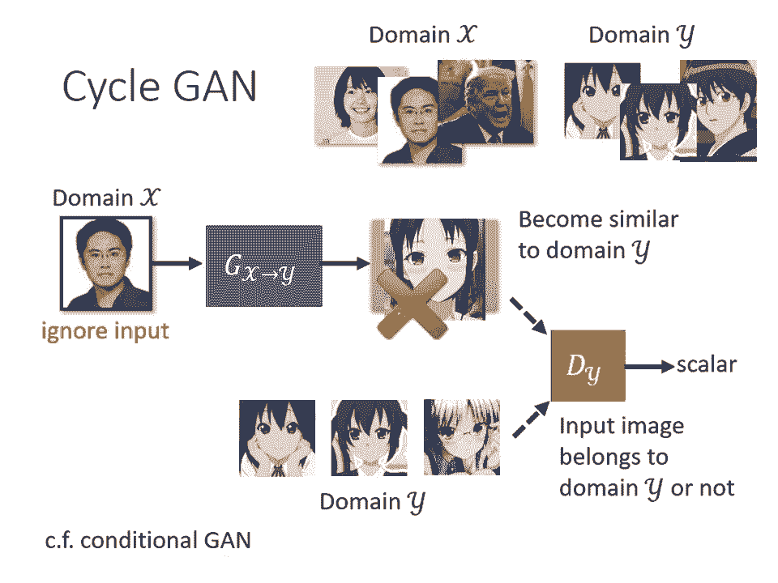

## 解决方案：CycleGAN 🔄

你会发现，在讲解条件GAN（Conditional GAN）时，我们也遇到过一模一样的问题：如果判别器只看输出Y，生成器可能会无视输入X。但在当前的无配对数据场景下，我们无法直接套用条件GAN的想法，因为条件GAN需要成对数据来训练判别器判断（X, Y）组合是否正确。

CycleGAN采用了一个巧妙的思路。在CycleGAN中，我们会训练两个生成器：
*   **生成器G**：负责将X域的图变成Y域的图。
*   **生成器F**：负责将Y域的图还原回X域的图。

在训练时，我们增加了一个额外的目标——**循环一致性（Cycle Consistency）**。我们希望：输入一张X域的图片，经过G转换成Y域后，再经过F转换回X域，得到的图片应该与原始输入图片越接近越好。

如何衡量两张图片的接近程度？很简单，一张图片可以看作一个高维向量，计算两个向量之间的距离（如L1或L2距离）即可，让这个距离越小越好。

因为这里有一个从X到Y再到X的循环，所以被称为CycleGAN。

## CycleGAN如何工作

现在，我们的目标有三个：
1.  生成器G要把X转成Y。
2.  生成器F要把Y转回X。
3.  判别器DY仍然要判断生成器G的输出像不像真实的Y域图片。

加入从Y到X的生成器F后，有什么不同呢？对于生成器G来说，它再也不能随意产生与输入无关的输出了。

假设输入是一个戴眼镜的真人照片（X域）。如果生成器G随意输出一个完全无关的二次元女性角色（Y域），那么生成器F在接收到这个角色后，根本无法将其还原回原来那张戴眼镜的真人照片。因此，为了满足循环一致性损失，生成器G在转换时，必须保留输入的关键特征（例如眼镜），输出一个戴眼镜的二次元男性角色。这样，生成器F才有可能将其还原。

所以，CycleGAN通过循环一致性约束，至少可以强迫生成器G的输出与输入X域的图片存在一定的内容关联。

## 理论局限与实际效果

你可能会问：CycleGAN只保证“有一些关系”，怎么知道这个关系就是我们想要的“内容一致，风格转换”呢？机器有没有可能学到一些奇怪的、但仍满足循环一致性的转换规则？

例如：
*   生成器G学到“看到眼镜就输出一颗痣”，生成器F则学到“看到痣就还原成眼镜”。
*   生成器G学到“把图片左右翻转”，生成器F也学到“把图片左右翻转”。

理论上，这些情况确实可能发生，CycleGAN无法绝对保证输入输出在内容上高度相似。目前也没有特别完美的理论解法。

然而，在实际应用中，这种问题并不容易出现。你会发现，使用CycleGAN时，输入和输出往往看起来非常像，只是风格发生了改变。甚至在实践中，有时不用CycleGAN，只用基础GAN也能完成风格转换，因为神经网络本身有“惰性”，它倾向于输出与输入相似的内容，而不愿做过于复杂的无意义变换。

总之，虽然CycleGAN在理论上没有绝对保证，但实际效果通常很好。

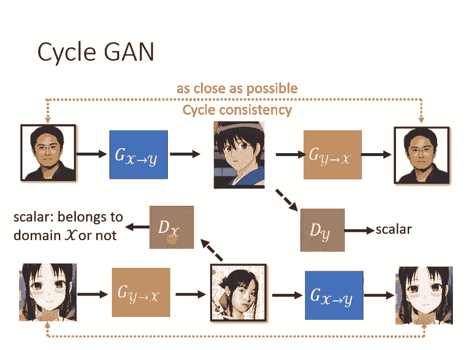

## 双向训练与同类模型

CycleGAN的训练是双向的。我们不仅可以从X到Y再到X，也可以从Y到X再到Y。这意味着我们同时训练两个方向的转换，并各自配备一个判别器（DX判别X域图片，DY判别Y域图片）。

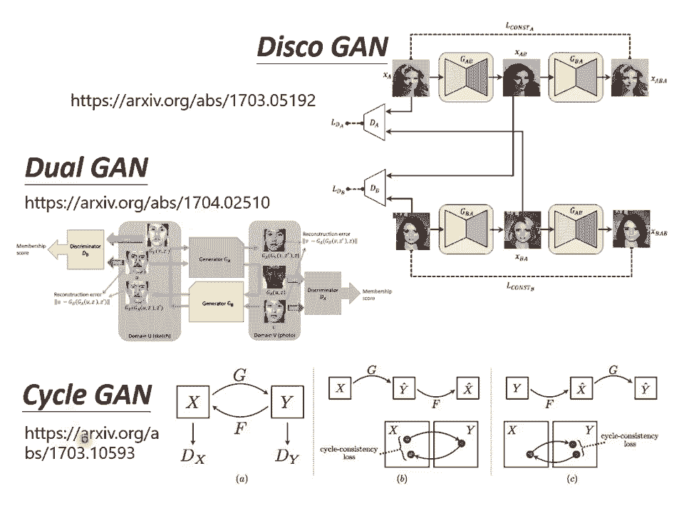

除了CycleGAN，你可能还听说过DiscoGAN、DualGAN等用于风格转换的GAN。它们与CycleGAN**没有本质不同**，是不同团队在几乎同一时间（2017年3月前后）独立提出的相同想法。

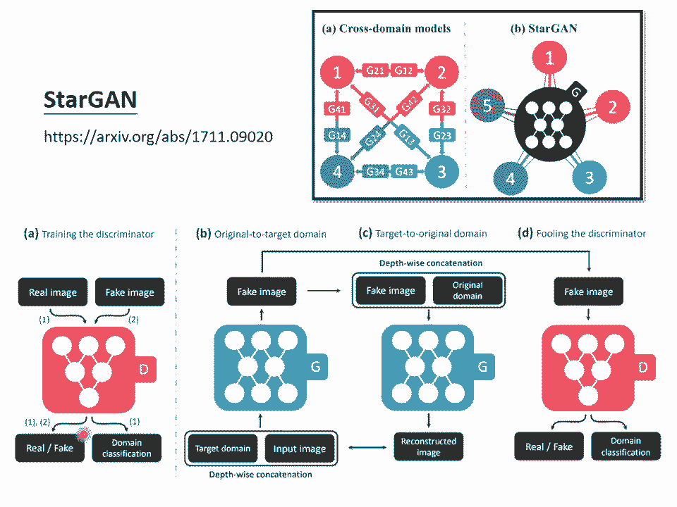

还有更进阶的StarGAN，它可以在多种风格间进行转换，而CycleGAN仅限于两种风格。不过，这超出了我们本节课的重点。

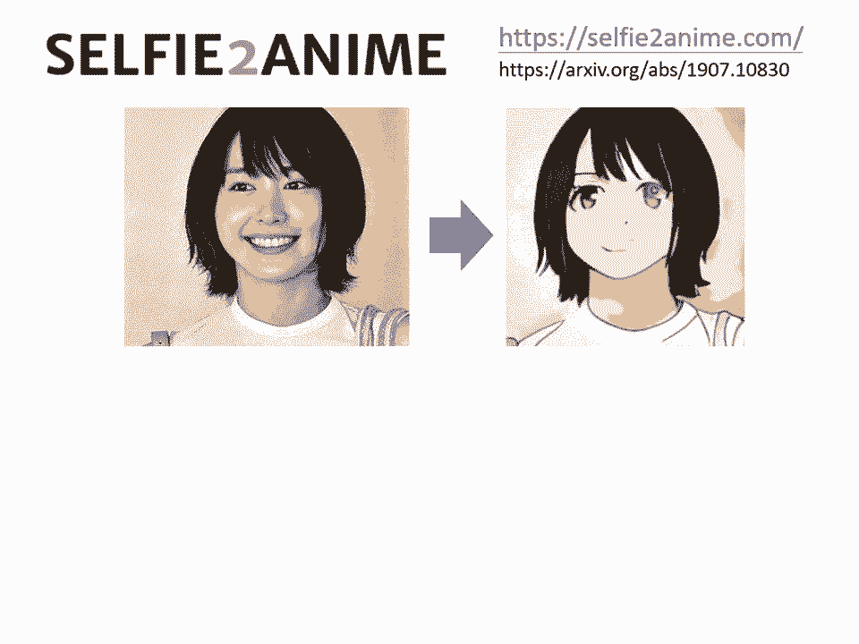

## 实际应用展示

真人脸转二次元人物在实际中是可以做到的。例如，某个韩国团队建立的网站就能实现此功能（他们使用了更进阶的GAN技术）。

实际测试表明，模型确实学到了一些二次元特征，比如把眼睛变大。当然，有时也会失败，例如转换结果可能两眼大小不一。

## 扩展到文字领域 ✍️

同样的技术不仅可以用于图像，也可以用于文字风格转换，例如将负面句子转成正面句子。

要实现这个，模型需要是一个序列到序列（Sequence-to-Sequence）的模型，可能会用到类似作业5中的Transformer架构。训练方式与CycleGAN一模一样：

1.  **收集数据**：收集一大堆负面句子和一大堆正面句子（例如从PTT论坛，推文作为正面，嘘文作为负面）。这些数据是不成对的。
2.  **搭建模型**：
    *   生成器G：负面句子 → 正面句子。
    *   生成器F：正面句子 → 负面句子。
    *   判别器D：判断句子是否像真实的正面句子。
3.  **应用循环一致性**：负面句子 → (G) → 正面句子 → (F) → 应接近原负面句子。

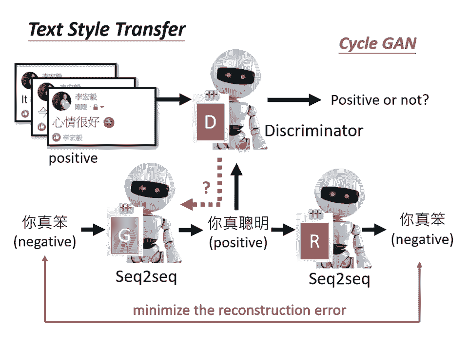

这里有两个技术点：
*   **句子相似度**：如何计算两个句子的相似度？这比图像向量复杂，有专门的研究方法。
*   **离散输出问题**：生成器输出的是离散的文字序列，直接连接判别器会有梯度问题，实践中可能需要使用强化学习（RL）的方法来解决。

实际演示结果很有趣，例如：
*   输入：“胃疼没睡醒 各种不舒服”
*   输出：“生日快乐睡醒超级舒服”
*   输入：“我都想去上班了 真够贱了”
*   输出：“我都想去睡了 真帅了”

模型有时会犯有规律的错误，例如把所有表示腹部疼痛的句子都转换成“生日快乐”。虽然这个系统可能没有直接实用价值，但它展示了无监督学习的潜力。

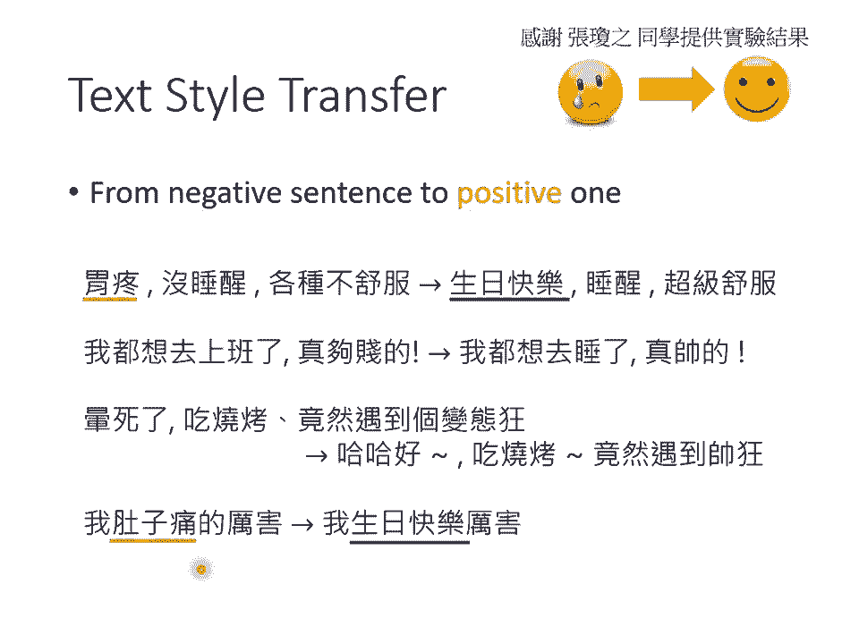

文字风格转换还有更多应用：
*   **文本摘要**：让机器学会把长文章变成简短摘要。
*   **无监督翻译**：收集一堆英文句子和一堆中文句子（无需配对），用CycleGAN的思路让机器学会中英互译。
*   **跨模态转换**：甚至可以在不同类型的数据间转换，例如我们实验室尝试过的**无监督语音识别**——让机器只听一堆语音（无文本）和只看一堆文本（无语音），然后尝试将语音转换成文本。

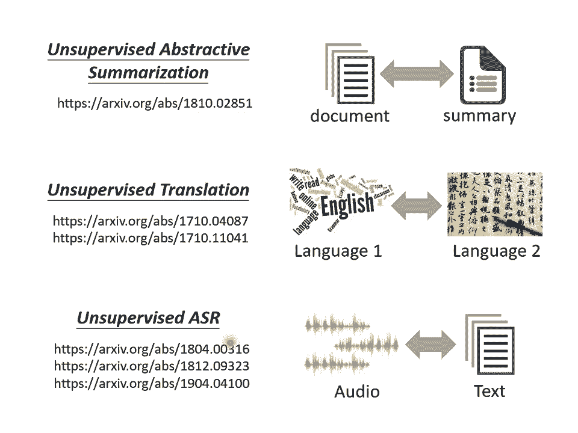

## 总结 🎯

本节课中，我们一起学习了CycleGAN及其核心思想。我们了解到：

1.  **问题背景**：在完全没有成对数据（无监督）的情况下，如何进行图像风格转换等任务。
2.  **直接应用GAN的不足**：普通的GAN无法保证转换前后内容的一致性。
3.  **CycleGAN的解决方案**：通过引入两个生成器（G: X→Y, F: Y→X）和**循环一致性损失**，强制模型在转换风格时保留输入内容的关键信息。
4.  **实际效果**：尽管存在理论局限，但CycleGAN在实践中效果显著，能很好地完成风格转换。
5.  **应用扩展**：CycleGAN的思想不仅适用于图像，还可扩展到文字风格转换、无监督翻译甚至跨模态任务（如无监督语音识别）中。

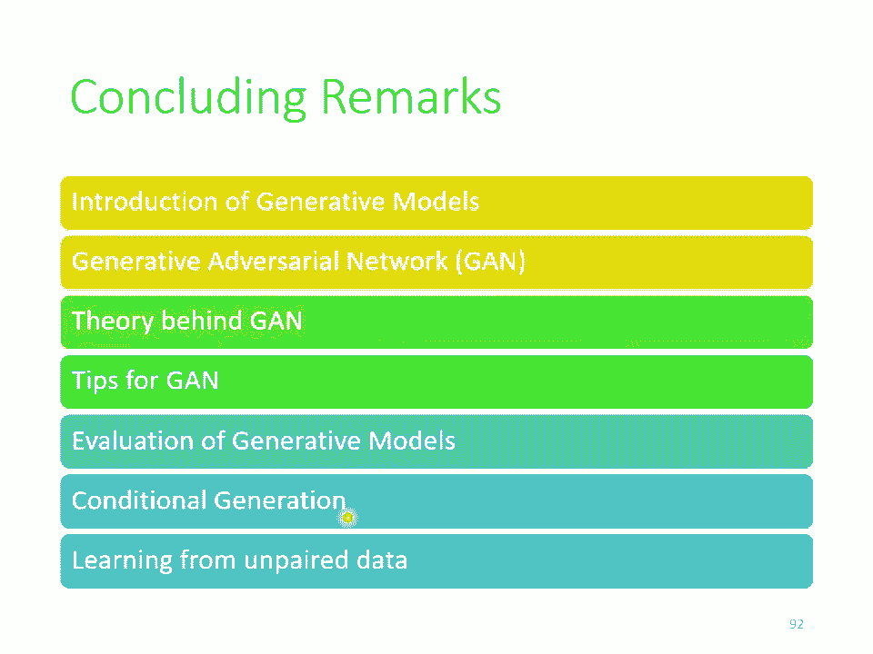

CycleGAN展示了生成式对抗网络在无监督学习领域的强大能力和灵活性。