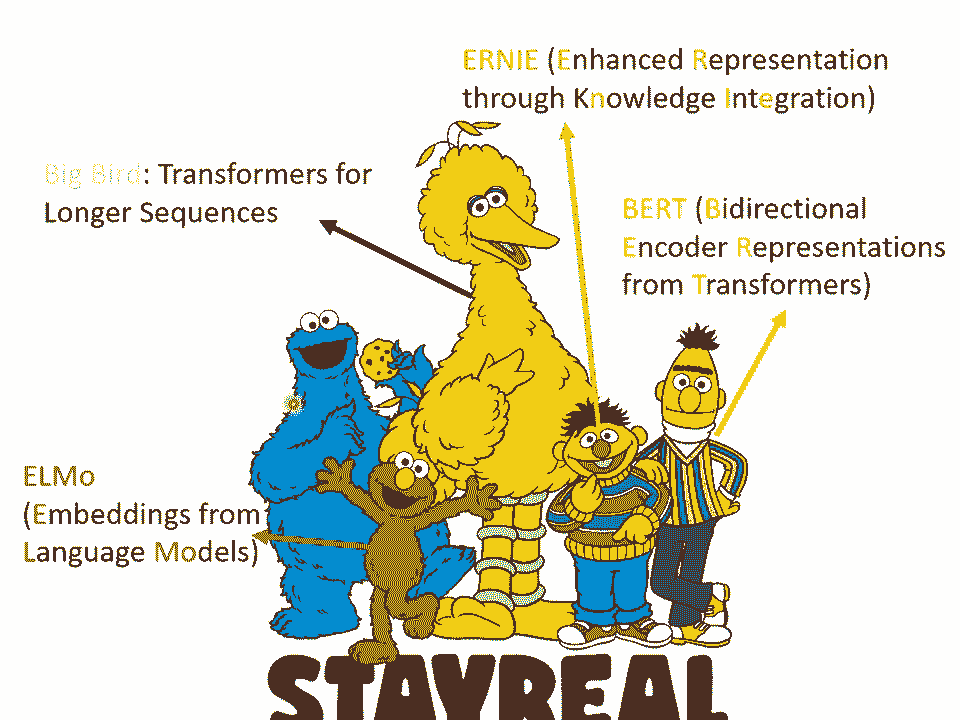
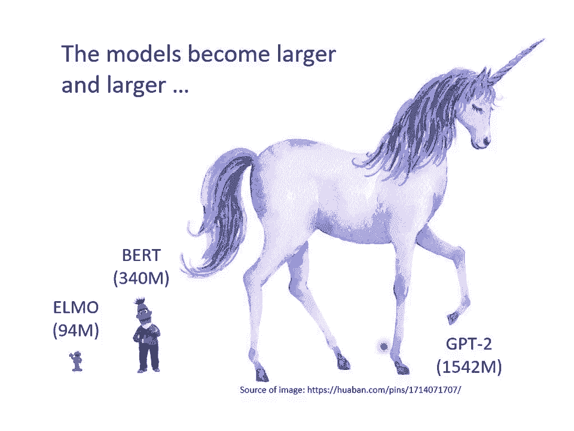
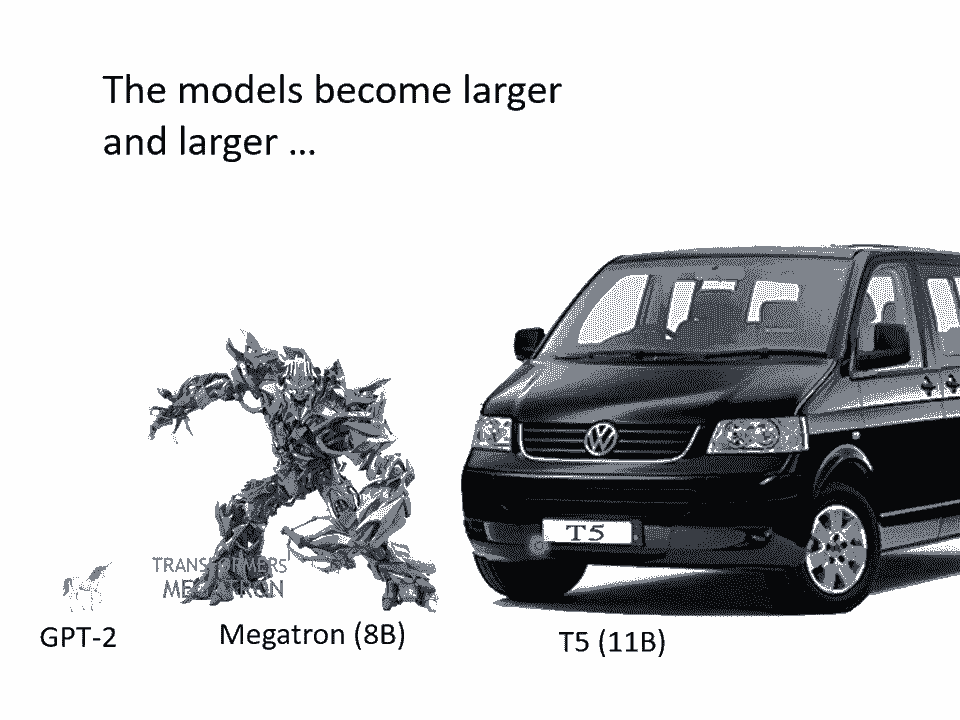
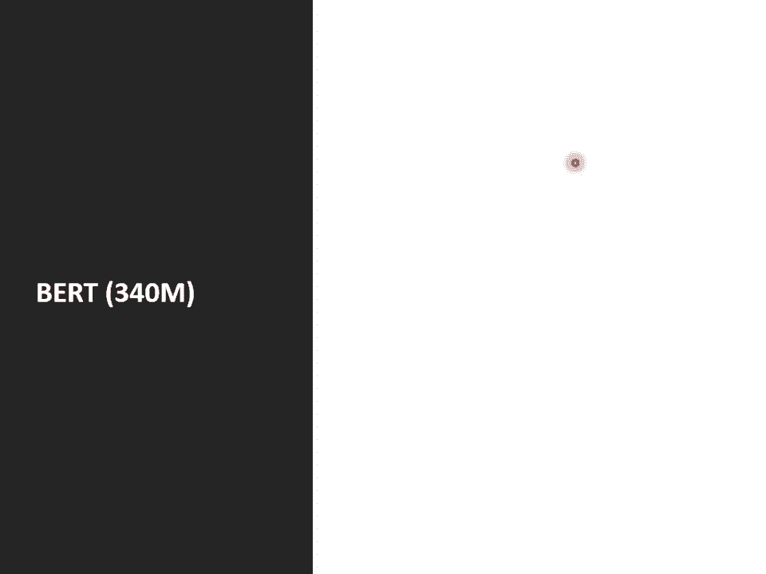
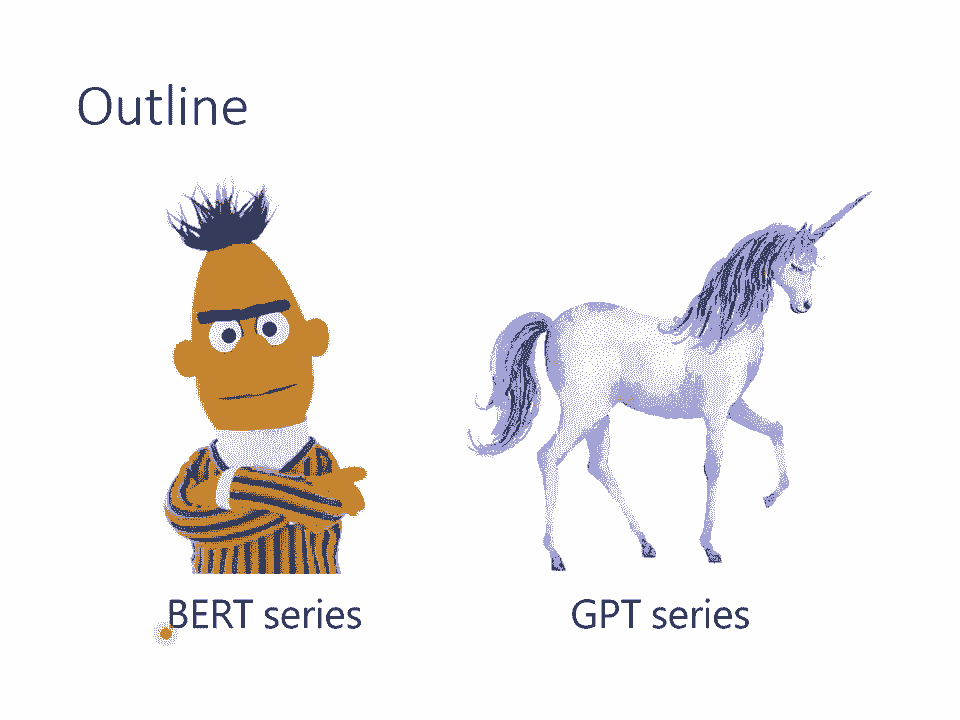

# 18：L13.1 - 自督导式学习1：芝麻街与进击的巨人 🧠

在本节课中，我们将要学习**自督导式学习**。我们会先了解该领域一些以芝麻街角色命名的经典模型，并探讨模型规模如何像“进击的巨人”一样飞速增长。课程内容将简单直白，确保初学者能够理解。

***

## 芝麻街角色与模型命名 🎭

在深入讲解自督导式学习之前，需要先介绍芝麻街。因为自督导式学习的许多模型都以芝麻街的角色命名。

以下是几个关键模型及其对应的芝麻街角色：

*   **Elmo**：这是最早的自督导式学习模型之一。它的全称是 **Embeddings from Language Model**，缩写恰好是 **ELMo**。
*   **BERT**：这是最广为人知的自督导式模型。它的全称是 **Bidirectional Encoder Representations from Transformers**，缩写是 **BERT**。
*   **ERNIE**：在BERT出现后，很快出现了两个都叫ERNIE的模型。其中一个的全称是 **Enhanced Representation from Knowledge Integration**，缩写为 **ERNIE**。
*   **Big Bird**：后来，一个模型直接命名为 **Big Bird**，其全称是 **Transformer for Longer Sequence**。

目前，自督导式学习模型中已经有一系列芝麻街角色，例如Cookie Monster还没有对应的模型，正等待大家去创造。

***

## 进击的巨人：模型规模的膨胀 🏗️

上一节我们认识了以芝麻街角色命名的模型，本节中我们来看看这些模型的规模。提到BERT，就不得不联想到“进击的巨人”。

BERT是一个参数量非常庞大的模型，具体有 **3.4亿（340 million）** 个参数。为了理解这个数字，我们可以对比一下：课程作业4中的Transformer模型只有 **0.1 million** 个参数。BERT的规模是作业模型的 **3000倍**。

因此，当我们想到BERT时，就会联想到超大型的巨人。有趣的是，在动漫《进击的巨人》中，超大型巨人的操控者名叫 **贝**尔**托**特（Ber**t**olt），其名字中包含了“Bert”。这或许并非巧合。

***

## 地鸣时代：更大的模型涌现 📈

你可能觉得BERT已经很大了，但还有更多更庞大的模型不断涌现。这个时代就像发动了“地鸣”，无数超大型巨人从地底出现。

以下是模型参数量增长的一个简要对比，我们用角色的身高来形象化地表示参数量：

*   **ELMo**：参数量为 **94 million**。
*   **BERT**：参数量为 **340 million**（设定其身高为1米作为基准）。
*   **GPT-2**：参数量达到 **1.5 billion**，是BERT的4倍多。
*   **Megatron**：参数量为 **8 billion**。
*   **T5**：参数量为 **11 billion**。
*   **Turing NLG**：参数量为 **17 billion**。
*   **GPT-3**：参数量高达 **175 billion**，是Turing NLG的10倍。

如果进行形象化对比，将BERT（340 million参数）视为1米高的人，那么GPT-3的规模就如同背后的台北101大楼一样巨大。

然而，GPT-3也并非终点。目前已知的最大模型之一是 **Switch Transformer**，其参数量达到了 **1.6 trillion（1.6万亿）**，这又比GPT-3大了近10倍。

***

## 课程总结与预告 📚

本节课中，我们一起学习了自督导式学习的开端。我们首先认识了以芝麻街角色（如ELMo、BERT）命名的一系列重要模型。接着，我们探讨了模型参数量的爆炸式增长，从百万级别（million）到十亿级别（billion），再到万亿级别（trillion），其增长态势宛如“进击的巨人”。

这些庞大的模型究竟在做什么？在接下来的课程中，我们将重点讲解 **BERT** 和 **GPT** 这两个核心模型，介绍自督导式学习模型的基本原理和任务。

***
> 注：本节课程内容涉及《进击的巨人》剧情提及，但主讲人认为不构成关键情节剧透。