# 19：L13.2 - 自督导式学习2：BERT简介 🧠

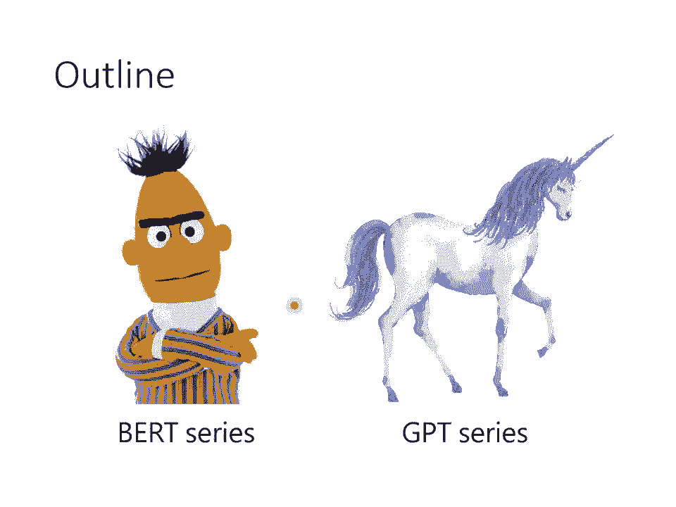

在本节课中，我们将要学习BERT模型。BERT是一种革命性的自督导式学习模型，它通过“填空”任务从海量无标签文本中学习，并能被微调以解决各种下游的自然语言处理任务。我们将从自督导式学习的概念讲起，详细拆解BERT的训练和使用方法。

## 什么是自督导式学习？

上一节我们介绍了自督导式学习的基本思想，本节中我们来看看它的具体定义。

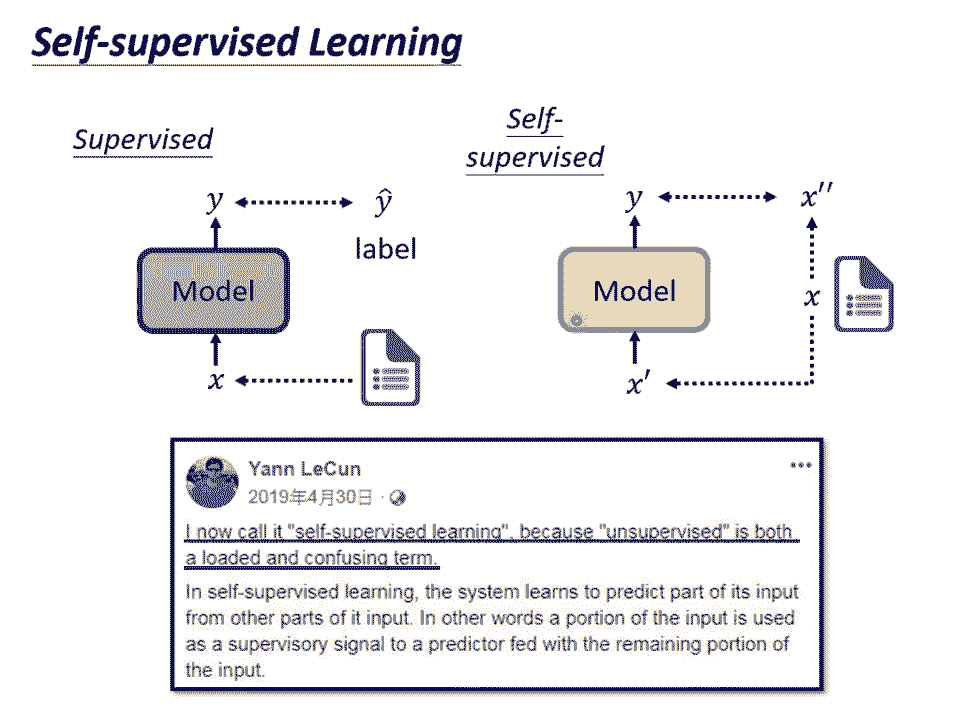

监督学习大家应该非常熟悉。在做监督学习的时候，我们有一个模型，这个模型的输入是X，输出是Y。为了让模型输出我们想要的Y，需要有标签的资料。例如，假设你想要做情感分析，让机器看一篇文章，然后决定这篇文章是正面的还是负面的。你得先找一大堆文章来，然后把这些文章都标注是正面的还是负面的。这个正面或负面就是所谓的标签。你要有文章、有标签才能够训练监督模型。

什么叫自督导式学习呢？自督导式学习就是自己想办法做监督，在没有标签的情况下进行学习。假设我们现在只有一堆文章，没有标注。但是想办法从这些没有标注的资料里面，把资料分成两部分，让一部分作为模型的输入，另外一部分作为模型的标注。假设你有没标注的资料，比如一篇文章叫做X，X把它分成两部分，一部分叫X‘，一部分叫X’‘。把X’输到模型里面，让它输出Y，然后我们要让Y跟它的学习目标，也就是它的标签X’‘越接近越好。这个就是自督导式学习。

自督导式学习可以看作是一种无监督学习的方法。因为有标签叫做监督学习，没有标签就是无监督学习。监督的相反就是无监督。自督导式学习没有用到标签的资料，所以可以说它是无监督学习的方法。但是之所以特别称之为自督导式学习，是为了让我们所指涉的方法更为明确。自督导式学习这个词汇最早是Yann LeCun说的。这个其实不是一个特别旧的词汇。Yann LeCun在2019年4月的Facebook贴文说，他现在把这种方法叫做自督导式学习。为什么不叫做无监督学习呢？因为无监督学习是一个比较大的范畴，里面有很多不同的方法。为了比较明确地说明现在在做的事情是什么，所以说现在做的是自督导式学习。像我们刚才讲的Cycle GAN，那也算是无监督学习的方法，我们也没有用到标签的成对资料，但是它跟自督导式学习就是不太一样。所以无监督学习下面有很多的方法，其中一种是自督导式学习。

## BERT模型详解

刚才讲得非常抽象，什么把X分成X‘和X’‘，自己跟自己学，自己产生标签。实际上到底是怎么回事呢？我们就直接拿BERT这个模型来跟大家说明，实际上是怎么做的。

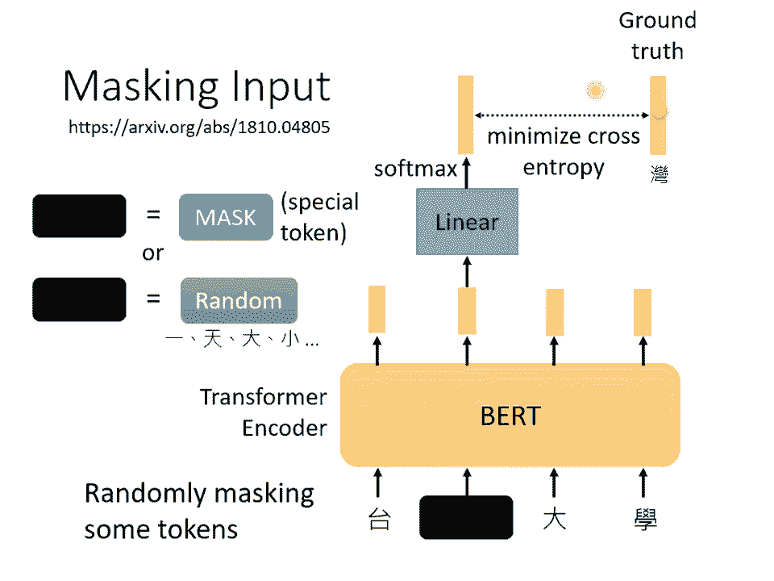

BERT这个模型是一个Transformer的编码器。我们已经讲过Transformer了，也花很多时间介绍了编码器和解码器。Transformer的编码器就是BERT。BERT的网络架构就跟Transformer的编码器一模一样，里面就有很多自注意力机制、残差连接、层归一化等等。这个就是BERT。如果已经忘记这个编码器里面有什么样的东西也没关系，反正就记得说，BERT可以做的事情就是输入一排向量，输出另外一排向量。输入多长就输出多长。

BERT的输入是什么呢？BERT一般是用在自然语言处理上，用在文字上，所以一般它的输入就是一排文字，就是一个序列。我们其实在讲自注意力的时候，也说过不是只有文字是一个序列，语音也可以看作是一个序列，甚至图像也可以看作是一堆向量。所以跟BERT同样的想法，不是只能用在NLP、用在文字上，它也可以用在语音跟影像上。只是因为BERT最早是用在文字上，所以我们这边都拿文字作为例子。你完全可以说我把输入换成语音，把输入换成影像，也都是一样的。

BERT的输入这边是一段文字。接下来我们要做的事情是，把文字输入的这串文字里面，其中一些部分把它随机地盖住。哪些部分会被盖住呢？随机的，随便采样。就是你输入100个词元，那词元是什么？词元就是你在处理一段文字的时候的单位。这个词元的大小是你自己决定的。在中文里面，我们通常把方块字当成词元。所以输入一个句子，那里面会有一些词汇随机地被盖住。盖住哪些？随机决定，随便决定。

怎么把它盖住呢？所谓的盖住具体而言是什么样的意思呢？有两种做法。
以下是两种具体的遮盖方法：
*   第一种做法是把句子里面的某一个字，换成一个特殊的符号。我们用`[MASK]`来代表特殊的符号。你就想成它是一个新的中文字，这个中文字在字典里面从来没有出现过的，这是个新的字，它的意思就代表了盖住。
*   第二种做法就是，随机把某一个字换成另外一个字。本来这边放的是“湾”，那就随便找一个中文字把它替换掉，换成“一”、换成“天”、换成“大”、换成“小”，随便换成某一个字。

所以有两种做法，一种是加`[MASK]`，一种加随机的字。用哪一种呢？两种都可以用。所以到底用哪一种，也是随机决定的。所以在BERT训练的时候，输入一个句子，先随机决定哪些中文字会被盖起来，接下来再决定说要怎么盖，是要换成这个特殊的代表盖住的符号，还是随便从中文字里面挑一个出来把它盖住。所以这两种方法都可以用。

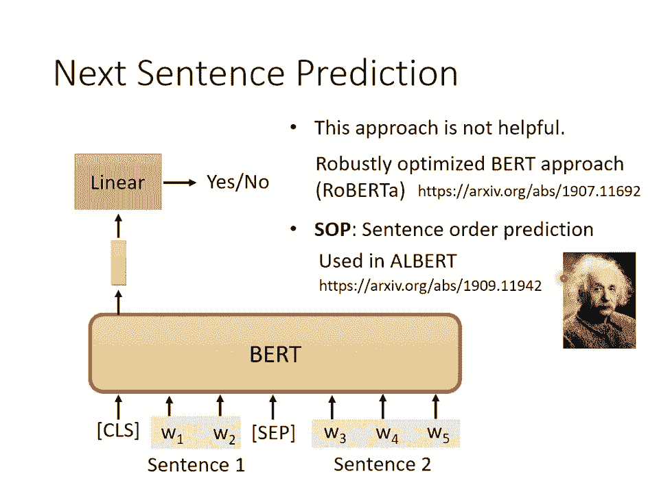

盖住以后呢，盖住以后你一样是输入一个序列。BERT的输出，它对应的输出就是另外一个序列。接下来，你把盖住的部分所对应的输出拿出来。盖住的部分，你还是放东西进去了，只是它可能是`[MASK]`或者是随机的。盖住的部分还是有放东西进去，它一样输出一个向量。把这个向量做一个线性变换，所谓做线性变换的意思就是，乘一个矩阵，然后做softmax得到一个输出，输出一个分布。

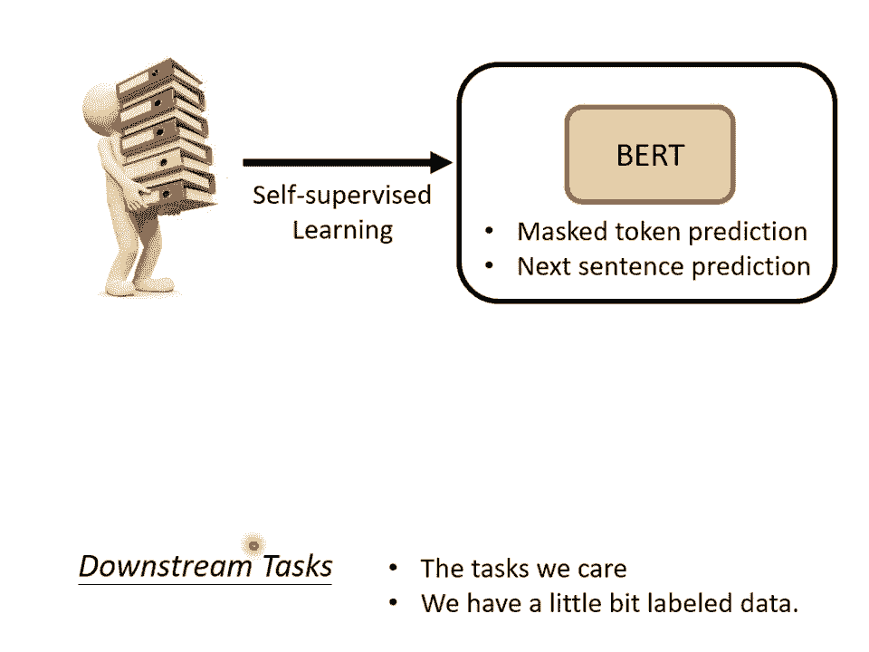

这个输出的分布是什么东西呢？输出的这个分布就跟我们在做翻译的时候，在讲序列到序列模型、在讲Transformer的时候是一模一样的。它的输出是一个非常长的向量，这个向量里面包含了所有你感兴趣的、你想要处理、你知道的中文字。每一个字都对应到一个分数，它是一个分布，因为这边有一个softmax。

接下来要怎么训练这个BERT呢？训练的时候，它训练的目标就是，因为我们其实知道被盖起来的东西原来是哪一个字，BERT本身不知道。我们给BERT的时候它是被盖起来的，所以BERT不知道这边应该是“湾”，但我们自己知道。我们知道说这个被盖起来的位置，本来应该要是“湾”。所以BERT学习的目标就是，它要学到说这边的输出，跟“湾”这个字越接近越好。你会把“湾”表示成一个独热编码的向量，然后你会最小化这边的输出，跟“湾”这个独热编码向量的交叉熵。或讲得更简单一点，你其实就是在做一个分类的问题，只是你有多少个类别。我们的类别的数目，就跟中文字的数目一样多。中文字那就看你觉得有几个，如果4000个，那就是一个4000个类别的分类的问题。现在BERT要做的事情就是，它必须要成功地预测说，这个被盖起来的地方，它属于的类别就是属于“湾”这个类别。

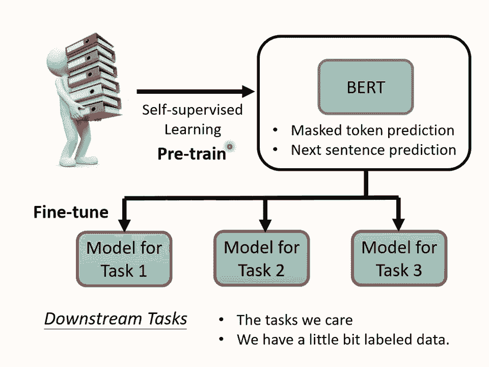

在训练的时候，你是BERT加后面这一个线性的模型，两者一起训练。就是BERT里面，它是一个Transformer的编码器，有一堆的参数。线性的模型是一个矩阵，那它也是有一些参数，但跟BERT比非常小。它们两个是一起训练的，要一起努力，然后输出要去预测说，现在被盖住的词汇是“湾”。这个叫做遮盖语言模型。

其实BERT在训练的时候，除了做遮盖语言模型以外，同时也会做另外一个方法。

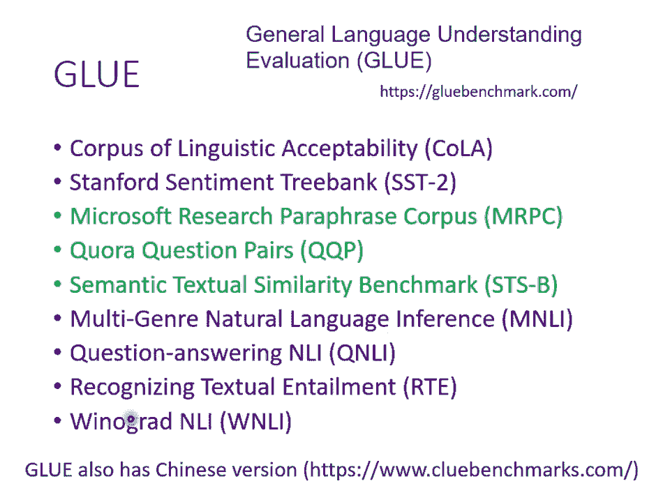

## 下一句预测

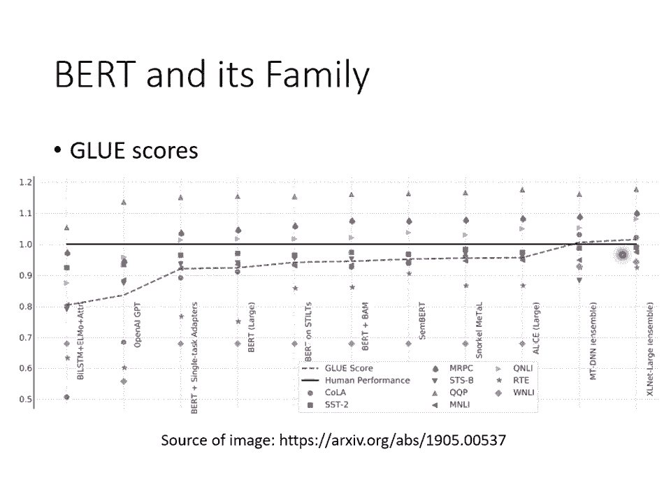

这个另外的方法呢，叫做下一句预测。下一句预测的意思是，你拿出两个句子。从你的资料库里面，你会收集很多的句子，那个网络上随便爬一爬就有了。收集很多的句子，从里面拿两个句子出来。然后在这两个句子的中间，你会加入一个特殊的符号代表分隔，这样BERT才知道说，这是两个不同的句子。两个句子中间有个分隔的符号。你还会在这个最前面，这整个序列的最前面，加入一个特别的符号，这边我们用`[CLS]`来表示这个特别的符号。等一下我们会知道这个特别的符号有什么样的作用。

现在我们有一个很长的序列，它包括两个句子，中间有一个分隔符，还有`[CLS]`的符号。整个一股脑把它丢到BERT里面。照理说这边输入一个序列，输出就会是另外一个序列，这个就是编码器可以做的事情。BERT就是Transformer编码器，这个就是编码器可以做的事情。但是我们现在只取`[CLS]`所对应的那个输出。就这边有输出，但不管它不去看它，我们只看`[CLS]`这边的输出。把这个输出乘上一个线性的变换，然后它要做的是一个二元的分类问题，它要预测的就是“是”或“否”。

这个“是”或“否”指的是什么呢？这个方法名字叫下一句预测，所以“是”或“否”就是要预测说，这两个句子是不是相接的。如果这两个句子是相接的，BERT它就要训练成，看到两个相接的句子就输出“是”。看到两个不是相接的句子就输出“否”。

但是后来的研究发现说，下一句预测对于接下来BERT所要做的事情，其实帮助不大。BERT接下来要做什么事情，我马上就会讲到了。总之这一招不太有用。举例来说，在一篇叫做《Robustly Optimized BERT Pretraining Approach》的论文里面，它缩写是RoBERTa，他就明确地指出说，他尝试了做下一句预测这个方法，但是没有什么特别的帮助。你知道这个就是墙倒众人推，一个人说没有用，接下来会有更多文章说没有用。后来什么SpanBERT、XLNet，通通都说下一句预测没有用。

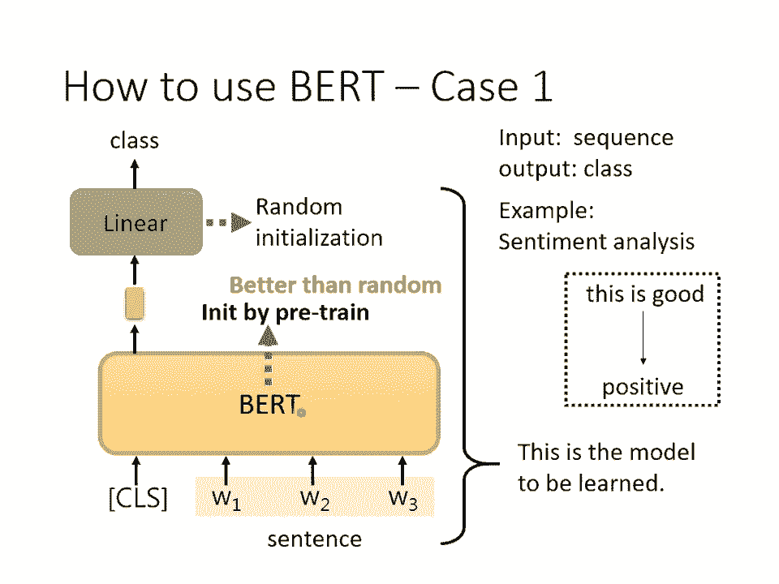

它没有用的一个可能是，下一句预测这个任务可能太简单了。要知道两个句子该不该被接在一起，也许不是一个特别难的任务。因为今天这两个句子，你通常的做法就是，你先随机选一个句子，接下来你选接在它后面的句子，或者从整个资料库里面随便选一句。那你通常随便选一句，跟你一开始选的这句一定很不像。所以对BERT来说，它分辨两个句子是不是接在一起，可能挺容易的，所以它没有藉由这一个任务，没有藉由下一句预测这个任务学到太多有用的东西。

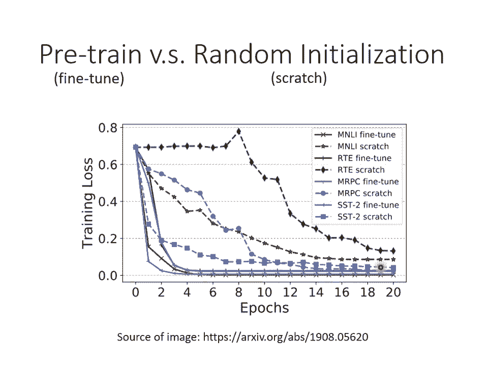

后来还有另外一招，跟下一句预测有点像，但是在文献上看是比较有用的，叫做句子顺序预测，它的缩写是SOP。这个方法是说，我们找出来的句子1跟句子2，它本来就是接在一起的，只是你可能会把本来放在前面的那个句子当句子1，放在后面的那个句子当句子2；或者是本来放在前面的句子当句子2，放在后面的句子当句子1。有这两种可能，然后问BERT是哪一种。那可能这个问题比较难，所以句子顺序预测SOP目前在文献上看是有用的。它被用在一个叫做ALBERT，就是BERT的一个进阶的版本里面。ALBERT就是爱因斯坦，爱因斯坦就叫Albert。

## BERT的用途：预训练与微调

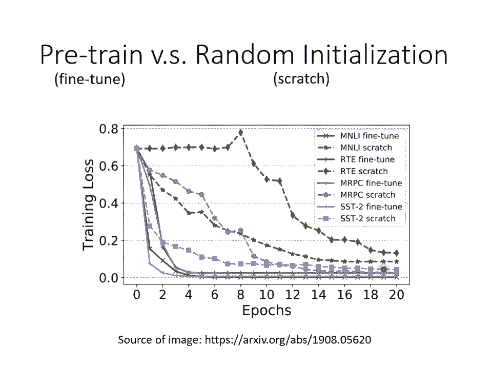

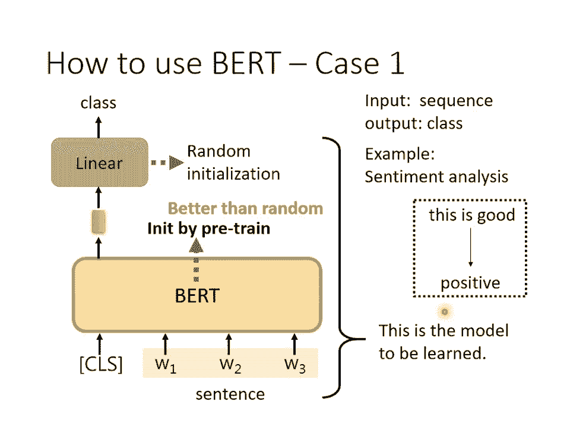

那BERT怎么用呢？我们刚才说我们训练BERT会做的事情是什么？训练的时候就是叫BERT学两个任务，一个是盖住一些词汇，它盖住一些中文字，它可以把盖住的部分补回来，它知道怎么做填空题。另外一个是它可以预测两个句子是不是应该被接在一起，但我有说这招好像没有什么用。所以整体而言BERT真正学到的是，它就是学到怎么做填空题。你说那又怎样？如果我要解的任务就不是填空题的话，那这个BERT有什么用呢？它就只会做填空题啊，它学来就是做填空题啊，你教它的事情就是做填空题啊。

训练会一个模型做填空题以后，然后呢？接下来就是神奇的地方。它可以被用在其他的任务上，这些任务跟填空题不一定要有关，甚至是根本没有什么关系。但是BERT可以被用在这些任务上。这些任务，就BERT真正被使用的任务叫做下游的任务。

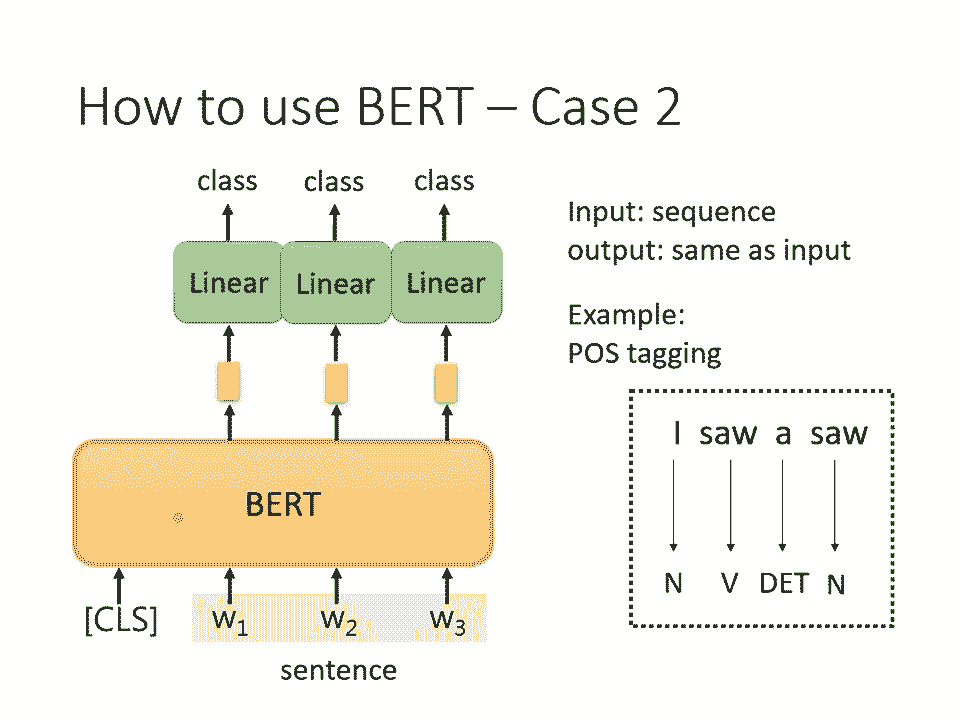

所谓下游任务的意思就是那些你实际上真正在意的任务。但是我们要BERT学会做这些任务的时候，其实我们还是需要有一些标注的资料的。等一下我们会看得更清楚一点。

总之，BERT它只学会做填空题，但接下来它可以被拿来做各式各样你感兴趣的下游任务。它有点像是胚胎里面的干细胞，它具有各式各样无限的潜能，虽然现在还没有发挥它的能力，只会做填空题，但是接下来它有能力去解各式各样的任务，只要给它一点资料刺激它，它就可以。你知道干细胞就是胚胎干细胞，可以分化成各式各样不同的细胞，心脏细胞、肌肉细胞等等。BERT也是一样，给它一点有标注的资料，它就可以学会，它就可以分化成各式各样的任务。

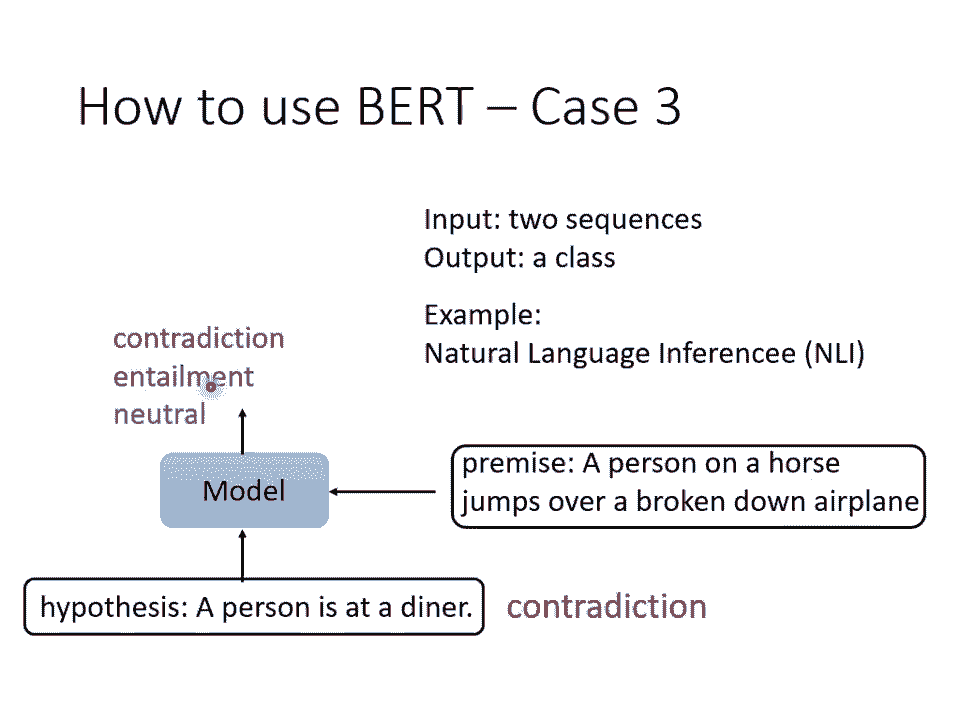

那BERT分化成各式各样任务这件事情叫做微调。所以常听到有人说，他微调了那个BERT，指的就是他手上的BERT，他把这个BERT拿来做微调，让它可以去做某一种任务。那相对于微调，在微调之前产生这个BERT的过程就叫做预训练。所以产生BERT的这个过程，它是自督导式学习，但你也可以说它叫做预训练。

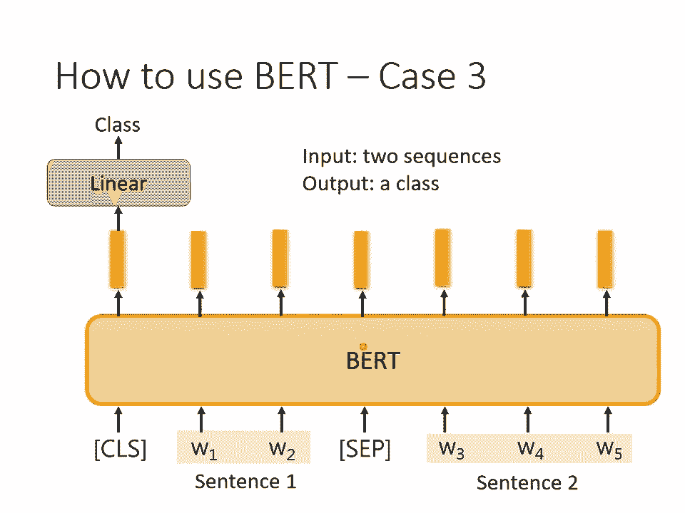

你会发现说我们在作业里面其实有反复说，我们就不使用预训练的模型。那如果你不知道什么是预训练的模型没有关系，反正你既然不知道它是什么，你就不会用到它。那如果你知道是什么的话，这边的意思就是说，你不要用这种自督导式学习的方法去别的地方，找一个自督导式学习的模型直接用在作业上。因为这些方法往往都有不可思议强大的能力，会让你接下来做的事情变得没有特别有趣。但是其实接下来有个BERT的作业，作业7就是用BERT的作业。所以作业7当然就是可以用预训练的模型的，这是唯一一个可以用预训练模型的作业，因为作业7就是要微调BERT，所以当然你要用预训练的BERT来进行微调。所以只有作业7是可以用预训练的模型的。

在讲BERT是怎么微调之前，我们先来看看它的能力。

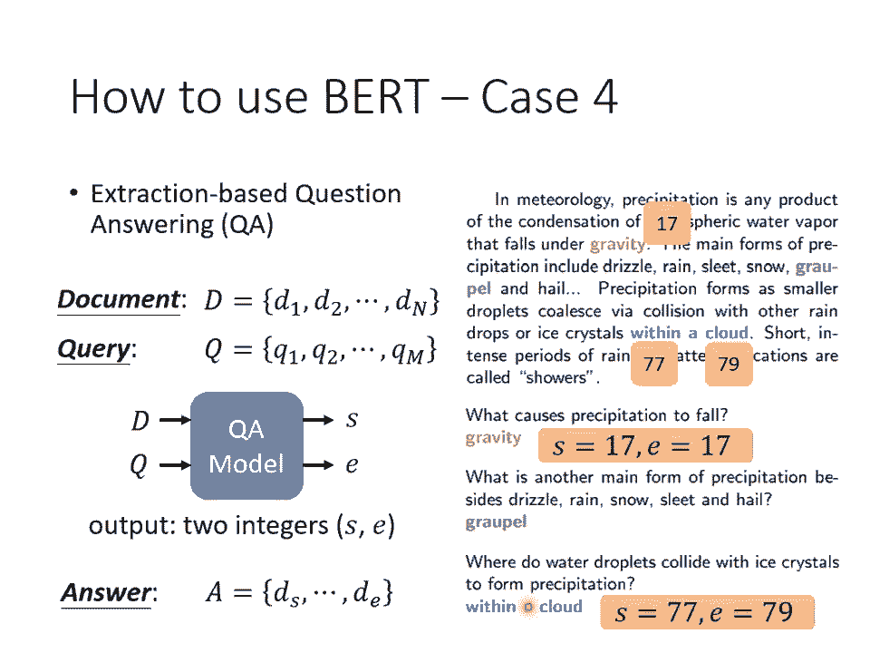

## 评估BERT的能力：GLUE基准

今天你要测试一个自督导式学习的模型的能力，通常你会把它测试在多任务上。因为我们刚才说BERT就像是一个胚胎干细胞，接下来它要分化去做各式各样的任务，所以我们通常不会只测试它在一个任务上的能力，你是会把这个BERT分化去做多个不同的任务，看看它在每个任务上得到的正确率是多少，再取一个平均值。在这种任务组合，这样一个模型去测试的时候，我们叫任务集。在任务集里面最知名的一个标杆就叫做GLUE，它是General Language Understanding Evaluation的缩写。

那GLUE里面总共有九个任务。一般你想要知道一个像BERT这样训练出来的模型好不好，你就会把它分别微调在九个任务上。所以你实际上会得到九个模型，分别做在九个任务上，看看这九个任务上正确率的平均是多少。你得到一个数值，这个数值代表了这个自督导模型的好坏。

我们来看一下在GLUE上面的表现。有了BERT以后，GLUE的分数就是那九个任务的平均的分数，确实逐年攀升。在这个图上，横轴是不同的模型，这边有列表，那你发现说来来去去都是有什么ELMo、GPT、BERT、BERT、BERT、BERT、BERT，一大堆BERT这样子，各式各样的BERT。这个黑色的线代表的是人类在这个任务上得到的正确率，那这个当作是1。这边每一个点就代表了一个任务。你为什么要跟人类的正确率比呢？人类正确率是1，然后这些点如果做得比人类好，就是大于1，做得比人类差，就是小于1。这些任务它们用的那个评估的标准不见得是正确率，每个任务用的评估标准不一样，不见得是正确率，所以直接把它的数值放在一起比，可能没什么意思。所以这边是看跟人类的差距。所以你会发现说，本来9个任务里面只有一个是可以做的比人类好的，后来呢，随着越来越多技术被提出来，就有另外三个任务可以做的比人类好，而其他本来跟人类相差甚远的任务，也慢慢的追上来了，它的机器的效能也慢慢追上来了。蓝色的虚线是机器的GLUE分数的平均，发现说最近一些比较强的模型，比如XLNet，居然还超越了人类。当然你这只是在这一个数据集上面的结果，并不代表说机器真的超越了人类，它只是在这个数据集上超越了人类。这显示的是什么呢？就这个数据集被玩坏了，不够难。所以接下来在GLUE之后，就有人做了SuperGLUE，找更难的自然语言处理的任务来让机器来解。

但展示这个图的意思主要是想要告诉你，有了BERT这样的技术以后，确实机器在自然语言处理的能力上面又往前迈进了一步。

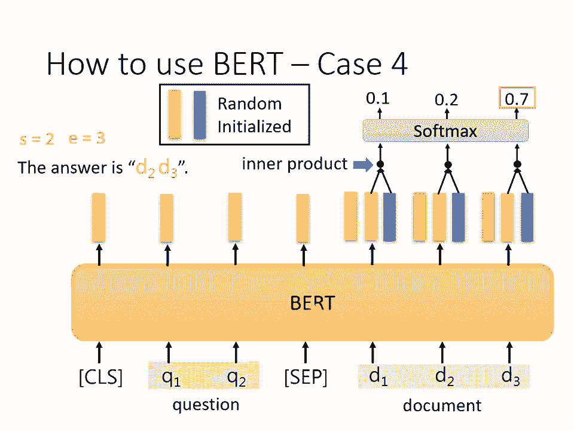

## BERT的应用案例

那BERT到底是怎么被使用的呢？BERT是这样子用的。我们等一下会举四个使用BERT的案例。

### 案例一：句子分类

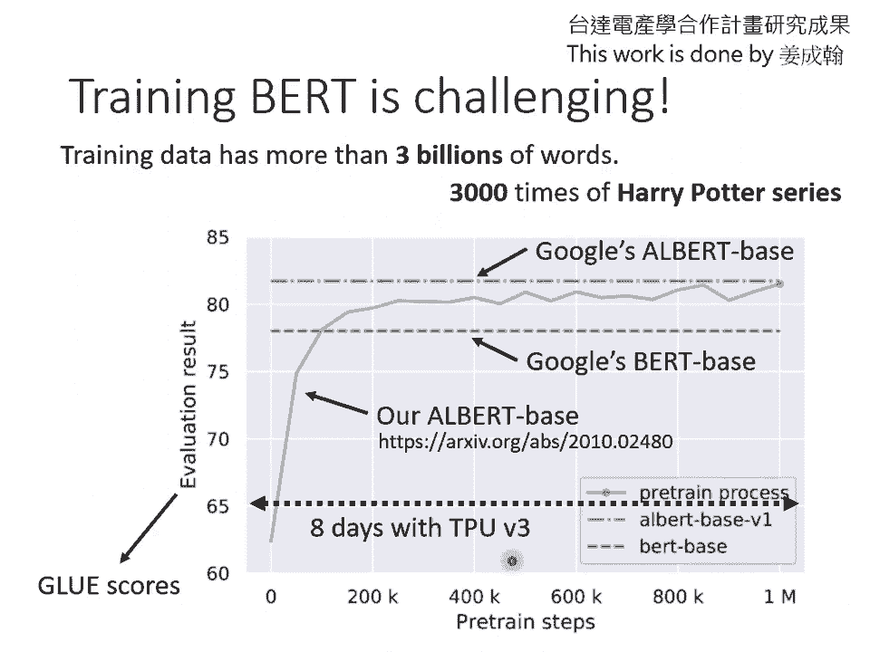

第一个案例是，假设我们的下游任务是输入一个序列，输出一个类别，它是一个分类的问题，只是输入是一个序列。什么样的任务是输入一个序列，输出一个类别呢？比如情感分析，就给机器一个句子，只要去判断说这个句子是正面的还是负面的。

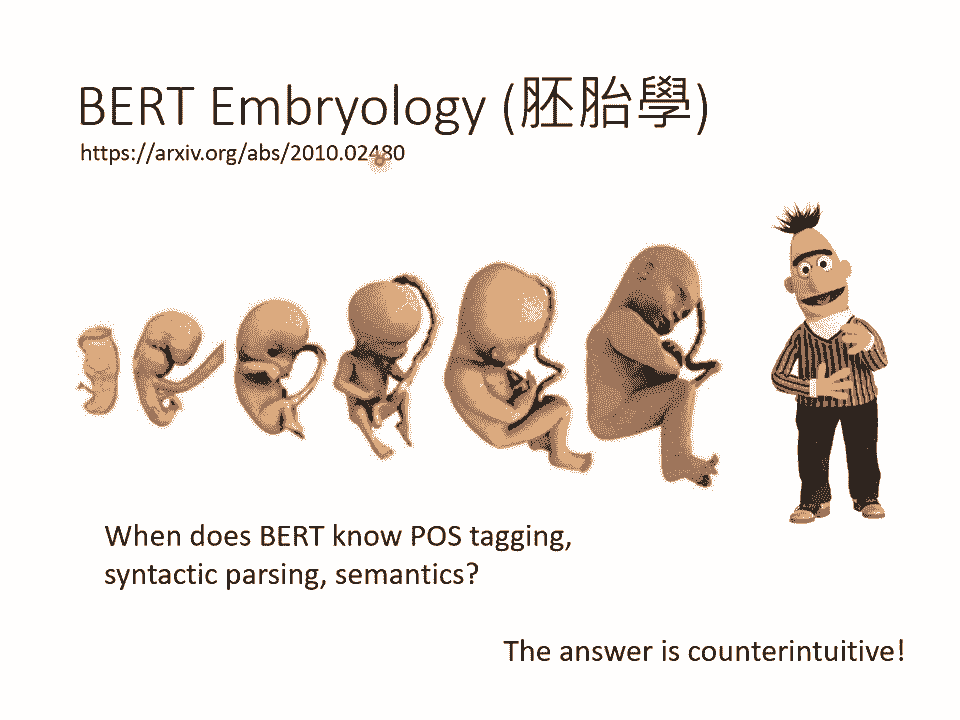

对于BERT而言，它怎么解情感分析的问题呢？你就给它一个句子，就是你要拿来决定情感的那个句子，然后把这个句子前面放`[CLS]`那个词元。我上次提到它的时候是在讲下一句预测的时候，前面放`[CLS]`的词元，丢到BERT里面。那这四个输入，其实都会对应给它四个输出。那我们只看`[CLS]`的部分。`[CLS]`这边输出一个向量，把它做一个线性变换，乘上一个矩阵，然后通过softmax，然后决定说输出的类别是什么，正面还是负面等等。

这边实际上在做的时候，你需要有你下游任务的标注资料。也就是说BERT并没有办法凭空去解情感分析的问题，你仍然需要提供给BERT一些标注的资料。你需要提供给它大量的句子，跟每一个句子是正面的还是负面的，你才能够去训练这个BERT的模型。在训练的时候，我们其实是把BERT加上这个线性的变换合起来，说它是一个完整的情感分类的模型。在训练的时候，线性的部分跟BERT都会用梯度下降去更新。

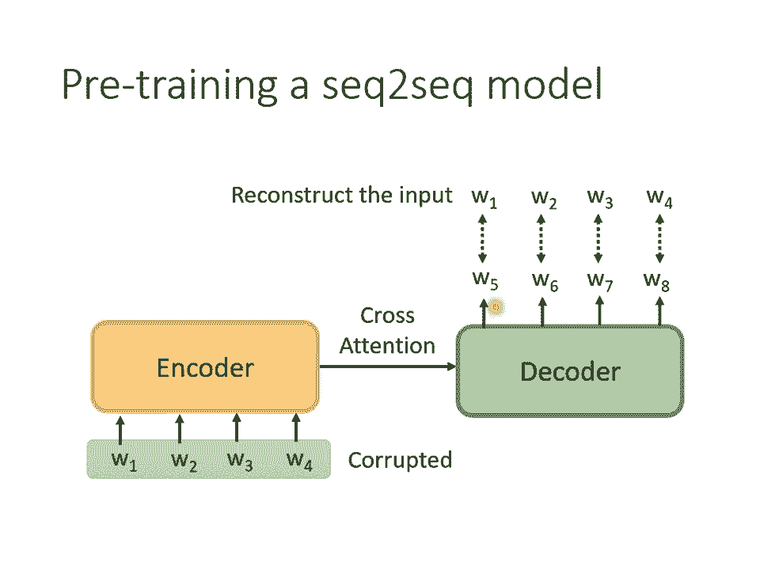

只是现在呢，线性部分的参数是随机初始化的。而BERT的部分，它的初始的参数是从学习了做填空题的那个BERT来的。我们在训练模型的时候，不是会随机初始化一个参数吗？然后用梯度下降去调那个参数，对不对？然后最后去最小化我们的损失。这边也是一样，我们有一个要最小化的损失，就是做情感分类。但是我们的参数不再是完全随机初始化了。有了BERT以后，我们有唯一随机初始化的，只有线性变换这个地方。而BERT这个本体，这边是一个巨大的Transformer编码器，这个网络它的参数不是随机初始化的。我们是直接把学会了做填空题的BERT，它的参数拿来填在这个地方，把那个可以做填空题的BERT的参数拿来填在这个地方，当做初始化的参数。

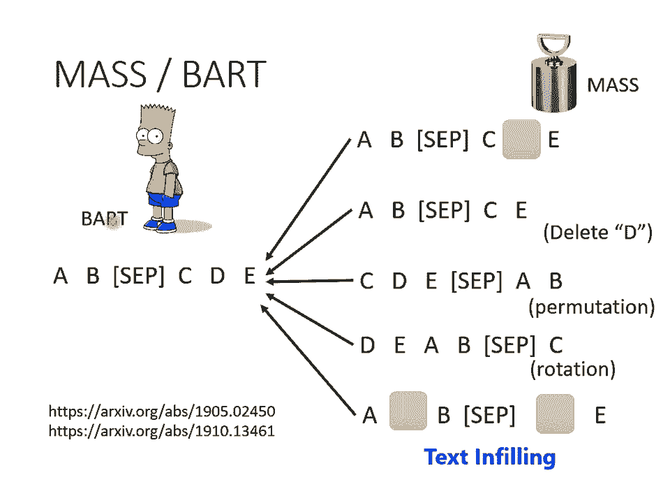

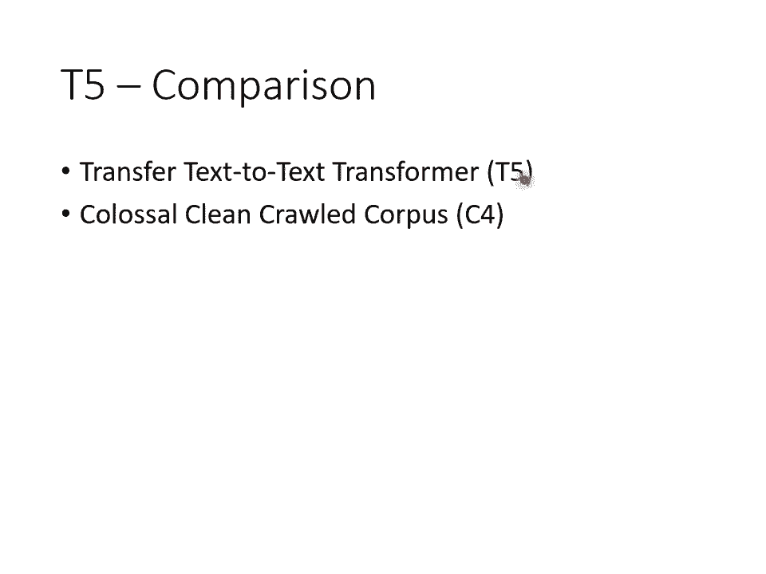

那为什么要这样做？为什么要用那个学会做填空题的BERT，把它放在这边呢？最直觉最简单的理由当然是比随机初始化好。当你这边放了那个会做填空题的BERT的时候，它得到的结果会比随机初始化好。

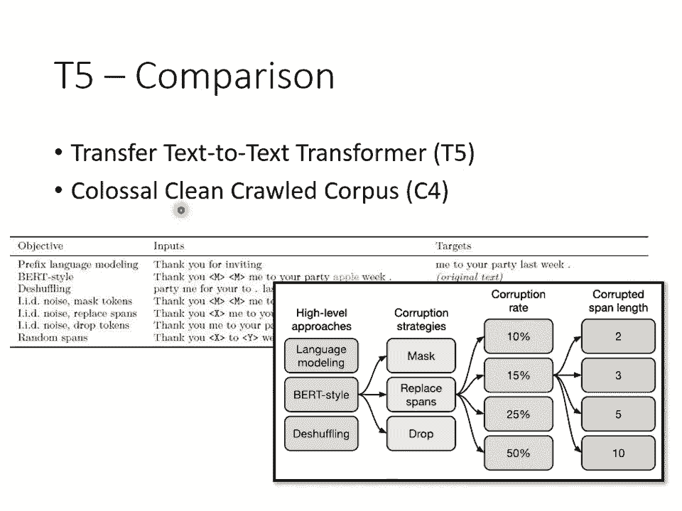

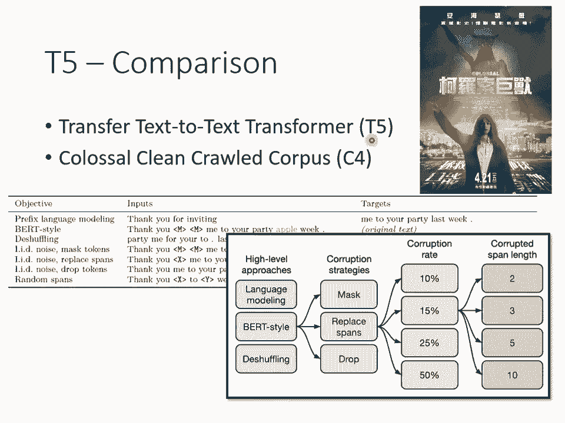

这边有一个文献上的例子。横轴是训练的周期，纵轴是训练的损失。随着训练过程的进行，训练的损失当然会越来越低。有趣的地方是，这边这个图上有各式各样的任务，细节是什么我们就不解释，这边就是各种不同的任务。那“Finetune”代表的就是有预训练，就是BERT的那个部分，那个编码器的部分，是用学会做填空题的那个BERT的参数来做初始化的。“Scratch”的意思就是，整个模型包括BERT的那个本体，包括编码器的部分，都是随机初始化的。你会发现说，如果是Scratch，首先你在训练