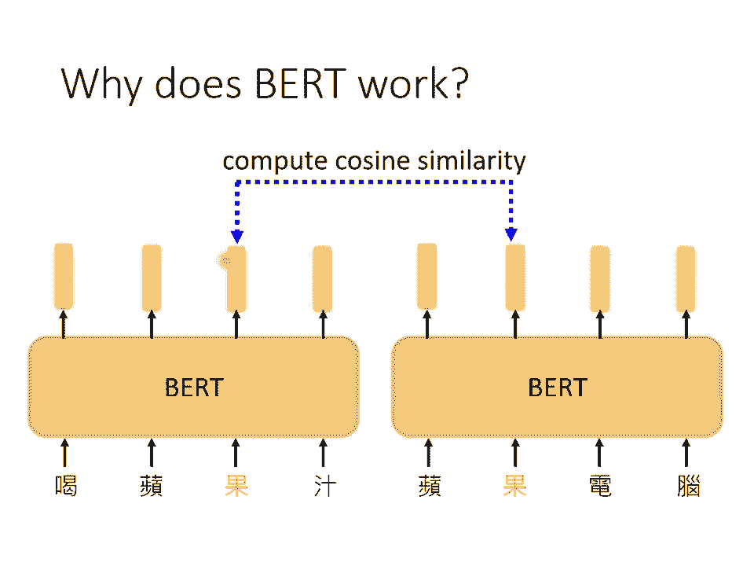
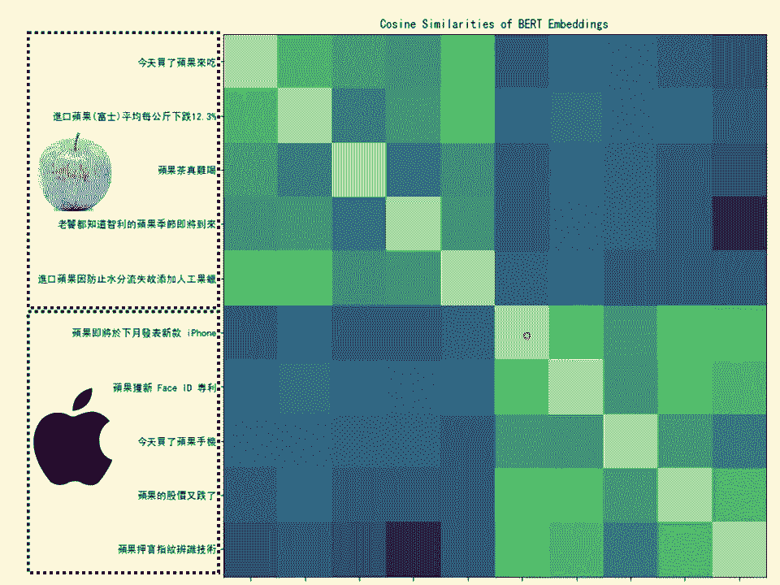
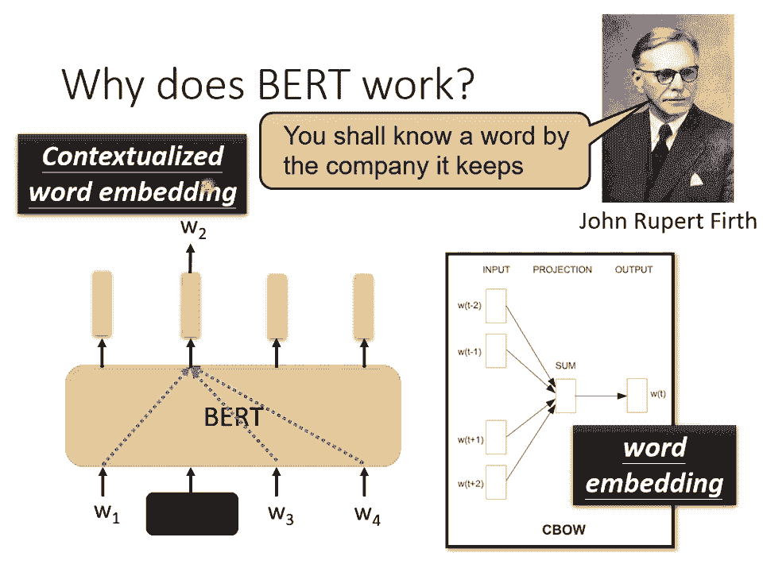
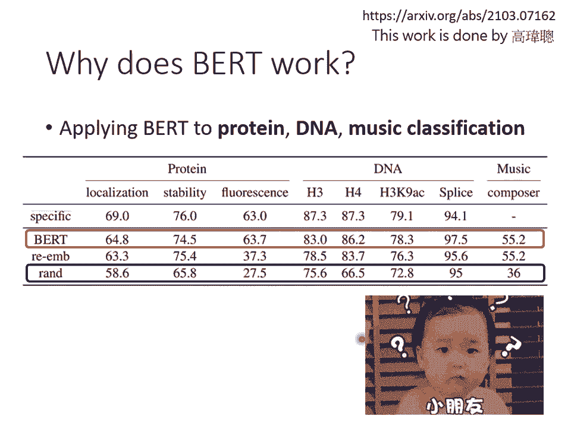
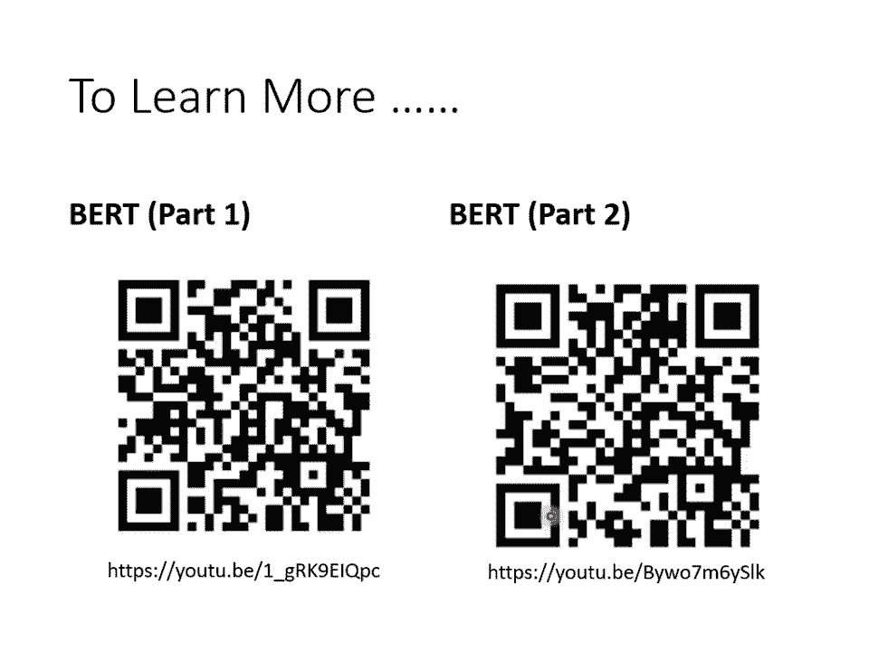
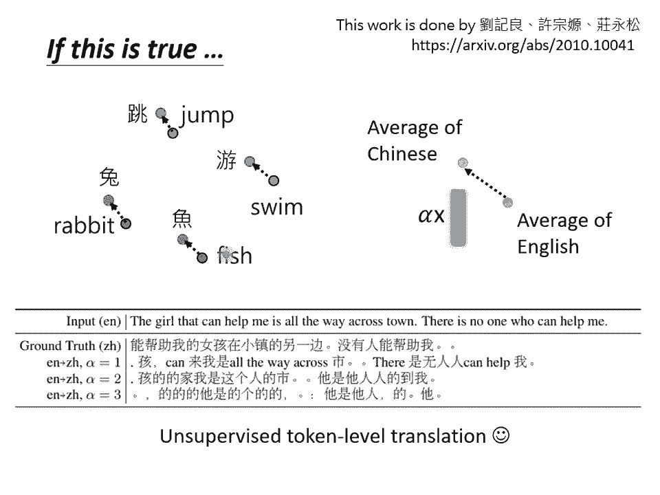

# 20：L13.3 - 自督导式学习3：BERT详解 🧠

在本节课中，我们将深入探讨BERT模型的工作原理，并解释它为何如此有效。我们将从最直观的解释入手，逐步分析其内部机制，并通过一些有趣的实验来揭示其更深层的特性。

## BERT为何有效？🤔

上一节我们介绍了自督导学习的基本概念，本节中我们来看看BERT模型的核心思想。最常见的解释是：BERT能够为输入文本中的每个字或词生成一个对应的向量，这个向量被称为**嵌入**。



这个嵌入向量的特别之处在于，它代表了输入字词的含义。例如，输入“台湾大学”，BERT会输出四个向量，分别代表“台”、“湾”、“大”、“学”的意思。

### 向量如何表示含义？

具体来说，如果我们将这些字词对应的向量可视化或计算它们之间的距离，会发现含义越相近的字词，其向量在空间中也越接近。



**公式**：对于两个词向量 **v1** 和 **v2**，其相似度通常用余弦相似度衡量：
`similarity = (v1 · v2) / (||v1|| * ||v2||)`

例如，“苹果”和“橘子”都是水果，它们的向量会比较接近；而“苹果”和“电脑”的向量则可能相距较远。

### 处理一词多义

你可能会问，中文（以及许多其他语言）存在一词多义的问题。BERT可以很好地处理这一点，因为它考虑了上下文信息。同一个字，在不同的上下文中，其生成的嵌入向量是不同的。

**代码示例**（概念性）：
```python
# 伪代码：BERT根据上下文生成不同的嵌入
context1 = "吃苹果"
context2 = "苹果手机"
embedding_apple1 = BERT_encode(context1)["果"] # 与“水果”含义接近
embedding_apple2 = BERT_encode(context2)["果"] # 与“品牌”含义接近
```

因此，“吃苹果”中的“果”与“草”的向量可能更接近，而“苹果手机”中的“果”则可能与“电”更接近。

## 实证：BERT理解词义 📊

为了验证BERT是否真的能做到这一点，我们来看一个真实的例子。我们收集了包含“果”字的句子，并将其输入BERT。

以下是分析步骤：
1.  收集句子（例如：“今天买了苹果来吃”、“苹果即将发表新款iPhone”）。
2.  将每个句子输入BERT，获取其中“果”字对应的嵌入向量。
3.  计算这些向量两两之间的余弦相似度。



分析结果会形成一个相似度矩阵。你会发现，代表“水果”含义的“果”的向量彼此相似度高，代表“苹果公司”含义的“果”的向量彼此相似度也高，但这两组向量之间的相似度则较低。这表明BERT确实能根据上下文区分词语的不同含义。

所以，在通过“填空”任务进行训练的过程中，BERT似乎学会了理解每个字词的含义。这使得它能够在后续的下游任务中表现得更好。

## BERT能力的语言学基础 🗣️

那么，BERT为何拥有这种神奇的能力呢？这基于一个语言学假设：**一个词的含义取决于它的上下文**。

这个观点由语言学家John Rupert Firth提出，即“You shall know a word by the company it keeps.”。例如，“苹果（水果）”的上下文常出现“吃”、“树”等词，而“苹果（公司）”的上下文则常出现“股价”、“专利”等词。

BERT在训练时所做的正是这件事：给定上下文（如W1, [MASK], W3, W4），它需要预测被遮盖的词（W2）。为了完成这个任务，模型必须从上下文中抽取关键信息。因此，它输出的嵌入向量，本质上是上下文的精华浓缩，用于预测目标词。

这种思想在BERT之前就已存在。例如，**Word2Vec**技术中的**Skip-gram**模型就做着类似的事情：预测给定中心词周围的上下文。BERT可以看作是它的“深度”版本，模型更复杂，并且能生成**上下文相关的词嵌入**。

## 一个令人深思的实验 🧬

以上是文献中最常给出的解释。但这里我想分享一个我们实验室进行的、可能颠覆直觉的实验。



我们将原本在文本上预训练的BERT，直接用于**DNA序列分类**、蛋白质分类和音乐分类任务。以DNA分类为例：



**实验步骤**：
1.  DNA由A、T、C、G四种碱基组成。
2.  我们随机地将每个碱基映射到一个英文单词（例如，A->“we”， T->“you”）。
3.  于是，一段DNA序列就变成了一段无意义的“英文”句子（如“AGAC” -> “we she we he”）。
4.  我们将这个无意义的句子输入BERT（使用在英文文本上预训练的权重），然后接一个线性分类器来预测DNA类别。

令人惊讶的是，即使输入是毫无语义的乱码，使用预训练BERT的模型性能（红色部分）也比随机初始化的模型（蓝色部分）更好。

**核心发现**：这个实验表明，BERT的强大能力可能不完全源于其“理解语义”。它可能作为一种**更好的参数初始化方法**，其架构本身就更适合学习各种序列模式（无论是语言、DNA还是音乐）。这提醒我们，对于这些新模型为何有效，仍有巨大的研究空间。

## 多语言BERT的奇迹 🌍

接下来要介绍的是**多语言BERT**。它在预训练时使用了104种不同语言的文本进行“填空”训练。

其神奇之处在于：**用英文问答数据微调后的多语言BERT，竟然能直接处理中文问答任务**。

**实验数据**：
*   在纯中文BERT上微调：在中文问答数据集DRCD上达到约89%的准确率。
*   在多语言BERT上，**仅用英文问答数据集SQuAD微调**，然后直接在中文DRCD上测试：准确率达到了约78%，这与BERT出现之前最强的问答模型QANet性能相当。

它从未见过中文的问答数据，却能够回答中文问题。这是如何做到的？

### 探究原因：词向量对齐

一个合理的猜测是：多语言BERT在学习过程中，自动将不同语言中意思相同的词映射到了向量空间中相近的位置。例如，“兔子”和“rabbit”的向量很接近。

我们使用**Mean Reciprocal Rank (MRR)** 指标来衡量这种对齐效果，MRR越高，说明不同语言间同义词的向量越接近。实验发现，谷歌发布的104语言BERT的MRR值非常高。

为了探究成因，我们尝试自己训练多语言BERT。最初，每个语言只用20万句数据，训练出的模型无法实现良好的跨语言对齐。直到我们将每个语言的数据量增加到100万句，在训练了相当长时间后，模型才突然“学会”了对齐。

**启示**：许多神奇的能力（如跨语言迁移）可能需要**海量的数据**和**足够的计算资源**才能显现出来，这在过去是无法观察到的。

### 语言信息藏于何处？

然而，这整件事仍有一个疑点：如果BERT认为不同语言的同义词没有区别，那它如何区分不同语言的句子并进行正确的填空呢？

我们发现，语言的差异信息并没有被完全抹去。通过计算所有英文词向量的平均值和所有中文词向量的平均值，我们可以得到一个代表“语言差异”的向量。

**神奇实验**：将一句英文的BERT嵌入向量，加上这个“中英文差异向量”，再让BERT做填空，它输出的竟然会是中文答案！

**示例**：
输入英文：`“There is no one who can help me.”`
处理后的BERT输出：`“無人能幫助我。”`

这虽然不是一个完美的翻译，但说明多语言BERT在将语义空间对齐的同时，依然在内部保留了语言特征信息。

---



**本节课总结**：
我们一起深入探讨了BERT模型。我们了解到，BERT通过“填空”预训练任务，学会了生成**上下文相关的词嵌入**，这些嵌入能有效表示词语的语义。其能力源于“词义取决于上下文”的语言学假设。同时，通过DNA分类和多语言BERT的实验，我们看到BERT的能力可能超越单纯的语义理解，其架构和预训练方式本身可能就是一种强大的特征提取器。最后，多语言BERT展现的跨语言迁移能力，揭示了大数据时代下模型涌现出的新特性，也留下了许多值得探索的奥秘。