# 21：L13.4 - 自监督学习4：GPT 🤖

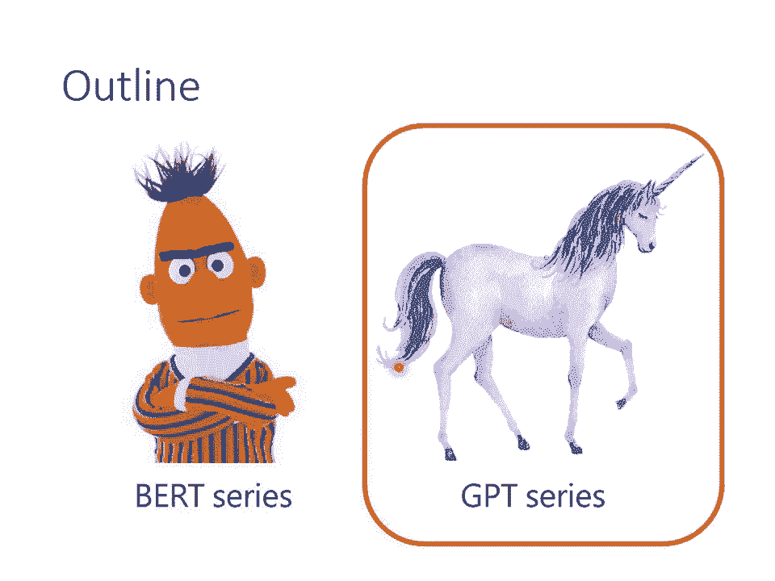

在本节课中，我们将要学习GPT模型。这是一种与BERT不同的自监督学习方法，它通过预测下一个词元（token）来训练模型，并具备强大的文本生成能力。我们还将探讨GPT如何应用于下游任务，以及自监督学习在语音和图像领域的扩展。

---

## GPT的核心任务：预测下一个词元 🎯

上一节我们介绍了BERT模型，它通过“填空”任务进行训练。本节中我们来看看GPT模型，它的核心训练任务与BERT不同。

GPT模型的任务是**预测接下来会出现的词元是什么**。这类似于一个语言建模任务。

假设训练数据中有一个句子是“台湾大学”。GPT在训练时会如何处理呢？以下是其训练过程：

1.  首先，模型接收一个“句子开始”（Begin of Sentence）标记。
2.  GPT输出一个嵌入向量（embedding）。
3.  使用这个嵌入向量去预测下一个应该出现的词元。根据训练数据，下一个词元是“台”。
4.  模型的目标是让预测的分布与正确答案之间的交叉熵（cross entropy）越小越好。

这个过程可以用以下公式表示：

**H → Linear Transform → Softmax → Distribution**

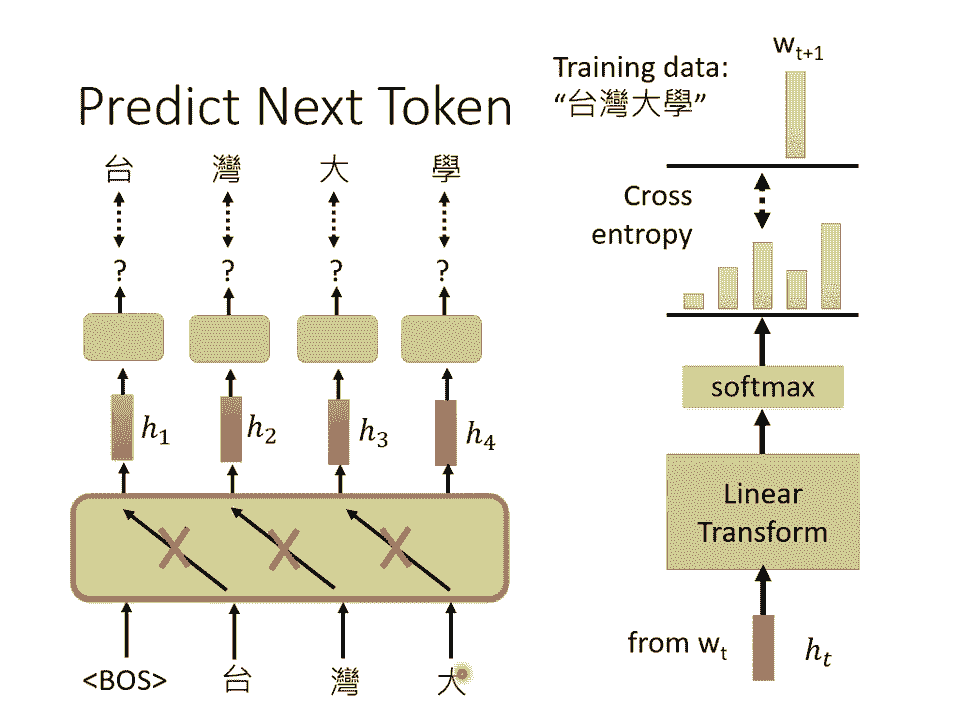

其中，`H` 是模型输出的嵌入向量，经过线性变换和Softmax后得到一个概率分布，目标是最小化该分布与真实下一个词元之间的交叉熵损失。

接下来，这个过程会反复进行：

*   输入“句子开始”和“台”，模型预测下一个词元应为“湾”。
*   输入“句子开始”、“台”、“湾”，模型预测下一个词元应为“大”。
*   以此类推。

在实际训练中，模型会使用海量的句子数据进行学习。GPT的强大之处在于，**使用巨量数据训练了一个参数规模异常庞大的模型**，从而展现出惊人的能力。

---

## GPT的模型架构 🔧

这里需要说明的是，GPT的模型架构类似于Transformer的**解码器**部分。

我们知道Transformer包含编码器和解码器。GPT的架构类似于解码器，但**移除了“编码器-解码器注意力”部分**，只使用带掩码的自注意力机制。

这意味着：
*   当模型根据“句子开始”预测“台”时，它**看不到**后面“湾”、“大”、“学”这些词元。
*   当模型根据“台”预测“湾”时，它同样**看不到**后面“大”、“学”这些词元。

这种掩码机制确保了模型在预测时只能利用当前位置之前的信息，这与“预测下一个词元”的任务要求是一致的。

---

## GPT的生成能力与应用实例 🦄

由于GPT能够预测下一个词元，因此它具备了**文本生成能力**。你可以让它不断预测下一个词元，从而生成完整的文章或段落。

GPT系列最著名的一个例子，就是它生成了一篇关于“在安第斯山脉发现独角兽”的假新闻。这篇文章活灵活现，以至于很多人提到GPT时，都会联想到这只“独角兽”。

为了让您更直观地了解GPT的运作，线上有一个演示网页叫“Talk to Transformer”。它使用了一个较小的GPT模型（最大的GPT模型并未公开），您可以输入一句话的开头，模型会自动将后续内容补全。

---

## GPT如何用于下游任务？🧠

那么，这种“补全句子”的能力，如何应用到问答系统等下游任务中呢？GPT采用了一种与BERT不同的、更为“激进”的思路。

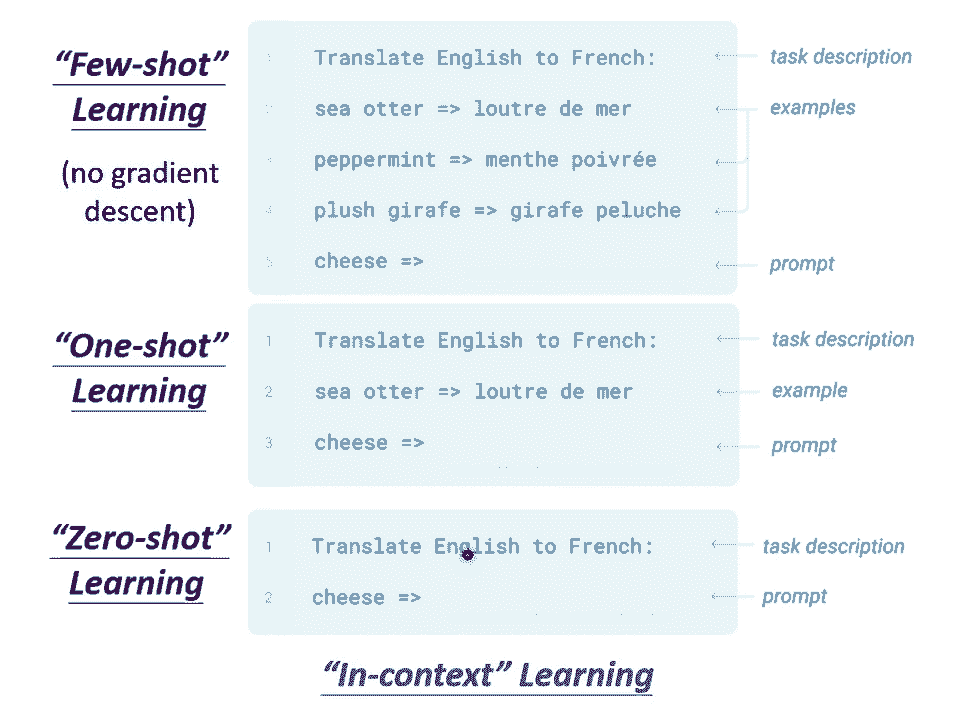

BERT的做法是：将预训练好的BERT模型拿出来，在后面接一个简单的线性分类器，然后在下游任务数据上进行微调。

GPT论文中提出了一个更接近人类学习方式的想法，称为**情境学习**。

设想你参加托福听力考试：
1.  首先，你会看到题目说明，告诉你这是选择题，并从A、B、C、D中选出答案。
2.  接着，会给你一个示例，展示题目和正确答案。
3.  最后，你看到新的问题，并期望你能举一反三开始作答。

GPT系列模型试图做同样的事情。例如，要让GPT做**翻译**任务：
1.  先输入任务描述：“Translate English to French:”。
2.  然后给几个示例：“sea otter => loutre de mer”、“plush giraffe => girafe peluche”。
3.  最后给出新的输入：“cheese =>”，并让模型补全后面的部分。

这个想法之所以“激进”，是因为在训练时，GPT**从未专门学习过翻译**。它只学会了“根据前半段文字补全后半段”。现在，我们通过几个示例（情境）直接告诉它现在要做翻译，它就能尝试给出翻译结果。

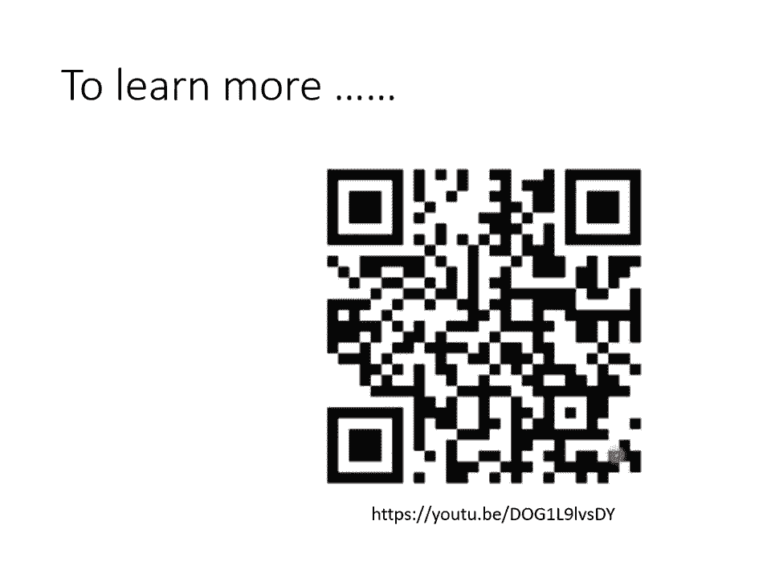

这种学习方式在GPT文献中被称为 **Few-Shot Learning**，但它与通常的机器学习不同，**完全没有使用梯度下降来调整模型参数**。因此，GPT的研究者给这种方式起了一个特殊的名字：**In-Context Learning**。

还有更具挑战性的设置：
*   **One-Shot Learning**：只给模型一个示例，就期望它学会任务。
*   **Zero-Shot Learning**：不给任何示例，只给任务描述（如“Translate English to French:”），就期望模型能执行任务。

---

## GPT-3的性能与局限 ⚖️

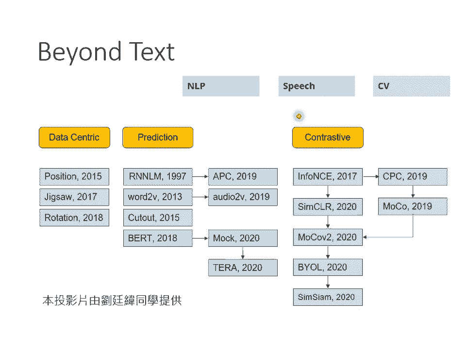

GPT系列（特别是GPT-3）是否真的实现了强大的情境学习能力呢？这是一个见仁见智的问题。

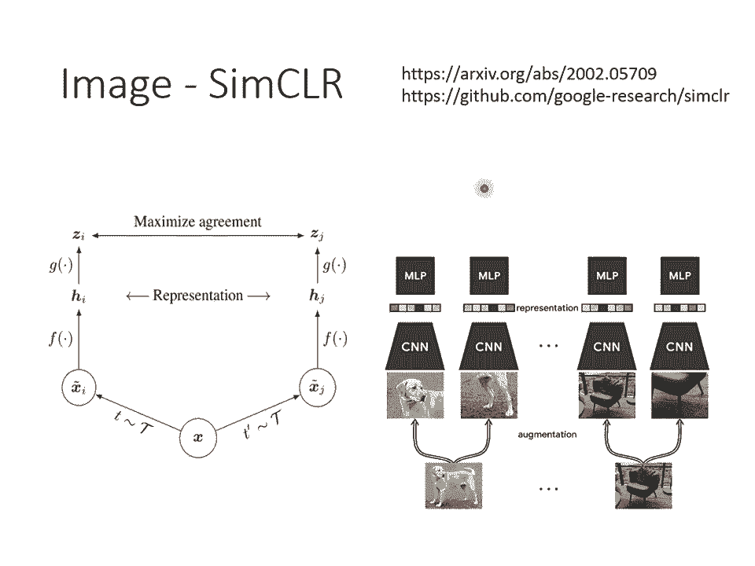

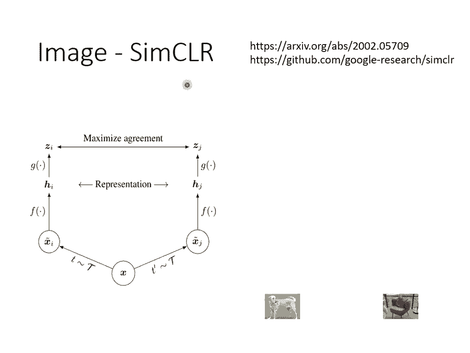

根据GPT-3论文中的实验结果：
*   它在42个不同的任务上进行了测试。
*   在Few-Shot、One-Shot、Zero-Shot三种设置下，模型的表现随着参数量的增大（从1亿到1750亿参数）而提升。
*   在Few-Shot设置下，平均正确率从20%多提升到了50%多。

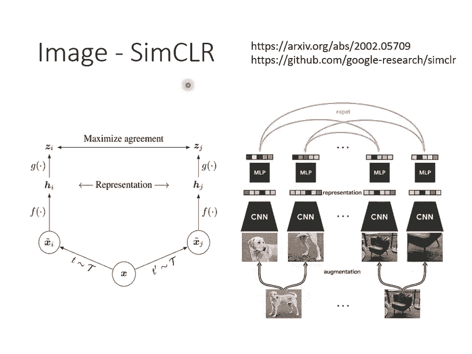

50%多的平均正确率算成功吗？这取决于评判标准。目前看来：
*   对于一些任务，如**简单的加减法运算**，GPT-3确实能够学会。
*   但对于一些需要**逻辑推理**的任务，它的表现则非常糟糕。

因此，GPT-3展现出了令人印象深刻的少样本学习潜力，但其能力并不均衡，且距离通用人工智能仍有很大差距。

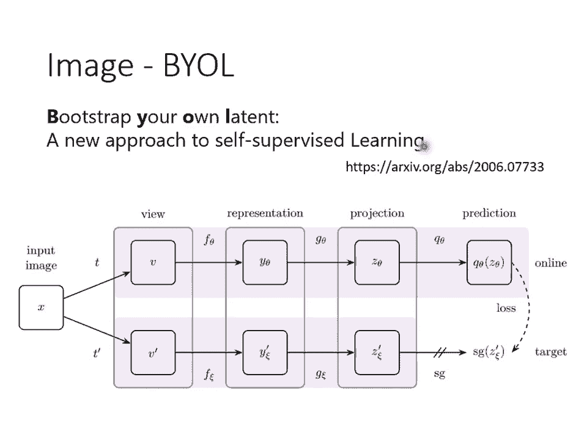

---

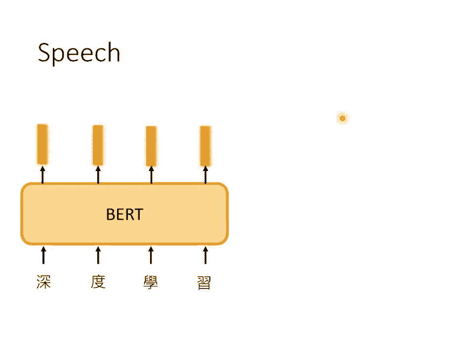

## 自监督学习不限于文字 🌈

到目前为止，我们的例子都围绕文本展开。但请不要误会，**自监督学习的概念同样可以应用于语音和图像领域**。

事实上，自监督学习的技术非常多，我们讲解的BERT和GPT只是其中“预测”这一类方法。接下来我们简要了解其他领域的应用。

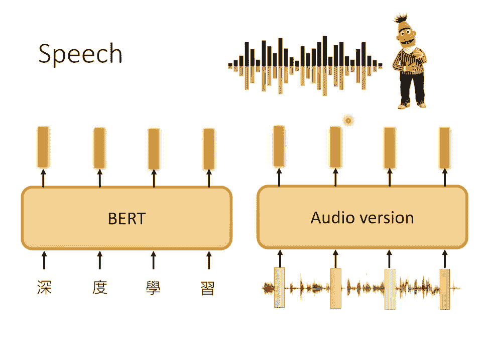

### 图像中的自监督学习 🖼️

以下是图像领域两种著名的自监督学习方法：
*   **SimCLR**：其核心思想是对同一张图像进行两种不同的数据增强，然后训练模型让这两个增强版本的表示向量尽可能接近，而与其他图像的表示向量远离。这个概念并不复杂，通过阅读论文可以理解。
*   **BYOL**：这是一个更令人惊奇的工作。它的想法在论文发表前，如果学生向我提出，我可能会认为存在巨大缺陷而难以成功。但事实上它不仅有效，还一度达到了顶尖水平。这再次说明了深度学习的奇妙之处。

### 语音中的自监督学习 🎤

在语音领域，完全可以运用自监督学习的概念：
*   你可以训练**语音版的BERT**：例如，将一段音频的部分片段掩盖，让模型预测被掩盖的部分是什么（填空任务）。
*   你也可以训练**语音版的GPT**：让模型根据已有的音频序列，预测接下来会出现的声音。

目前，语音领域相比文本领域，还缺乏一个像GLUE那样的**统一的基准测试集**。为了推动该领域发展，我们实验室与其他团队共同开发了一个语音版的“GLUE”，称为 **SUPERB**。

SUPERB是一个语音理解通用性能基准测试，它包含了10个不同的任务，全面评估模型在语音内容识别、说话人识别、情感识别和语义理解等多方面的能力。它旨在全方位检测一个自监督学习模型在理解人类语音上的能力。

---

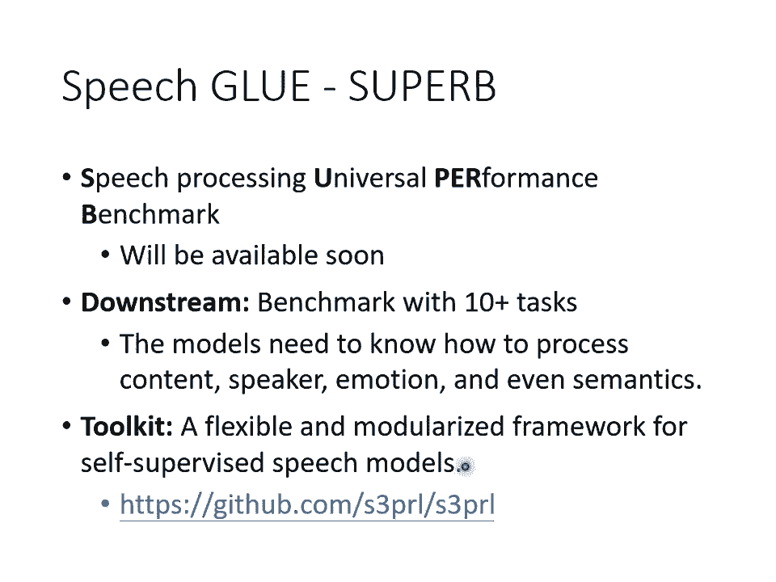

## 总结 📚

本节课中我们一起学习了：
1.  **GPT模型**的核心训练任务是**预测下一个词元**，这使其具备了强大的文本生成能力。
2.  GPT的模型架构类似于**Transformer的解码器**，并使用掩码自注意力机制。
3.  GPT应用于下游任务时，采用了一种创新的 **“情境学习”** 方式，通过提供任务描述和少量示例，让模型在不更新参数的情况下适应新任务。
4.  最新的GPT-3模型在少样本学习上展现了潜力，但其能力并不全面，仍有局限性。
5.  最后，我们了解到**自监督学习是一个广阔的领域**，其技术不仅适用于文本，在图像和语音处理中也有丰富且活跃的研究与应用，例如图像领域的SimCLR、BYOL，以及语音领域的SUPERB基准测试集。

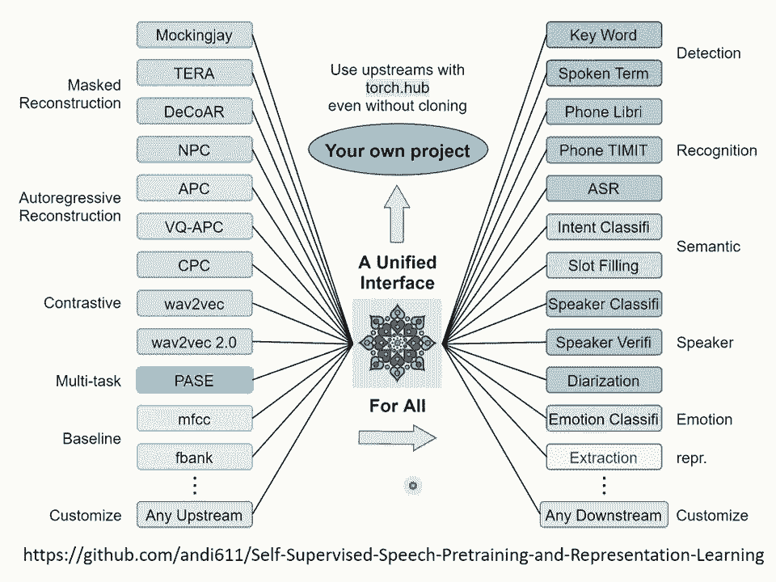

自监督学习为我们提供了利用海量无标注数据训练强大模型的新范式，是当前人工智能研究的前沿方向之一。