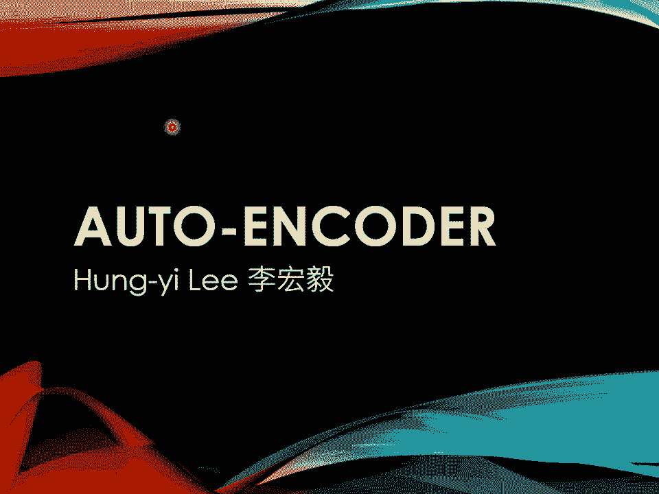
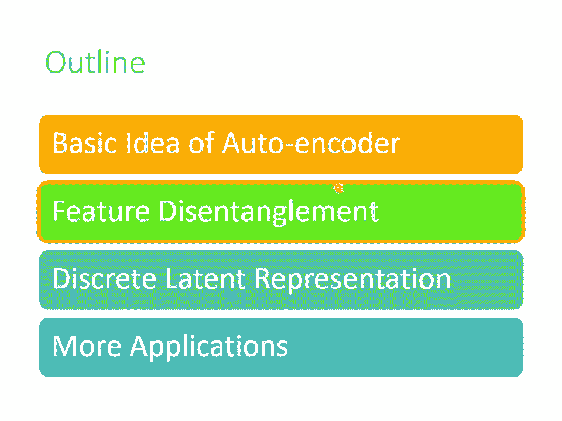

# 22：L14.1 - 自编码器1：基本概念 🧠

在本节课中，我们将要学习自编码器的基本概念。自编码器是一种无监督学习模型，它能够学习数据的有效表示，是深度学习中的一个重要组成部分。

## 概述

自编码器可以被视为自监督学习的一种预训练方法。它的核心思想是让模型学习如何压缩数据，然后再重建数据，整个过程无需任何标注数据。

## 自编码器的工作原理

上一节我们介绍了自编码器属于自监督学习的范畴，本节中我们来看看它的具体工作原理。

自编码器包含两个主要部分：一个**编码器**和一个**解码器**。以下是它们的工作流程：

1.  **编码器**接收输入数据（例如一张图片），并将其转换为一个低维度的向量表示。这个向量通常被称为**嵌入**、**表示**或**代码**。
    *   公式表示：`h = Encoder(x)`
2.  **解码器**接收这个向量，并尝试重建出与原始输入尽可能相似的数据。
    *   公式表示：`x' = Decoder(h)`
3.  训练的目标是最小化原始输入 `x` 与重建输出 `x'` 之间的差异（例如均方误差）。
    *   目标函数：`Loss = ||x - Decoder(Encoder(x))||^2`

这个过程完全不需要标注数据，只需要大量未标注的数据即可进行训练。

## 自编码器的应用：降维与下游任务

理解了自编码器如何工作后，我们来看看它的实际用途。自编码器最常见的应用之一是**降维**。

编码器将高维度的输入数据（例如一张数万维的图片）压缩成一个低维度的向量（例如100维）。这个中间的低维向量层被称为**瓶颈层**。

以下是自编码器用于下游任务的典型方式：

1.  使用大量无标签数据预训练一个自编码器。
2.  将训练好的编码器部分固定下来。
3.  对于新的下游任务（如图片分类），我们将输入图片通过这个编码器，得到其低维表示。
4.  使用这个低维表示（而非原始高维像素）作为特征，来训练一个简单的分类器。

这样做的好处是，编码器学习到的低维表示可能捕捉到了数据最本质的特征，从而使得下游任务需要更少的标注数据就能获得良好的性能。

## 自编码器的变体：去噪自编码器

自编码器有许多变体，其中一个重要的变体是**去噪自编码器**。它的核心思想是让模型学习从带噪声的数据中恢复出干净的数据。

以下是其工作原理：

1.  我们首先对原始输入数据 `x` 人为地添加一些噪声，得到带噪声的数据 `x̃`。
2.  将 `x̃` 输入编码器，得到编码 `h`。
3.  解码器根据 `h` 进行重建，目标是输出原始的干净数据 `x`，而不是带噪声的输入 `x̃`。
4.  训练目标是最小化重建输出与原始干净数据 `x` 之间的差异。

通过这种方式，模型被迫学习到数据中更鲁棒的特征，从而能够去除噪声。有趣的是，像 **BERT** 这样的现代自然语言处理模型，其掩码语言模型任务本质上就是一个针对文本的**去噪自编码器**。

## 历史背景

自编码器并不是一个全新的概念，它拥有悠久的历史。例如，深度学习先驱 Geoffrey Hinton 在 2006 年发表于《科学》杂志的论文中就探讨了基于受限玻尔兹曼机的深层自编码器训练方法。早期的研究认为深层网络需要分层预训练，但随着技术的发展，人们发现端到端的训练方式更为有效。

## 总结

本节课中我们一起学习了自编码器的基本概念。我们了解到：

*   自编码器是一种无监督/自监督学习模型，由编码器和解码器组成。
*   其核心目标是学习数据的压缩表示，并能从该表示中重建数据。
*   编码器学习到的低维表示（瓶颈层）可以用于数据降维，并作为下游任务的有效特征。
*   去噪自编码器通过让模型学习去除噪声，能够学习到更鲁棒的数据表示。
*   自编码器的思想历史悠久，并且与现代模型（如BERT）的核心思想一脉相承。

自编码器为我们提供了一种理解数据内在结构和进行特征学习的强大工具。