# 23：L14.2 - 自编码器2：领结变声器与更多应用 🎙️🔧

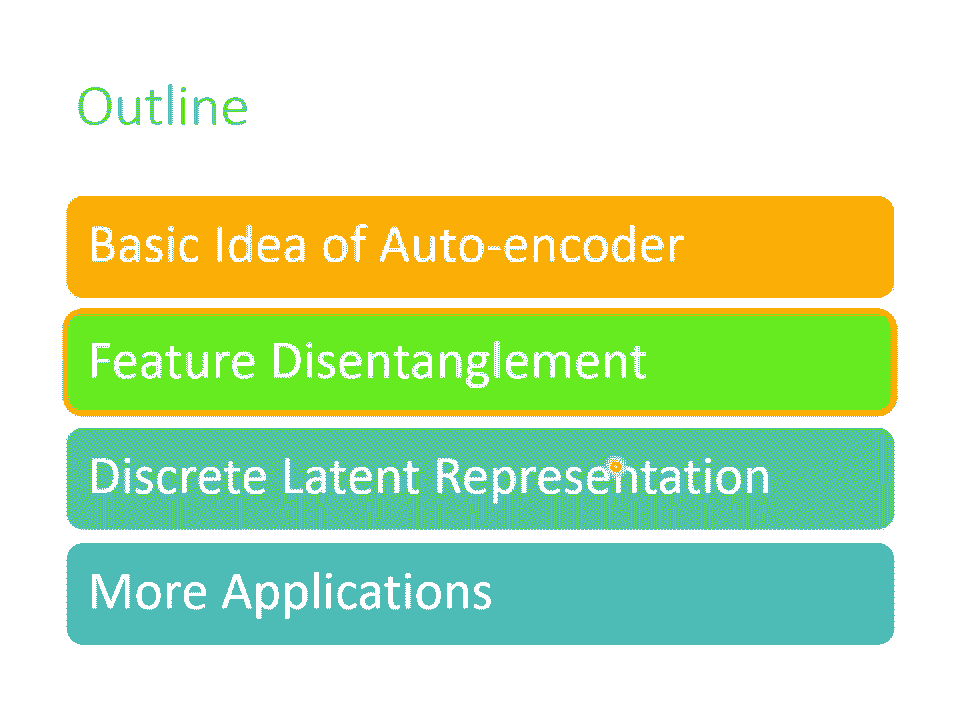

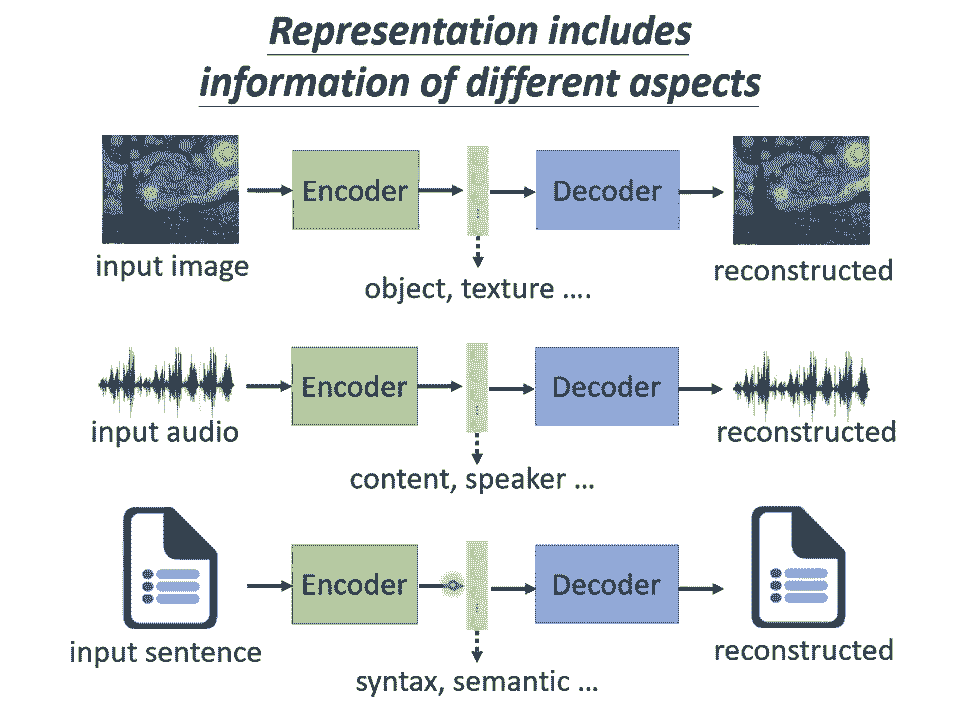

在本节课中，我们将继续探索自编码器的应用。上一节我们介绍了自编码器的基本概念和下游任务，本节中我们将深入了解特征解缠、离散潜在表示等高级概念，并探讨自编码器在语音转换、异常检测等领域的实际应用。

## 特征解缠 🧵

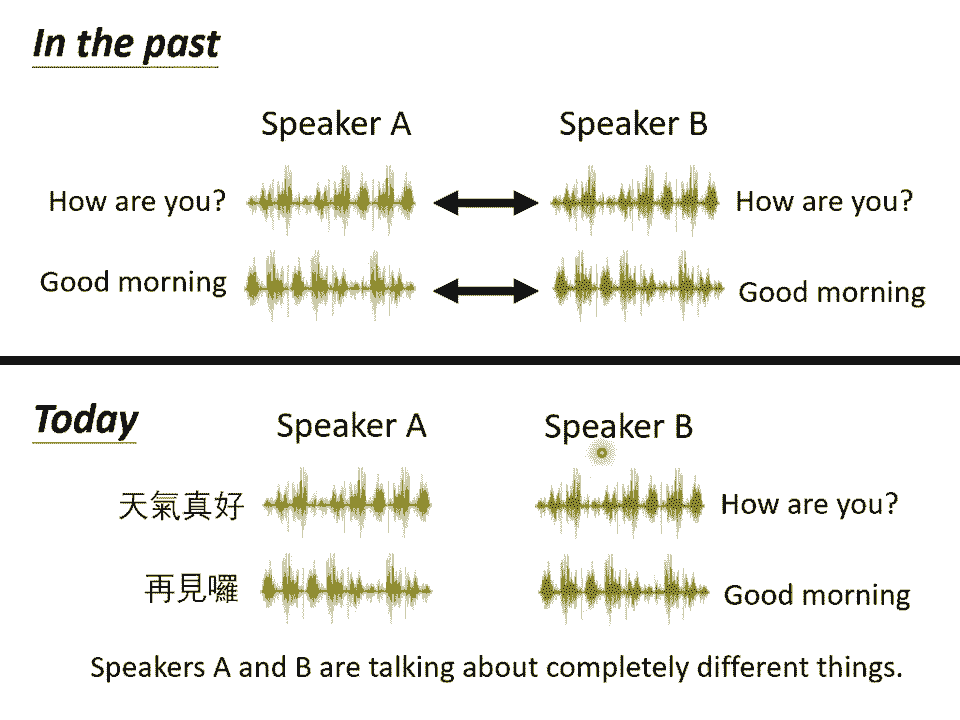

上一节我们介绍了自编码器如何将输入数据压缩为包含所有重要信息的编码。然而，这些信息通常是纠缠在一起的。本节中我们来看看特征解缠技术，它旨在将编码中不同维度的信息分离开来。

特征解缠的目标是解开原本纠缠在一起的特征。自编码器将输入（如图片）编码为一个向量，再解码回原始输入。这个向量包含了输入的所有关键信息。例如，在语音中，向量可能同时包含语音内容和说话人身份的信息；在文本中，可能同时包含句法和语义信息。但这些信息都混合在一个向量中，我们无法区分哪些维度对应哪些具体信息。

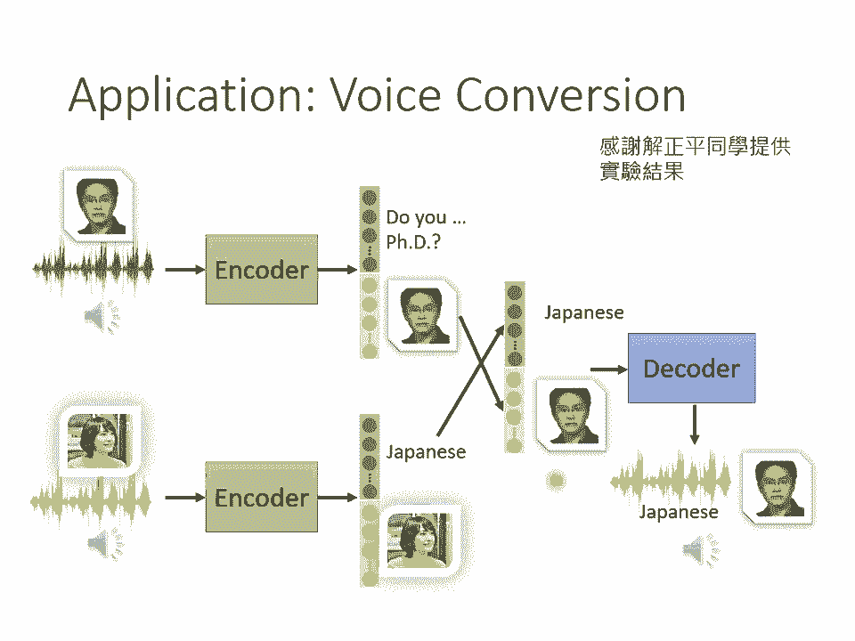

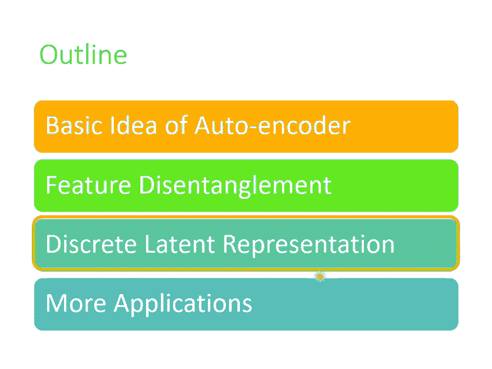

特征解缠技术试图在训练自编码器时，让编码的特定维度明确代表特定类型的特征。例如，一个100维的编码，可能前50维代表语音内容，后50维代表说话人特征。以下是实现这一目标可能带来的应用：

*   **语音转换**：这项技术可以将一个人的声音转换为另一个人的声音，类似于动画中的“领结变声器”。传统方法需要成对的语音数据（两个人说相同的句子），而利用特征解缠，即使说话人使用不同语言或说不同句子，也有可能实现声音转换。

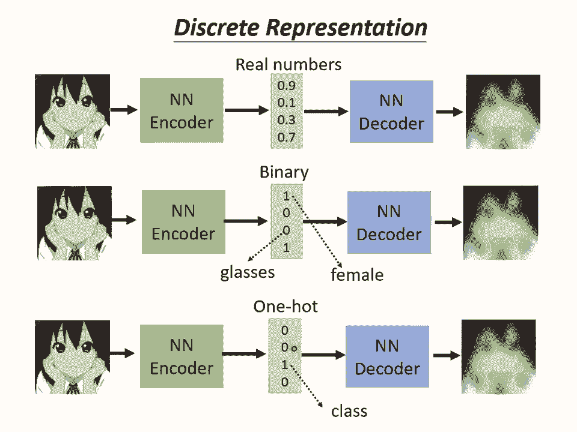

具体操作流程如下：首先，用大量语音数据训练一个具备特征解缠能力的自编码器。这样，编码器输出的向量中，代表“内容”和“说话人特征”的维度就被分开了。接着，将说话人A的语音编码，取出其“内容”部分；将说话人B的语音编码，取出其“说话人特征”部分。将这两部分拼接成一个新向量，输入解码器，就能得到具有B的声音特征、但说着A的内容的语音。这项技术在图像和自然语言处理中也有类似应用。

## 离散潜在表示 🔢

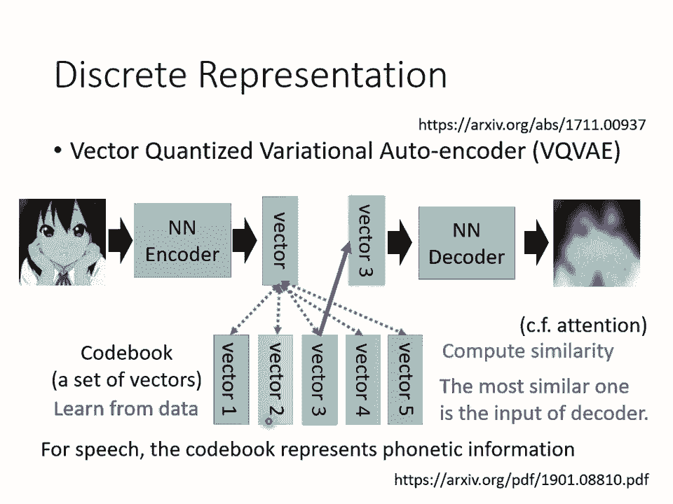

到目前为止，我们都假设编码是连续的实数向量。本节中我们来看看编码是否可以表示为其他形式，例如离散值。

将编码变为离散值（如二进制或独热编码）可能带来好处。二进制编码可以让每个维度明确表示某种特征的有或无。独热编码则意味着编码中只有一个维度为1，其余为0。如果强制编码为独热向量，或许可以实现无监督分类。例如，在手写数字识别中，如果编码是10维的独热向量，那么每种独热编码可能自动对应到一个数字（0-9）。

在离散表示技术中，最著名的是**向量量化变分自编码器**。它的工作原理是：编码器输出一个连续向量后，会与一个可学习的“码本”中的多个向量计算相似度，并选取最相似的向量作为离散表示，传递给解码器。在训练中，编码器、解码器和码本一同被学习。这样做的好处是，解码器的输入被限制为码本中的有限选项，从而实现了离散的潜在表示。例如，在语音上应用VQ-VAE，码本中的向量可能学会对应到基本的发音单位。

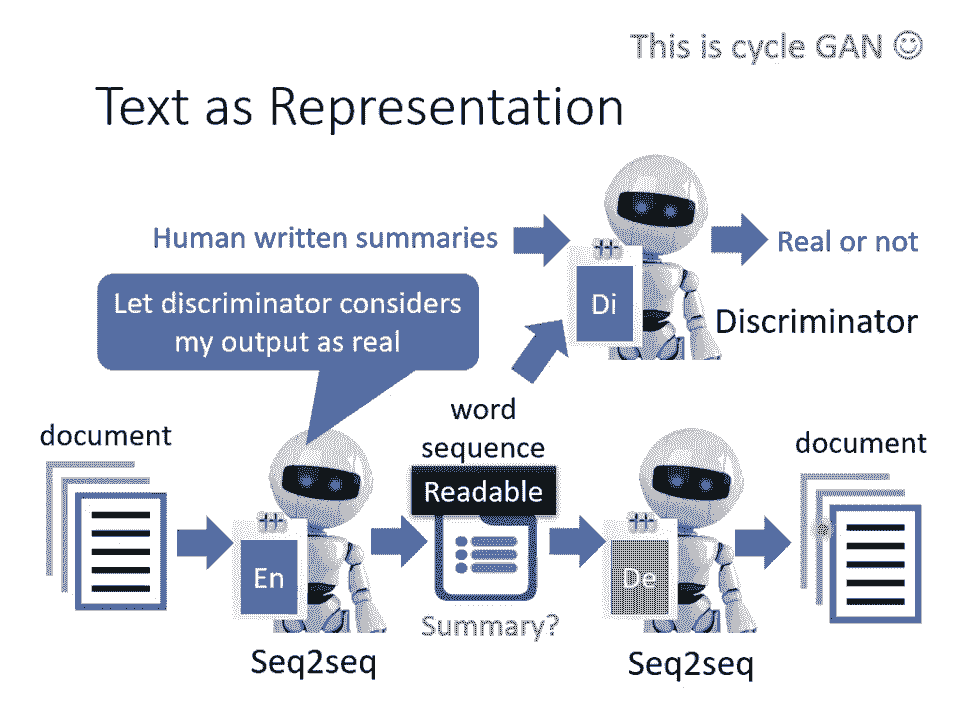

## 更广义的表示：文字与树结构 📝🌳

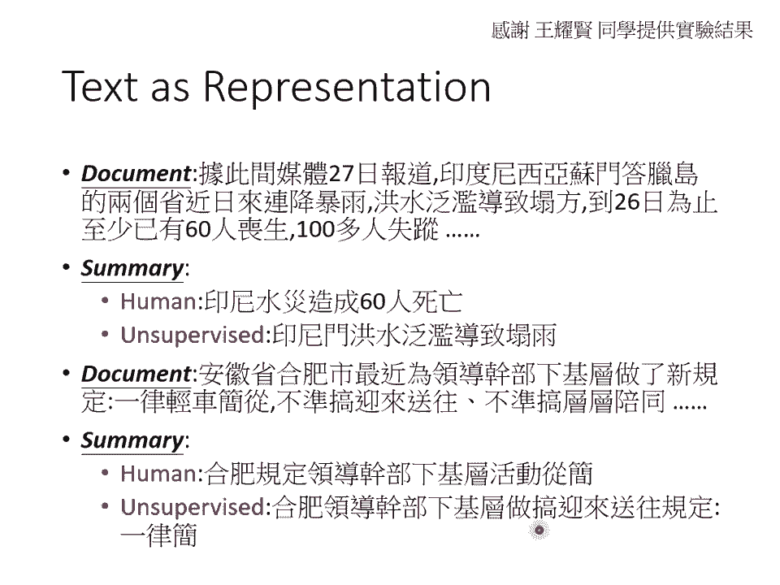

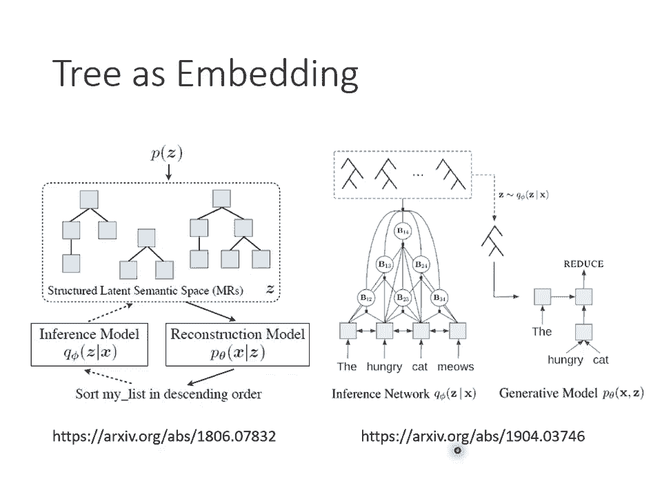

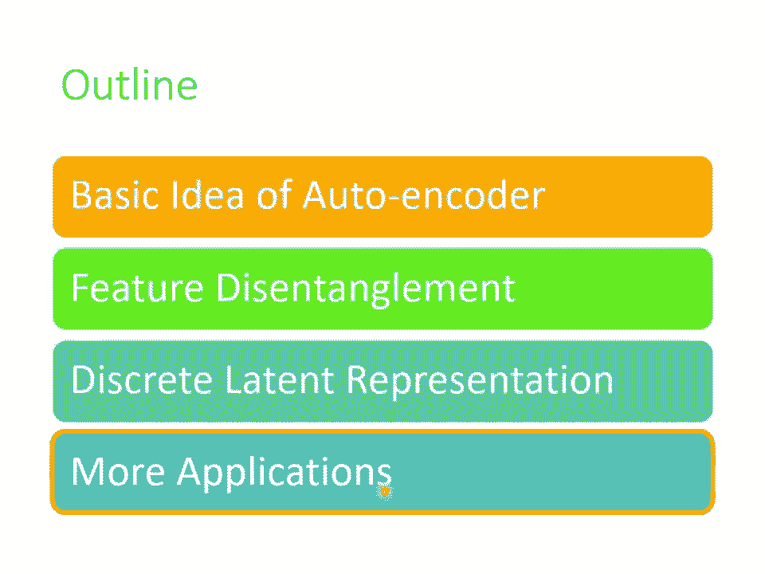

我们进一步思考，表示一定要是向量吗？本节中我们来看看能否使用更复杂的结构，如文字或树结构，作为编码。

**以文字作为编码**：在文本自编码器中，编码器读入一篇文章，输出一段文字（而非向量），解码器再将这段文字还原成原文。如果这段输出文字能通过解码器还原原文，那它很可能就是原文的精华——即摘要。这为实现无监督的自动摘要提供了可能。然而，直接训练这样的模型会遇到问题：编码器和解码器可能会发明一套人类无法理解的“暗号”进行通信。为了解决这个问题，可以引入对抗训练的思想，加入一个判别器来迫使编码器生成人类可读的句子。这本质上与循环生成对抗网络的思想相似。

**以树结构作为编码**：也有研究尝试将输入（如文本）编码为树形结构，再从这个树结构解码回文本。这为理解文本的层次化结构提供了新思路。

## 自编码器的其他应用 🛠️

除了上述应用，自编码器还有许多其他用途。本节中我们来看看其中几个重要的方向。

*   **作为生成器**：自编码器的解码器本身就是一个生成器，它可以接受一个从某个分布（如高斯分布）中采样的向量，并生成数据（如图片）。变分自编码器正是利用了这一思想来构建生成模型。
*   **数据压缩**：编码器可以将高维输入压缩为低维编码，这可以看作是一种有损压缩技术，类似于JPEG图像压缩。解码器则执行解压缩操作。
*   **异常检测**：这是我们课程作业将重点应用的技术。其核心思想是：使用大量“正常”数据训练一个自编码器。在测试时，给模型输入新数据，如果该数据与训练数据相似（属于“正常”类），则自编码器能够较好地重构它，重构误差小；反之，如果数据是“异常”的，重构误差就会很大。通过计算重构损失，可以判断新数据是否异常。这种方法特别适用于难以获取异常样本的场景，也称为单类分类问题。异常检测在欺诈检测、网络入侵检测、医疗诊断等领域有广泛应用。

## 总结 📚

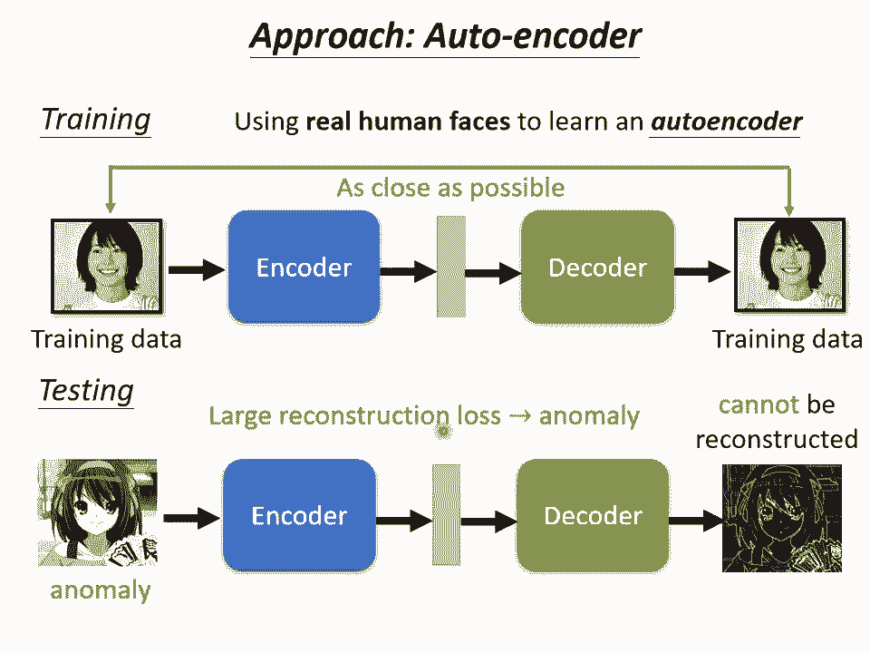

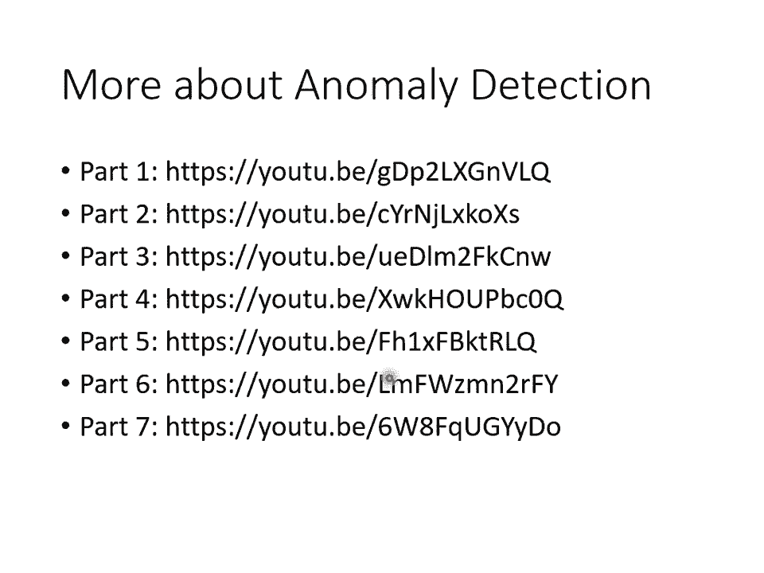

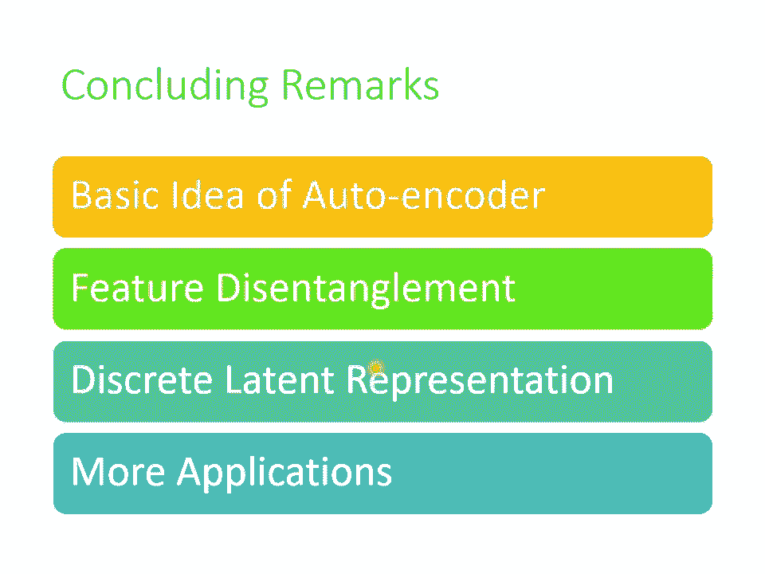

本节课我们一起深入学习了自编码器的多种高级应用。我们探讨了特征解缠技术如何分离编码中的不同信息，并实现了像语音转换这样的有趣应用。我们了解了离散潜在表示（如VQ-VAE）以及用文字甚至树结构作为编码的前沿思路。最后，我们还介绍了自编码器作为生成器、压缩工具以及在异常检测中的重要作用。自编码器作为一个基础而强大的框架，其灵活性和潜力在各种机器学习任务中不断得到展现。