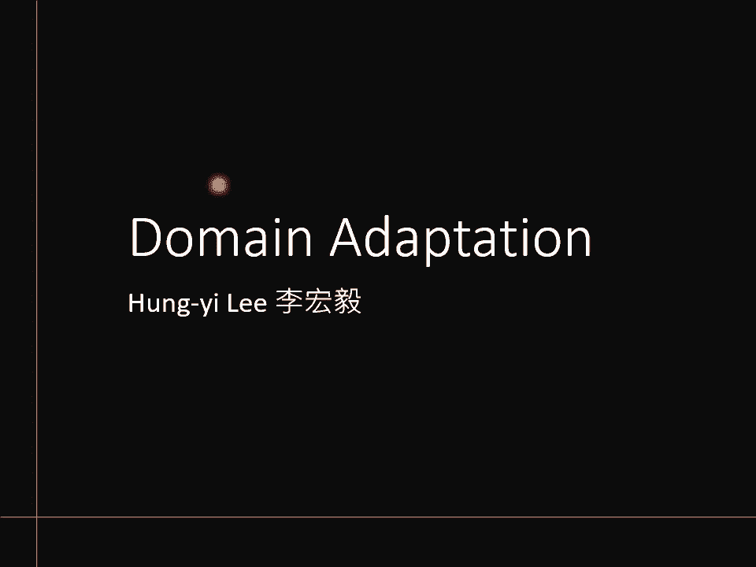
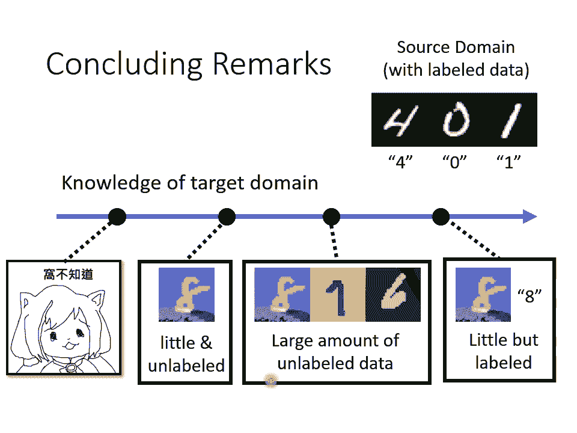

# 28：L17 - 概述领域自适应 🎯

在本节课中，我们将要学习**领域自适应**的核心概念。我们将探讨当训练数据和测试数据分布不同时，如何让模型依然保持良好的性能。这是迁移学习中的一个重要环节，对于将实验室模型应用到真实场景中至关重要。

---

## 领域偏移问题

上一节我们介绍了领域自适应的背景，本节中我们来看看什么是**领域偏移**。

到目前为止，我们已经训练了许多机器学习模型。训练一个分类器对大家来说已不是问题。假设要训练一个数字分类器，只要有训练数据，训练好模型后应用在测试数据上即可。

像数字识别这么简单的问题，在基准测试上可能轻松达到95%的正确率。但是，如果测试数据与训练数据的分布不同，会发生什么呢？

我们举一个简单的例子。假设训练时数字是黑白的，但测试时数字是彩色的。你可能认为，虽然一边是黑白一边是彩色，但对模型来说数字形状是一样的。它能在黑白图片上认出数字，在彩色图片上应该也可以。

但实际上并非如此。如果在黑白数字上训练一个模型，直接用在彩色数字上，得到的正确率会非常低，只有57%。这不能算是一个及格的分数。

因此，一旦训练数据与测试数据之间存在差异，即它们的分布不同，在训练数据上训练出的模型在测试数据上就可能失效。这种问题叫做**领域偏移**。

在多数作业或基准测试中，我们都假设无视领域偏移问题，训练数据与测试数据往往有着相同的分布。这会给人们一个错误的印象，即人工智能在很多任务上都有极高的正确率。但实际上，当训练数据与测试数据存在差异时，机器能否做好就是一个未知数。

我们今天要讲的就是，当训练数据与测试数据存在差异时，有没有什么方法可以让我们做得比什么都不做更好。这就是**领域自适应**技术。

领域自适应技术也可以看作是**迁移学习**的一种。迁移学习是指在A任务上学到的技能可以被用在B任务上。对于领域自适应来说，训练数据来自一个领域，测试数据来自另一个领域。你要把一个领域学到的知识用在另一个领域上，所以它可以看作是迁移学习的一个环节。

在过去的上课录音中，有完整讲解迁移学习相关的技术。由于今天时间有限，我们只聚焦在领域自适应的部分。如果你有兴趣，可以再看一下过去的上课录音。

领域偏移其实有很多种不同的类型。我们刚才看到的只是其中一种，即模型输入数据的分布发生变化。输入分布变化是一种可能性。

其实还有另一种可能性，即输出的分布也可能变化。举例来说，在训练数据上，可能每个数字出现的概率都一样。但在测试数据上，可能每个数字输出的概率不同，某个数字出现的概率特别大。这也是有可能的，这也是一种领域偏移。

还有一种更罕见但并非完全不可能发生的状况是，输入和输出虽然分布可能一样，但它们之间的关系变了。也许在训练数据里，这种东西叫做“零”，但在测试数据里，这种东西叫做“一”。这也不是不可能的。有时可能发生输入和输出关系在训练和测试数据中不一样的状况。这又是另一种领域偏移。

我们今天只专注在**输入数据不同**的领域偏移上。

在接下来的课程里，测试数据我们称其来自**目标领域**，训练数据我们称其来自**源领域**。所以源领域是我们的训练数据，目标领域是我们的测试数据。

---

## 领域自适应的情境

在领域自适应中，我们的情境是这样的：我们有一堆训练数据。这边我们直接拿手写数字辨识来当例子。我们有一堆来自源领域的训练数据，而且这些数据是有标注的，我们知道每张图片对应的数字是什么。

我们希望用这些数据训练出一个模型，这个模型可以用在不一样的领域上。要把这个模型用在不一样的领域上，在训练时，我们就必须对另一个领域，即测试数据所在的目标领域，有一些了解。

随着了解的程度不同，我们就有不同的领域自适应方法。

了解最多的情况是，假设我们在目标领域上有一点数据，而且这些数据居然还有标签。那这是一种情况。

还有一种更好的状况是，也许你根本在目标领域上就有一大堆的数据，那些数据也都有标签，那你其实就不需要做领域自定了，直接拿目标领域的数据来训练就好。

所以，要做领域自定的情境，可能是你在目标领域有数据也有标注，但量非常少。在这种状况下怎么办呢？

这种状况还算是在领域自适应里比较容易处理的状况。如果你遇到的是有标注资料但资料量很少的情况，你可以用这些有标注的资料来**微调**你在源领域上训练出来的模型。这边所谓的微调，就跟你在做BERT时的行为很像，就是你已经有一个在源领域上训练好的模型，然后你拿目标领域数据只稍微跑两三个epoch就足够了。

在这种情境下，你需要注意的问题就是因为目标领域的数据量非常少，所以你要小心不要过拟合。也就是说你不要在目标领域的数据上跑太多的迭代。如果跑太多迭代可能会过拟合到这些少量的数据上，然后在你真正的测试集上就做不好。这是有可能的。

为了避免过拟合的情况，过去就有很多的解决方案，比如把学习率调小一点，让微调前和微调后的模型参数不要差很多，或者让微调前和微调后的模型，它的输入和输出的关系不要差很多等等。有很多不同的方法，这边我们就不细讲。

今天主要想跟大家分享的情境，也是我们作业要处理的情境是：我们在目标领域有大量的资料，但是这些资料是**没有标注**的。你的目标是有颜色的数字，你收集到了一大堆有颜色的数字图片，但是没有人标注每张图片里的数字是什么。

我们在作业里面要处理的就是遇到这种状况时，到底应该怎么解？像这种情境，其实是蛮符合你在真实系统上有可能会发生的情境。举例来说，你在实验室里训练了一个模型，想把它用在真实的场域里，你就把模型上线。确实有一些人来用，但你发现得到的结果很差，大家都嫌弃你的系统正确率很低。那怎么办？但这个时候你也许就可以用领域自适应的技术。因为你的系统已经上线，真的有人使用，所以你可以收集到一大堆的资料，只是这些资料是没有标注的。

现在的问题是，怎么用这些没有标注的资料，来帮助我们在源领域上训练出一个模型，让它可以用在目标领域上呢？

---

## 核心思想：特征提取器

这边最基本的想法是这个样子的：我们想要找一个**特征提取器**。这个特征提取器其实也是一个神经网络，它以一张图片作为输入，吐出一个特征向量。

虽然源领域和目标领域的图片表面上看起来不一样，但特征提取器会把它们不一样的部分拿掉，只抽取出它们共同的部分。所以，虽然从图片上看起来这两组图片（一个有颜色，一个没颜色）本来就很不一样，但我们期待这个特征提取器可以学到无视颜色这件事，把颜色的资讯滤掉。

今天不管是来自源领域的图片还是来自目标领域的图片，只要通过这个特征提取器后，它们得到的特征看起来是没有差异的，它们看起来有一样的分布。这样你就可以用这些特征训练一个模型，在源领域上训练一个模型，直接用在目标领域上。

接下来的问题就是，怎么找出这样一个特征提取器？

其实我们可以把一个一般的分类器分成**特征提取器**和**标签预测器**两个部分。我们知道一个图像分类器就是输入一张图像，输出分类结果。假设这个图像分类器有10层，我们就可以说前5层算是特征提取器，后5层算是标签预测器。因为前5层，一张图像通过后输出就是一个向量（如果是CNN，输出其实是特征图，但特征图拉直也可以看作是一个向量）。这个向量再丢到标签预测器（后面5层），它会产生类别。

所以我们可以把前5层看作是特征提取器。你可能会问，为什么是前5层？为什么不是前4层、前3层、前2层、前1层？可以是前4、前3、前2、前1，这是你自己决定的。一个分类器里哪些部分算特征提取器，哪些部分算标签预测器，这是你自己决定的，这算是一个超参数，就跟神经网络架构要调一样。

如果你今天用领域对抗训练的方法（等一下会用的方法叫**领域对抗训练**），你要把分类器里的哪几层当作特征提取器，这个也要问你自己，这也是你自己要决定的。

---

## 领域对抗训练

我们现在要怎么训练这个特征提取器和标签预测器呢？

对于源领域的数据，源领域的数据是有标注的。我们就期待把源领域数据丢进去，跟训练一个一般的分类器一样，它通过特征提取器再通过标签预测器可以产生正确的答案。

但不一样的地方是，目标领域的这些数据，我们有一堆目标领域的数据，但这些数据是没有任何标注的。所以我们不能说把这些数据丢进去后，期待标签预测器输出什么数字，因为我们根本不知道标签预测器输出什么数字才是对的。

但是这些数据可以怎么被使用呢？这些数据的使用方式就是，我们把这些图片丢进这个图像分类器，然后我们把特征提取器的输出拿出来看。拿出来看以后，我们希望源领域的图片丢进去得到的特征，跟目标领域图片丢进去得到的特征，它们看起来要分不出差异。也就是说，源领域图片的特征我们用蓝色的点来表示，目标领域图片的特征我们用红色的点来表示，我们要这些蓝色的点跟这些红色的点分不出差异。

那怎么让蓝色的点跟红色的点分不出差异呢？这就要借由**对抗训练**的技术。等一下如果你觉得这一段讲得有点快也没有关系，等一下助教会再更详细地讲一次。

我们现在要做的事情就是训练一个**领域分类器**。这个领域分类器就是一个二元的分类器，它以特征提取器的输出作为输入。它要做的事情就是判断这个特征是来自于源领域还是来自于目标领域。

而特征提取器学习的目标就是要去想办法**骗过**这个分类器。听到“骗过”这件事，是不是让你脑中就浮现了GAN（生成对抗网络）？没错，领域对抗训练就非常像是GAN。你可以把特征提取器想成是生成器，把领域分类器想成是判别器。其实对抗训练最早的论文发表在2015年的ICML上，比那个GAN还要稍微晚一点点，不过他们几乎可以说是同时期的作品。在对抗训练那篇论文里是有引用到GAN那篇论文的，但那时候GAN那篇论文还没有上NeurIPS，所以只说“有一篇另外的论文提了个叫GAN的想法，他是技术报告放在网络上的，跟我的想法有点像”，所以他们算是一个同时期的作品。

但是讲到这边，领域对抗训练跟GAN还是有一点不一样的。因为在这个游戏里，对生成器（特征提取器）来说，它要骗过判别器（领域分类器）完全不需要花什么力气。有一个非常无脑的做法就是：你的特征提取器不管看到什么输入，永远都输出零向量就好了。看到什么输入，我都输出一个零向量。那对领域分类器来说，它完全不知道输入图像是什么，它永远都看到零向量，它就完全无法分辨这个向量来自于哪一个领域。但这显然不是我们要的状况。

如果特征提取器只会输出零向量，那样子等于根本就什么事都没有做是一样的。那这件事情会发生吗？其实这件事情是不会发生的。为什么？因为标签预测器也需要这个特征。标签预测器也需要这个特征让它可以去判断输入的图片属于哪一个类别。所以假设生成器（特征提取器）就直接“放大绝”，说今天不管输入什么样的图像，我输出都是零向量。那对于标签预测器来说，它就没有办法判断是哪一张图片。在这个情况下，因为特征提取器还是需要产生这个向量让标签预测器可以产生正确的图片，所以特征提取器就不能“放大绝”，它就不能看到什么东西永远都输出零向量。

---

## 数学形式化

这边我们用符号再稍微把我们刚才讲过的事情重新说得更清楚一点。

假设标签预测器的参数是 `θ_y`，领域分类器的参数是 `θ_d`，特征提取器的参数是 `θ_f`。

源领域上的这些图像是有标签的，所以你可以算它们的交叉熵损失。根据它们的交叉熵损失定出一个损失函数 `L_y`。

对于领域分类器而言，它要去想办法分辨源领域和目标领域的特征，它要去做一个二元的分类问题。这个分类问题有一个损失函数 `L_d`。

我现在要去找一组参数 `θ_y`，它可以让 `L_y` 越小越好。我们要去找一组参数 `θ_d`，它可以让 `L_d` 越小越好。也就是说，标签预测器要做的事情就是让分类越正确越好；领域分类器做的事情就是让领域分类越正确越好。

特征提取器呢？特征提取器要做的事情是，它站在标签预测器这边，然后它要去“捅”领域分类器一刀，它要去做跟领域分类器相反的事情。所以这个特征提取器的损失是标签预测器的损失 `L_y` 去减掉领域分类器的损失 `L_d`。所以特征提取器的损失就是 `L_y - L_d`。你要去找一组参数 `θ_f`，它可以让 `L_y - L_d` 的值越小越好。

这个是最原始的领域对抗训练做法。但这真的是最好的做法吗？你可以想想看。详情我们就不细讲，这个留给大家自己思考、自己发掘。你想想看，假设领域分类器的工作是要把源领域和目标领域分开，是要看到这种特征知道它来自源领域，看到那种特征知道它来自目标领域。它要把这两组特征分开。而特征提取器如果它的损失是领域分类器损失直接加一个负号，那意味着什么？意味着说它要做的事情就是跟分类器相反：本来分类器看到这个图的特征说是源领域，现在特征提取器是要让分类器看到这个图以后，说是目标领域；看到那个图反过来要说是源领域。如果你这么做，不也是把两组特征分开了吗？我们说我们现在要做的事情是要让源领域和目标领域没有分别，但是你今天不管是用 `L_d` 还是负的 `L_d`，其实都是要把源和目标分开。你让 `L_d` 的值本来分类器让 `L_d` 越小越好，你现在是特征提取器要让 `L_d` 的值越大越好，其实也是把源和目标分开。所以这未必是最好的做法。至于怎么做可以做得更好，哎，这个留给大家慢慢思考。但这招是有用的。

---

## 原始论文结果

我们来看一下领域对抗训练最原始的论文，它做的结果怎么样呢？当年看到这个论文的时候，真的觉得结果非常惊人。

这边它做了4个任务。上半部是源领域的图片，这边其实都是数字辨识。下半部都是目标领域的图片。

如果今天是拿目标领域的图片来做训练，目标领域的图片来做测试，那结果像是这样，每个任务正确率都是90%以上。

但如果我们是源领域训练，目标领域测试，却在黑白的数字上训练，在彩色的数字上测试，结果直接“铲掉”（崩溃），没办法做了，结果直接“铲掉”。

如果加上领域对抗训练的话，结果怎么样呢？你会发现，本来如果只在黑白图片上训练，在彩色图片上测试，正确率57.5%。如果今天做了领域对抗训练，正确率就飙升到81%。在很多其他任务上进步量都挺明显的，59%到71%，74%到88.7%，进步量都是挺明显的。这个就是领域对抗训练。

---

## 领域对抗训练的局限与改进

刚才这整套想法还是有一个限制，有一个小小的问题。什么样小小的问题呢？我们来看看。

今天蓝色的圈圈跟蓝色的三角形代表源领域上的两个类别。我们当然可以找一个决策边界去把这两组类别分开来。对于目标领域上的数据，我们没有任何的标签，我们就只能用正方形来表示它。

我们今天训练的目标就是要让这些正方形（目标领域特征）的分布，跟圈圈三角形合起来（源领域特征）的分布越接近越好。但是什么叫做越接近越好呢？

左边这个情况，红色的点跟蓝色的点，它们也算是蛮“挨”在一起的，也算是分布蛮接近的。右边这个情况，红色的点跟蓝色的点，它们也算是分布蛮接近的。但是你觉得左边比较好，还是右边比较好呢？

大多数同学都觉得是右边。没错，很多人都觉得是右边。所以我们是不是应该要让右边的状况发生，而避免让左边的状况发生呢？怎么做呢？怎么让右边的状况发生，左边的状况不要发生呢？

也许一个可能的想法是，我们既然知道蓝色的圈圈跟蓝色的三角形的分界点在哪里，而这个分界点我们是知道的，那我们应该要让这些方形（虽然我们不知道它是哪一个类别）远离这个分界点。

怎么让方形远离这个分界点呢？在文献上就有很多不同的做法了。你可以参考一下文献，看看你觉得怎么做比较好。

举例来说，一个最简单的做法是说，今天我有很多无标签的图片。丢到特征提取器再丢到标签预测器以后，我不知道它是哪一个类别。但是我希望它离决策边界越远越好。那什么叫做离决策边界越远越好呢？如果今天输出的结果非常的集中，就叫做离边界远；如果今天输出的结果每一个类别都非常的接近，就叫做离边界近。所以我希望说把无标签的图像丢进特征提取器再丢进标签预测器，输出的结果它离决策边界越远越好，也就是说集中在某一个类别上。我们虽然不知道它应该算是哪一个类别，但至少应该集中在某一个类别上。那只是一种招数，并不是全部。

也可以参考一下文献，比如说有个知名的方法叫做 **DIRT**。这个DIRT，它论文里特别告诉你说这个要念“dirty”。大家都是模型命名大师，都会命名一个很有创意的名字。这个DIRTY是一个招数。还有另外一个招数叫 **Maximum Classifier Discrepancy**。如果你要在这个领域自适应作业里得到最好的结果的话，这些招数是不可或缺的。实际上这些招数怎么进行还挺复杂，这个就留给大家自己研究。

---

## 类别不一致问题

这边还有一个问题，什么样的问题呢？我们到目前为止，好像都假设说源领域跟目标领域它的类别都要是一模一样的。源领域假设是影像分类的问题，源领域有老虎、狮子跟狗，目标领域也应该要有老虎、狮子跟狗。但是真的一定会这样吗？目标领域是没有标签的，我们根本不知道目标领域里面有什么样的类别。

在这个图示里面，实心的圈圈代表源领域里面有的东西，虚线的圈圈代表目标领域里面有的东西。所以，有没有可能是源领域里面的东西比较多，目标领域里面的东西比较少呢？有没有可能是目标领域里面东西比较少，源领域东西比较多呢？有没有可能两者虽然有交集，但是各自都有独特的类别呢？这都是有可能发生的。

在这个前提之下，你说源领域和目标领域要把它们完全对齐在一起，听起来有点问题呀。因为举例来说，在这个情况里，你说你要让源领域的数据跟目标领域的数据，它们的特征完全匹配在一起，那意味着说你硬是要让老虎去变得跟狗像，或者是老虎硬是要变得跟狮子像，到时候你就分不出老虎这个类别了。听起来就是有问题的方法。

那怎么解决这个问题？怎么解决源领域跟目标领域它可能有不一样的标签的问题？那你可以参见 **Universal Domain Adaptation** 这篇文章。

---

## 特征空间的挑战

有同学问：如果特征提取器是CNN而不是线性层，那领域分类器的输入就是特征图拉直的向量。这样潜在空间学到的东西把两个领域分布抹平，会不会有影响？因为特征图本来就有空间关系，现在却硬是被拉直。

你说的非常对。真的，你说的非常对。就是特征提取器它是一个复杂的网络，然后我们硬是要把两个领域的东西拉在一起，会不会变成它