# 29：L18.1 - 强化学习三步概述 🧠

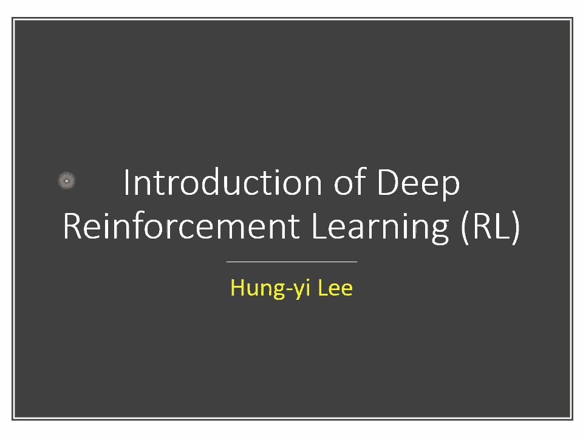

在本节课中，我们将学习强化学习的基本概念，并将其与我们熟悉的机器学习框架联系起来。我们将看到，尽管强化学习听起来很复杂，但它本质上仍然遵循“定义模型、定义损失、优化参数”这三个核心步骤。

## 强化学习是什么？

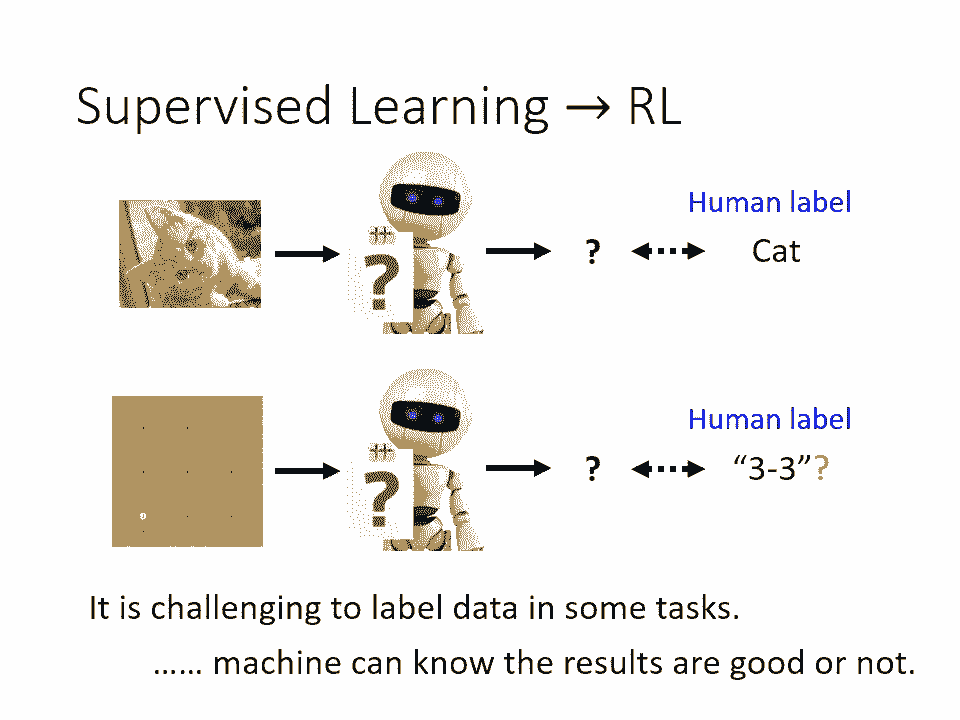

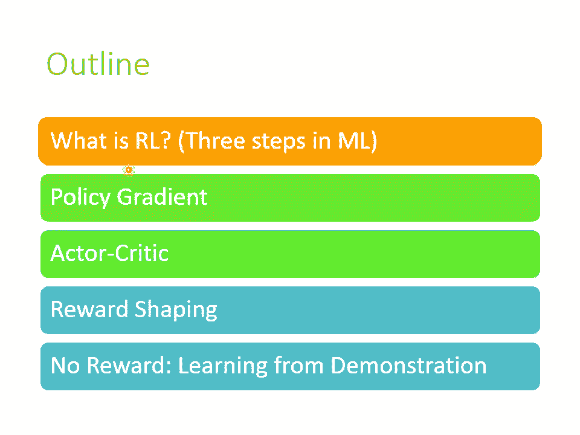

到目前为止，我们课程中讨论的几乎都是监督学习。在监督学习中，我们不仅需要告诉机器输入是什么，还需要告诉它正确的输出（标签）应该是什么。然而，强化学习面向的是另一类问题。

在强化学习中，当我们给机器一个输入时，我们并不知道最佳的输出应该是什么。例如，教机器学习下围棋。用监督学习的方法似乎也可以做：告诉机器看到当前棋盘时，下一步应该落在哪里。但问题是，哪一步才是最好的？人类可能也不知道。当你发现收集有标注的数据很困难，或者连人类都不知道正确答案是什么时，强化学习就可能派上用场。

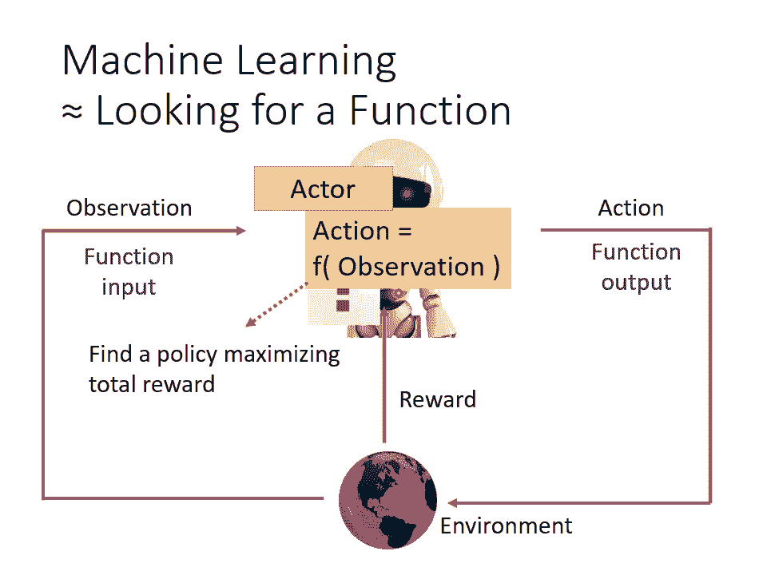

在学习过程中，机器并非一无所知。虽然我们不知道正确答案，但机器会通过与环境的互动，得到一个称为“奖励”的信号，从而知道某个输出是“好”还是“不好”。通过这种互动和反馈，机器仍然可以学习到一个有效的模型。

## 强化学习的框架

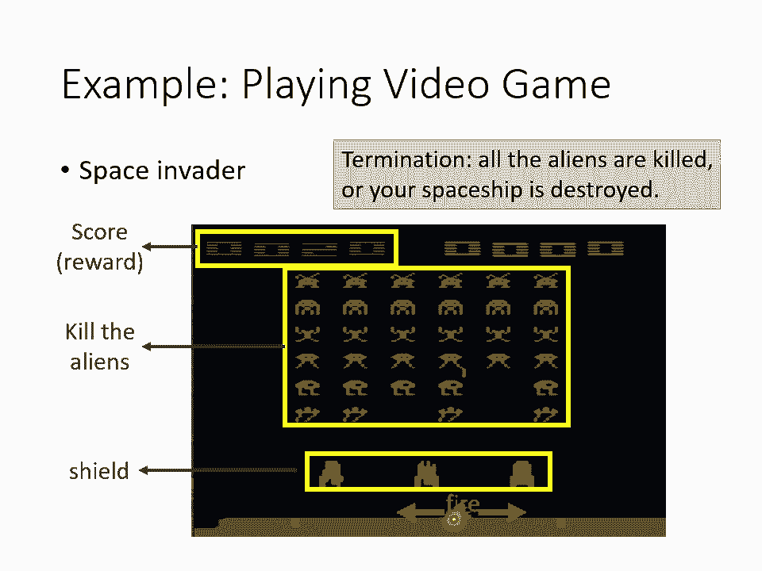

在本课程一开始，我们就提到机器学习包含三个步骤。强化学习作为机器学习的一种，也遵循完全相同的三个步骤框架。

### 第一步：定义函数（模型）

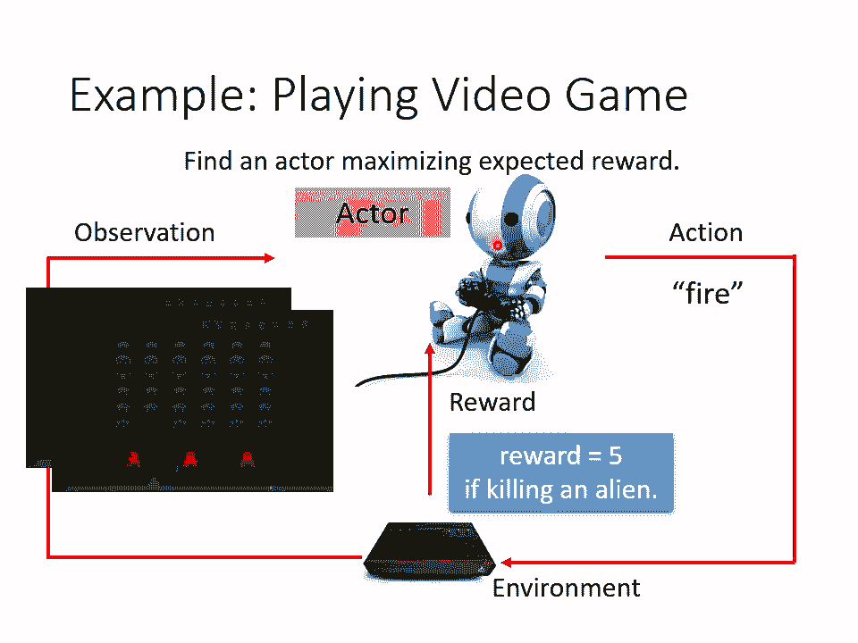

在强化学习中，我们要找的函数被称为“智能体”或“策略”。这个函数的输入是环境给出的“观察”，输出是智能体要采取的“动作”。

**公式表示：**
`动作 = 策略(观察)`

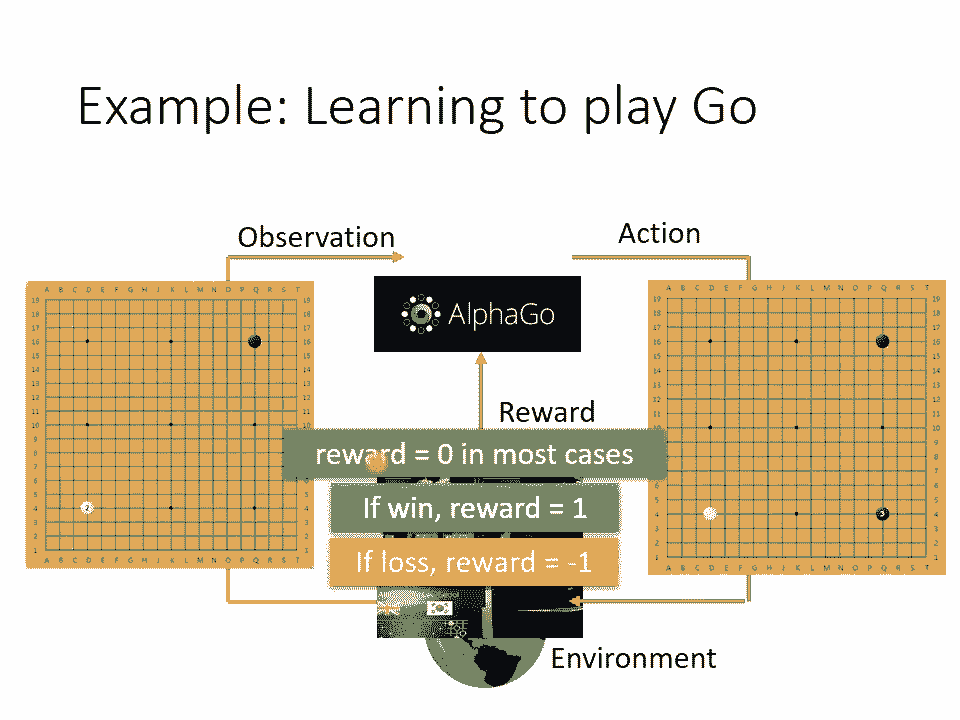

这个策略函数可以是一个神经网络。例如，在玩太空入侵者游戏时，输入是游戏画面（像素），输出是三个可能动作（左移、右移、开火）的分数。这本质上与一个多类分类网络非常相似。

### 第二步：定义损失函数

在强化学习中，智能体与环境进行多轮互动。每采取一个动作，环境会给予一个即时“奖励”。我们将从游戏开始到结束所获得的所有奖励之和称为“总奖励”。

**公式表示：**
`总奖励 R = r1 + r2 + ... + rT`

我们的目标是最大化这个总奖励。在机器学习的语境下，我们通常最小化损失函数。因此，我们可以将 **负的总奖励 (-R)** 定义为我们的损失函数。

**损失函数公式：**
`损失 L = -总奖励 R`

### 第三步：优化参数

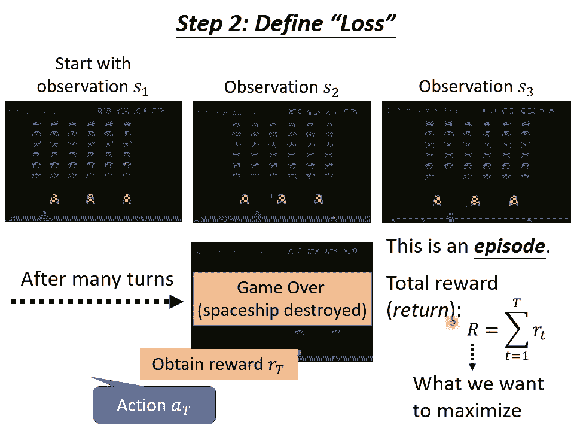

我们的优化目标是找到一组神经网络的参数，使得损失函数 L 最小化，即总奖励 R 最大化。

然而，强化学习的优化问题比标准的神经网络训练更复杂，主要因为：
1.  **智能体的输出具有随机性**：动作是根据输出分数采样得到的，而非确定性的最大分数。
2.  **环境与奖励函数是“黑盒”**：我们通常不知道环境内部的具体运作机制和奖励的计算细节，它们可能也具有随机性。

因此，我们不能直接使用标准的梯度下降法来优化参数。这就需要专门为强化学习设计的优化算法，例如我们接下来要介绍的策略梯度方法。

## 策略梯度方法的核心思想

在深入策略梯度之前，我们先思考如何控制一个智能体的行为。如何让智能体在看到特定观察时，采取或不采取某个特定动作？

这完全可以被视为一个分类问题。假设我们希望智能体在状态 S 下采取动作 A。我们可以将 S 视为输入，A 视为标签（正确答案），然后计算智能体输出与标签之间的交叉熵作为损失。通过最小化这个损失，我们就可以训练智能体在 S 下倾向于输出 A。

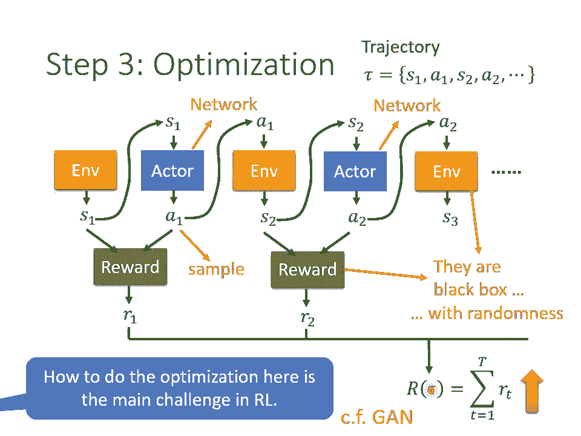

反之，如果我们希望智能体在状态 S 下避免动作 A，只需将损失定义为负的交叉熵，然后最小化它，这会使智能体的输出远离 A。

所以，只要我们能为每个“状态-动作”对分配一个分数，表明我们“多希望”智能体执行该动作，我们就可以像训练分类器一样训练智能体。

以下是定义损失函数的一般形式：

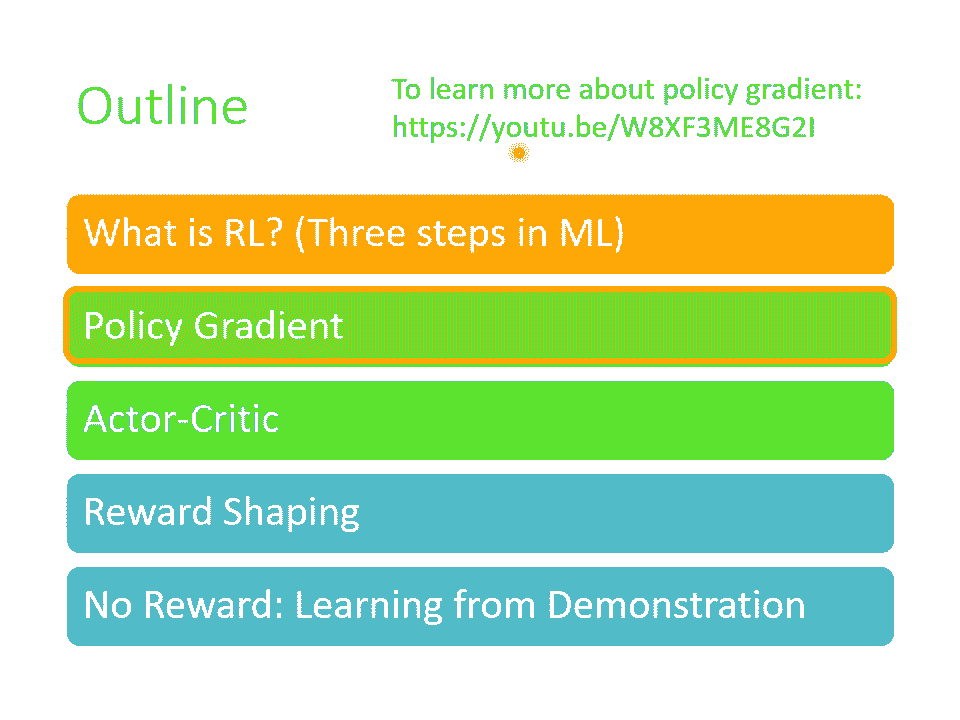

假设我们收集了 N 个训练数据 `(s_i, a_i)`，并为每个数据对分配了一个分数 `A_i`。`A_i` 为正表示鼓励该动作，为负表示不鼓励，其绝对值大小代表鼓励或不鼓励的程度。

**损失函数公式（策略梯度的一种形式）：**
`L = - (1/N) * Σ [ A_i * log( P(a_i | s_i) ) ]`

其中，`P(a_i | s_i)` 是智能体在状态 `s_i` 下选择动作 `a_i` 的概率。

接下来的关键问题就变成了：
1.  如何生成这些训练数据 `(s_i, a_i)`？
2.  如何为每个数据对设定合适的分数 `A_i`？

这正是策略梯度等强化学习算法要解决的核心问题。

## 总结

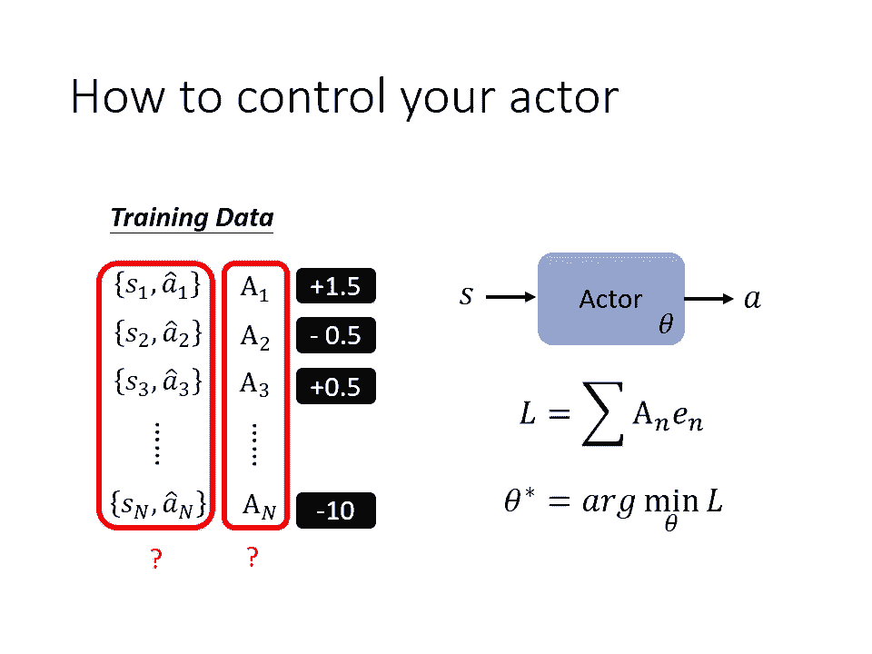

本节课我们一起学习了强化学习的基本框架。我们了解到，强化学习与我们熟悉的机器学习三步骤一脉相承：首先定义一个参数化的策略函数（智能体），然后定义一个以总奖励为基础的损失函数，最后通过专门的优化方法（如策略梯度）来调整参数，使智能体获得更高的奖励。我们还初步探讨了策略梯度方法的思想，即通过为智能体在不同状态下采取的动作打分，来引导其学习更好的行为策略。在接下来的课程中，我们将深入探讨如何具体实现这些步骤。