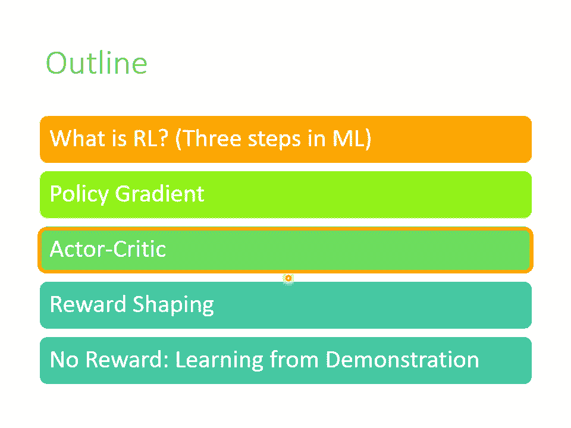
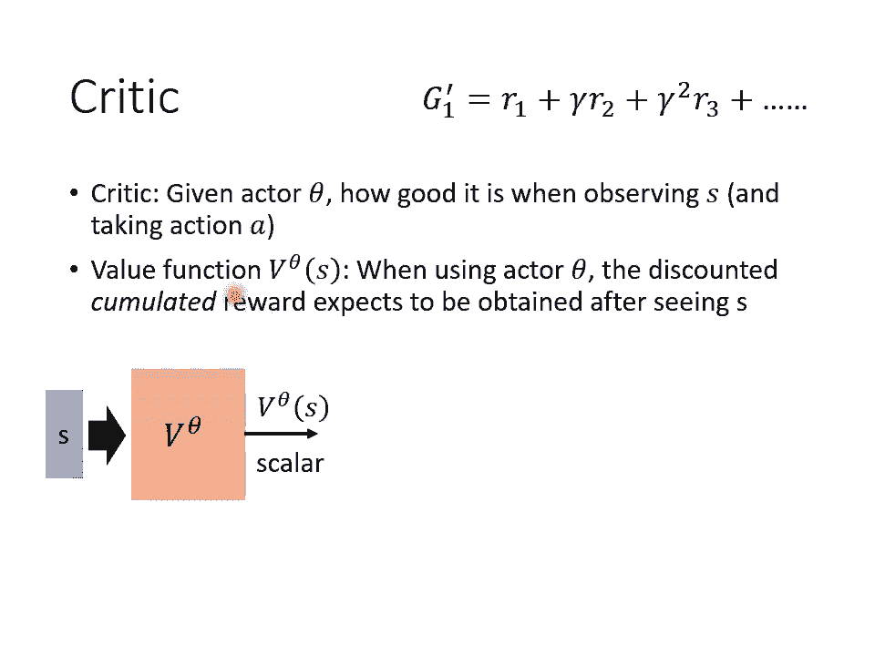
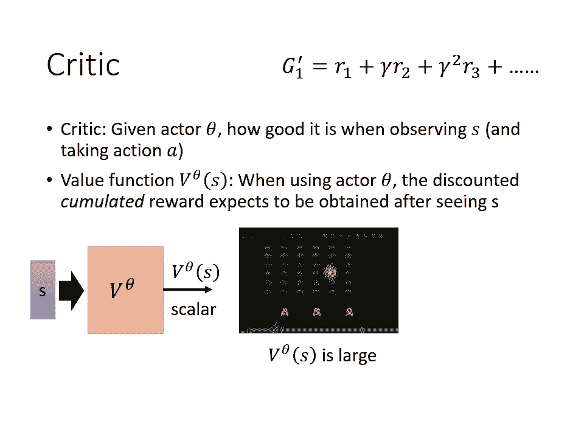
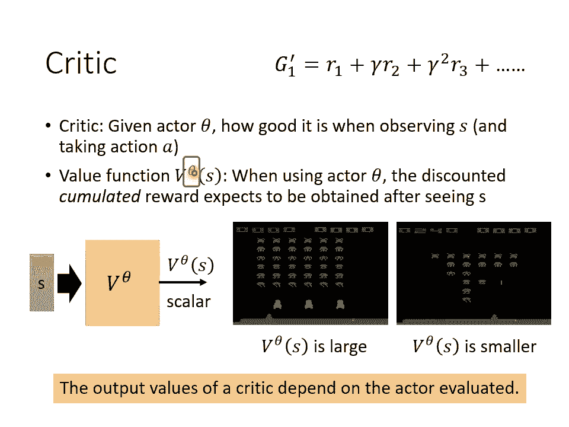
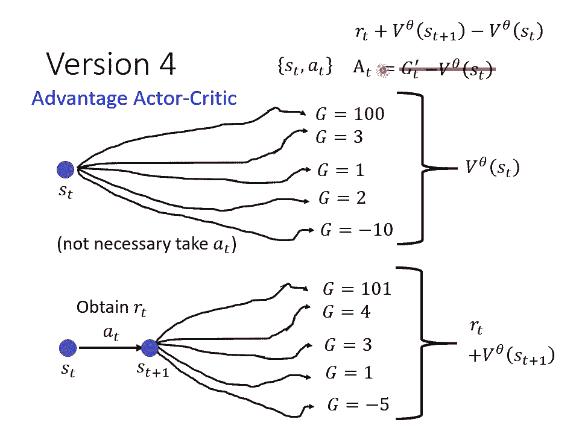
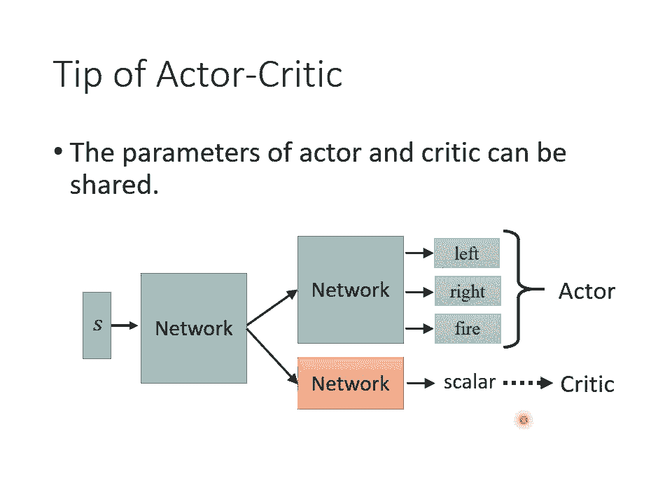
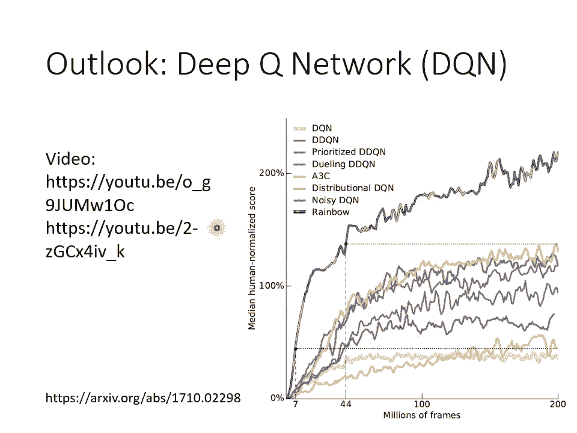
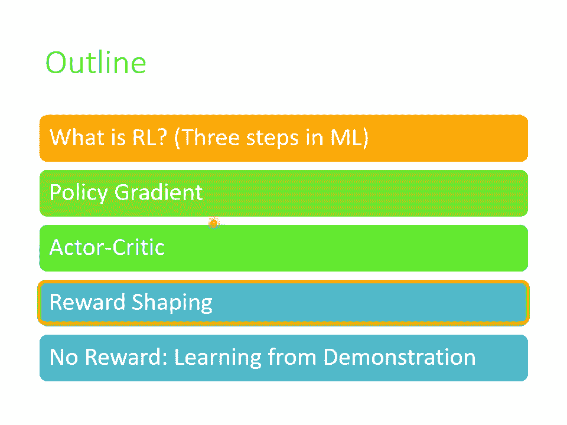
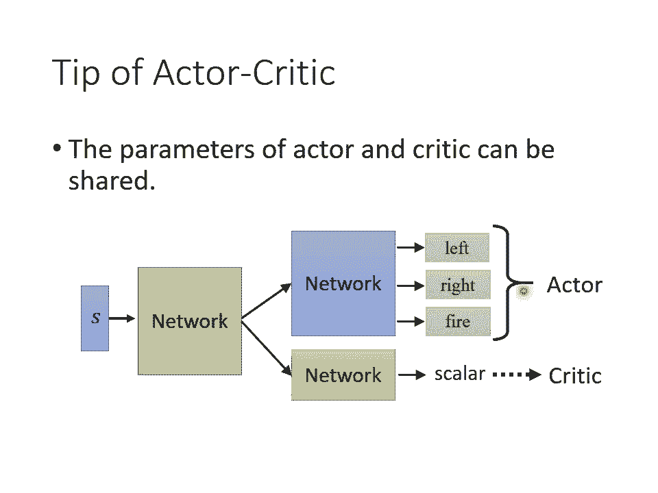

# 31：L18.3 - Actor-Critic 概述 🎯

在本节课中，我们将学习强化学习中的 **Actor-Critic** 方法。我们将首先介绍 **Critic** 的概念及其作用，然后讲解如何训练 Critic，最后探讨如何将 Critic 与 Actor 结合，以更有效地训练智能体。

---

## 什么是 Critic？🤔

Critic 的核心任务是评估一个 Actor 的好坏。具体来说，给定一个 Actor（其参数为 θ），Critic 需要评估当该 Actor 观察到某个状态（例如游戏画面）时，预期能获得多少累积奖励。

Critic 有多种形式。有些 Critic 仅根据当前状态进行判断，有些则同时考虑状态和 Actor 采取的动作。为了更具体地理解，我们将介绍一个在实际作业中会用到的重要概念：**价值函数（Value Function）**。

### 价值函数（Value Function）

价值函数用 **V^θ(s)** 表示。其输入是状态 **s**（例如当前游戏画面），输出是一个标量值。上标 θ 表示这个价值函数是针对参数为 θ 的特定 Actor 进行评估的。

这个标量值的含义是：当 Actor θ 观察到状态 **s** 后，预期能获得的 **折现累积奖励（Discounted Cumulative Reward）**。折现累积奖励的计算公式为：

**G = R_t + γR_{t+1} + γ²R_{t+2} + ...**

其中，**γ** 是折扣因子（0 ≤ γ ≤ 1），用于衡量未来奖励的当前价值。价值函数的目标是“未卜先知”，即在游戏未结束前，仅根据当前状态 **s** 来预测 Actor 的长期表现。

需要注意的是，价值函数的输出值与所评估的 Actor 密切相关。相同的状态，不同的 Actor 会得到不同的价值评估。

---

## 如何训练 Critic？🔧

训练价值函数主要有两种常用方法：**蒙特卡洛方法（Monte Carlo, MC）** 和 **时序差分方法（Temporal Difference, TD）**。

### 蒙特卡洛方法（MC）

MC 方法非常直观。我们让 Actor 与环境进行多轮互动，收集游戏记录。对于每一轮游戏中的每个状态 **s_t**，我们都能计算出实际获得的折现累积奖励 **G_t**。这些数据对 **(s_t, G_t)** 就构成了训练资料。训练目标是让价值函数的预测值 **V^θ(s_t)** 尽可能接近实际值 **G_t**。

### 时序差分方法（TD）

TD 方法则不需要玩完整场游戏。它只需要观察到连续的两个状态 **s_t** 和 **s_{t+1}**，以及其间的即时奖励 **r_t**，就可以更新价值函数。

根据定义，**V^θ(s_t)** 和 **V^θ(s_{t+1})** 之间存在以下关系：

**V^θ(s_t) = r_t + γ * V^θ(s_{t+1})**

因此，我们可以构造训练目标：让 **V^θ(s_t) - γ * V^θ(s_{t+1})** 尽可能接近观察到的即时奖励 **r_t**。这种方法特别适用于回合很长或永不结束的游戏。

### MC 与 TD 的差异

MC 和 TD 方法基于不同的假设，即使对同一组数据，计算出的价值函数也可能不同。MC 严格依赖于观察到的具体结果，而 TD 则假设状态转移是独立的，更侧重于期望值。

---

## 如何将 Critic 用于训练 Actor？🤝

上一节我们介绍了 Actor 的训练方法：通过计算每个“状态-动作”对 **(s_t, a_t)** 的优势分数 **A_t** 来更新策略。**A_t** 衡量了在状态 **s_t** 下执行动作 **a_t** 的相对好坏。

一个关键问题是：如何设定基准值 **b** 来进行归一化？一个合理的选择是使用价值函数的输出，即设 **b = V^θ(s_t)**。

### 优势函数（Advantage Function）

因此，优势分数 **A_t** 可以定义为：

**A_t = G_t - V^θ(s_t)**

*   **G_t** 是在 **s_t** 下执行 **a_t** 后实际获得的（采样）累积奖励。
*   **V^θ(s_t)** 是在 **s_t** 下，随机采取动作所能获得的（平均）期望奖励。

如果 **A_t > 0**，说明动作 **a_t** 优于平均动作；如果 **A_t < 0**，则说明劣于平均动作。

为了减少采样的方差，我们通常使用 TD 思想来定义优势函数：

**A_t = r_t + γ * V^θ(s_{t+1}) - V^θ(s_t)**

这个公式直接计算了执行动作 **a_t** 所带来的期望奖励增量，是 Actor-Critic 方法中常用的核心公式。

---

## 实用技巧：网络参数共享 💡

在实现 Actor-Critic 时，Actor 和 Critic 都是神经网络，且输入相同（都是状态 **s**）。因此，一个实用的技巧是让它们共享前面的网络层（例如用于处理图像输入的卷积层），只在最后的分支上产生不同的输出：
*   Actor 分支输出每个动作的概率分布。
*   Critic 分支输出一个标量价值 **V^θ(s)**。

这样做可以有效减少参数量，并让特征提取更高效。

---

## 扩展与总结 📚

本节课我们重点介绍了 **Actor-Critic** 框架，它通过引入 Critic（价值函数）来更稳定、高效地评估和指导 Actor（策略）的学习。

值得注意的是，强化学习中还有一个重要的系列方法是基于 **价值函数** 直接选择动作，例如著名的 **DQN（Deep Q-Network）** 及其众多变体（如集成多种技巧的 **Rainbow** 算法）。这些内容我们将在其他课程中探讨。

### 本节课总结
在本节课中，我们一起学习了：
1.  **Critic（价值函数）** 的概念与作用：评估给定状态下 Actor 的预期回报。
2.  训练 Critic 的两种方法：**蒙特卡洛（MC）** 和 **时序差分（TD）**。
3.  如何利用 Critic 计算 **优势函数（A_t）**，从而更有效地训练 Actor。
4.  Actor-Critic 的实用实现技巧：**网络参数共享**。

通过结合 Actor 和 Critic，我们能够构建出更强大、更稳定的强化学习智能体。