# 32：L18.4 - 奖励塑形：当奖励稀少时怎么办？🚀

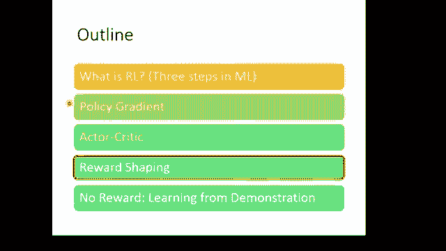

在本节课中，我们将要学习一个名为 **奖励塑形** 的重要概念。当强化学习任务中的奖励信号非常稀疏（例如，多数时候奖励为0，只有极少数关键步骤才有奖励）时，智能体将难以学习。本节课将探讨如何通过设计额外的奖励来引导智能体更有效地学习。

## 什么是奖励塑形？🤔

到目前为止，我们学习的方法是让智能体与环境互动，收集奖励，并利用这些奖励计算优势分数 **A**。有了优势分数，我们就可以更新策略，教导智能体该做什么、不该做什么。

然而，在强化学习中，我们可能会遇到一种棘手的情况：**奖励非常稀疏**。如果奖励几乎总是0，只有在极低概率下才能获得一个巨大的奖励，那该怎么办？

这意味着，无论智能体采取什么行动，得到的奖励都差不多（都是0）。因此，计算出的优势分数 **A** 对每个动作而言也几乎相同。既然执行任何动作都没有显著差异，智能体就无法有效地学习和改进策略。

## 稀疏奖励的挑战与实例 🎲

谈到稀疏奖励问题，有人可能会想到围棋。在围棋中，每落一子通常没有即时奖励，只有在整盘游戏结束时，赢了得到正奖励，输了得到负奖励。但相较于其他任务，围棋的奖励问题还算“温和”。

一个更典型的例子是**教机械手臂拧螺丝**。合理的奖励定义是：成功拧入螺丝获得正奖励，否则奖励为0。但问题在于，初始时机械手臂的参数是随机的，它只是在空中随意挥舞。除非它极其巧合地拿起螺丝并成功拧入，否则它做的任何动作得到的奖励都是0。这与围棋不同，围棋玩完一整局至少能获得明确的最终奖励。

那么，遇到这种状况时，我们该怎么办呢？

## 解决方案：奖励塑形 🛠️

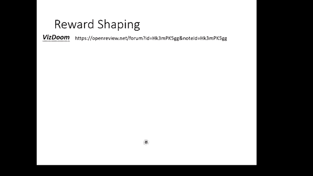

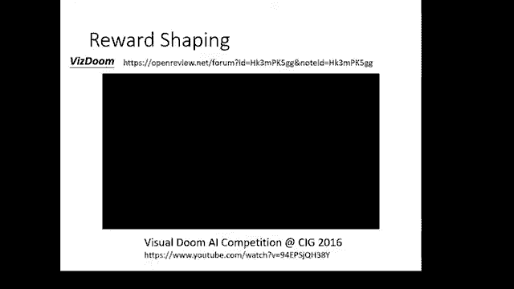

一个有效的解法是：**我们设法提供额外的奖励来引导智能体学习**。也就是说，在原始的真实奖励（即我们希望智能体最大化的目标）之外，我们再定义一些**额外的奖励**。这些额外奖励旨在帮助智能体更顺畅地学习。这种做法就叫做**奖励塑形**。

人类其实也非常擅长进行“奖励塑形”。例如，在教育中，我们不会只告诉学生“博士毕业才能获得奖励”。相反，我们会设置一系列中间目标：修完一门课得到鼓励，完成一个小项目得到表扬，发表一篇会议论文得到认可……通过这些逐步的“奖励”，最终引导学生达成获得博士学位这个终极目标。

## 实战案例：在《毁灭战士》中应用奖励塑形 🎮

接下来，我们看一个奖励塑形在强化学习中实际应用的例子，以第一人称射击游戏《毁灭战士》为例。

在《毁灭战士》的AI竞赛中，仅凭游戏内置的奖励（杀敌加分、被杀扣分）很难训练出强大的智能体。因此，当年的冠军队伍就使用了奖励塑形技术。他们定义了一系列额外的奖励来引导智能体：

以下是他们定义的部分额外奖励规则：

*   **扣血惩罚**：在游戏中，扣血本身不会扣分，只有死亡才会。但为了让智能体更快地学会避免受伤，直接规定扣血就给予负奖励。
*   **弹药与医疗包**：损失弹药扣分，捡到弹药或医疗包加分。这些行为在原始游戏中不影响分数。
*   **禁止原地不动**：如果智能体总是待在原地，则扣分。这是为了防止智能体在初期因外出容易被杀而选择“躺平”，因为待在原地至少奖励为0。
*   **鼓励移动**：智能体每移动一步，就给予一个非常小的正奖励（例如 `9e-5`）。
*   **“活着扣分”**：这是一个非常有趣的设定。智能体每存活一帧，就会被扣一点分。这听起来有违常理，但目的是防止智能体学会“边缘OB”（即一直躲藏、转圈、避免与敌人交战）。为了迫使智能体积极与敌人交战以结束游戏（从而停止扣分），必须加入这个奖励。

从这些例子可以看出，**奖励塑形需要开发者基于对任务和环境的深刻理解来设计**。它是一把双刃剑，设计得好可以大幅加速学习，设计得不好则可能引导智能体学习错误的行为。

## 奖励塑形的注意事项 ⚠️

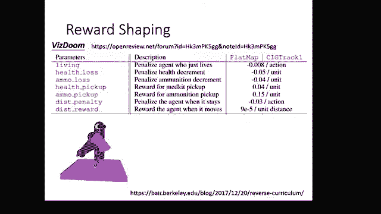

再举一个机械臂插板的例子。任务目标是将蓝色板子插到棍子上。一个直觉的奖励塑形方法是：**蓝色板子离棍子越近，奖励越大**。

但仔细思考后会发现，仅凭“距离近”是不够的。观察下图，右侧两种情况中，机械臂也让板子靠近了棍子，但却是从侧面接近或撞击棍子，这无法达成最终“插入”的目标。

```
# 伪代码示例：一个可能不够完善的奖励塑形
reward_shaping = -distance(blue_block, peg) # 距离越近，惩罚越小（奖励越大）
```

如果只用这个简单的距离作为额外奖励，智能体可能会学到一些奇怪但能“骗”到高奖励的策略，而不是我们真正想要的行为。因此，使用奖励塑形时必须谨慎，需要对问题有足够深入的理解。


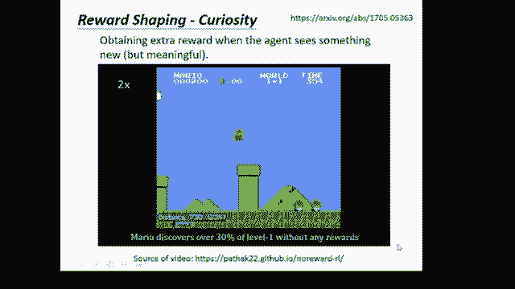

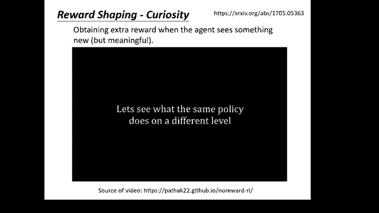

## 进阶方法：基于好奇心的奖励塑形 🧐

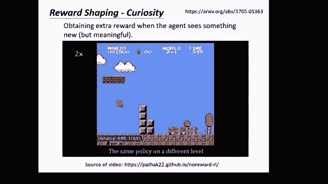


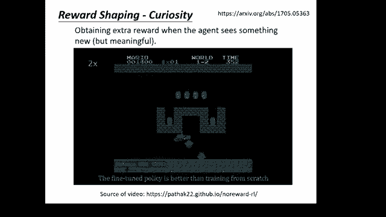

在奖励塑形中，有一个特别知名且有趣的方法叫做 **基于好奇心的奖励塑形**。其核心思想是：给智能体加上“好奇心”，鼓励它去探索未知。

具体做法是，在原始奖励之外，增加一个奖励：**如果智能体在探索过程中看到了新的、未曾预料到的事物，就给予它正奖励**。

这里有一个关键点：所谓的“新”必须是有意义的新，而不是无意义的噪声变化。例如，如果环境背景是电视雪花屏（不断随机变化），智能体可能会因为单纯“看雪花”而不断获得“看到新东西”的奖励，从而停止对真实环境的探索。因此，在实际算法中（如ICLR 2017的这篇论文），需要设计机制来过滤掉这种无意义的“新”。


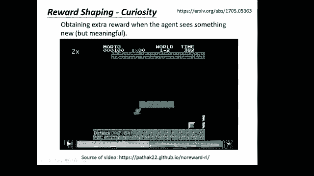

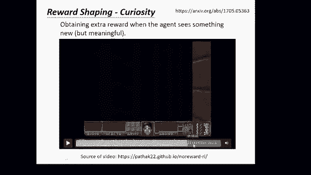

该论文有一个令人印象深刻的演示：让智能体玩《超级马里奥》，甚至不告诉它“通关”是最终目标，只赋予它“好奇心”（探索新东西获得奖励）。仅凭这一点，智能体就学会了通过一些关卡。因为《超级马里奥》是横向卷轴游戏，要看到新场景就必须向右移动，这恰好与通关的目标方向一致。

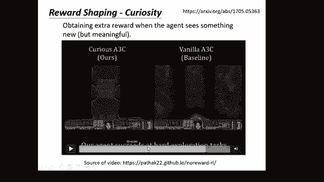

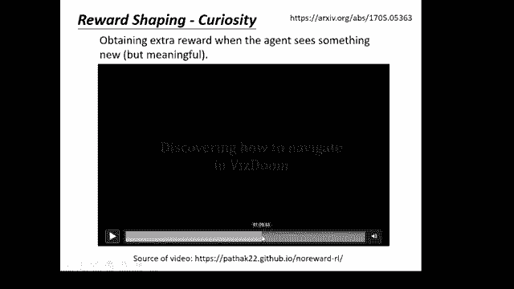

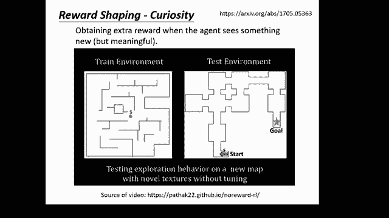

## 总结 📚

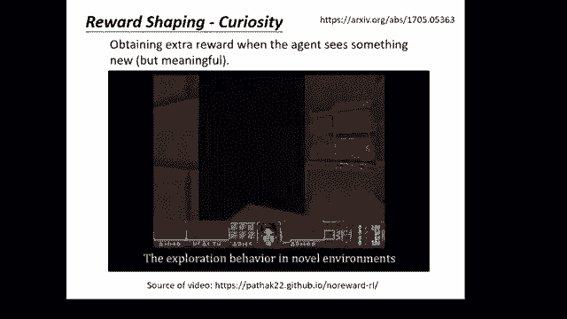

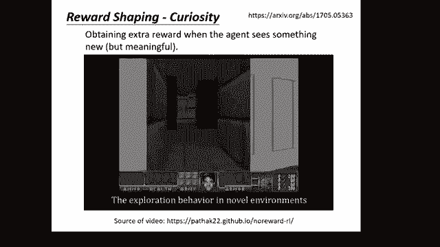

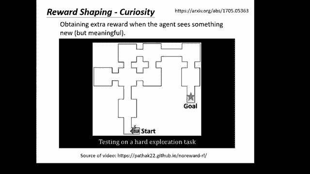


本节课中，我们一起学习了**奖励塑形**这一重要技术。

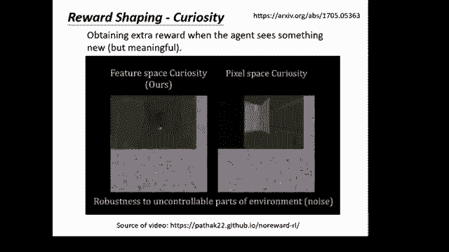

*   我们首先认识了**稀疏奖励问题**，它会导致智能体因缺乏学习信号而无法进步。
*   接着，我们学习了奖励塑形的核心思想：**通过设计额外的、引导性的奖励**，来帮助智能体在稀疏奖励环境中更有效地学习。
*   我们通过《毁灭战士》AI竞赛的实际案例，分析了如何具体设计这些额外奖励，并了解到这需要开发者对任务有深入理解。
*   最后，我们介绍了一种特殊的奖励塑形方法——**基于好奇心的奖励塑形**，它通过鼓励探索来应对稀疏奖励，但需要注意区分“有意义的探索”和“无意义的噪声”。

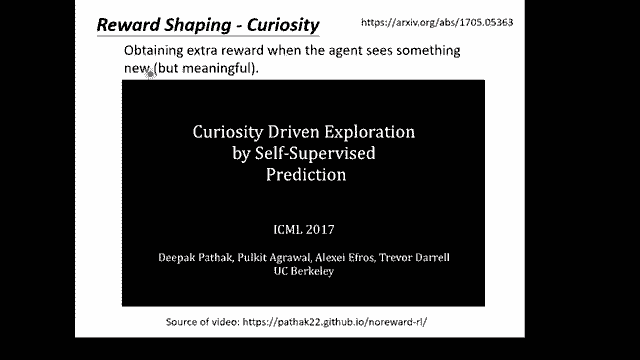

奖励塑形是强化学习实践中一项强大的工具，它能将人类知识注入学习过程，引导智能体朝着我们希望的方向前进。然而，它也需要精心设计，以避免智能体学到“捷径”或错误行为。