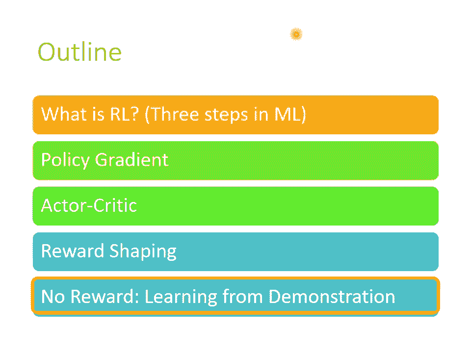
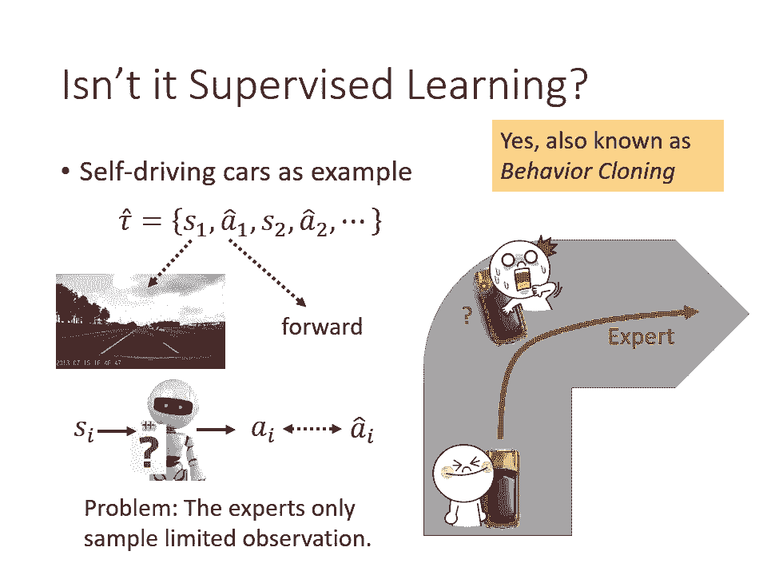
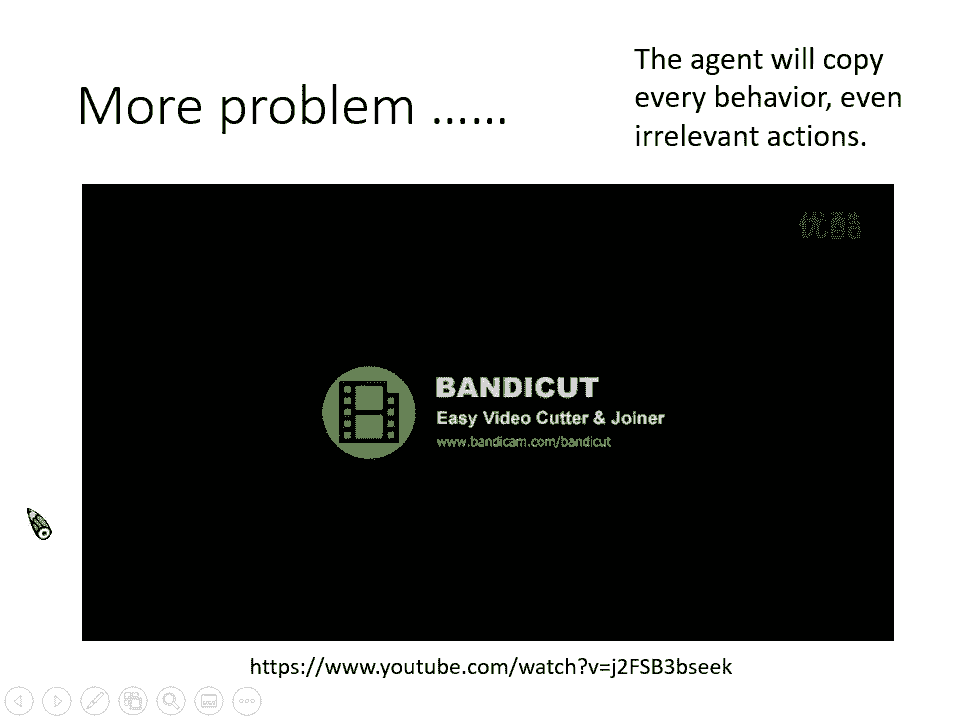
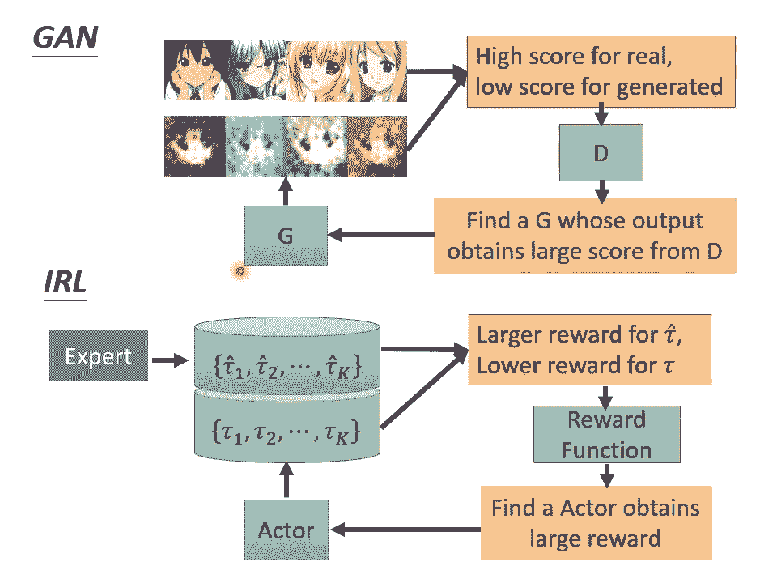
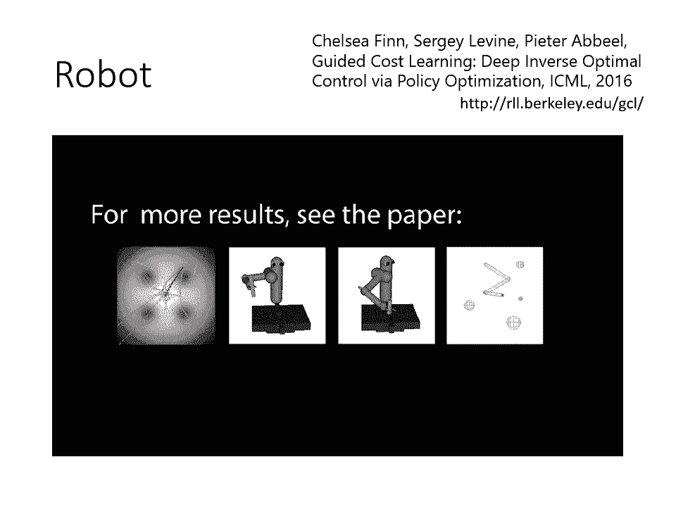
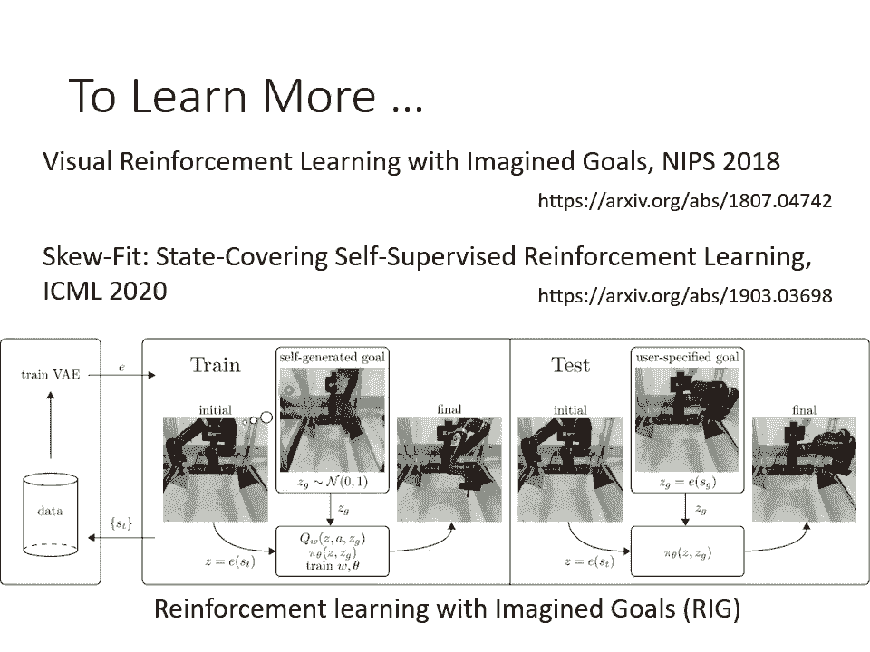
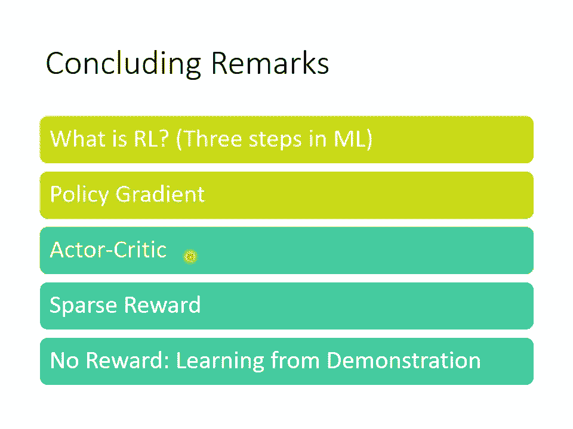

# 33：L18.5 - 从示范中学习：逆向增强式学习 🧠



在本节课中，我们将要学习当增强式学习（Reinforcement Learning）环境中没有明确的奖励（Reward）时，如何通过专家的示范来训练智能体（Agent）。我们将重点介绍两种方法：行为克隆（Behavior Cloning）和逆向增强式学习（Inverse Reinforcement Learning）。

---

## 为何有时没有奖励？

在之前的课程中，我们假设环境会提供奖励信号，尽管有时奖励非常稀疏（Sparse），需要进行奖励塑形（Reward Shaping）。然而，在真实世界中，定义明确的奖励函数可能非常困难。

例如，在训练自动驾驶汽车时，如何量化奖励？礼让行人加100分还是1000分？闯红灯扣50分还是50000分？这些数值难以确定。此外，人为设计的奖励函数可能导致智能体出现意想不到的、甚至有害的行为，例如电影《机械公敌》中机器人将人类囚禁起来的“神逻辑”，或者训练机械臂摆盘子时，智能体为达成目标而摔碎盘子。

因此，当没有预定义奖励时，我们需要其他方法来指导智能体学习。

---

## 模仿学习（Imitation Learning）简介

在没有奖励的情况下，一种方法是**模仿学习（Imitation Learning）**。智能体仍然可以与环境互动，接收观测（Observation）并做出动作（Action），但不会从环境获得奖励。取而代之的是，我们拥有**专家示范（Expert Demonstrations）**，通常来自人类专家与环境的互动记录。

例如：
*   训练自动驾驶时，人类司机的行驶记录就是专家示范。
*   训练机械臂时，人类手动引导机械臂完成一次倒水或摆盘动作，这也是专家示范。

我们记专家的示范轨迹为 **$\hat{\tau}$**。模仿学习的目标就是利用这些示范 $\hat{\tau}$ 以及智能体与环境的互动来进行学习。



---



## 方法一：行为克隆（Behavior Cloning）

一个直观的想法是将其视为监督学习（Supervised Learning）问题：让智能体直接模仿专家的动作。

**具体做法：**
我们拥有数据集 ${(s_1, \hat{a}_1), (s_2, \hat{a}_2), ...}$，其中 $s_t$ 是状态，$\hat{a}_t$ 是专家在该状态下采取的动作。我们训练一个策略网络 $\pi_\theta$，使其在输入状态 $s_t$ 时，输出的动作 $a_t$ 尽可能接近 $\hat{a}_t$。损失函数可以定义为：
```python
loss = MSE(a_t, \hat{a}_t)  # 均方误差损失
```

**行为克隆可能遇到的问题：**

1.  **状态分布不匹配（State Distribution Mismatch）**：专家示范通常只包含“成功”的轨迹。智能体在训练中从未见过“接近失败”的状态（例如，汽车即将撞墙），因此当它自己在实践中遇到这些陌生状态时，可能不知道如何正确处理。
2.  **盲目模仿无关行为**：智能体会模仿专家的所有行为，包括一些个人习惯或与任务无关的 idiosyncrasies（例如，老师讲课时习惯性的手势）。这可能导致效率低下或出现多余动作。
3.  **智能体能力有限**：当智能体的能力（例如模型容量）无法完全复现专家所有行为时，它可能只学到部分特征。如果恰好学到的是无关特征（如“不修边幅”），而非核心技能（如“有创意”），则效果会很差。

上一节我们介绍了直接模仿专家行为可能带来的问题。接下来，我们看看一种更鲁棒的方法。

---

## 方法二：逆向增强式学习（Inverse Reinforcement Learning, IRL）

逆向增强式学习的核心思想是：**我们不直接模仿专家的动作，而是尝试从专家的示范中反推出其背后隐含的奖励函数（Reward Function）**。

**基本框架：**
1.  **输入**：环境（Environment）和专家的示范轨迹 $\hat{\tau}$。
2.  **过程**：运行逆向增强式学习算法，其目标是找到一个奖励函数 $R$。这个 $R$ 需要满足一个关键条件：**专家示范轨迹所获得的累计奖励，应高于智能体策略产生的任何其他轨迹**。
3.  **输出**：学得的奖励函数 $R$。
4.  **应用**：得到 $R$ 后，我们就可以使用标准的增强式学习算法（如PPO、DQN）来训练一个优化该奖励函数的智能体。

**一个简单的奖励函数（如“生存”），也可能衍生出非常复杂和多样的智能体行为。**

---

### IRL 的算法流程

以下是逆向增强式学习的一个典型迭代流程：

1.  **初始化**：随机初始化一个智能体策略 $\pi$。
2.  **迭代以下步骤**：
    *   a. **收集轨迹**：让当前智能体 $\pi$ 与环境互动，收集其轨迹 $\tau$。
    *   b. **更新奖励函数 $R$**：学习一个新的奖励函数 $R$，使得：
        *   $R(\hat{\tau}) > R(\tau)$ （专家轨迹得分高于智能体轨迹）
    *   c. **更新智能体策略 $\pi$**：使用标准RL算法，更新策略 $\pi$ 以最大化新奖励函数 $R$ 下的期望回报。
3.  **循环**：重复步骤2，直到奖励函数 $R$ 和策略 $\pi$ 收敛。

**图像化理解：**
可以将智能体 $\pi$ 看作生成器（Generator），奖励函数 $R$ 看作判别器（Discriminator）。判别器 $R$ 的任务是给专家数据 $\hat{\tau}$ 打高分，给生成器数据 $\tau$ 打低分；生成器 $\pi$ 的任务是生成能骗过判别器（即获得高分）的轨迹。这形成了一个与生成对抗网络（GAN）非常相似的对抗学习框架。

---



### IRL 的应用实例

逆向增强式学习在机器人操控领域特别有用，因为它避免了为复杂任务手工设计奖励函数的困难。

**以下是其应用方式：**
1.  人类专家通过手动引导（如抓着机械臂）或遥控，演示20次“摆盘子”或“倒水”的任务。
2.  系统使用IRL从这20次示范中，学习到完成该任务的隐含奖励标准（例如，盘子需平稳到达指定位置，水要倒入杯中）。
3.  智能体基于学到的奖励函数，通过RL自我训练，最终学会完成任务，甚至可能比人类演示做得更快、更稳。

更前沿的研究甚至可以让智能体通过“想象”目标画面（自己创造目标），并练习达成这些目标，从而获得一种通用的“实现指定目标”的能力。

---



## 常见问题解答

**Q: 使用IRL方法，智能体的表现能否超越人类专家？**
A: **可以**。因为IRL的本质是学习奖励函数，而非单纯模仿动作。我们可以在学到的奖励函数基础上，添加额外的优化目标（例如“速度更快”、“能耗更低”）。智能体在优化这个组合奖励函数时，就有可能找到比原始人类示范更优的策略，实现“青出于蓝而胜于蓝”。

---



## 总结 🎯

本节课中我们一起学习了在没有明确奖励函数的情况下进行增强式学习的两种主要方法：
1.  **行为克隆（Behavior Cloning）**：将问题简化为监督学习，直接模仿专家的状态-动作对。这种方法简单直接，但容易受到状态分布不匹配和盲目模仿等问题的影响。
2.  **逆向增强式学习（Inverse Reinforcement Learning, IRL）**：其核心思想是从专家示范中反推其遵循的奖励函数。它通过一个类似GAN的对抗过程，迭代地优化奖励函数和智能体策略。这种方法更鲁棒，能够学习任务背后的本质目标，并且有潜力让智能体表现超越专家。



通过这两种技术，我们可以让智能体通过观察和推理来学习复杂任务，大大降低了为真实世界任务设计奖励函数的门槛。