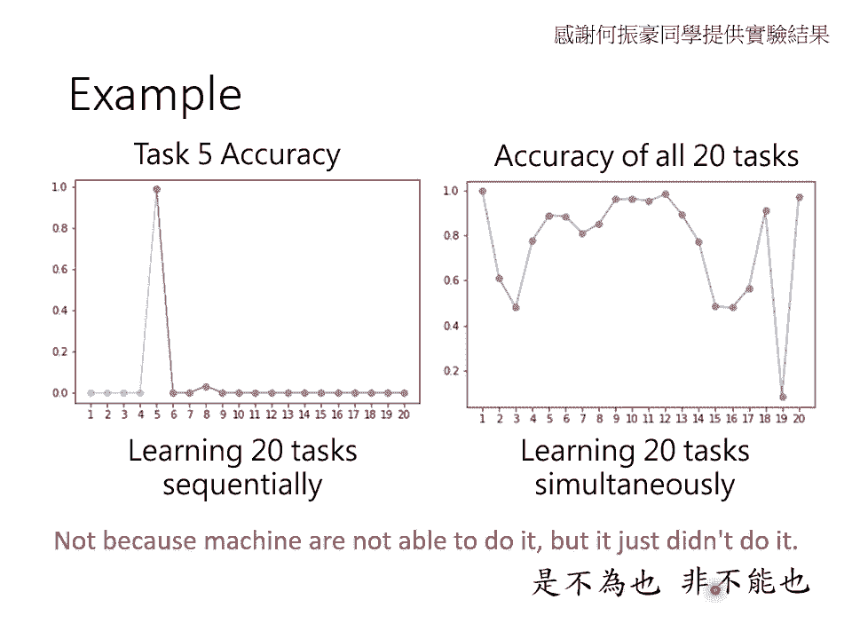
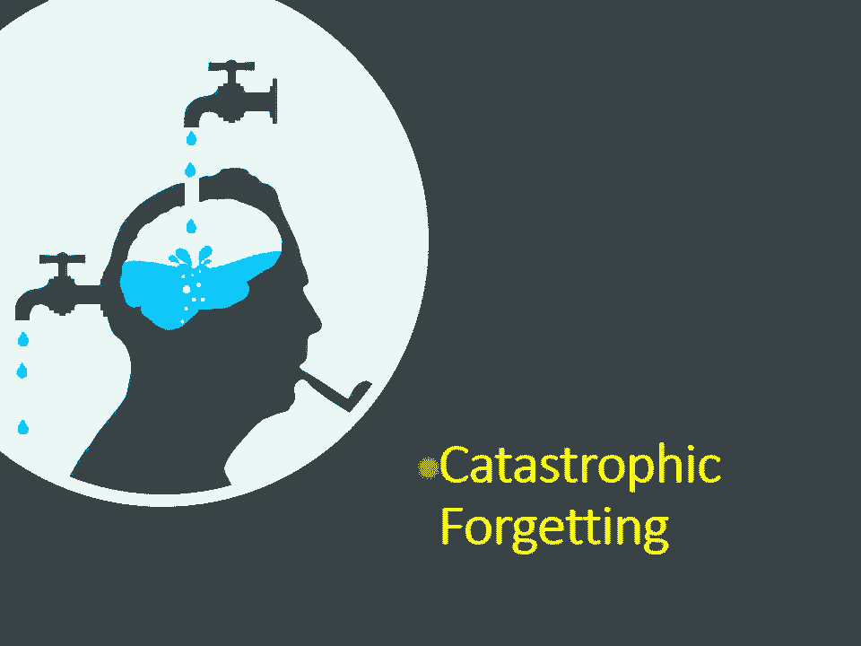
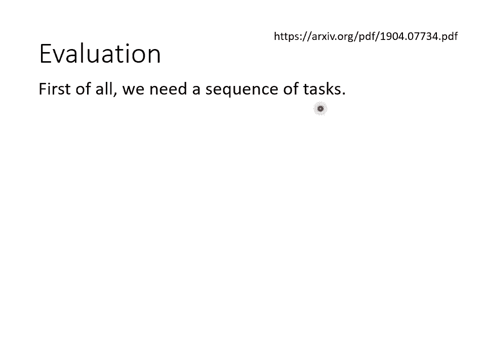
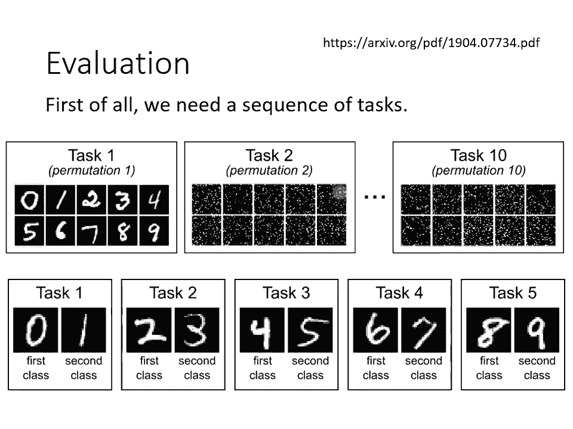
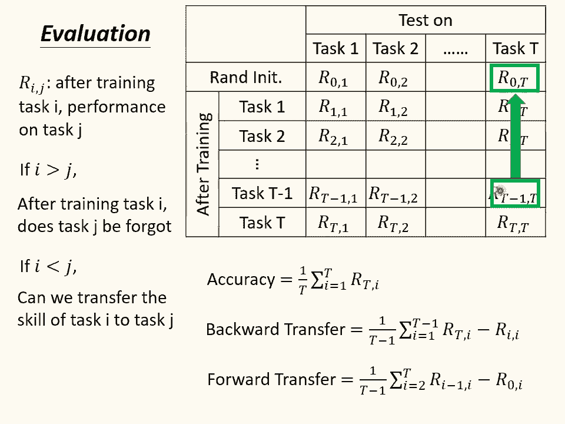

# 34：L20.1 - 机器终身学习 1：人工智能与灾难性遗忘 🧠

在本节课中，我们将要学习**机器终身学习**的基本概念，并探讨其核心挑战——**灾难性遗忘**。我们将了解为什么让一个模型持续学习多个任务如此困难，以及如何评估终身学习系统的性能。

## 什么是终身学习？🤔

终身学习，英文为 **Lifelong Learning**，字面意思是“活到老，学到老”。在人工智能领域，它指的是让机器能够像人类一样，持续不断地学习新的任务或技能，而不会忘记之前学过的内容。

人们对人工智能的普遍想象是：先教会机器一项技能（如语音识别），它掌握后，再教它第二项技能（如图像识别），它就能同时掌握两项技能。如此不断学习新技能，最终变得非常强大。这个构想就是**终身学习**的目标。

终身学习也被称为 **Continuous Learning**、**Never Ending Learning** 或 **Incremental Learning**。

## 终身学习的实际应用场景 🔄

你可能会觉得终身学习的目标过于宏大。但在实际应用中，它非常有用。

例如，在实验室开发一个模型时，我们先用收集的数据进行训练。模型上线后，会从用户那里获得新的反馈数据。我们希望形成一个循环：用新数据更新模型参数，更新后的模型能收集更多数据，从而再次更新。这样，系统就能变得越来越强大。

我们可以将旧数据看作“过去的任务”，将新反馈数据看作“新的任务”。这种让模型在线上持续用新数据更新的场景，本质上就是一个**终身学习**问题。

## 终身学习的核心挑战：灾难性遗忘 💥

那么，终身学习的难点在哪里呢？难道不是让机器不断看新数据、更新参数就行了吗？为什么这是一个值得研究的问题？

以下通过一个简单的例子来说明难点所在。

### 一个手写数字识别的例子

假设有两个任务：
*   **任务一**：识别带有大量噪声的手写数字图片。
*   **任务二**：识别清晰、无噪声的手写数字图片。

我们训练一个简单的三层神经网络（每层50个神经元）。

**实验步骤与结果：**
1.  **先训练任务一**：模型在任务一上达到 **90%** 的正确率。此时，即使没看过任务二的数据，模型在任务二上也能达到 **96%** 的正确率（迁移效果很好）。
2.  **用同一个模型继续训练任务二**：模型在任务二上的正确率提升到 **97%**。但糟糕的是，它**忘记**了任务一，正确率从90%暴跌至 **80%**。

你可能会认为，这是因为模型容量（脑容量）有限，学了新任务就忘了旧的。但请看另一个实验：

3.  **将任务一和任务二的数据混合在一起同时训练**：模型在任务一上能达到 **89%**，在任务二上能达到 **98%** 的正确率。这说明，这个模型**完全有能力同时学好两个任务**。

问题在于：如果让模型**依次**学习任务，它就无法记住旧任务；但如果**同时**学习所有任务，它就能学好。模型是“**非不能也，是不为也**”。

### 一个自然语言处理的例子

我们再举一个问答（QA）任务的例子，使用的数据集是简单的 **bAbI** 任务集。

**实验设置：** 让模型依次学习20个不同的bAbI问答任务。

**观察任务五的学习曲线：**
*   在学习任务五之前，其正确率为0%。
*   学完任务五后，正确率立刻达到100%。
*   但当模型继续学习任务六、任务七……时，任务五的正确率**迅速暴跌至0%**。机器一学新任务，旧任务马上就忘得一干二净。

**对比实验：** 如果将20个任务的数据混合在一起**同时训练**，模型可以同时学会其中多个任务（尽管有些难的任务可能学不会）。

这个现象表明，当模型依次学习多个任务时，它就像一个“脑袋有洞”的人，新知识进来，旧知识就掉出去了。这种现象在学术上被称为 **灾难性遗忘**。

> **灾难性遗忘**：模型在学习新任务时，对旧任务性能的急剧、灾难性下降。

## 为什么不直接用多任务学习？🤷

看到这里，你可能会问：既然把数据混在一起同时训练（即**多任务学习**）能解决遗忘问题，那终身学习还有什么好研究的？

设想一下，如果我们要让模型学习第1000个任务，为了避免遗忘，就需要把前999个任务的所有数据都拿出来，和第1000个任务的数据混合在一起重新训练。这在实际中会带来两大问题：
1.  **存储问题**：模型需要储存一辈子看过的所有数据，存储开销巨大。
2.  **计算问题**：随着任务数量增加，混合数据量会变得极其庞大，训练时间和计算成本会变得无法承受。

这就像一个人每学一门新课，都必须把这辈子学过的所有教材重读一遍，显然效率极低。

因此，多任务学习虽然是终身学习性能的**理论上限**，但并非实用的终极解决方案。终身学习的目标是：**在不依赖旧数据（或仅依赖极少旧数据）的前提下，让模型持续学习新任务而不遗忘旧技能**。

## 为什么不用多个模型？🔢

另一个直接的想法是：为每个任务单独训练一个模型，不就没有遗忘问题了吗？

这样做确实避免了遗忘，但会带来新问题：
1.  **存储与扩展性问题**：如果技能数量极多（如上亿个），存储和管理海量独立模型是不现实的。
2.  **知识无法共享**：不同任务的模型之间无法互通有无，无法从其他任务中汲取对单个任务有益的通用知识。

人类只有一个大脑，却能学会多种技能。机器为什么不能做到同样的事情呢？这就是终身学习要探索的核心问题。

## 终身学习 vs. 迁移学习 ⚖️

终身学习和迁移学习都涉及让模型学习多个任务，但关注点不同：
*   **迁移学习**：关注在**源任务**上学到的知识，对**目标任务**的性能提升有多大帮助。其核心是“**向前看**”。
*   **终身学习**：关注在学习了**新任务**之后，模型在**旧任务**上的性能保持得如何。其核心是“**向后看**”，防止遗忘。

## 如何评估终身学习系统？📊

在讲解解决方案前，我们需要知道如何评估一个终身学习算法的好坏。

**常见的任务设置：**
研究中使用的一连串任务往往比较接近，例如：
*   任务一：识别正常手写数字。
*   任务二：识别经过特定规则打乱像素后的手写数字。
*   或者，任务一：区分数字0和1；任务二：区分数字2和3；以此类推。

**评估指标：**
假设有一系列任务 \( T_1, T_2, ..., T_N \)。

1.  **最终平均准确率**：模型依次学完所有任务后，分别在每个任务的测试集上计算准确率，然后求平均值。这是最常用的指标，反映了学完所有技能后的综合能力。
    \[
    \text{最终平均准确率} = \frac{1}{N} \sum_{i=1}^{N} R_{N, i}
    \]
    其中 \( R_{i, j} \) 表示学完第 \( i \) 个任务后，在第 \( j \) 个任务上的测试准确率。

2.  **逆向迁移**：衡量学习新任务对旧任务性能的影响（通常是负面影响）。
    \[
    \text{逆向迁移} = \frac{1}{N-1} \sum_{i=1}^{N-1} (R_{N, i} - R_{i, i})
    \]
    通常这个值为负。值越大（越接近0），说明遗忘越少。如果能得到正值，说明新知识反而提升了旧任务性能，这将是非常出色的结果。

3.  **正向迁移**：衡量在未见过的任务上，从已学任务中获得的先验知识有多少帮助。
    \[
    \text{正向迁移} = \frac{1}{N-1} \sum_{i=2}^{N} (R_{i-1, i} - R_{0, i})
    \]
    其中 \( R_{0, i} \) 是模型未经过任何训练（随机初始化）时在任务 \( i \) 上的准确率。

## 总结 📝

本节课中，我们一起学习了机器终身学习的基本概念。我们了解到，让单个模型持续学习多个任务面临**灾难性遗忘**的核心挑战——模型在学习新任务时会急剧遗忘旧任务。我们探讨了为什么简单的解决方案（如多任务学习或为每个任务训练独立模型）在实际中不可行，并学习了如何评估终身学习系统的性能。

下一节课，我们将开始探讨解决灾难性遗忘的各种技术方法。