# 35：机器终身学习2 - 灾难性遗忘的克服之道 🧠

在本节课中，我们将学习如何克服机器终身学习中的核心挑战——灾难性遗忘。我们将探讨三种主要的解决思路，并重点讲解其中发展最完善的基于正则化的方法。

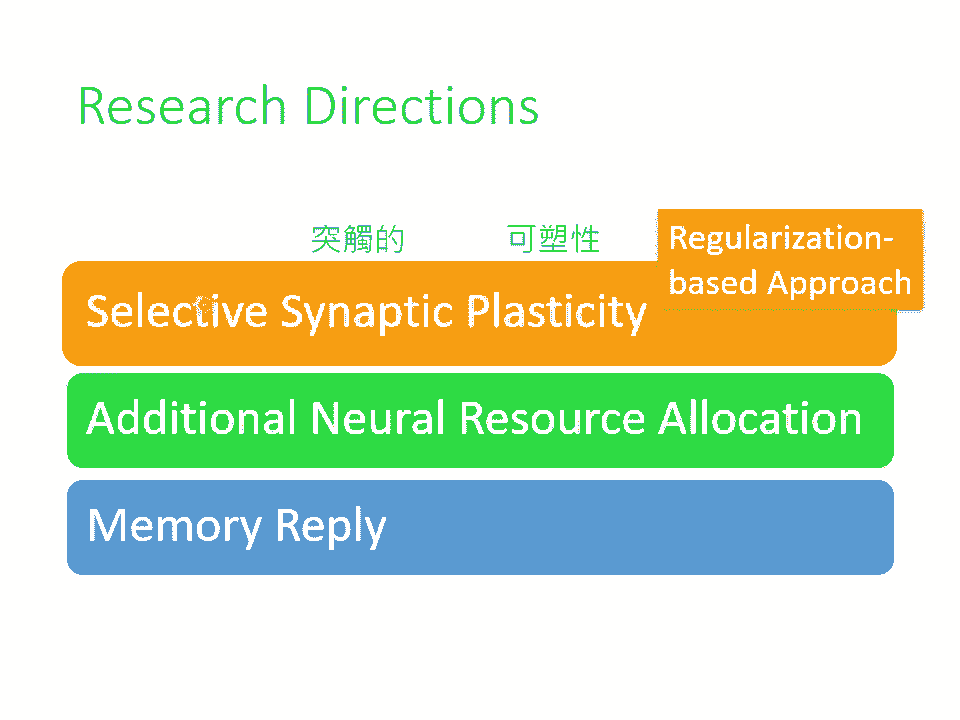

## 三种可能的解法 💡

上一节我们介绍了灾难性遗忘的概念，本节中我们来看看三种主要的解决思路。

第一种解法叫做**选择性突触可塑性**。从字面上看，你可能无法立刻理解这个方法要做什么。“突触”是神经连接的意思，“可塑性”是指改变的能力。因此，这个方法的核心思想是：只让神经网络中的一部分神经元或连接具有可塑性，而另一部分连接则被“固化”，其数值不能再被改变。这类方法也被称为**基于正则化的方法**。这个研究方向在终身学习领域发展得最为完善，我们将花较多时间讲解。

另外两种研究方向，我们将用较短的篇幅快速带过。你会发现，作业中的主要问题也集中在与基于正则化方法相关的部分。

## 灾难性遗忘为何发生？ 🤔

我们先来思考一下，为什么灾难性遗忘会发生。

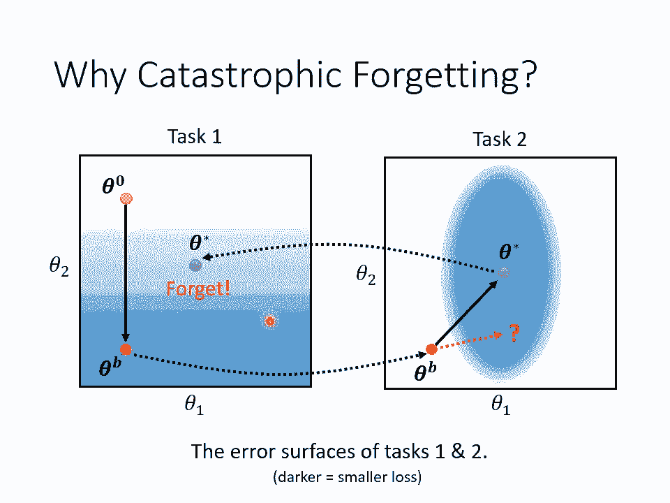

假设有两个任务：任务一和任务二。为了简化，我们假设模型只有两个参数：θ₁ 和 θ₂。当然，实际模型通常有数百万甚至数十亿个参数。

下图中的两张图分别代表了任务一和任务二的损失函数。颜色代表损失的大小：越偏蓝色表示损失越小，越偏白色表示损失越大。

首先，我们让模型训练任务一。从一个随机初始化的参数 θ⁰ 开始，使用梯度下降法调整参数，最终得到参数 θᴮ。假设训练足够充分，损失降得足够低，我们就认为任务一学完了。

接下来，我们继续解决任务二。我们把 θᴮ 这组参数复制到任务二的损失曲面上。注意，虽然左右两边的损失曲面不同，但 θᴮ 指的是同一组参数。我们在任务二上继续训练，可能会将 θᴮ 往右上角移动，得到参数 θ*。θ* 是依次训练完两个任务后得到的参数。

θ* 在任务二上处于损失较低的位置，因此在任务二上表现良好。但如果你把 θ* 拿回到任务一上使用，你会发现它无法得到好的结果，因为 θ* 在任务一上的损失不一定低。这就是遗忘产生的原因。

## 克服遗忘的基本思路 🛡️

那么，如何解决遗忘问题呢？

对于一个任务而言，可能有很多组不同的参数都能给出较低的损失。对于任务二，也许在蓝色椭圆形范围内的参数，其损失都足够低。

如果我们更新 θᴮ 的方向不是往右上，而是只往左边移动，那么得到的新参数用在任务一上，是否就不会产生遗忘了呢？这就是我们接下来要分享的做法。

其基本想法是：**每个参数对我们过去学过的任务的重要性是不同的**。有些参数对过去看过的任务特别重要，我们就希望在学新任务时，这些重要的旧参数值尽量不要改变；新任务只去改动那些对旧任务不重要的参数。

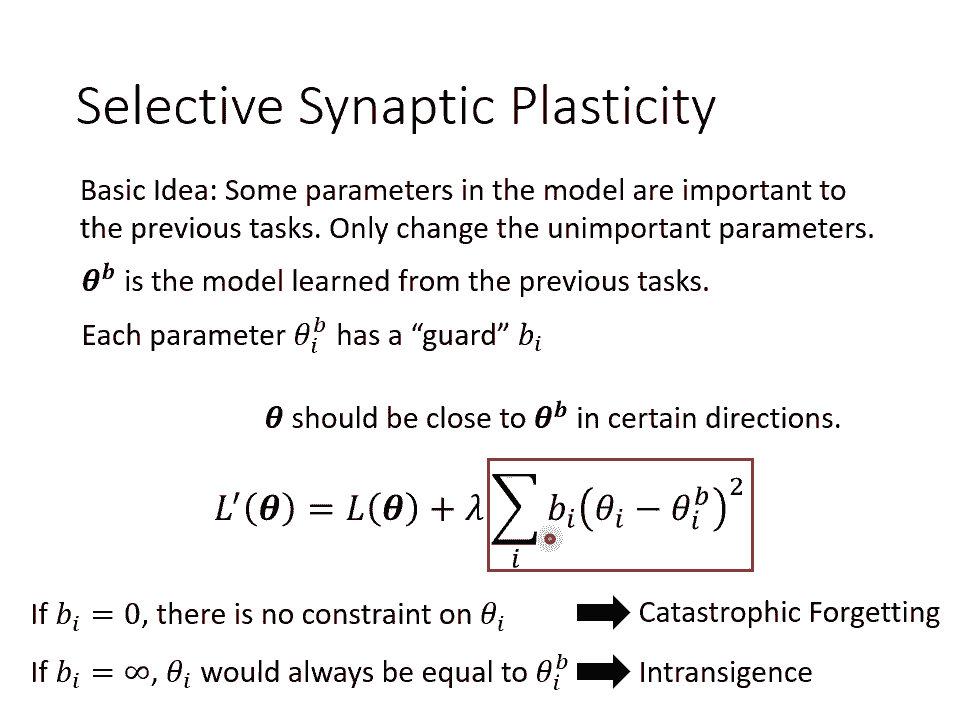

## 选择性突触可塑性详解 🧩

假设 θᴮ 是在前一个任务（任务一）中学出的参数，它在任务一上表现良好。现在我们要让 θᴮ 在第二个任务上继续学习。

在选择性突触可塑性方法中，我们会给每一个参数配备一个“守卫”，用 **bᵢ** 表示。每个参数（即网络中的每一个权重和偏置）都有一个自己的守卫值 bᵢ。这个守卫值代表了该参数对过去任务的重要性。

我们在新任务上更新参数时，会改写损失函数。原来的损失函数记为 **L**。如果我们直接最小化 L，就会发生灾难性遗忘。因此，我们要做的是更改损失函数，定义一个新的损失函数 **L‘** 作为我们真正要最小化的目标。

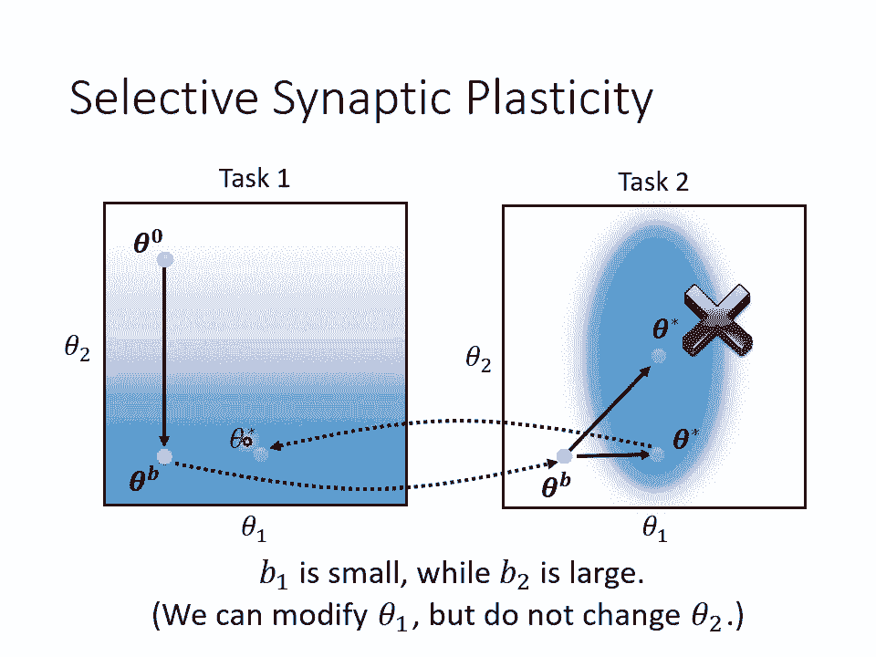

**L‘ = L + Σᵢ bᵢ (θᵢ - θᴮᵢ)²**

这个新的损失函数 L‘ 由两部分组成：
1.  原来的新任务损失 **L**。
2.  一项正则化项：对所有参数 i 求和，**bᵢ (θᵢ - θᴮᵢ)²**。

这项正则化的目的是让新参数 θᵢ 与旧参数 θᴮᵢ 越接近越好。前面的系数 bᵢ 控制了我们希望它们接近的“强烈程度”：
*   如果 **bᵢ 的值很大**，代表我们非常希望 θᵢ 与 θᴮᵢ 非常接近。
*   如果 **bᵢ 的值很小**，代表我们不在乎 θᵢ 是否接近 θᴮᵢ。

我们并不要求所有参数都接近旧值，只要求某些重要参数接近即可，而哪些参数重要就由 bᵢ 来控制。

**极端情况分析：**
*   如果所有 bᵢ 都设为 **0**，意味着我们对新参数没有任何限制，这就是一般的训练，会导致灾难性遗忘。
*   如果所有 bᵢ 都设为一个**非常大的值**，那么最终学出的新参数 θ 会非常接近旧参数 θᴮ。这虽然能防止在旧任务上遗忘，但会导致模型无法学好新任务，这种现象称为 **顽固不化**。

## 如何确定参数的重要性？ 🔍

那么，如何知道一个参数对某个任务是否重要呢？

你可以在训练完一个模型得到 θᴮ 后，观察每个参数对任务损失的影响。例如：
*   如果你在 θ₁ 方向稍微移动参数，发现对损失 **L** 影响很小，那就说明 θ₁ 对任务一不重要，可以随意改变。因此，在新任务上，我们可以给 θ₁ 设置一个较小的 b₁ 值。
*   反之，如果你发现改变 θ₂ 的值对损失 **L** 影响很大，那就说明 θ₂ 是一个重要参数，不应该轻易改动。因此，你要给 θ₂ 设置一个较大的 b₂ 值。

这就是选择性突触可塑性的基本概念。如果我们把 b₁ 设小，b₂ 设大，在训练任务二时，模型参数就会倾向于在 θ₁ 方向（不重要方向）移动，而尽量避免在 θ₂ 方向（重要方向）移动。这样得到的新参数 θ* 再拿回任务一上使用时，由于在重要方向上改动小，对任务一的损失影响就小，从而可能避免灾难性遗忘。

## 实际效果与实验 📊

下图展示了一个文献中的真实实验结果（来自论文 *EWC*）。

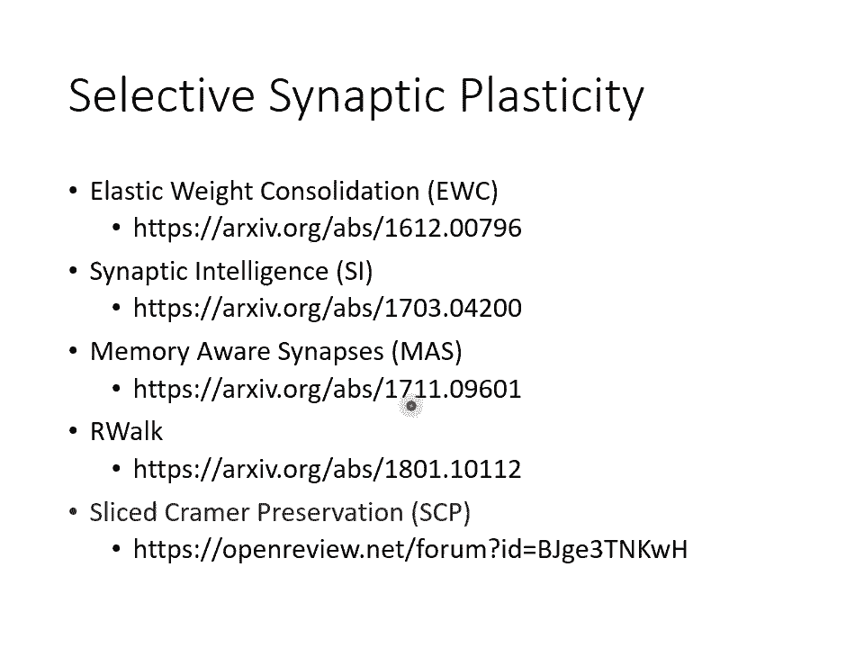

**如何解读此图：**
*   **横轴**：代表依次训练任务的过程（A -> B -> C）。
*   **纵轴**：有三个，分别代表任务A、B、C的正确率。
*   **蓝色线（Fine-tuning）**：bᵢ 恒为0，即一般训练。可以看到，学任务B时，任务A的正确率骤降；学任务C时，任务A正确率再降。这就是灾难性遗忘。
*   **绿色线（L2-norm）**：所有 bᵢ 恒为1。任务A的正确率在学B、C时没有下降很多，防止了遗忘。但带来了“顽固不化”的问题：任务B和任务C的正确率无法有效提升（学不起来）。
*   **红色线（EWC）**：根据重要性设置不同的 bᵢ。它在防止任务A遗忘的同时，任务B和任务C也能学到不错的水平，取得了较好的平衡。

在课堂上，我们没有详细讲解如何具体计算 bᵢ，只介绍了概念。在作业中，助教实现了多种计算 bᵢ 的方法（如 EWC, SI, MAS, RWalk, SCP等），每种方法都有其考量和特色，这部分留给大家在作业中探索。

## 基于梯度方向修正的方法 🧭

除了在参数上施加约束，还有一种早期有效的方法叫做 **梯度情景记忆**。

GEM 的做法是：
1.  在任务二上计算梯度 **g**。
2.  在更新参数前，先回到任务一上，计算旧参数 θᴮ 在任务一上的梯度方向 **gᴮ**（图中蓝色箭头）。
3.  如果新任务的梯度 **g** 与旧任务的梯度 **gᴮ** 方向不一致（即内积为负），则修改 **g** 为一个新的方向 **g‘**。
4.  修改的条件是：**g‘** 需要与 **gᴮ** 的内积大于等于0（方向一致或正交），同时 **g‘** 与原始 **g** 的差异不能太大。

这样通过刻意修改更新方向，可以减轻灾难性遗忘。但请注意，这个方法需要存储一部分旧任务的数据来计算 gᴮ，这与终身学习不完全存储旧数据的初衷略有出入，不过它通常只需要存储少量数据即可。

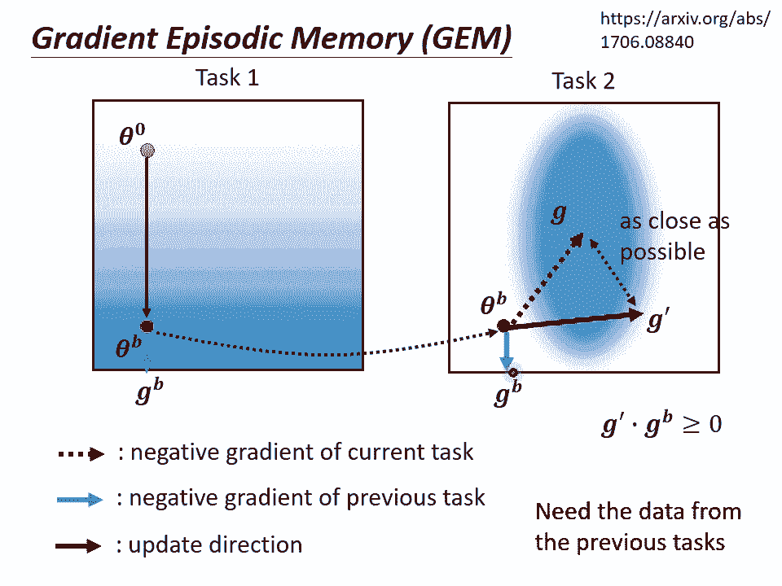

## 增加/分配神经资源 🧱

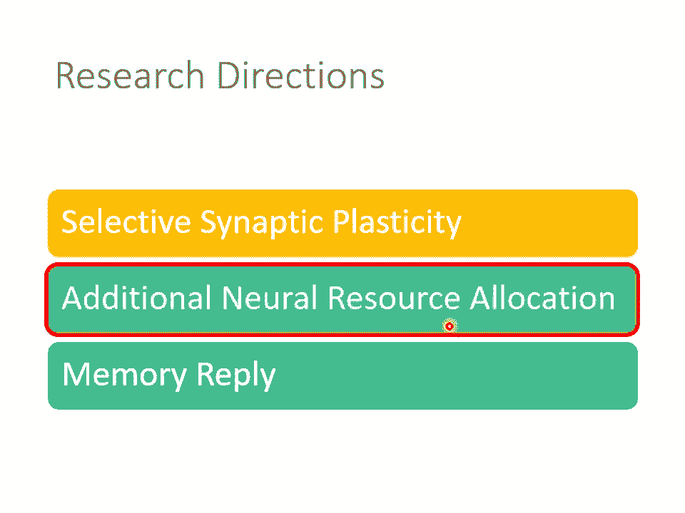

第二种思路是改变每个任务所使用的神经资源。

**1. 渐进式网络**
一个经典方法是**渐进式网络**。

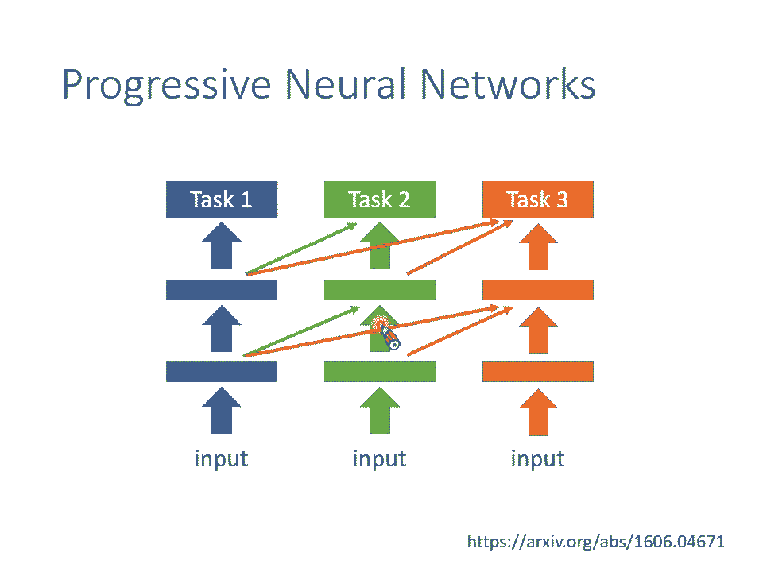

它的思想是：
*   训练任务一时，有一个模型。
*   训练任务二时，**不再改动**任务一学到的模型参数，而是**新增**一组神经元（侧枝）。
*   这个新增的侧枝以任务一层的输出作为输入。这样，任务二可以利用任务一学到的信息，但不会破坏它。
*   训练任务三时，再新增一组神经元，以此类推。

这种方法完全不会导致遗忘，因为旧参数丝毫未动。但问题是，模型会随着任务数量增加而不断变大，最终可能耗尽内存。

**2. 打包网络**
另一个方法是**打包网络**，它是渐进式网络的反向思路。

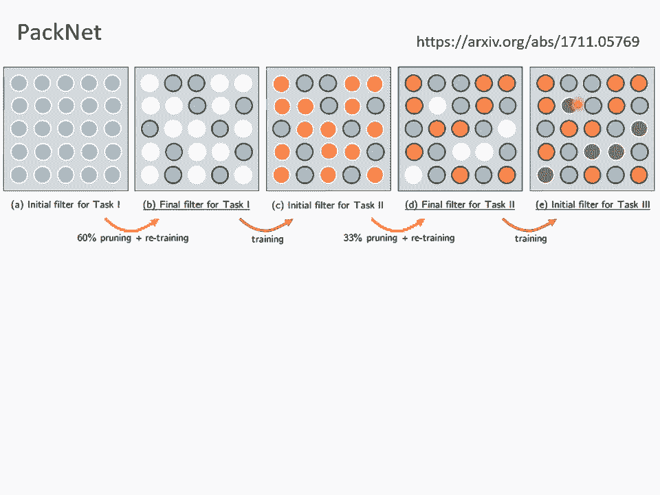

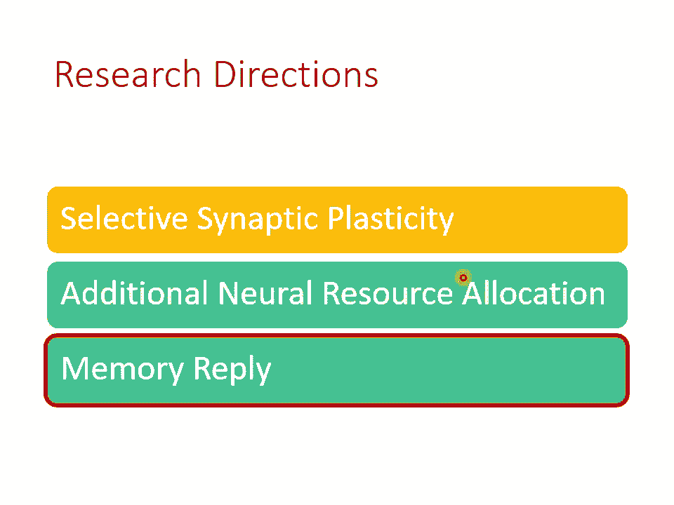

它的思想是：
*   先初始化一个较大的神经网络。
*   每个新任务进来时，只允许使用这个大网络中的**一部分**参数（如图中不同颜色的圈）。
*   任务一用黑色部分，任务二用橙色部分，任务三用绿色部分。

这样参数量不会随任务增加。但本质上，这只是提前分配了更多的参数，有点“朝三暮四”的感觉。这两种思路也可以结合使用（如 CPG 方法）。

## 记忆回放 🎭

第三种思路非常直观：既然把所有旧数据和新数据混在一起训练就不会遗忘，但又不能存储旧数据，那我们何不训练一个**生成模型**，在需要时“即时”生成旧数据呢？

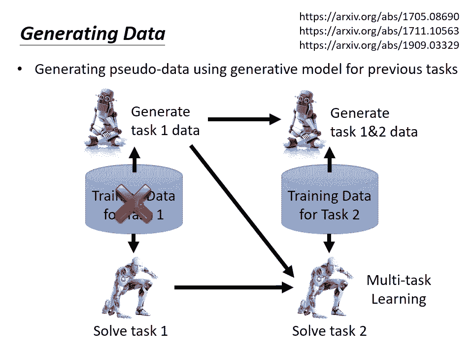

具体做法：
1.  用任务一的训练数据，除了训练分类器，同时训练一个生成模型 **G₁**，它能生成类似任务一的数据。
2.  训练任务二时，分类器不仅看到任务二的真实数据，还会看到由 **G₁** 生成的任务一“伪数据”。
3.  接着，用任务二的数据和生成的任务一数据，共同训练一个能生成任务一和任务二数据的生成模型 **G₂**。
4.  此过程反复继续。

这种方法是否合理见仁见智，因为它需要额外训练生成模型，也会占用空间。但如果生成模型比存储所有原始数据更节省空间，那它就是一个有效的方法。在实践中，这类方法往往能取得接近多任务学习上限的效果。

## 总结与拓展 📚

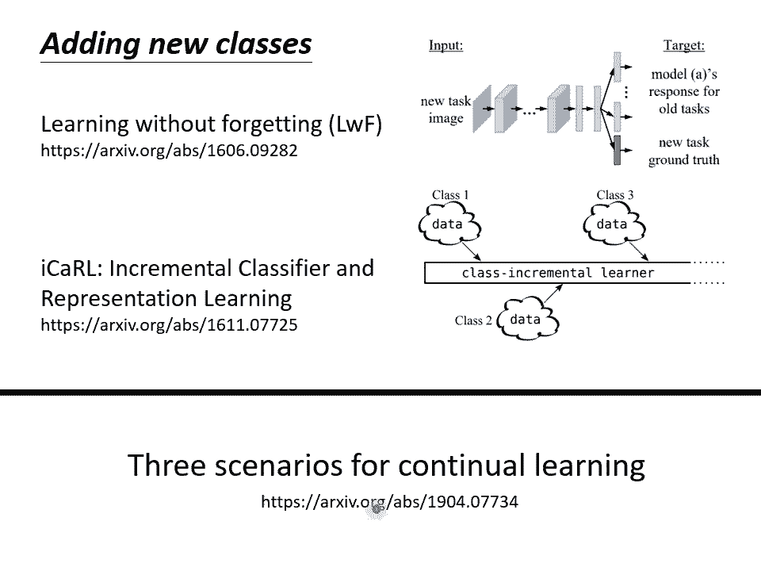

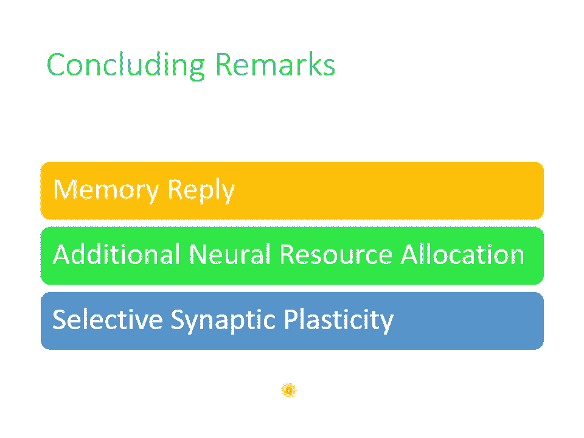

本节课我们一起学习了克服机器终身学习中灾难性遗忘的三种主要思路：
1.  **基于正则化的方法**：核心是识别并保护对旧任务重要的参数（如 EWC）。
2.  **基于架构的方法**：通过增加或分配独立的神经资源来处理新任务（如渐进式网络）。
3.  **基于记忆回放的方法**：使用生成模型重现旧数据，与新数据混合训练。

此外，我们还了解到：
*   任务的**学习顺序**对结果有显著影响。研究最佳学习顺序的领域称为课程学习。
*   今天的场景（任务类别数固定）只是终身学习中最简单的一种。还有更复杂的场景，例如**增量分类学习**，即新任务会引入新的类别，相关方法如 *Learning without Forgetting*, *iCaRL* 等。

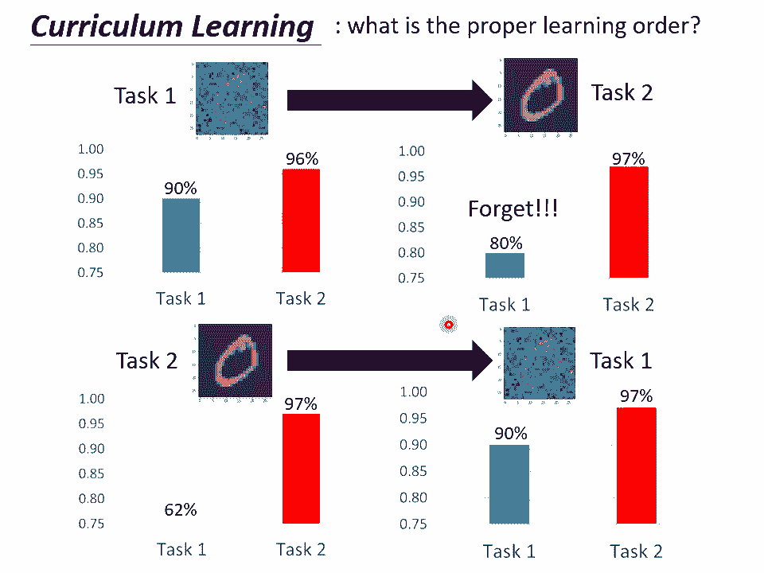

希望本教程能帮助你理解机器终身学习的基本挑战和主流解决方案。要深入了解细节，特别是各种计算参数重要性的方法，请仔细完成相关的作业练习。