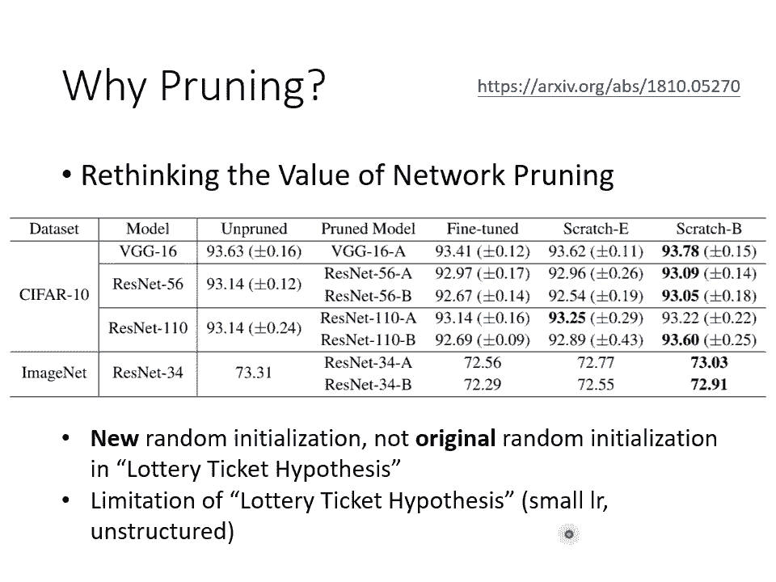

# 36：L21.1 - 神经网络压缩1：神经网络剪枝与大乐透假说 🧠✂️

在本节课中，我们将要学习神经网络压缩技术，特别是神经网络剪枝。我们将探讨如何将庞大的模型缩小，使其在保持相近性能的同时，拥有更少的参数。这对于在资源受限的设备上部署模型至关重要。

## 概述

我们已经见识过许多庞大的模型，例如 BERT 或 GPT。本节课的核心问题是：我们能否将这些庞大的模型缩小？能否简化模型，使其参数更少，但性能与原始模型相差无几？这就是神经网络压缩的目标。

我们之所以关注神经网络压缩，是因为许多时候需要在资源受限的环境下运行模型。例如，在智能手表或无人机等 IoT 设备上，内存和计算能力有限。庞大的模型可能无法在这些设备上顺利运行。

有人可能会问，为何不将数据传至云端计算，再将结果传回设备？主要原因有两个：延迟和隐私。对于需要即时响应的应用（如自动驾驶传感器），云端计算的延迟可能无法接受。此外，将数据传至云端可能涉及隐私泄露风险。因此，在设备端直接进行运算和决策是更优选择。

本节课将介绍五种以软件为导向的神经网络压缩技术，不涉及硬件加速部分。首先，我们将深入探讨神经网络剪枝技术。

## 神经网络剪枝

上一节我们概述了神经网络压缩的必要性。本节中，我们来看看第一个具体技术：神经网络剪枝。

神经网络剪枝，顾名思义，就是修剪掉神经网络中的一些参数。其基本理念是：在一个庞大的神经网络中，并非所有参数都在有效工作。许多参数可能无所作为，只是占用空间和浪费计算资源。因此，我们可以找出并移除这些无用的参数。

这类似于生物学中的现象：人脑在成长过程中，神经元之间的连接会先增多，随后一些不必要的连接会逐渐消失。神经网络剪枝也遵循类似的思路。

早在 20 世纪 90 年代，Yann LeCun 等人就在论文 *Optimal Brain Damage* 中探讨了神经网络剪枝，将其视为一种对网络的“损伤”，并寻求最小化这种损伤的修剪方法。

神经网络剪枝的基本流程如下：

1.  **训练一个大型网络**：首先，训练一个庞大的神经网络。
2.  **评估参数重要性**：评估该大型网络中每个参数或神经元的重要性，找出那些不重要的部分。评估方法多样，例如：
    *   查看参数的绝对值（绝对值越大可能越重要）。
    *   借鉴终身学习中的方法，计算参数的“重要性分数”。
    *   统计神经元输出不为零的次数等。
3.  **剪枝**：移除不重要的神经元或参数，得到一个更小的网络。
4.  **微调**：剪枝后，网络性能通常会下降。因此，需对剩余参数进行微调，以恢复性能。
5.  **迭代**：上述过程可反复进行。实验表明，一次性剪枝过多参数可能造成不可逆的损伤。因此，通常采用迭代方式：每次剪枝一小部分（如 10%），然后微调，重复此过程直至网络达到预期大小。

剪枝可以以不同单位进行：

*   **以参数为单位**：评估并移除单个权重参数。
*   **以神经元为单位**：评估并移除整个神经元。

这两种方式在实践中有显著差异。以参数为单位剪枝会导致网络结构变得不规则，给实现和 GPU 加速带来困难。通常的变通方法是将“剪掉”的参数设为零，但这并未真正减少参数存储。而以神经元为单位剪枝，网络结构保持规则，更易于实现和加速。

## 大乐透假说

在了解了剪枝的基本操作后，一个自然的问题是：为什么不直接训练一个小型网络，而非要先训练大型网络再剪枝呢？

普遍答案是：大型网络通常更容易训练。直接训练的小型网络往往无法达到“大型网络剪枝后”的小型网络的性能。这引出了著名的“大乐透假说”。

该假说认为，训练神经网络如同抽奖，初始参数的好坏直接影响结果。大型网络可以看作是许多小型子网络的组合。训练大型网络相当于同时训练所有这些子网络。只要其中有一个子网络成功“中奖”（即训练良好），整个大型网络就表现为成功。网络越大，包含的子网络越多，“中奖”几率就越高。

实验上，该假说通过剪枝相关实验得到验证：从训练好的大型网络中剪枝得到的小型网络，如果使用剪枝后对应的**原始初始化参数**，能够成功训练；但如果对这些参数**重新随机初始化**，则可能训练失败。这表明，剪枝后保留的参数恰好构成了一个“幸运”的、可训练的子网络初始化状态。

大乐透假说在 ICLR 2019 获得了最佳论文奖，非常知名。后续研究，如 *Deconstructing Lottery Tickets*，进一步发现：
*   剪枝策略中，某些方法特别有效。
*   初始化参数中，**正负号**比绝对值更重要，是决定子网络能否训练成功的关键。
*   甚至在大型随机初始化的网络中，可能已经存在一个无需训练、剪枝后即可直接使用的有效子网络分类器。

然而，大乐透假说并非没有争议。同期另一篇论文 *Rethinking the Value of Network Pruning* 提出了不同观点。其实验表明，如果为直接训练的小型网络设置更多的训练周期（epoch），其性能可以媲美“先训练大再剪枝”得到的小型网络。该文认为，大乐透假说观察到的现象可能只在特定条件下（如学习率较小、非结构化剪枝）成立。因此，这一领域仍需更多研究来厘清。

## 总结

本节课我们一起学习了神经网络压缩的重要性及其首个关键技术——神经网络剪枝。我们了解了剪枝的基本流程、以不同单位（参数/神经元）剪枝的利弊，并深入探讨了解释“为何要先大后小”的**大乐透假说**及其相关实验与争议。

神经网络剪枝是模型压缩的有效手段，它帮助我们在资源受限的设备上部署高性能的模型。理解其背后的原理（如大乐透假说）能让我们更好地应用和探索这一技术。