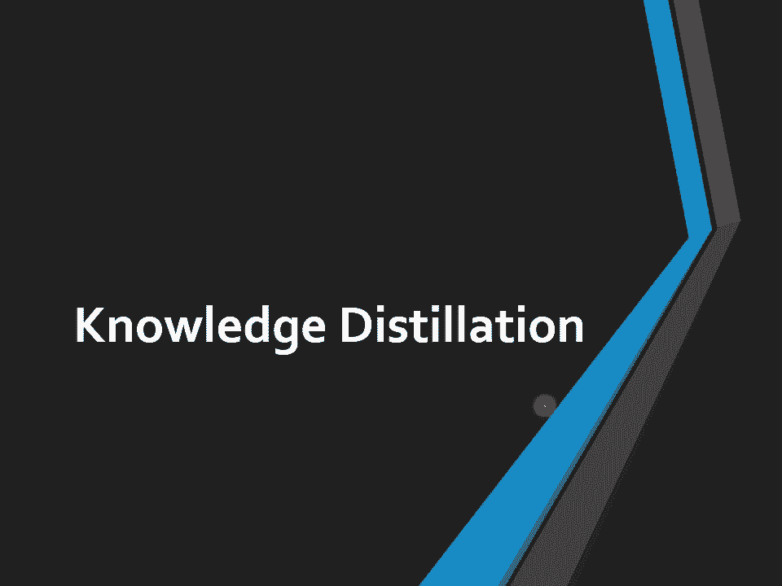
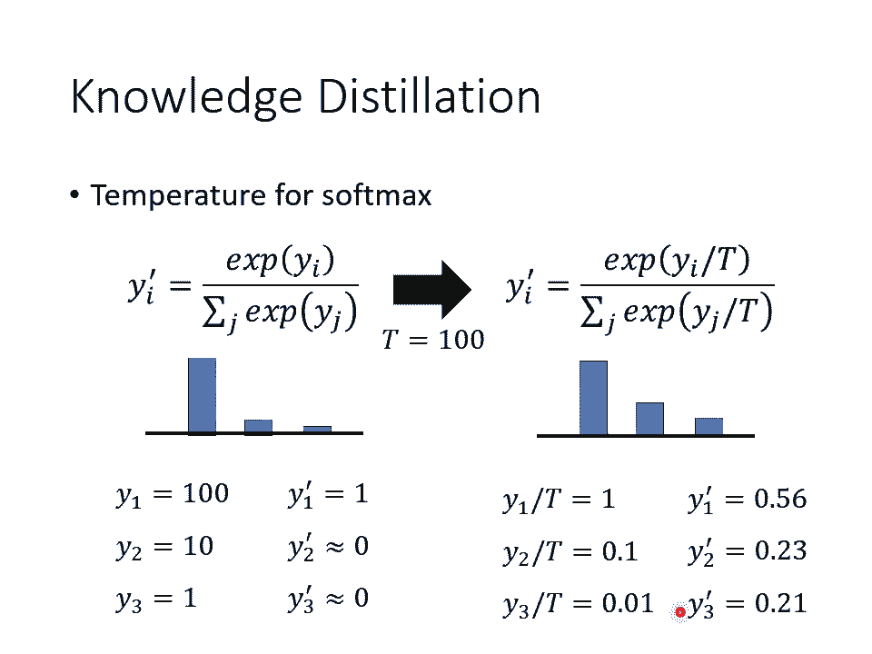
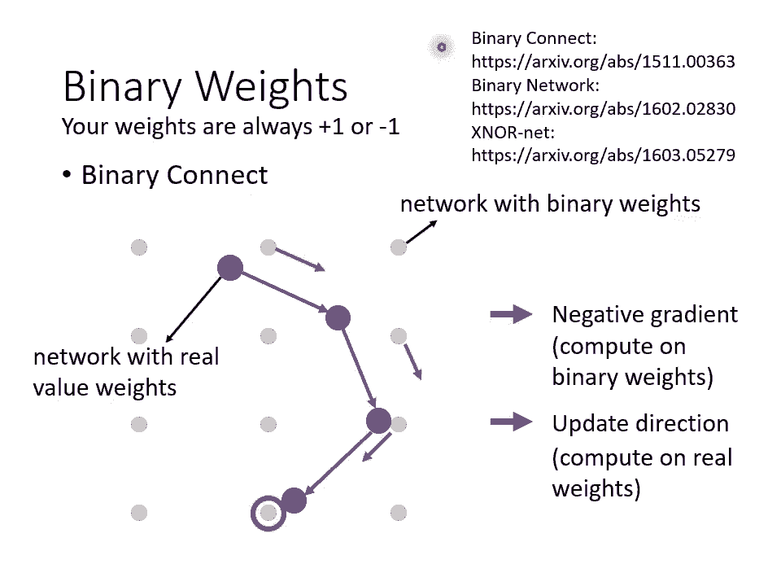
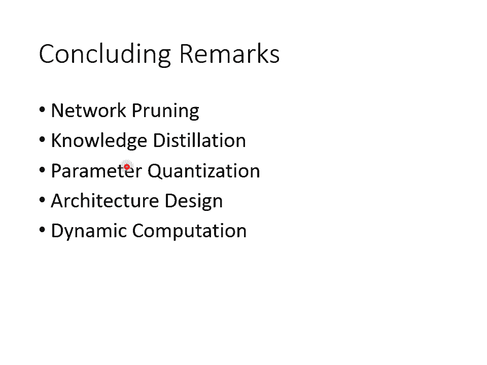

# 37：L21.2 - 神经网络压缩2：从各种不同的面向来压缩神经网络 🧠



在本节课中，我们将要学习神经网络压缩的多种方法。上一节我们介绍了网络剪枝，本节中我们来看看知识蒸馏、参数量化、网络架构设计以及动态计算等不同面向的压缩技术。

## 知识蒸馏 (Knowledge Distillation) 🧑‍🏫

知识蒸馏的核心概念是让一个小的“学生”网络去学习一个大的“教师”网络的输出行为，而不仅仅是学习原始的训练标签。

### 基本概念与流程

知识蒸馏的过程如下：首先，训练一个大型神经网络，称为教师网络。然后，训练一个较小的神经网络，称为学生网络。学生网络的学习目标不是直接匹配训练数据的真实标签，而是去匹配教师网络对相同输入产生的输出分布。

例如，在手写数字识别任务中，教师网络的输出可能是一个概率分布，如数字“1”的概率是0.7，“7”的概率是0.29，“9”的概率是0.01。学生网络的目标就是让自己的输出分布尽可能接近这个由教师网络产生的“软标签”。

### 为何有效？

你可能会问，为什么不直接训练一个小网络呢？一个直观的解释是，教师网络为学生网络提供了额外的、更丰富的监督信息。直接告诉学生网络“这是一张‘1’的图片”可能过于困难，因为‘1’可能与‘7’或‘9’有相似之处。而教师网络的软标签（如‘1’: 0.7, ‘7’: 0.29）则揭示了类别之间的相似性，使学生网络更容易学习。

**公式描述**：学生网络的损失函数通常结合了与教师网络输出的KL散度（或交叉熵）以及与真实标签的交叉熵。
`总损失 = α * 蒸馏损失(学生输出 vs 教师软标签) + (1-α) * 学生损失(学生输出 vs 真实硬标签)`

### 技巧：温度参数 (Temperature)



为了使教师网络的输出分布更平滑，从而传递更多类别间关系的信息，常在Softmax函数中引入温度参数T。

**代码描述**：
```python
# 普通Softmax
output = torch.softmax(logits, dim=-1)

# 带温度参数的Softmax
temperature = 5
soft_targets = torch.softmax(logits / temperature, dim=-1)
```
温度T大于1时，会软化概率分布，使各类别的概率差异变小，从而让学生网络能更好地从教师网络学习到类别间的相对关系。

### 集成模型作为教师

教师网络不一定是单个大模型，也可以是多个模型的集成。集成模型通常能获得更高的准确率，但推理成本高昂。通过知识蒸馏，可以让单一的学生网络去学习集成模型的输出，从而在保持较高性能的同时大幅降低计算开销。


---

## 参数量化 (Parameter Quantization) ⚖️

参数量化的目标是通过降低存储每个参数所需的精度来减少模型大小。请注意，此方法在本次作业的评估标准（参数数量）中可能不直接受益，但仍是一种重要的压缩技术。

### 基本方法

最简单的量化方法是降低参数的数据类型精度，例如从32位浮点数转换为16位甚至8位整数。这通常能在模型性能损失很小的情况下，将模型体积减半或更多。



### 权重聚类 (Weight Clustering)

更进一步的压缩技术是权重聚类。其步骤如下：
1.  对所有网络权重进行聚类（如K-means），将数值相近的权重归为一类。
2.  每个类用一个代表值（如类中心）来表示。
3.  存储时，只需保存聚类中心表和一个记录每个权重属于哪个类的索引表。

以下是权重聚类的操作步骤：
*   设定聚类数目K（例如4类）。
*   对所有权重进行聚类分析。
*   用聚类中心值替代原始权重值。
*   存储时，保存K个中心值和每个权重对应的聚类索引。

当K值较小时，存储索引所需的比特数远小于存储原始权重值。例如，若K=4，则每个权重只需2个比特来存储其类别索引。

### 极致压缩：二值化权重 (Binary Weight)


参数量化的终极形式是二值化权重，即每个权重只能是+1或-1。这样每个权重仅需1个比特存储。研究表明，在某些情况下，二值化网络由于引入了极强的正则化，反而可能比全精度网络表现更好，因为它能有效防止过拟合。

---

## 网络架构设计 🏗️

通过设计更高效的网络层结构，可以直接减少参数量。本节介绍深度可分离卷积，这是本次作业中突破强基线（strong baseline）的关键方法。

### 回顾标准卷积

在标准卷积层中，每个滤波器都是一个三维张量（高 x 宽 x 输入通道数）。假设输入特征图有 `I` 个通道，使用 `O` 个大小为 `K x K` 的滤波器，则参数量为：
`参数量 = K * K * I * O`

### 深度可分离卷积 (Depthwise Separable Convolution)

深度可分离卷积将标准卷积分解为两个步骤，大幅减少计算量和参数量。

**第一步：深度卷积 (Depthwise Convolution)**
*   每个输入通道独立使用一个二维卷积滤波器。
*   输入有 `I` 个通道，就使用 `I` 个滤波器。
*   每个滤波器只与一个输入通道进行卷积，输出 `I` 个通道的特征图。
*   此步骤负责处理空间特征，但通道间无交互。
*   参数量：`K * K * I`

**第二步：逐点卷积 (Pointwise Convolution)**
*   使用 `1x1` 大小的标准卷积。
*   其作用是将深度卷积输出的 `I` 个通道的信息进行融合，并变换到指定的输出通道数 `O`。
*   此步骤负责处理通道间的关系。
*   参数量：`1 * 1 * I * O = I * O`

**总参数量对比**：
*   标准卷积：`K * K * I * O`
*   深度可分离卷积：`K * K * I + I * O`

两者比值为 `1/O + 1/(K*K)`。当 `O` 较大时，比值约等于 `1/(K*K)`。例如，当 `K=3` 时，深度可分离卷积的参数量约为标准卷积的 `1/9`。

### 原理：低秩近似 (Low-rank Approximation)

深度可分离卷积的本质是将一个全连接层（或卷积层视为一种全连接）分解为两个更薄层的连续操作。这种分解限制了权重矩阵的秩，从而减少了自由度（参数量），但通常能以较小的性能损失换取显著的空间节省。

---

## 动态计算 (Dynamic Computation) ⚡


动态计算的目标不是单纯地让网络变小，而是让同一个网络能够根据可用的计算资源（如设备电量、算力）动态调整其计算成本。


### 调整网络深度

一种方法是让网络能在中间层提前输出结果。具体做法是在网络的某些中间层后添加辅助分类器。训练时，要求所有辅助分类器和最终分类器的输出都尽可能接近真实标签。推理时，资源紧张则使用浅层的输出，资源充足则使用深层输出。

### 调整网络宽度

另一种方法是让网络能选择性地“关闭”一部分神经元（即使用子网络）。在训练时，同时优化多个不同宽度的子网络（共享权重），使它们都能取得良好性能。推理时，根据资源选择激活的神经元比例。

### 基于输入难度的动态计算

更智能的方法是让网络根据输入样本的难度自行决定需要多少计算。对于简单的样本（如清晰的猫图片），网络可能早期层就能做出准确判断并提前退出；对于困难的样本（如伪装成食物的猫），网络则会使用全部层进行计算。这可以在不牺牲精度的前提下，平均减少计算量。

---

## 总结 📚

本节课中我们一起学习了多种神经网络压缩与加速技术：
1.  **知识蒸馏**：让小模型学习大模型的输出分布，传递暗知识。
2.  **参数量化**：通过降低权重精度、聚类或二值化来减少存储开销。
3.  **网络架构设计**：采用如深度可分离卷积等高效结构，从根本上减少参数量。
4.  **动态计算**：使网络能根据资源或输入难度灵活调整计算成本。



这些技术并非互斥，在实际应用中常被组合使用，以在模型大小、速度和精度之间达到最佳平衡。掌握这些方法，将有助于你将强大的深度学习模型部署到资源受限的实际环境中。