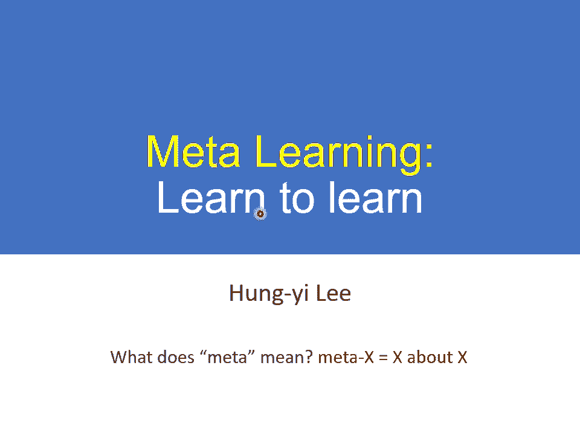
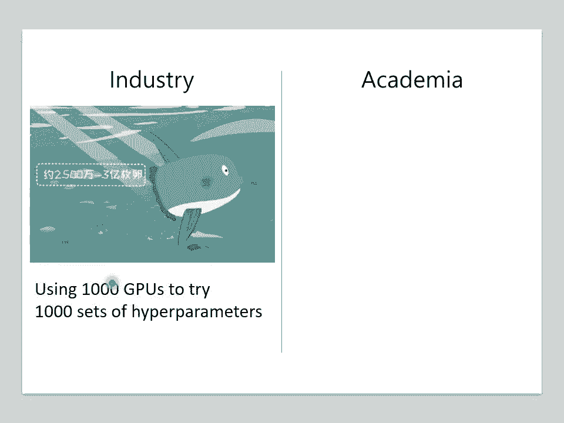
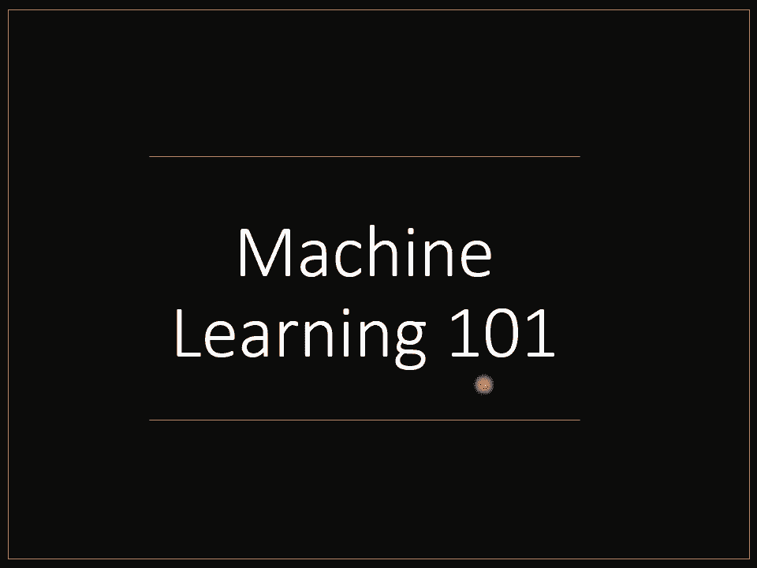
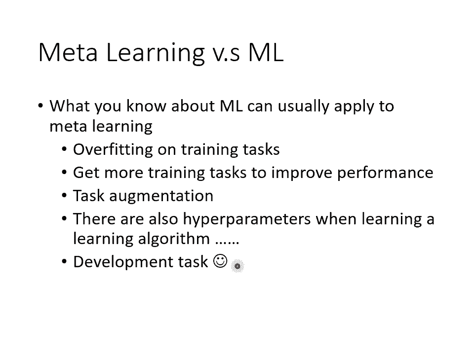

# 38：L22.1 - 元学习1：元学习跟机器学习一样也是三个步骤 🧠

在本节课中，我们将要学习元学习的基本概念。元学习，即“学习如何学习”，是机器学习领域的一个高级主题。我们将看到，元学习的基本框架与传统的机器学习非常相似，同样遵循三个核心步骤。

## 什么是元学习？🤔

元学习中的“元”字，通常翻译为“元”，如“一元复始”中的“元”。从字面意思看，元学习是关于“学习的学习”。因此，元学习可以理解为 **学习如何学习**。这与我们之前讨论的机器学习处于不同层次，是迈向更高级领域的一步。

## 为什么需要元学习？🔧

在深度学习中，调整超参数（如学习率、网络架构）是一项繁琐且关键的任务。目前，业界常用的方法是使用大量GPU同时训练多个不同超参数的模型，然后选择表现最好的一个。然而，在学术环境中，资源往往有限，通常只能依靠经验和直觉来设定超参数。

既然机器学习可以自动学习模型，那么超参数是否也能通过学习得到呢？这就是元学习可以发挥作用的地方之一。

## 回顾机器学习 📚

在深入元学习之前，让我们先回顾一下机器学习的基本框架。你会发现，元学习的基本思想与机器学习并无太大差异。

机器学习就是寻找一个函数。例如，构建一个图像识别系统，就是寻找一个输入图片、输出识别结果的函数。机器学习包含三个步骤：

1.  **定义一个带有未知参数的函数**。在深度学习中，这通常是一个神经网络。我们用 **F_θ** 表示这个函数，其中 **θ** 代表网络中的权重和偏置等待学习的参数。
2.  **定义一个损失函数**。损失函数 **L(θ)** 用于衡量参数 **θ** 的好坏。它基于带有标签的训练数据计算得出，例如，对于分类问题，常计算所有样本的交叉熵之和。
3.  **寻找最优参数**。目标是找到一个参数 **θ***，使得损失函数 **L(θ)** 最小。我们通常使用梯度下降等优化方法来解决这个问题。找到 **θ*** 后，我们就得到了最终可用的模型 **F_θ***。

## 元学习的三个步骤 🚀

学习本身也可以看作一个函数。一个机器学习算法，本质上是一个函数，我们称之为 **F**。它的输入是训练数据集，输出是一个训练好的分类器。目前，这些算法（如梯度下降）都是人工设计的。

元学习的目标，就是学习这个“学习算法” **F**。我们同样可以通过三个步骤来实现：

### 第一步：定义带有未知元参数的函数

在元学习中，我们要找的函数 **F** 是一个学习算法。这个算法内部有一些我们希望机器自动决定的组件，例如网络架构、初始化参数或学习率策略。我们用 **φ** 来表示这些待学习的元参数。因此，学习算法可以表示为 **F_φ**。

不同的元学习方法，主要区别在于学习算法中哪些组件（即 **φ**）被设定为可学习的。

### 第二步：定义元损失函数

我们需要一个损失函数 **L(φ)** 来衡量一个学习算法 **F_φ** 的好坏。如何定义这个损失呢？这需要用到“训练任务”。

在元学习中，我们收集的是许多相关的“任务”，而不是单一任务的数据。例如，要训练一个二元分类器，我们就准备许多个二元分类任务（如任务1：区分苹果和橘子；任务2：区分汽车和自行车）。每个任务都包含自己的训练集和测试集。

以下是评估学习算法 **F_φ** 的流程：

1.  从第 **i** 个任务中取出训练集，输入给学习算法 **F_φ**。
2.  **F_φ** 根据该训练集进行学习（即进行一次“任务内训练”），产出一个针对该任务的分类器 **F_θ_i***。
3.  使用该任务中的测试集来评估这个分类器 **F_θ_i*** 的性能，计算出一个损失值 **l^i**（例如，分类错误率或交叉熵）。**l^i** 越小，说明针对此任务学习到的分类器越好，间接反映了学习算法 **F_φ** 在此任务上表现越好。
4.  重复以上步骤，在所有 **N** 个训练任务上运行学习算法 **F_φ**，得到 **N** 个损失值 **l^1, l^2, ..., l^N**。

最终，元损失函数 **L(φ)** 定义为所有任务损失的平均值：
**L(φ) = Σ_{i=1}^{N} l^i / N**

**请注意**：这里的每个 **l^i** 是在单个任务的“测试集”上计算的。这与传统机器学习在训练集上计算损失不同。在元学习中，训练的基本单位是“任务”，因此任务内部的测试集可以在元学习训练过程中被合法地用于评估。

### 第三步：寻找最优元参数

我们的目标是找到一个元参数 **φ***，使得元损失函数 **L(φ)** 最小化：
**φ* = argmin_φ L(φ)**

如何解决这个优化问题呢？如果我们可以计算 **L(φ)** 关于 **φ** 的梯度 **∇L(φ)**，那么可以直接使用梯度下降法。如果梯度无法计算（例如 **φ** 是离散的网络架构选择），则可以考虑使用强化学习或进化算法等黑盒优化方法。

找到 **φ*** 后，我们就得到了一个“学出来的”学习算法 **F_φ***。

## 元学习的完整流程与应用 🎯

整个元学习的框架如下：
1.  **跨任务训练**：使用大量训练任务，通过上述三个步骤，学习出最优的学习算法 **F_φ***。
2.  **跨任务测试**：面对一个新的测试任务（例如，区分猫和狗），我们将该任务的训练集输入给学到的算法 **F_φ***。**F_φ*** 会针对这个新任务进行学习，产出一个分类器。最后，我们用该任务的测试集来评估这个分类器的性能。

测试任务是我们真正关心的、希望取得好结果的任务。而训练任务则是用于“锻造”学习算法的、与测试任务不同的任务。

元学习的一个著名应用是**小样本学习**。小样本学习是目标，希望模型只需看少量样本就能学会新任务；而元学习是手段，通过让模型在大量任务上学习“如何学习”，从而获得强大的小样本适应能力。因此，两者紧密关联，但概念上略有区别。

## 元学习与机器学习的比较 🔄

为了更清晰地理解，我们来系统比较一下机器学习和元学习。

| 方面 | 机器学习 | 元学习 |
| :--- | :--- | :--- |
| **目标** | 寻找一个函数 **f_θ** (如分类器) | 寻找一个学习算法 **F_φ** (能产出分类器) |
| **训练数据** | 单个任务的训练集 | 多个训练任务，每个任务包含支持集(训练集)和查询集(测试集) |
| **训练过程** | 任务内训练 | 跨任务训练 |
| **测试过程** | 任务内测试 (直接应用模型) | 跨任务测试 (包含：用新任务支持集进行任务内训练 + 用新任务查询集进行任务内测试) |
| **损失函数** | **L(θ)**，对单个任务训练集求和 | **L(φ)**，对多个任务的查询集损失 **l^i** 求和/平均 |
| **过拟合** | 在训练集上表现好，在测试集上差 | 在训练任务上表现好，在新测试任务上差 |
| **缓解过拟合** | 收集更多训练数据、数据增强 | 收集更多训练任务、任务增强 |

**术语澄清**：
*   **跨任务训练/测试**：涉及多个任务的学习和评估过程。
*   **任务内训练/测试**：在单个任务内部，用其支持集学习模型，或用其查询集评估模型。
*   **支持集/查询集**：为避免与“元学习的训练集”混淆，文献中常将任务内的训练集称为支持集，测试集称为查询集。
*   **外层循环/内层循环**：在某些元学习方法（如学习初始化参数）中，跨任务训练被称为外层循环，而任务内训练被称为内层循环。

## 元学习的实践细节与挑战 ⚙️

元学习训练的计算量通常很大。因为每计算一次元损失 **L(φ)**，都需要对每个任务完整执行一次任务内训练和测试（即一个**回合**）。

与传统机器学习一样，元学习也需要调参（如优化 **φ** 时使用的学习率）。这似乎陷入了“为减少调参而引入更多调参”的循环。但元学习的理想目标是：花费一次大力气调参，找到一个强大的通用学习算法 **F_φ***，之后将其应用于任何新任务时，都无需或只需极少调参。

此外，元学习也应有验证环节。合理的流程是：拥有训练任务、验证任务和测试任务。用验证任务来选择元学习过程中的超参数，最终在测试任务上报告性能。目前并非所有文献都严格遵循此流程，但这应是未来标准。

## 总结 📝

本节课中，我们一起学习了元学习的基础知识：
1.  元学习的核心是 **学习如何学习**，旨在让机器自动发现高效的学习算法。
2.  其框架与机器学习一脉相承，都包含**定义函数、定义损失、优化参数**三个步骤，只是操作对象从“模型参数 **θ**”提升到了“学习算法元参数 **φ**”。
3.  元学习在“任务”的层面上进行学习和评估，需要准备大量的训练任务。
4.  元学习与机器学习在目标、数据形式、流程上既有相似之处，也有关键区别，理解这些区别对于掌握元学习至关重要。
5.  元学习是小样本学习等前沿方向的重要实现手段，尽管在实践中面临计算量大和自身需要调参等挑战，但其前景是让AI获得更强大、更通用的学习能力。