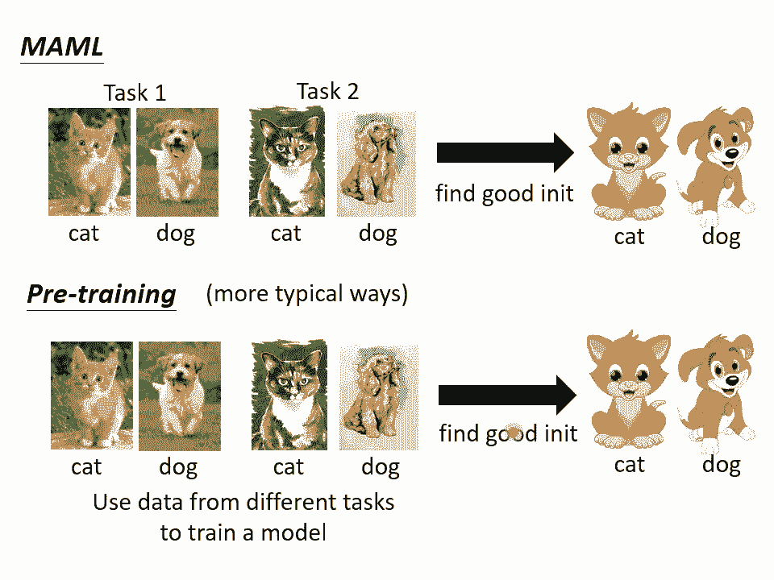
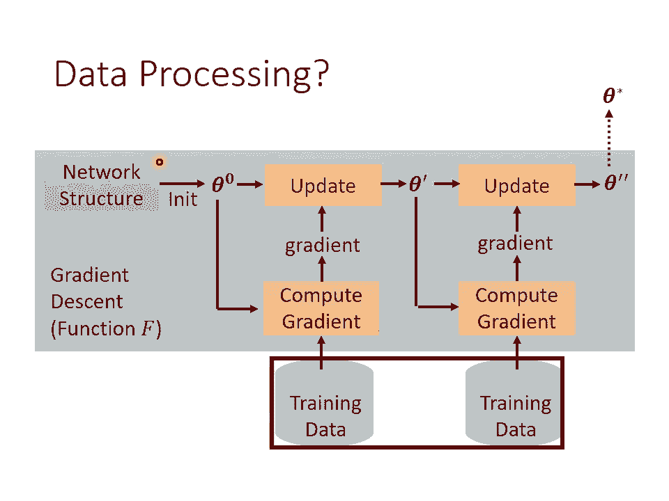
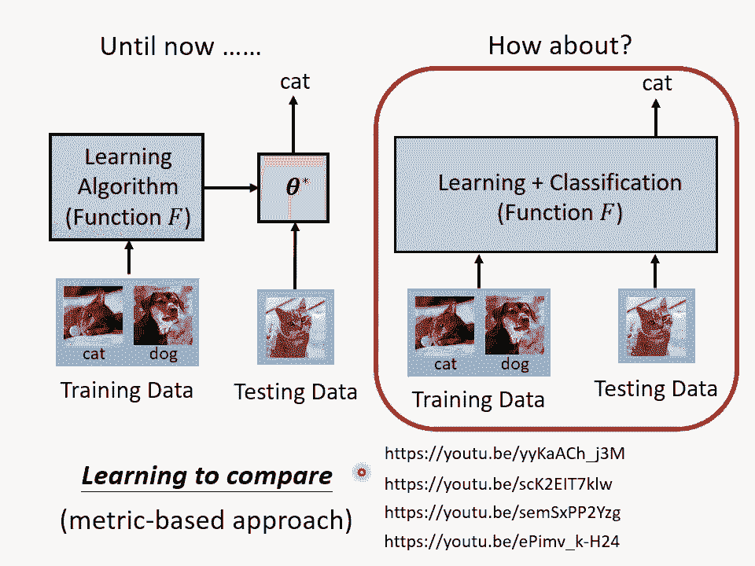
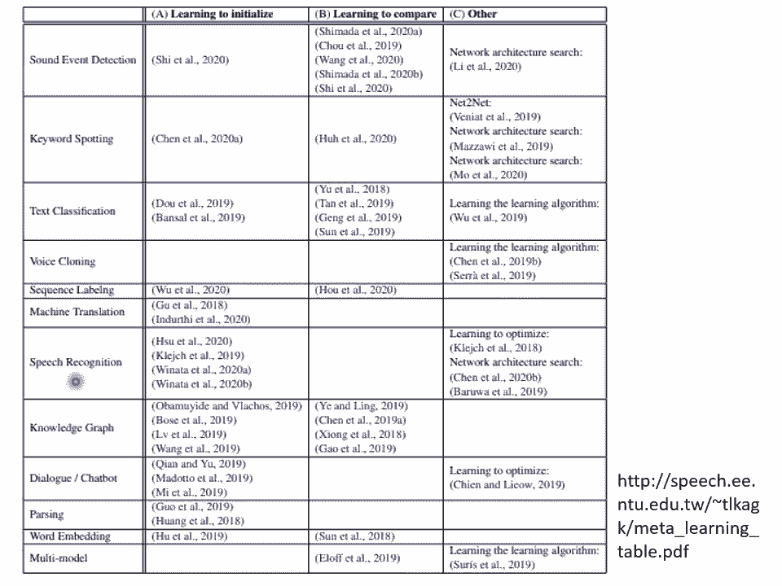

# 39：L22.2 - 元学习2：万物皆可Meta 🧠

在本节课中，我们将学习元学习（Meta Learning）的具体应用实例，探讨在元学习框架下，哪些组件可以被学习。我们将从梯度下降算法出发，逐一分析可学习的部分，并介绍相关的经典方法与研究。

---

## 概述

上一节我们介绍了元学习的基本概念。本节中，我们将通过具体实例，详细说明在元学习框架中，哪些组件可以被学习。我们将从最常见的梯度下降算法开始，分析其各个部分，并介绍如何通过元学习来优化这些部分。

---

## 梯度下降算法中的可学习组件

最常用的学习算法是梯度下降（Gradient Descent）。在梯度下降中，我们首先需要一个神经网络架构。接着，我们初始化参数，这个初始化的参数通常记作 **θ₀**。然后，我们从训练数据中采样一个批次（Batch），计算梯度，并用这个梯度来更新参数。这个过程反复进行，直到达到满意的训练次数，最终输出训练得到的参数 **θ**。

在这个完整的过程中，以下部分是可以被学习的：

### 1. 初始化的参数（θ₀）

初始化的参数 **θ₀** 是可以学习的。通常，**θ₀** 是随机初始化的，从一个固定的分布中采样出来。然而，初始化的好坏对最终结果有显著影响。好的初始化参数可以带来更好的训练效果，而差的初始化则可能导致结果天差地别。因此，我们可以通过元学习，利用一系列训练任务来找到一个对训练特别有帮助的初始化参数。

以下是学习初始化参数的代表性方法：

*   **MAML（Model-Agnostic Meta-Learning）**：这是元学习领域中最知名的方法之一。它的目标是学习一个通用的初始化参数，使其能够通过少量梯度更新快速适应新任务。
*   **Reptile**：这是 MAML 的一个变体，其名称与爬行动物相关。它通过一种更简单的方式学习初始化参数。

这些方法的细节因时间有限不在此详述，但相关参考文献已列在课程材料中供大家深入阅读。在作业中，我们也会涉及更多与 MAML 相关的细节问题。

需要注意的是，训练 MAML 本身也需要调整超参数。原始的 MAML 版本效果并不总是非常稳定。有一篇名为 **《How to Train Your MAML》** 的论文专门研究了如何更好地训练 MAML，并提出了改进版本 **MAML++**。有关 MAML++ 的更多细节，建议大家自行阅读这篇论文。

讲到学习好的初始化参数，这让我们联想到课程中的另一个主题：**自监督学习（Self-Supervised Learning）**。在自监督学习中，我们利用大量无标签数据，通过预训练任务（例如 BERT 中的填空题，或图像中的对比学习）来获得一个好的初始化参数，然后将其用于下游任务。

那么，MAML 和自监督学习的预训练有何不同呢？最明显的区别在于，MAML 在训练任务中使用了标注数据，而自监督学习完全不需要标注数据。自监督学习虽然有效，但其背后的原理并不完全清晰。而 MAML 的有效性则更直观：它在训练任务上找到了一组好的初始化参数，因此有望迁移到测试任务上。

在自监督学习这个概念流行之前，另一种常见的做法是将多个任务的数据混合在一起，当作一个任务进行训练，以获得一个好的初始化参数。这种方法被称为 **多任务学习（Multi-Task Learning）**。在元学习研究中，多任务学习常被用作比较的基线（Baseline），因为两者使用的数据相同，只是组织方式不同。

### 2. 优化器（Optimizer）

在更新参数时，我们需要决定学习率（Learning Rate）、动量（Momentum）等超参数。这些超参数能否通过元学习自动学习出来呢？答案是肯定的。

早在 2016 年，就有一篇名为 **《Learning to Learn by Gradient Descent by Gradient Descent》** 的论文提出了这种方法。该论文直接学习优化器（如 Adam）内部的参数，并将其方法类比为训练一个 LSTM，因此直接命名为 **LSTM Optimizer**。

该研究首先在 MNIST 数据集上训练并测试，取得了不错的结果。更重要的是，它早期就具备了“训练任务与测试任务应不同”的概念。例如，训练时使用一层神经网络，测试时使用两层神经网络，模型依然有效。但如果改变激活函数（例如从 Sigmoid 改为 ReLU），学习到的优化器就可能失效。这表明了元学习泛化能力面临的挑战。

### 3. 神经网络架构（Neural Architecture）

我们能否学习神经网络架构本身呢？当然可以。这一系列的研究就是鼎鼎大名的 **神经网络架构搜索（Neural Architecture Search, NAS）**。在元学习框架中，如果我们将神经网络架构本身视为要学习的函数 **f**，那么我们就是在进行 NAS。

在 NAS 中，**f** 是网络架构，我们的目标是找到一个 **f** 来最小化损失函数 **L(f)**。由于 **f** 是离散的架构选择，无法直接计算梯度。这时，我们可以运用本课程反复强调的思路：当遇到无法计算梯度的问题时，强化学习（Reinforcement Learning）是一个可行的解决方案。

如何用强化学习实现 NAS呢？我们可以将 **f** 视为一个智能体（Agent）的参数。这个智能体的输出就是与网络架构相关的超参数（例如，每一层的滤波器大小、数量、步长等）。然后，我们训练这个智能体去最大化一个奖励（Reward）。这里的奖励可以直接设置为损失函数 **L(f)** 的负值，即最小化 **L(f)** 等价于最大化负的 **L(f)**。通过策略梯度等强化学习算法，我们就可以训练出能设计出好架构的智能体。

除了强化学习，使用进化算法（Evolutionary Algorithm）也是可行的。此外，还有一种经典方法叫做 **可微分架构搜索（Differentiable Architecture Search, DARTS）**，它通过巧妙的参数化，使得架构选择变得可微分，从而可以直接使用梯度下降来优化。

### 4. 数据处理（Data Processing）

在训练神经网络时，我们通常需要进行数据增强（Data Augmentation）。目前，数据增强的方法大多是通过试错（Trial and Error）来选择的。那么，能否通过元学习自动学习出最佳的数据增强策略呢？这也是可以的。已有一些论文致力于学习自动化的数据增强方法。

此外，在训练时，我们有时需要为不同的数据样本赋予不同的权重。例如，有的策略认为接近决策边界的困难样本应给予更大权重，以便模型重点学习；也有相反的观点认为，这些样本可能标签噪声较大，应给予较小权重。如何决定样本权重的策略呢？我们可以通过元学习，根据数据的特性自动学习出样本权重的分配策略。

---

## 超越梯度下降：学习全新的算法

到目前为止，我们看到的方法都是在梯度下降的基础上进行改进。但我们是否可以完全抛弃梯度下降，让机器发明全新的学习算法呢？

### 1. 学习一个“元网络”

我们有可能直接学习一个神经网络，该网络的参数就是 **f**。这个网络以训练数据作为输入，直接输出训练好的模型参数。如果真有这样一个网络，我们就可以说机器发明了新的学习算法。这方面已有一些研究论文进行了探索。

### 2. 端到端的“学习与推理”

更进一步，我们能否不再区分训练和测试两个阶段，而是用一个神经网络把整个“训练+测试”的过程一次性搞定呢？这是有可能的。这类方法通常被称为 **基于度量的方法（Metric-Based Approaches）** 或 **学习比较（Learning to Compare）**。

在这类方法中，一个神经网络同时读取支持集（训练数据）和查询集（测试数据），直接输出查询集样本的预测结果。整个过程中没有显式的参数更新步骤。如果你想了解更多关于这类方法的内容，可以参考课程中过去讲解少样本学习（Few-Shot Learning）的相关部分。

---

## 元学习的实际应用与评测

你可能会好奇，元学习这种听起来有些科幻的技术，真的有实际应用吗？

### 少样本图像分类（Few-Shot Image Classification）

目前，元学习技术最常用来测试的任务是 **少样本图像分类**。在这类任务中，每个分类任务只有极少数量的图片。例如，一个 **N-way K-shot** 分类任务，表示任务中有 N 个类别，每个类别只有 K 个样本。

为了进行元学习训练，我们需要准备大量这样的 N-way K-shot 任务。在学术界，最常用的基准数据集是 **Omniglot** 数据集。它包含 1623 个不同的手写字符，每个字符有 20 个样本。研究人员可以从中采样字符来构造大量的训练任务和测试任务，从而评估元学习算法的泛化能力。

### 更广泛的应用

元学习并非只能用于简单的 Omniglot 任务。下表列举了元学习在语音和自然语言处理等更复杂任务上的应用：

| 方法类型 | 语音检测 | 关键词识别 | 语音转换 | 序列标注 | 机器翻译 | 语音识别 |
| :--- | :--- | :--- | :--- | :--- | :--- | :--- |
| **学习初始化 (e.g., MAML)** | ✓ | ✓ | ✓ | ✓ | ✓ | ✓ |
| **基于度量的方法** | ✓ | ✓ | | ✓ | | |
| **其他 (e.g., NAS)** | | ✓ | | | ✓ | |

这表明，元学习已经开始被推向更复杂的现实任务。我们可以期待未来元学习技术能够在实际应用中走得更远。

---

## 总结

本节课中，我们一起深入探讨了元学习的各种可能应用。我们从梯度下降的各个组件（初始化参数、优化器、网络架构、数据处理策略）出发，分析了如何通过元学习来优化它们。接着，我们展望了超越梯度下降、让机器学习全新算法的可能性。最后，我们了解了元学习在少样本分类等任务上的评测方式及其在更复杂领域的应用前景。元学习作为一个充满潜力的方向，正在不断拓展机器学习的边界。