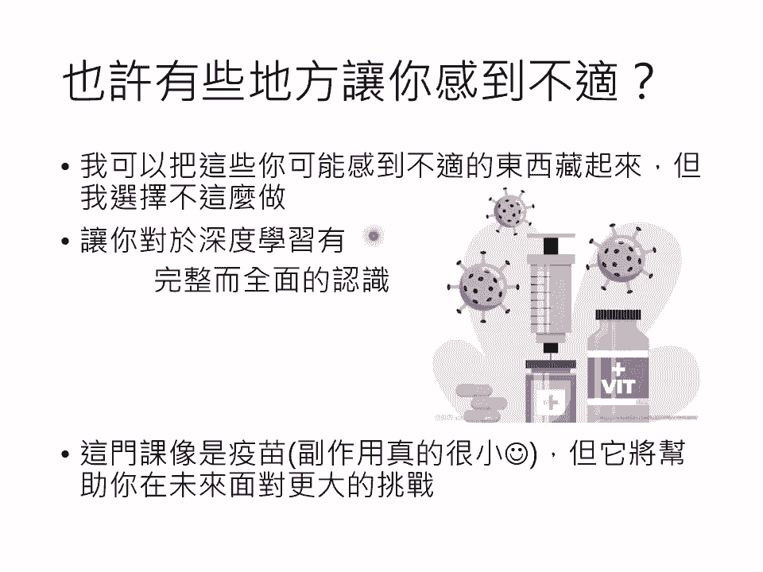
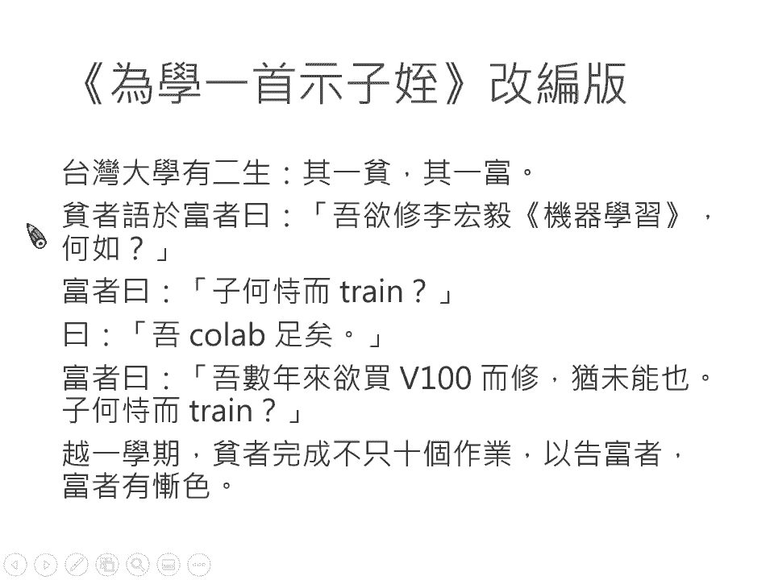

# 40：回顾、总结与展望 🎓

在本节课中，我们将回顾整个机器学习课程的核心内容，总结所学知识，并对未来的学习与应用进行展望。

---

## 课程内容回顾 📚

在这门课程中，我们学习了机器学习的核心概念与技术。课程伊始，我们明确了机器学习的本质：**寻找一个函数**。

### 上半学期：深度学习基础与核心模型

上一节我们介绍了机器学习的基本目标，本节中我们来看看课程前半部分的核心内容。

我们首先指出，简单的线性模型（**linear model**）能力有限。因此，课程直接进入深度学习领域，讲解了深度学习（**deep learning**）的基本原理。

以下是上半学期涵盖的核心模型：

*   **卷积神经网络**：用于处理图像等具有矩阵结构的输入数据。
*   **自注意力机制**：用于处理序列数据，如声音或文字。
*   **Transformer模型**：其输入与输出的长度可以不同。

掌握了这些模型，便足以处理大多数常见的应用场景。

### 下半学期：进阶主题与应用

在掌握了基础模型后，我们进入了一系列机器学习的进阶主题。

以下是下半学期探讨的关键技术：

*   **生成模型**：让机器学会创造，例如介绍了**GAN**技术。
*   **自监督学习**：利用无标注数据进行学习，例如**BERT**模型。
*   **领域自适应**：处理训练与测试数据分布不匹配的问题。
*   **强化学习**：以通俗易懂的方式介绍了**Reinforcement Learning**。
*   **对抗攻击与防御**：应对针对模型的恶意攻击。
*   **可解释机器学习**：解释模型的学习结果与决策。
*   **网络压缩**：在资源有限的设备上进行模型部署。
*   **终身学习**：探讨模型持续学习新知识的能力。
*   **元学习**：学习如何学习，实现超越传统学习框架的目标。

---

## 技术应用实例展示 🛠️

课程中，我们通过大量实例展示了机器学习技术的广泛应用可能性。

以下是课程中涉及的部分应用领域：

*   **影像处理**：不仅包括基础的影像分类，还涉及影像生成、对抗攻击、模型调试、压缩、解释以及异常检测。
*   **自然语言处理**：实现了机器翻译与问答系统。
*   **语音处理**：完成了语音转文字（语音辨识）和说话人辨识任务。
*   **强化学习应用**：让机器学会了玩小游戏。

这些应用旨在说明，深度学习技术可以应用于各行各业。你可以思考自己关注的问题是否能用这些技术来解决。

---

## 课程定位与未来学习建议 🧭

这门漫长的学习旅程现已接近尾声，但这并非终点，而是另一段探索的开始。

本课程的核心目标并非深入钻研某个特定问题，而是像“深度学习一日游”一样，带领大家概览该领域的关键技术与景点，为大家打开一扇扇门。真正的深入探索，需要依靠各位未来的持续努力。

课程结束后，你可以从以下几个方面继续前进：

*   **尝试解决实际问题**：结合课程作业中的概念，尝试解决你研究或感兴趣的问题。
*   **阅读学术论文**：如果你已掌握课程多数内容，便已具备阅读顶尖机器学习会议论文的基础能力。
*   **参与进阶学习**：例如关注并参与像**MLSS**这样的机器学习暑期学校，继续深入学习。

---

## 关于课程设计与挑战的说明 💡

本学期课程开放给所有感兴趣的同学，这带来了多元的背景，也对课程设计提出了挑战。为此，我们重新设计了教材与作业，并提供了范例程式，旨在让尽可能多的同学理解课程内容。

我们理解同学们可能遇到的一些挑战，例如模型训练时间长、运算资源有限等。需要说明的是：

*   这些挑战是深度学习实践中本质存在的困难，并非课程刻意设置。
*   课程选择不隐藏这些困难，是为了呈现深度学习真实、完整的样貌，避免产生“深度学习非常简单”的误解。
*   这种体验或许像疫苗，可能带来短暂不适，但能帮助你未来更好地应对实际应用中更大的挑战。

无论你未来是否继续深入研究深度学习，本课程都希望为你提供客观、全面的认识，由你自己做出选择。

---

## 结语与勉励 🌟

最后，想对坚持修完这门课，尤其是那些在资源有限条件下克服困难的同学，表达勉励之意。这让人联想到改编自《为学一首示子侄》的故事：

> 台湾大学有二生，其一贫，其一富。贫者语于富者曰：“吾欲修李宏毅机器学习，何如？”富者曰：“子何恃而训？”曰：“吾 Colab 足矣。”富者曰：“吾数年来欲买 V100 而修，犹未能也。子何恃而训！”越一学期，贫者完成不止十个作业，以告富者。富者有惭色。

感谢大家这学期的参与。在座的各位来自不同科系，未来将步入各行各业。你们之中，或许有人会运用深度学习创造出今日难以想象的成就。

本学期的课程到此结束。请为坚持到最后的自己，献上热烈的掌声。

---

**本节课中我们一起学习了**：对整个机器学习课程的知识体系进行了全面回顾，总结了从基础模型到进阶技术的核心内容，探讨了课程的设计理念与面临的挑战，并对未来的学习与应用方向给予了建议和勉励。