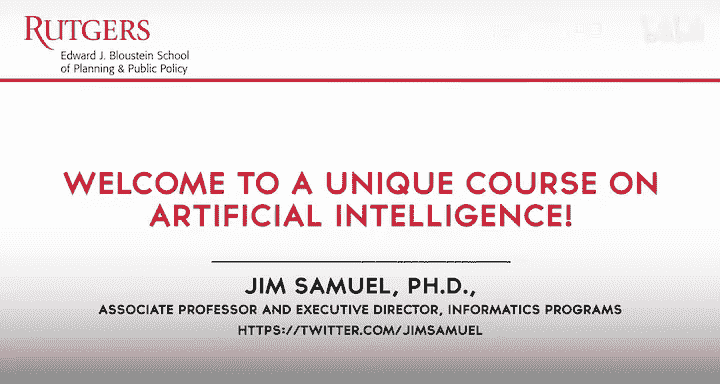
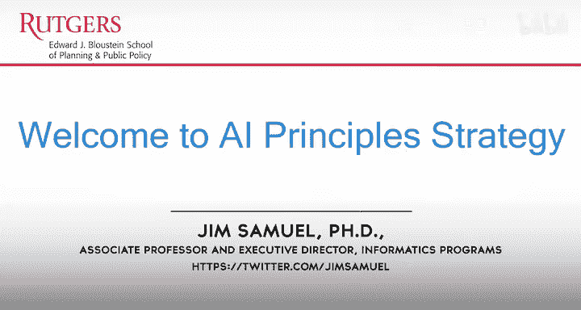

# 1：AI概念与策略概述 🧠

在本节课中，我们将学习《AI概念与策略》这门课程的整体框架与核心目标。课程旨在为管理者与领导者提供对人工智能概念的深入理解，而非编程教学。我们将探讨AI的基本原理、哲学思想、科学基础、战略意义及发展趋势。

---

## 课程目标 🎯

上一节我们介绍了课程的整体定位，本节中我们来看看课程的具体目标。

课程旨在帮助学员达成以下目标：

*   深入理解人工智能的核心概念与原理。
*   掌握将AI战略应用于管理与领导实践的方法。
*   完成一项综合性的AI研究项目。

---

## 课程模块与主题 📚

了解目标后，我们来看看课程将涵盖哪些具体内容。

课程内容按模块组织，每个模块聚焦一个特定主题，以便学员规划学习进度与研究项目。

---

## 考核方式 📝

以下是本课程的考核方式说明。

考核结构清晰，包含两部分：

*   **每周练习**：与每个教学模块相关的实践作业。
*   **期末研究项目**：一项总结个人对人工智能特定方面见解的大型研究项目。

---

## 课程特色 ✨

本课程与其他AI课程相比具有独特之处。其核心特色在于研究驱动，重点关注人类智能与人工智能的交互。

课程提供大量独特的内容与视角，特别是在课程后期，将引导学员从哲学层面思考AI的本质，而非仅仅关注应用与编程。

---

## AI的本质：多学科融合 🌐

人工智能领域发展迅速，部分原因在于其本质。

**AI并非一门孤立的纯科学**。它是一个**多学科、跨学科、多维度的范式**，对个人、社区、组织乃至整个世界都具有深远影响。

---

## 核心焦点：原理与策略 ⚖️

理解AI至关重要。我们熟悉各种AI应用（如手机、电脑上的App，或特定领域的机器人），但本课程将帮助你理解两个关键方面：

1.  **驱动人工智能的原理**。
2.  **人工智能的战略层面**——即作为管理者或领导者，应如何运用AI。

战略至关重要。即使你能编写出最佳的机器学习算法，但若缺乏清晰的战略来指导这些算法如何助力治理、提升商业投资回报、或用于公共实体实现社会公益，最终可能无法取得最优结果。**战略是理解AI、实现最优化的关键**。

---

## 课程深度与哲学视角 🤔

本课程虽是入门性质，但在奠定AI基础概念后，将深入探讨研究驱动的观点与课程。

课程的一个独特之处在于，它将引导学员欣赏AI的**哲学视角**，而非局限于关注编码和创建AI应用的**应用视角**。从哲学视角，我们需要思考“什么是人工智能”，乃至“什么是智能”。从本体论角度定义“智能”的本质是一项艰巨的任务。

目前主流观点主要关注智能的外在表现，这是一种非常局限的视角。我们将在课程后续部分深入探讨这一点。

---

## 课程来源备注 ℹ️

本课程源自罗格斯大学布劳斯坦学院公共信息学硕士项目中的“人工智能”课程的一部分。如需了解更多信息，可访问相关链接获取完整课程详情。

---

## 总结 📌

本节课中，我们一起学习了《AI概念与策略》课程的定位、目标、内容结构、考核方式及独特价值。我们明确了本课程侧重于为管理者提供AI的原理性理解和战略思维，并指出了从哲学层面思考AI本质的重要性。接下来，我们将逐步深入这些核心概念。