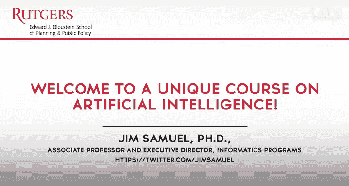
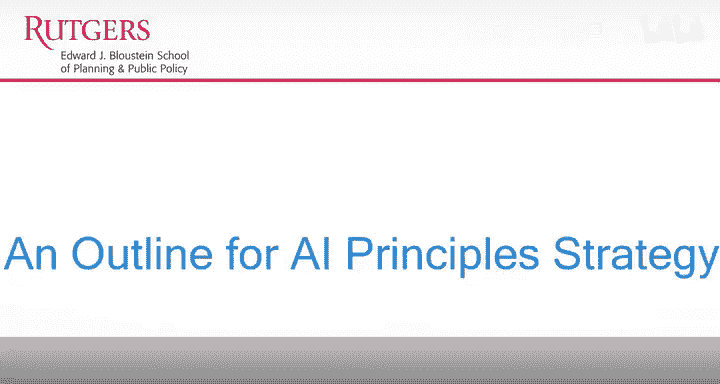

# 2：AI原则与策略 🧠

在本课程中，我们将学习人工智能的基本概念、能力、风险、伦理以及如何制定AI策略。课程旨在提供一个系统性的框架，帮助你理解AI的本质、发展方向及其在商业和社会中的应用。

---

## 概述

本课程将引导你理解人工智能的实质与能力，探讨其发展轨迹，并深入分析相关的伦理与风险问题。最后，我们将学习如何制定可持续的AI策略以创造价值。

---

## 课程目标

以下是本课程希望帮助你达成的具体目标。

*   **理解AI的实质与能力**：课程旨在传授对人工智能实质与能力的部分理解。AI的**实质**指其本质，例如AI如何理解语言的含义。AI的**能力**指其具体应用，例如用于自然语言处理或实时翻译。
*   **提升关联AI概念与应用的能力**：课程旨在提高你将AI概念与实际应用联系起来的能力。
*   **把握AI发展方向**：课程旨在帮助你理解AI的发展方向。虽然AI发展迅速，但在计算机视觉、自动驾驶等领域存在可辨识的趋势。
*   **提供关于AI伦理与风险的独特见解**：课程将提供关于AI伦理与风险的独特见解。除了常见的偏见问题，课程将探讨AI系统能否持续、可靠地避免偏见，以及AI失败可能导致的极端后果（即“肥尾”风险）。
*   **鼓励AI策略与战略思维的发展**：课程将鼓励你针对特定场景思考潜在的AI策略。一个有效的商业模式是思考如何将AI应用于尚未部署AI的传统成功领域，以提升其效率与效果。

---

## 课程模块与主题

上一节我们明确了课程的整体目标，本节中我们来看看实现这些目标的具体路径。课程内容将分为五个核心模块。

### 模块一：人工智能概念导论

本模块将介绍人工智能的基础概念，为后续学习奠定基础。这些基础概念应被广泛传授，而非仅限于计算机科学专业人士。

本模块将从一开始就鼓励对人工智能本质进行批判性思考。每个模块都会辅以轻量级的实践活动，例如阅读材料和基于Jupyter Notebook或R的建模练习。这些是实践性作业，目的是让参与者在学习理论和获得管理视角的同时，也能接触AI的实际实现。例如，在第一课中，我们可能会实现一个简单的**目标搜索模型**。

**目标搜索模型**是一个简单的数学结构：我们设定一个数值目标（例如1000万美元收入），并基于一组变量或业务场景，让模型调整变量以精确达成该目标。

### 模块二：AI能力

本模块将探讨人工智能的能力，并强调“人工智能”是一个通用术语。在具体实现中，我们面对的是多个专门化的人工智能。

例如，擅长解读医学影像的AI与擅长下棋的AI是两套不同的系统和算法。人类智能是综合的，而人工智能目前是**孤岛式**的。本模块将探讨这种**人工智能的多元性**，并引入**优化**这一关键概念。

**优化**是机器学习在实践中运作的核心原则，其重要性常被低估。一个优化问题可以表述为：在给定约束条件下，寻找使目标函数 `f(x)` 最大或最小的变量 `x` 的值。

### 模块三：AI风险

本模块将涵盖人工智能的风险，包括显而易见的、迫在眉睫的风险，以及那些可以想象到的、后果极其严重的风险。

评估风险时，需同时考虑**可能性**与**后果**。如果事件可能性极低且后果不严重，或许无需过度关注。然而，如果事件可能性虽低，但后果极其严重（例如影响数百万人生命或关键基础设施），那么即使概率很低，此类风险也绝不可忽视。

随着AI应用日益深入并在各个层面获得更多**自主权**，我们必须考虑那些后果严重的低概率事件。

### 模块四：AI伦理原则

本模块将探讨人工智能伦理的根本问题。我们熟知一些案例，例如用于评估累犯风险的AI工具COMPAS被指存在种族偏见。

这引出了一个核心困境：如果坚持**数据驱动**的方法，算法会客观反映数据中的偏见；如果要求算法无视有偏见的数据并产出符合伦理的结果，我们又背离了数据驱动的原则，并面临“由谁判定数据对错”的灰色地带。

因此，AI伦理不仅要求遵循数据，还需认识到输入数据可能包含固有的社会偏见，而AI有可能将其放大。本模块将深入探讨这些核心问题。

### 模块五：AI策略与价值创造

在最后的模块中，我们将探讨如何利用人工智能创造可持续的价值。

以自然语言处理为例，大型语言模型的效果令人惊叹，但其计算成本极高。因此，在将AI从实验室推广到商业和政府大规模应用时，**成本效益比**和**投资回报率**变得至关重要。

任何人工智能战略都必须审视其**价值创造**和**可持续性**。

---

## 课程安排与说明

课程将以一个最终研究项目作为总结。请注意，课程介绍视频是一次性录制的，具体的作业细节、评分方案和最终项目要求可能会更新。

请务必以课程大纲为准，以获取最新的具体信息。

---

## 总结

本节课中，我们一起学习了《AI原则与策略》课程的总体框架。我们明确了课程旨在帮助你理解AI的实质与能力、把握其发展方向、深入思考相关的伦理与风险，并最终学会制定创造价值的AI策略。课程将通过五个循序渐进的模块来实现这些目标，并结合理论与实践，为你提供全面的人工智能入门视角。