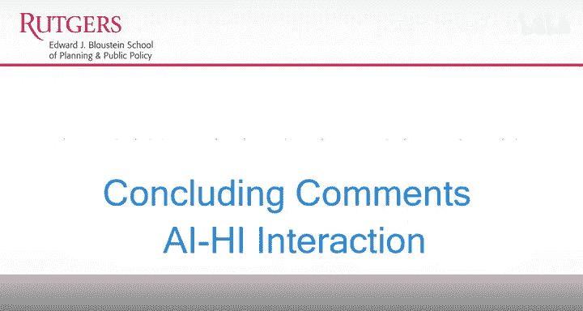
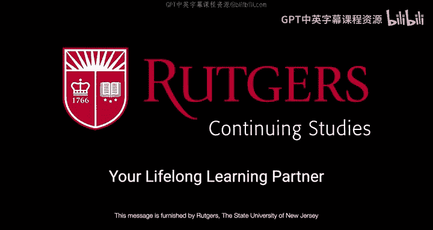

# 3：AI概念和策略  🎯

在本节课中，我们将对罗格斯大学《AI概念与策略》研究生课程的核心特点、教学理念与学习预期进行总结。课程旨在超越基础编程与统计，引导学员从战略与管理层面深入理解人工智能。

## 课程核心特点 🧠

上一节我们介绍了课程背景，本节中我们来看看这门课程的几个核心特点。

以下是本课程的五个主要特点：

1.  **研究生级研讨**：本课程是罗格斯大学EJ Blalowstein学院研究生课程的一部分，属于公共信息学硕士项目。参与者需具备研究生级别的思维能力。课程不会探讨基础的统计模型（如回归分析、正态分布）或编程技能，而是默认学员已具备相关知识背景，包括Python等AI语言的使用能力。

2.  **内容独特且研究驱动**：课程内容基于前沿研究。这意味着部分内容已被证实，部分属于理论探讨，部分仍在进展中。我们并非提供绝对真理，而是呈现关于人工智能的多元视角，鼓励学员形成自己的观点。

3.  **前瞻性视角**：与许多课程回顾历史不同，本课程在每次研讨中都将重点放在展望未来，探讨人工智能的发展趋势与潜在影响。

4.  **弱化编码，强调理解**：当前多数AI课程聚焦于编码。本课程则不同，它不教授如何分割数据集或构建模型。课程的核心是探讨人工智能的理解与应用策略，引导学员思考一个关键问题：**“你为何要使用机器学习？此问题能否在不使用机器学习的情况下高效解决？”** 课程强调，许多场景用经典统计学即可处理，无需套用机器学习标签。

5.  **鼓励独立思考**：作为讲师，我将分享我个人对人工智能的见解。期望学员能通过课程学习与自身思考，形成独立观点。观点的分歧与讨论，正是推动我们对人工智能理解进步的动力。

## 核心理念：战略先行，技术随后 ⚙️

课程将教导并鼓励学员，基于对AI原则与战略的理解，在人工智能领域开展工作。

我的核心理念是：**如果你以恰当且被充分理解的“原则”和清晰的“AI战略”作为引领，那么技术自然会跟上。** 反之，如果你的决策、规划和商业方法从一开始就被技术主导，则可能错失战略层面的考量。

当你确立了正确的AI战略，你将能清晰地判断何时需要使用深度学习模型、优化算法或强化学习等技术。技术是为战略目标服务的工具。

## 关键维度：AI与人类智能的交互 🤝

我认为，当前人工智能实施中最关键的维度是**人工智能与人类智能的交互**。

尽管已有不少研究和中心关注此领域，但讨论仍不充分，需要更广泛的、基层层面的思考和探讨。与过去人类单纯“使用”互联网或工具不同，现在人类智能将与一个在许多领域**超越自身能力**的技术进行交互。

例如，棋手知道AI下棋更好，这种认知将如何影响棋手的心理？当个体在与AI的交互中受到影响，这又将如何大规模地影响社会、塑造未来？我们是否会看到大众信心的普遍丧失？这是否会将过多权力转移给AI的创造者与控制者？这些都是至关重要的问题，需要长时间去探索和解答。

## 研究驱动内容示例：自适应认知框架 📊

以下是一个具体的研究驱动内容示例，说明课程如何连接理论与实践。

我们的一项主要研究持续了数年，探讨在股票交易等场景中，人类智能如何感知信息。关键不仅在于“获取什么信息”，更在于信息的“信息面”。

例如，你获得股价信息，但信息的**模糊性**在不同场景中高低不同，这会影响我们处理信息的方式。此外，信息的呈现方式、来源、格式（如图表 vs 表格）也会影响人类的感知和表现。

我们的研究表明，你可以利用人工智能和机器学习来**支持和改善人类的表现**。这就是我们提出的“自适应认知框架”。

该框架包含几个核心部分：
*   **信息面的影响**：如模糊性、复杂性。
*   **AI生成的信息表征**：可以是数据可视化或表格形式。
*   **AI模块的能力**：监控人类在特定信息面和信息表征条件下的表现。

基于对表现的持续观察，人工智能能够：
1.  **选择或分配**最合适的信息表征。
2.  **提出建议**，由人类决定是否采纳。

例如，在游戏应用中，玩家起初可能只接受AI的建议。随着AI被证明有效并赢得玩家信任，玩家可能会开启**自动选择模式**，让AI自动选择最佳信息呈现方式。

## 课程总结与学习建议 📝

最后，我们来总结一下课程要点并提供一些学习建议。

课程提供了关于人工智能的独特领导力视角。它并非编码课程，而是鼓励对人工智能进行批判性思考，促使管理者提出对于有效且可持续实施AI至关重要的问题。课程聚焦于概念，旨在提升学员在管理层面应用人工智能的能力。

关于课程作业，目前计划仅设置一个最终项目作为评分作业。这样设计是为了让学员专注于概念学习和理解深化，而非每周投入大量时间编码。最终成果将是一篇基于我们提供指南的研究论文或观点文章。期望学员能将所学、所读与所思结合，创作出原创性成果。

我的Twitter账号会不定期分享AI相关思考和研究成果，欢迎关注交流。

## 结语

这是一门非常重要的课程。我本人也希望能多年前在学习AI应用时就接触到这样的内容。我将通过本课程，尽力传授多年积累的对人工智能概念的理解。

感谢你选择聆听本介绍，期待你参与完整课程。祝愿你在学习人工智能、探索如何利用AI造福人类社会与追求更大福祉的旅程中一切顺利。

谢谢。