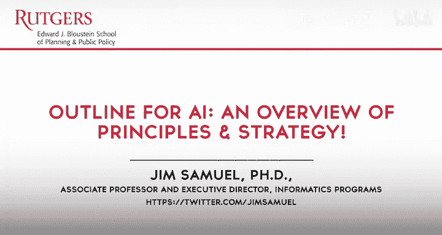
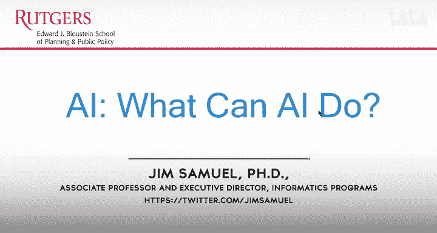

# 4：AI概念与策略入门 🧠

## 概述

在本节课中，我们将学习人工智能的基本概念，并从应用视角理解AI能做什么，同时澄清什么不是AI。我们还将探讨AI的理论视角，并展望其当前与未来的发展方向。

---

## 什么是应用视角下的人工智能？🔍

上一节我们概述了课程内容，本节中我们来看看人工智能的应用视角。这可以追溯到麦卡锡在20世纪50年代的观点：由于我们难以定义和阐明机器（甚至人类）如何思考，因此我们应关注其输出。即，如果我们为计算机提供特定输入（刺激），它能进行逻辑处理并产生输出，那么这种逻辑输出就是我们应关注的核心。

基于此视角，我们能很好地理解人工智能的应用层面。当前，应用是重点，各类公司和个人开发者都投身于AI应用开发。

以下是应用人工智能的几个关键能力：

*   **视觉能力**：AI算法可以“看”图像和现实场景，识别物体并将其分类。例如，疫情期间的人脸识别门禁系统。其公式可简化为：`识别结果 = 模型(输入图像)`。
*   **逻辑“思考”能力**：此处“思考”需谨慎使用，特指AI使用数学和系统规则处理信息并产生输出。这与人类更复杂的思维过程不同。例如，AI可以下棋、管理交通流量或预测灾害风险。
*   **感知与监控能力**：AI可以感知环境变量（如温度）并进行优化。例如，智能建筑中的AI通过传感器数据学习并优化能源使用。其核心是：`优化控制 = 学习算法(传感器数据流)`。
*   **听觉与交互能力**：AI可以“听”声音，甚至通过更灵敏的传感器捕捉比人耳更广的频率。像Siri、Alexa这样的聊天机器人能学习用户的语音习惯并做出回应。但需注意，AI的“理解”与人类不同，它基于模式匹配而非真正的认知。

---

## 什么不是人工智能？🚫

在了解了AI能做什么之后，区分什么不是AI同样重要。当前，任何涉及统计模型的新业务都可能被称为机器学习或AI，但我们需要更清晰的界定。

以下是需要辨别的几点：

*   单纯的传感器数据收集不构成人工智能。
*   仅执行预设规则、没有学习能力的自动化系统不是AI。
*   将任何复杂的软件或算法简单地贴上“AI”标签是一种误解。

真正的AI应具备从数据或经验中学习，并适应新情况的能力。

---

## 人工智能的应用领域 📈

现在，让我们看看人工智能在具体领域中的应用。这些应用展示了AI如何改变各行各业。

以下是AI的一些主要应用领域：

*   **股票交易**：AI能快速、一致地处理复杂算法，在给定风险水平下寻求最佳回报。目前，“AI增强的人类智能”（即人机协作）团队往往表现最佳。
*   **个人投资组合管理**：AI可以替代部分人类财务顾问的工作，但最佳模式仍是人类专家在AI工具的辅助下进行决策。
*   **商业运营优化**：AI可用于定价策略、促销活动设计等，据估计有数千亿美元的全球市场价值有待AI挖掘。
*   **风险管理**：AI用于信用评分，评估个人或实体的信贷价值。

关于**就业影响**的说明：AI的采用会导致团队所需人数显著减少（例如减少50%-75%），因为它能更高效地执行大量任务。但目前，在复杂场景中实现完全自主（零人类参与）的AI尚未成熟。

---

## 总结

本节课中，我们一起学习了人工智能的应用视角，明确了其核心能力（如视觉、逻辑处理、感知、听觉）与局限（如缺乏人类式的理解）。我们区分了真正的AI与常被误标为AI的技术，并探讨了AI在金融、商业等领域的实际应用及其对社会（包括就业）的影响。记住，当前阶段，“增强人类智能”是人机协作的最佳策略。