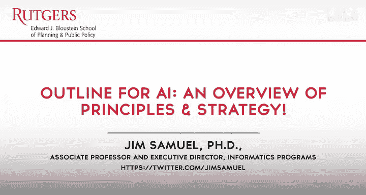
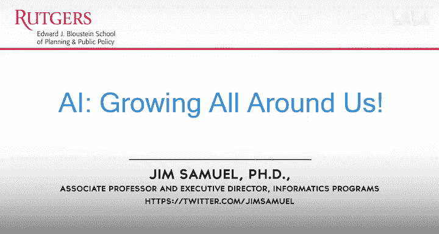

# 5：无处不在的人工智能应用 🚀

## 概述

在本节课中，我们将探讨人工智能在当今世界各个领域的广泛应用。我们将看到，人工智能已不再是遥远的概念，而是渗透到我们日常生活的方方面面，从个人设备到城市管理，甚至国防军事。

---

## 智能手机：口袋里的AI助手 📱

上一节我们概述了人工智能的普及性，本节中我们来看看最贴近我们生活的例子——智能手机。

你的智能手机本身就是一个人工智能的集合体。它至少包含几种不同的人工智能技术。

以下是智能手机中常见的AI应用：

*   **语音助手与聊天机器人**：手机能够听取你的指令并通过学习来改进，例如Siri或Google Assistant。
*   **输入预测**：当你输入文字时，算法会学习你常用的词汇，从而更好地提供**自动填充建议**。
*   **综合智能体**：这些功能可能由简单的算法实现，但整体上，你的手机就是人工智能的一个典型例子。

人工智能就在你身边。我们越来越多地与之互动，有时甚至没有察觉。

---

## 娱乐与商业：算法背后的推荐 🤖

了解了个人设备中的AI后，我们来看看它在商业和娱乐平台中扮演的核心角色。

如果你在流媒体平台看电影，这些平台如何为你推荐内容？像亚马逊这样的公司如何推荐产品、选择展示的广告？所有这些现在都依赖于人工智能技术，运用各种机器学习模型来实现。

---

## 交通与家居：从自动驾驶到智能生活 🚗🏠

上一节我们看到了AI在虚拟世界的应用，本节中我们来看看它在物理世界中的体现。

**自动驾驶汽车**从一个角度看是一个整体的人工智能，从另一个角度看则是各种传感器和算法的集群。这是一套协同工作的AI技术集合，出现在联网自动驾驶车辆中，可能是汽车，也可能是飞机（现代飞机大部分时间都依赖自动驾驶）。其中部分属于经典技术，部分则日益依赖如**强化学习**这类人工智能技术。

人工智能也进入了我们的家庭，不限于手机。我们有了**智能冰箱、洗衣机、烘干机**等各种电子设备。甚至有公司计划在鞋履中植入AI芯片，用于收集数据、学习用户的使用习惯、行走地点、速度和时间，从而提供多种建议。

---

## 城市、通信与安全：更广阔的应用场景 🌆

从个人和家庭场景走出，人工智能在城市管理和安全领域也发挥着巨大作用。

我们在智能城市中部署了人工智能，它们可以**个性化地接听电话**，也被用于**监控和追踪**。近年来，关于自主无人机和人工智能在未来一二十年内军事战争中应用的讨论也越来越多。世界各国的军队将严重依赖人工智能，既用于管理工具和武器，也用于研究和理解战场环境以生成洞察。

---

## 跨行业渗透：AI无处不在 🌐

人工智能的应用范围极其广泛，几乎无处不在。

我们在机器人技术、医疗保健、供应链中都能看到AI的身影。AI也被用于农业、音乐和艺术领域。如今，如果你想创作音乐，你不再需要组建一个完整的乐队，你可以与更少的人合作，甚至将AI作为你的团队成员，或者仅在你和一款能支持你音乐或艺术兴趣的合适人工智能之间完成创作。

人工智能在教育领域也被广泛使用。一方面，需要像本视频一样教育人们了解人工智能；另一方面，人工智能正被用于增强教育本身，例如通过**自适应学习过程**。

---

## 数据演进：从大数据到智能数据 💡

最后，我们来关注人工智能发展的一个关键基础——数据。

当然，人工智能正逐渐尝试从**大数据**转向**智能数据**，以确保计算成本的效率。然而，在某些领域和某些方面，处理所有数据仍然至关重要，因此大数据仍将持续一段时间。同时，在某些领域和应用中观察到，你不需要耗费所有计算资源去处理全部的大数据，而只需处理从大数据中智能地、精心提取的结构化数据片段就足够了。这种高质量的数据可以带来更快、更好的结果，这就是所谓的**智能数据**。

---

## 总结

本节课中，我们一起学习了人工智能如何广泛渗透到现代社会的各个层面。从我们口袋里的智能手机，到娱乐推荐、自动驾驶汽车、智能家居，再到城市管理、国防安全以及教育、艺术等创造性领域，人工智能的应用无处不在。同时，我们也了解到支撑这些应用的数据基础正在从单纯追求规模的大数据，向更高效、更精准的智能数据演进。人工智能已不再是未来的概念，而是正在深刻塑造我们当下生活的强大现实力量。