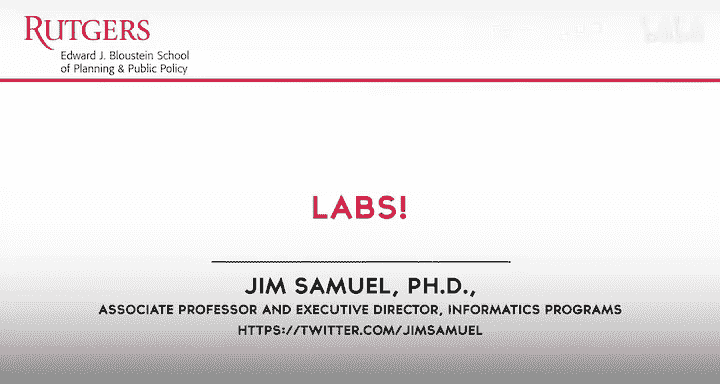
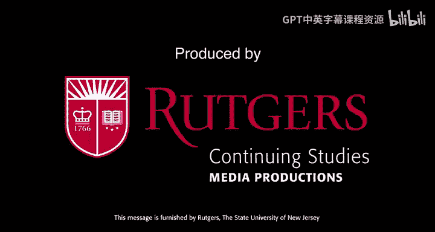

# 6：实验室介绍 🧪

## 概述

在本节课中，我们将介绍本课程配套的实验室部分。这些实验室旨在通过演示帮助你直观理解人工智能模型的工作原理。我们将说明实验室的性质、目标、内容构成以及对不同背景学生的适用性。

---

## 实验室性质与目标 🎯

欢迎来到《AI概念和策略》课程的实验室部分。这些实验室仅用于演示。

这意味着你可以选择性地运行它们。本课程的主要重点仍然是让你学习人工智能策略的概念。

正如在课程介绍部分所述，本课程的重点在于让你学习人工智能的基础原理和核心概念。

然而，自己动手运行一些代码并获得一些经验是有益的，尽管这不是必须的。

## 面向不同背景的学生 👥

许多选修本课程的学生可能已经具备计算机科学、运行机器学习模型、编写代码或微调大语言模型等方面的经验。对于你们来说，这些实验室将是非常简单的练习。

有些学生可能从未使用过Jupyter Notebooks或Python运行过人工智能模型。你们可能会觉得实验室的某些部分具有挑战性。请记住，这是可选的。但实验室的设计也考虑到了这一点，即使没有编码经验的人，通过有限的努力也应该能够运行所有的Notebook。

实验室中没有计分练习，因此从评分或通过课程的角度来看，无需担心。

## 实验室的设计目的 🔧

实验室旨在让你了解人工智能工作的具体细节。

每个实验室都旨在让学生窥探人工智能模型的内部构成。

这将允许你深入了解其中一些内容。一些Notebook包含手动编码的练习。

另一些则直接使用现有的Python库。

因此，我尝试在实验室之间取得一个公平的平衡。总共有五个实验室。

## 实验室内容示例 📚

其中一些实验室涉及非常基础、简单的内容，例如如何运行一个线性回归模型，并展示区分普通线性回归模型（属于统计学，而非人工智能）与属于人工智能范畴的系统的关键点——即当线性回归只是系统的一部分，而非一个孤立的模型时。

因此，当你从一个统计模型过渡到一个使用统计模型的系统时，你就从数学和统计学领域进入了类似微型人工智能模块的领域。

一些实验室稍微高级一些。例如，我们设置了一个关于机器翻译的Notebook。

部分学生可能会觉得其中一两个实验室有点挑战性。我建议你尝试运行这些实验室。其中没有需要解决的问题，所有代码都已完全实现。

你只需要逐步点击运行。

## 运行与反思 💡

运行每个单元格，并尝试思考这些模型是如何工作的。

尝试回顾模型的输入是什么、过程是什么以及输出是什么。同时请记住，这些Notebook和实验室是从学术框架出发，为教育目的而开发的。它们并非生产级或工业级的实验室或人工智能应用演示。

## 最后提醒与致谢 ✨

最后，正如课程开始时承诺的，你不需要编写代码。只需享受实验室的乐趣。希望你能像我以及我的研究助理们享受创建它们一样，享受运行这些实验室的过程。

需要注意的一点是，我尝试让我的团队添加了一些注释。在录制本视频时，我还没有机会审阅所有的注释。因此，当你运行实验室时，如果发现任何拼写或语法错误，敬请谅解。希望你能享受这个学习过程。

---

## 总结

本节课中，我们一起学习了本课程实验室部分的基本情况。我们明确了实验室的**演示**和**可选**性质，其核心目标是辅助理解概念而非考核。我们了解到实验室内容覆盖了从基础的**线性回归**到更高级的**机器翻译**等主题，并适合不同编程背景的学生尝试。最后，我们被告知只需按照指引运行代码并观察思考，无需担心评分问题。