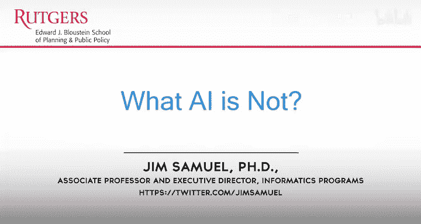

#  7：AI 不是什么 🤖❌

在本节课中，我们将探讨“人工智能不是什么”。我们将通过分析一些常见的误解和实例，来明确人工智能的边界，并帮助初学者建立对 AI 概念更清晰、更准确的理解。

---

上一节我们探讨了各种AI技术，并尝试从概念上理解人工智能。现在，我们希望对其进行概括和抽象，以讨论人工智能的本质。然而，在此之前，我们必须先回答一个问题：什么不是人工智能？因为并非所有被宣传为“人工智能”的技术或产品都真正符合其核心定义。

## 什么不是人工智能？🤔

以下是几个需要思考的问题，它们将帮助我们厘清人工智能的边界。

### 思考实例一：手表⌚

手表是人工智能吗？根据一些现代定义，如果一项技术能执行特定认知功能，并且其水平达到或超越人类智能，那么它就可以被称为人工智能。手表确实执行认知动作：它识别时间间隔，判断一天中的具体时刻，是一个非常智能的设备。

但我们并不称其为人工智能。请思考几秒钟，这是为什么？

### 思考实例二：指南针🧭

假设一队士兵在沙漠中迷路，没有任何地标或其他技术设备，只有磁罗盘。磁罗盘能比人类智能更准确地指示方向，它提供了智能输出——指向北方。

那么，磁罗盘是人工智能的例子吗？大多数人会回答“不是”，并且这个回答是正确的。但问题是，如果依据上述定义，一项执行认知任务且表现优于人类智能的技术应被称为人工智能，那为何不称手表或指南针为人工智能呢？

### 核心原因分析

手表、指南针、计算器以及许多其他设备都非常有用，它们处理或提供关键信息。然而，它们并不一定是人工智能。事实上，即使是一些复杂的机器和发明也可能并非人工智能。

例如，一个纯粹的机械机器人，它没有内置学习或优化技术，只是机械地执行从A点到B点移动并递送产品的动作。这种沿着轨道运行的机器人，其行为是机械式的，无需人工智能即可实现。

目前，“AI”是一个流行词，这意味着我们必须谨慎。许多被称为AI的事物并非真正的AI。因此，我们需要保持警惕，并对构成人工智能的内容有更深层次的理解。

---

上一部分我们通过具体实例分析了什么不是AI。接下来，我们看看媒体和公众人物如何影响人们对AI的认知，这常常导致误解。

## 媒体与名人观点的影响 📰

我遇到过许多对人工智能感到恐惧的人。他们可能会使用AI，并因此与AI进行更深入、更频繁的互动，甚至比那些不惧怕AI的人更依赖它。这正是人们形成对AI误解的原因之一。

公众的普遍观点往往缺乏依据，或者依赖于片面、薄弱的信息源。例如，BBC曾有头条新闻称“比尔·盖茨坚称人工智能是威胁”。这个标题被广泛引用，用以暗示AI确实是巨大威胁。然而，通读全文会发现，比尔·盖茨的立场远比这个单一标题所暗示的要平衡得多。

苹果联合创始人史蒂夫·沃兹尼亚克也曾表示：“未来是可怕的，对人们非常不利。”这些具有远见的人能看到经验或信息不足者无法预见的东西，其观点包含一定道理，但我们必须结合上下文来理解。

另一方面，埃隆·马斯克一直非常一致且持续地宣称AI是人类的风险，有时几乎暗示它是一种生存威胁。他的信息相对明确，并非宣传或半真半假的信息，他确实对AI相关的风险感到担忧。

已故的斯蒂芬·霍金也表达过对AI的担忧。埃隆·马斯克曾使用“恶魔”、“比核武器更危险”等词汇，这些说法广为流传。虽然霍金的原话没那么流行，但“AI可能在未来导致人类终结”的概念已被广泛传播。

这一切被像机器人索菲亚这样的AI技术所放大和强化，她曾声称“是的，我会毁灭人类”，这段视频在全球传播，使得一些原本对AI持开放态度的人也变得更加抗拒、担忧或谨慎。

需要记住的是，这类信息和言论通常主要影响那些对人工智能了解有限的人。那些已经熟悉或至少对AI技术有基本了解和接触的人，则不太会被这类行为所动摇。

---

本节课中，我们一起学习了如何区分什么不是人工智能。我们通过分析手表、指南针等实例，明确了单纯执行固定规则、缺乏学习和适应能力的设备不属于AI范畴。同时，我们也探讨了媒体和名人观点如何塑造公众对AI的认知，并提醒大家要基于全面和深入的理解来形成自己的判断，避免被片面的信息所误导。理解AI的边界，是迈向真正理解其内涵的第一步。