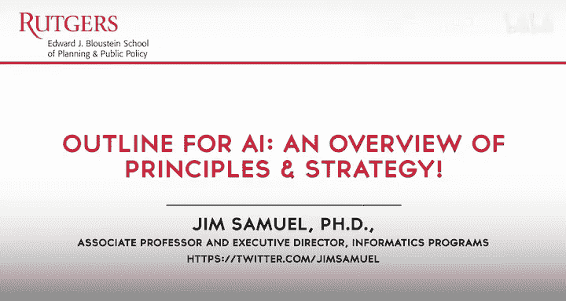
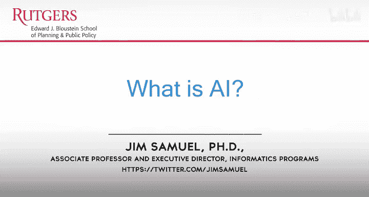

#  8：什么是人工智能？🤖

在本节课中，我们将探讨人工智能的定义。我们将回顾历史上几位重要思想家对人工智能的描述，分析其中的核心观点，并尝试构建自己对人工智能的理解。课程最后，我们还将简要展望人工智能的未来趋势。

---

## 历史视角下的定义

上一节我们提到了人工智能的广泛影响，本节中我们来看看几位先驱者是如何定义它的。

约翰·麦卡锡在20世纪50年代提出了“人工智能”这一术语。当时，计算机体积庞大，性能却远不及我们如今口袋里的手机。他的一些观点为今天的讨论奠定了基础。

*   **人工智能是对智能的研究**：通过计算机实现智能的基本特征。这里的“智能”似乎指的是人类智能。
*   **不关心“心理真实性”**：这表明早期研究更关注机器产生的逻辑输出或智能表现，而非其与人类思维过程的相似性。
*   **人工智能并非人类智能的模拟**：这一点非常有趣。尽管目标常以人类智能为参照，但他明确指出，由于将抽象的智能概念与具体的计算实现相匹配是一项精细复杂的任务，因此人工智能在定义上并非对人类智能的模拟。

---

## 其他重要定义

除了麦卡锡，其他学者也提出了有影响力的观点。以下是其中两个：

**雷氏等人的定义**：人工智能是机器执行我们通常与人类思维相关联的认知功能的能力。这些功能包括：
*   感知
*   推理
*   学习
*   与环境互动
*   解决问题
*   决策
*   甚至展现创造力

**图灵测试的核心思想**：我们只需判断一台机器是否能像人一样智能地行动。这强调了**智能的输出比智能的载体（身份）更重要**。是输出决定了某物是否具有人工智能。

理解“智能”一词本身也很关键。目前，我们尚未就“智能”本身形成一个非常清晰、统一的定义和框架。

---

## 综合与现代视角

基于以上的探讨，我们现在可以尝试阐述自己对人工智能的定义。

一种观点认为，人工智能是**人类智能能力的技术化体现**。这包括：
*   能够消费信息并进行“思考”的机器。
*   能够理解图像、文本、动作、口语和书面语言、视频、音频等的机器。

另一种更简洁的定义（来自2021年的一篇文章）是：**人工智能是一套模仿人类智能（特别是认知与逻辑）功能和表现的技术**。

> **建议**：请你根据目前的理解，尝试用自己的话写一段对人工智能的描述。在本课程结束时，你可以再次回顾这个定义，看看自己的理解发生了哪些变化。

---

## 未来趋势展望

在探讨了人工智能是什么之后，我们最后简要展望一下它的未来。当前，人工智能正由一系列技术、数学统计模型、海量多样数据以及日益增多的应用所驱动，这些共同致力于建模甚至超越人类智能功能。我们正处于一个能够讨论人工智能未来发展方向的位置。

---

**本节课总结**：我们一起回顾了从约翰·麦卡锡到现代学者对人工智能的不同定义，理解了其核心是让机器模拟或实现人类的认知功能，并认识到智能的“输出”是关键。最后，我们鼓励你形成自己的理解，并对人工智能的未来发展保持关注。