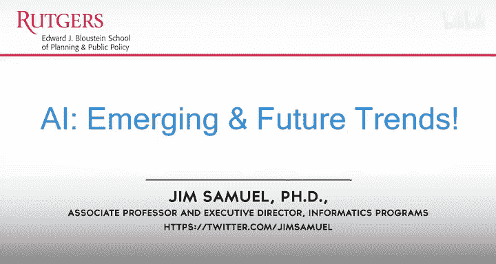
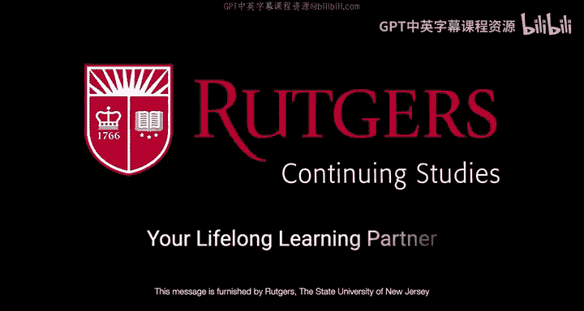

# 9：AI概念与策略 - 新兴与未来趋势 🚀

在本节课中，我们将探讨人工智能的未来发展趋势。我们将分析AI技术的现状，并展望其未来可能的发展方向，同时深入理解AI如何影响个人与社会。

## 概述：AI的独特力量与人类智能的十字路口

理解人工智能应用的发展轨迹及其对人类个体和社会影响的核心，在于一个关键理念：人工智能应用、技术和系统，拥有与以往技术革命不同的力量。

在过去的工业革命中，技术主要替代了人类的体力。在信息时代，技术在某些方面超越了人类智能，但同时也提升了人类智能在信息处理、解读和意义构建等方面的重要性。

然而，展望现在与未来，情况发生了变化。人工智能与过往技术结合，创造了一种新场景：在许多领域，替代人类智能变得轻而易举。

## 历史对比：从替代体力到挑战智力

有一种观点认为，就像过去的技术革命一样，如果一项技术导致失业，它同样会创造新的就业机会。汽车取代马车就是例证。

但是，人工智能的情况有所不同。当其他技术出现时，人类智能的价值依然稳固。人们可以通过再培训，转向需要人类理解、解读和应用能力的岗位，从而变得更有价值。

然而，对于人工智能，这一点难以成立。因为人工智能在其特定工作领域，**从定义上就比人类智能更“智能”**。它更精确、更细致、能存储更多信息、处理速度更快，并且拥有复杂的内部数学优化算法，能够处理海量变量并得出最优解。

因此，人类智能可能被人工智能完全超越。这正是理解未来的关键。

## 核心理论：人工与人类智能交互理论（AHIIT）

在我们的研究中，我们提出了一个理论框架：**人工与人类智能交互理论**。该理论阐述了在即将到来的时代，人工智能将如何主导人类智能。

那么，人类智能的出路何在？答案在于**人工智能教育**与**发展人类专长**的结合。

*   **人工智能教育**：意味着学习和理解AI如何运作、其优势与局限，并对AI有清晰的哲学认知。
*   **发展人类专长**：意味着人类需要专注于发展那些AI难以完全替代的特定专业领域。

例如，一位医生可以通过深度专注于解读医学影像，达到即使最先进的AI也只能作为其辅助工具，而非完全替代品的水平。虽然这个例子可能有些机械，但考虑其他领域，如**人际互动**。一个AI可以管理最复杂的工厂，但很难高效地运营一个幼儿园并让孩子们感到快乐。

## 战略应对：将AI视为竞争者与合作者

过去，技术主要替代人力；信息时代，信息系统辅助并增强了人类智能；如今，人类智能正处于一个临界点，面临着可能被完全替代的风险。

因此，我们需要：
1.  建立对人工智能清晰的哲学理解。这几乎像是我们发现了一个竞争对手——人工智能。
2.  在此基础上，制定应对策略。

我常对罗格斯大学的研究生们说，有时你需要将人工智能视为竞争者。这并非像伊隆·马斯克等人谈论的AI成为生存威胁那样，而是指在就业和智能替代层面上的竞争。

**将AI视为竞争者，首先要做的是理解它**。理解人工智能的本体论性质，就能清晰看到其优势与局限。

*   **理解AI优势**：目的不是放弃这些领域，而是思考如何**利用这些优势**，作为个人、公司或社会，来提升成功率、改善公共福祉。
*   **识别AI弱点**：认识到AI无法成功完成的领域，正是我们需要提升自身专业技能的**方向**。

因此，通用的人工智能教育，结合AI哲学，引导人类智能基于我们认为最适合由人类处理的复杂、自适应场景，去获得特定专长，这将使人类智能保持价值。

## 对“全民基本收入”的哲学思考

这也正是为什么一些政府和科技领袖谈论“全民基本收入”的原因——他们知道如果全面推广AI技术，将会导致失业。

但免费的食物和金钱，从哲学角度看，可能无法满足人类对自身身份认同的需求。从人类学和历史来看，我们天性喜欢竞争、创造价值、渴望变得重要和有意义。这不仅仅是获取生存资料，更是要在人类社会生态系统中创造价值、保持关联性。

因此，任何大规模应用人工智能的解决方案，如果不能解决人类身份认同的这些需求，都可能造成更多伤害，且不可持续。

## 总结与行动指南

本节课我们一起探讨了人工智能的未来趋势，其核心在于理解AI与人类智能的根本差异及互动关系。

出路在于：**理解AI哲学，改进和扩展AI教育，并帮助人类智能基于对人工智能优势与弱点的根本理解，发展专业领域。**

关于未来趋势，我讨论的很多内容是概念性的。同样重要的是关注具体技术及其发展轨迹，这方面有大量来自研究实验室、大学及谷歌、Facebook等公司的信息。

由于时间有限，我未具体提及例如NLP中非常有效的Transformer模型等技术细节。但如果你掌握了正确的哲学和概念，就能轻松在线搜索，找到你感兴趣的最新技术，并追踪特定AI模块的技术趋势。

我强烈建议你：
*   学习我所强调的哲学和概念层面。
*   进行在线搜索，关注斯坦福、MIT等重要实验室，了解领先研究者和公司的动态。
*   将你从本课程中获得的概念理解，与现实世界中正在发生的事情相结合。

现实世界的技术变化很快，但我所教授的原则和策略将会长期适用，因为它们更为稳定。如果你掌握了这些，再通过个人研究了解应用层面的具体进展，你将处于一个非常有利的位置。

感谢聆听，祝愿你在学习人工智能、增强人类智能、改善公共福祉的旅程中一切顺利。