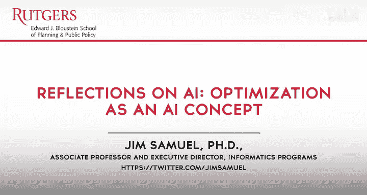
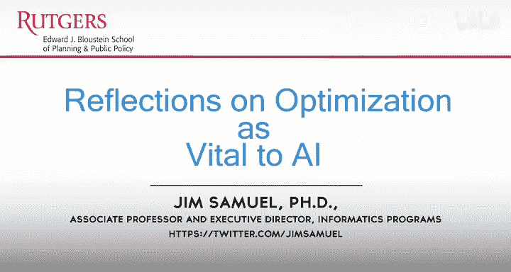

# 10：AI中的优化概念与策略 🎯

在本节课中，我们将要学习人工智能中的一个核心概念：**优化**。我们将探讨优化的定义、它在AI系统中的作用，以及为什么理解优化对于构建有效的AI应用至关重要。

---

## 什么是优化？🤔

上一节我们介绍了本课程的主题。本节中，我们来看看优化的基本定义。

从概念上讲，优化是**一个过程**。你通过这个过程，在给定的边界或约束条件下，对一组相关变量做出决策，从而获得**最佳可能的结果**。

这听起来有些抽象，让我们看一个例子。

假设你经营一家工厂，目标是**最小化浪费**。你希望在特定资源数量的基础上**最大化产出**。在这个案例中，资源数量就是你的**约束条件**。其他参数，比如机器可运行的小时数或成本限制，则成为其他约束。在理论设定中，我们通常还会做一些假设，例如忽略现实世界的摩擦（如员工生病或原材料瑕疵）。

如果你正确优化了这个场景，你可能会得到制造3500把椅子的最佳方案。这意味着，任何其他替代流程要么导致生产少于3500把椅子，要么最多只能达到3500把。优化后的结果就是**最佳可能输出**。

以下是优化的核心公式化描述：
**优化 = arg max/min f(x)， 约束条件：g(x) ≤ b**

---

## 优化总是好的吗？⚖️

在过去的讨论中，我们似乎美化了优化。它确实功能强大，应用广泛，从供应链管理到金融领域。但优化总是好的吗？

这取决于具体场景。

从数学上讲，优化能带来最佳可能的结果。但在实践中，情况并非总是如此。例如，在人际关系中，最优结果可能并非最佳选择。为了实现战略目标或给予伴侣建议时，一个对他人情绪和感受更敏感的“次优”回应，可能是更好的方式。

然而，在工厂生产或纯粹追求最佳数值结果的场景中，优化无疑是最佳途径。

---

## 敏感性分析与AI系统 🔍

在将人工智能作为一组技术或模型应用时，总会涉及一个流程：数据输入到模型结构中，经过处理，最终通过某种机制选择出最佳可能结果，即**最优解**。

当我们分析这个过程以期改进时（例如通过成本效益分析来放宽约束），我们就在进行**敏感性分析**。我们测量模型输入的变化，观察其经过原有模型结构后，对最优解产生了何种影响。

输入或模型本身的改变，有时对最优解没有影响，有时可能适得其反，有时则可能有益。因此，在追求最优解时，分析你的AI系统对输入、输入变化以及系统任何组件变化的**敏感度**，至关重要。

---

## AI全景中的优化：一个核心视角 🧩

现在，让我们进入本节课的核心内容，总结优化在人工智能应用中的角色。请注意，下图是一个用于沟通概念的示意图，而非严格的研究用图。

当前，当人们谈论AI时，很快就会提到**机器学习**或某种人工学习过程，但很少有人提及**优化**。我认为，机器学习之所以能在解决大规模AI应用问题中取得成功，**优化组件是关键原因**。

事实上，即使不使用大量机器学习，仅通过应用优化的捷径，也有可能解决某些问题。我并非说这适用于所有场景，但在某些情况下是可行的。我在此强调，是为了将**优化**置于AI研究的前沿。目前对机器学习的过度强调是可以理解的，但缺乏对优化同等程度的重视，则令人担忧。

以下视图描绘了当今由**大数据**驱动的人工智能（近期也出现了**智能数据**的趋势）。数据经过模型（如自然语言处理、计算机视觉、预测或强化学习模型），导向一个**最优解**。这意味着存在一个优化机制，选择能带来最佳结果的变量。

随后，最优解以推荐的形式呈现给人类智能，或通过系统应用直接产生效益。人类智能接收到输出效益后，无论是基于此还是直接通过最优解（在自主系统中），都会转化为**绩效**。这些绩效被记录下来，成为反馈到大数据的一部分。

由此，我们进入下一个迭代循环：大数据再次进入模型，产生新的最优解，影响绩效，并再次反馈为数据。这个循环持续不断。

**我们所使用的优化方法的质量，将直接影响这些循环的效率。** 优化方法越好，性能就越好，整个AI学习过程向最佳宏观解决方案的**收敛速度**也就越快。

总的来说，在这样的AI系统概念中，优化发生在每一个迭代周期内。随着通过更优质的数据获得N个最优解，这些解本身也不断改进，从而引领整个系统实现**宏观层面的优化**。

---

## 总结 📚

本节课中，我们一起学习了：

1.  **优化的定义**：在约束条件下，通过决策获得最佳可能结果的过程。
2.  **优化的双面性**：在追求数值最优的场景中极为有效，但在涉及人际互动等复杂情境中需谨慎使用。
3.  **敏感性分析的重要性**：评估AI系统对输入和组件变化的敏感度，是改进优化的关键。
4.  **优化在AI中的核心地位**：优化是驱动机器学习乃至整个AI系统有效解决大规模问题的引擎，值得在AI研究和应用中给予更多重视。

理解优化，不仅帮助你构建更高效的AI系统，也让你能更全面地审视AI技术的能力与边界。