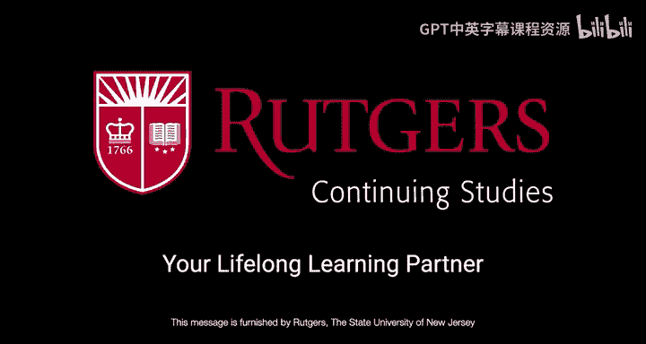

# 11：AI对人类智能的最优性 🎯

在本节课中，我们将要学习人工智能系统中优化的核心概念，特别是当AI与人类智能交互时，如何实现和趋向于最优结果。我们将探讨优化如何在微观迭代和宏观层面发挥作用，并介绍一项关于“自适应认知契合”的最新研究，该研究展示了AI如何通过适应信息特性的变化来增强人类表现。

---

## AI系统中的优化概念 🔄

幻灯片上概念化的AI系统，其核心思想是在每次迭代中进行优化。随着我们遍历N个或M个最优解，这些最优解本身有望随着数据质量的提升而改进。这个过程最终会导向一个整体的宏观层面优化。

从概念上讲，这套机制是可行的。

---

## 优化机制的应用场景 🤖👤

这套机制适用于两种场景。

以下是具体的应用场景：

*   **自主系统**：人工智能独立运行。
*   **人机交互场景**：人工智能通过某种图形用户界面与人类智能进行交互。

图形用户界面本身也会影响人类智能对信息、信息衍生物或模型输出的感知。

---

## 微观与宏观的优化总结 📊

在某种意义上，这很好地总结了优化如何被嵌入到两个层面。

以下是优化的两个层面：

*   **微观层面**：在每次迭代内部进行优化。
*   **宏观层面**：通过多次迭代的机器学习过程，无论模型是自然语言处理、计算机视觉、强化学习还是其他AI学习模型，最终导向宏观层面的最优解。

---

## 涉及人类智能时的“最优性”趋势 📈

现在，尤其是在涉及人类智能的情况下，由于某些变量的模糊性，以及我们当前（未来可能改变）无法精确测量人类智能输出的某些表现形式，我们可能无法确定性地声称存在一个最优结果。

因此，更恰当的说法是：当我们的目标是实现最优结果或最优性，且过程中涉及人类智能时，更好的表述是这些模型或人工智能**正趋向于**最优结果，或者说我们在与人类智能交互的背景下，正在实现**AI最优性**。这是一种趋势，我们不断朝着目标前进，随着更多数据的输入而持续改进。

---

## 自适应认知契合研究突破 🧠➡️💡

这实际上摘录自我们最近一篇名为《自适应认知契合：人工智能增强的信息面与表征管理》的研究论文，该论文即将发表在《国际信息管理杂志》上，我们对这项研究的启示感到非常兴奋。

原因在于，我们进行了大量研究并定期产出成果，尤其是在应用方面。但这项研究非常有趣，因为它代表了一种理论突破。

经典的“认知契合”理念认为，对于特定任务，人类需要特定类型的信息展示。因此，要执行任务A，最好的信息表征可能是A型；但对于另一个任务，B型信息表征可能是更好的机制。这里涉及的是任务的变化，且焦点仅在于信息表征。

在自适应认知契合中，我们的目标是研究能否在此过程中使用人工智能，使得AI能够支持和增强人类智能，从而提升人类表现。我们通过以下两种方式实现了这一点：

以下是研究的两种路径：

1.  **理论上或概念上**：可以改变任务，观察两个不同的任务。
2.  **实验操作上**：可以保持任务不变。在我们的实验中，我们保持了任务不变，因为这样更容易改变和扩展研究结果到不同任务。

但我们通过一个单一、相同的任务证明了：如果关联的**信息面**（即输入信息的本质）其潜在特性发生变化，例如从高模糊性变为低模糊性，或从高复杂性变为低复杂性，那么这种变化本身就会对信息表征产生重要影响。

---

## 自适应认知契合模型与优化 🧩

这一发现使我们能够构建一个更优的系统来增强人类表现。

在下图中，那个核心的、较大的图示表明，ACF模型（自适应认知契合模型）能够适应信息面的变化，也能适应信息表征的变化。任务可以保持不变，我们也有选择去改变它。这样，你可以分别研究任务和信息，也可以研究特定任务类型之间是否存在交互作用。所有这些都会影响人类智能，进而影响表现。一旦正确建模，你就可以在此过程中的正确位置放置一个优化过程（如我们论文所述），这将在一段时间后导向最优结果。

> 

---

## 总结与结语 🏁

感谢收听本节内容。结论是：**优化是人工智能的核心**。

因此，这对于每一位人工智能领域的学生、每一位研究并计划部署人工智能的管理者和领导者都至关重要。即使你不是管理者或领导者，只是这个星球上任何一个拥有手机或使用电子设备的人，你都在与人工智能交互。理解优化的基础概念对你来说非常重要。

如果你身处这个领域，正在开发或从事我们刚刚讨论的某个方向的工作，那么你当然需要深入理解优化的数学原理，这可能相当具有挑战性。但对于其他人而言，即使只是从概念上理解优化，认识到人工智能广泛运用优化来实现其目标，我认为这些知识也将非常有用。

祝愿大家在探索人工智能的旅程中一切顺利，希望我们能在未来的课程中再次相见。谢谢。

> 