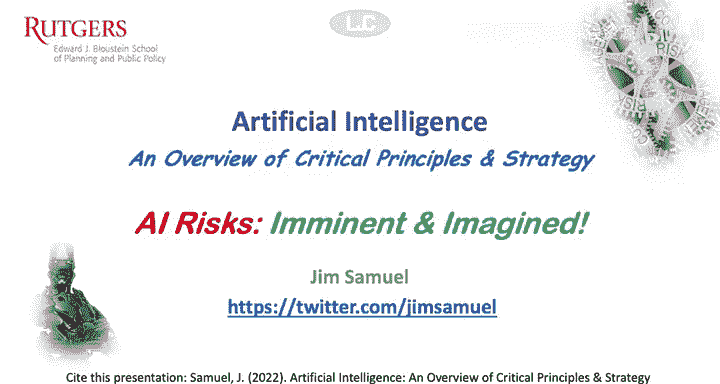
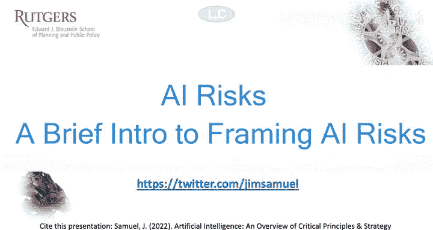

# 12：AI风险框架简介 🧠






在本节课中，我们将学习人工智能风险的基本框架。我们将区分系统性风险与系统性风险，探讨风险的分类方式，并理解为何在管理AI风险时，需要采取以人为中心的主动策略。

---

## 人工智能的定义与复杂性

人工智能是对人类智能的模仿。具体而言，它指的是一系列模仿人类认知（如视觉、听觉）和逻辑（如推理、决策）的技术。

例如，计算机视觉模仿人类的视觉功能，其代码逻辑可以表示为：
```python
# 一个简化的图像识别AI示例
def recognize_object(image):
    # 使用训练好的模型处理图像
    prediction = ai_model.predict(image)
    return prediction
```
而像国际象棋AI这样的程序，则模仿了人类的逻辑思维，其核心在于评估棋盘状态并做出最优决策。

然而，人工智能技术正在快速演变，并且与人类智能的交互可能是所有技术中最复杂的。这种复杂性，加上全球AI政策环境的快速变化，使得管理AI风险变得极具挑战性。

---

## 风险管理的核心：以人为本

在深入探讨风险分类之前，我们必须确立一个核心原则：**优先考虑个体人类实体**。

这意味着，在AI的整个生命周期中——从开发到使用——保护与之交互的每一个人的福祉，应成为首要目标。这一原则自然延伸至家庭、社区、企业等所有人类群体。如果必须在机器故障与人类受到伤害、或企业利益与人类福祉之间做出选择，后者必须优先。

这种理念可以总结为 **“主动的、以人为中心的风险管理方法”**。该方法需要两个关键支柱的支持：主动的、以人为中心的政策，以及对人工智能的普及教育。

---

## 理解风险：概率与分类

风险在本质上是指**不良事件发生的可能性**。它是一个概率概念。如果某事必然发生，那就不是风险，而是确定性事件。

在金融等领域，风险可以被量化（例如使用**风险价值VaR**模型）。但在AI领域，由于技术复杂且快速变化，目前尚缺乏全面、可量化的风险管理框架。一种可行的方法是分领域（如财务、法律、人机交互）进行零散的量化评估。

从定性角度看，AI风险可以分为两大类：**系统性风险**和**系统性风险**。

上一节我们确立了以人为本的原则，本节中我们来看看如何对AI风险进行高层分类。

---

## 系统性AI风险

系统性AI风险指的是**某个特定的AI应用或系统发生故障的可能性**。其影响范围相对有限。

以下是基于后果的系统性风险分类方式，我们主要关注故障发生时，谁受到影响以及如何受到影响。

**1. 物理系统性风险**
这类风险会导致客观的、物理的和物质的损害。一个典型的例子是自动驾驶汽车未能避免碰撞，导致车辆损坏甚至人员伤亡。其后果相对容易量化，例如用维修或赔偿的美元金额来衡量。

**2. 财务系统性风险**
这类风险主要导致财务损失。例如，一个用于高频交易的AI算法出现故障，可能导致巨额资金损失。其核心影响是经济上的。

**3. 法律与合规系统性风险**
当AI系统的决策或行为违反法律法规时，就会引发此类风险。例如，一个用于招聘的AI系统如果存在性别歧视，可能导致公司面临法律诉讼和罚款。

**4. 声誉系统性风险**
此类风险损害的是个人或组织的声誉和公信力。例如，一个内容推荐AI持续推送虚假信息，会严重损害其开发平台的信誉。

**5. 心理与行为系统性风险**
这类风险影响用户的心理状态或行为模式。例如，一个过度个性化的新闻推送AI可能导致用户陷入“信息茧房”，或一个设计不当的聊天机器人可能对用户的情绪产生负面影响。

---

## 系统性AI风险

系统性AI风险的性质则广泛得多。它指的是**在生态系统或全球范围内，大量人工智能系统同时发生故障的可能性，并可能带来灾难性后果**。

例如：
*   全球超级计算网络或关键AI基础设施发生灾难性故障。
*   多个复杂AI系统之间发生不可预测的极端交互，导致连锁崩溃。
*   一种广泛使用的核心AI算法被发现存在根本性缺陷，影响所有依赖它的系统。

系统性风险的影响是全局性的，难以预测和控制，因此需要更高层面的监管和国际协作来应对。

---

## 总结与前瞻

本节课中，我们一起学习了人工智能风险的基本框架。

我们首先明确了AI是对人类智能的模仿，其复杂性使得风险管理充满挑战。我们确立了**以人为中心**的核心管理原则。接着，我们理解了风险的概率本质，并将AI风险分为两大类：**系统性风险**（特定应用故障）和**系统性风险**（全局性故障）。对于系统性风险，我们进一步从后果角度将其分为物理、财务、法律、声誉及心理行为等五类。

展望未来，管理AI风险需要开发更完善的量化框架，加强跨领域研究，并通过持续的教育和稳健的政策，构建一个安全、可靠、以人为本的人工智能发展环境。