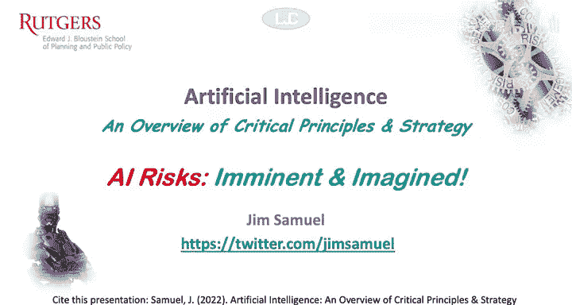
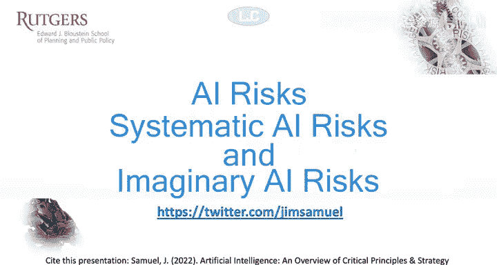

# 13：系统性AI风险与虚构的AI风险 🤖⚖️

在本节课中，我们将要学习两种不同类型的AI风险：**系统性AI风险**和**虚构的AI风险**。我们将探讨这些风险如何在社会、心理层面产生影响，并分析公众对AI产生非理性恐惧的常见原因。

***

## 系统性AI风险

上一节我们介绍了AI风险的基本概念，本节中我们来看看**系统性AI风险**。这类风险与特定AI应用或系统相关，其影响范围可能很广，但并非整个系统性的崩溃。

### 社会性系统性AI风险

当我们谈论社会性系统性AI风险时，指的是那些主要产生社会、伦理和道德后果的人工智能风险。

例如，一个自然语言处理系统可能无法提供公平的种族或性别对待。这在许多应用中都曾出现。我们看到NLP系统将女性与某些职业归类，并将女性与某些职业关联，男性与另一些职业关联，其性别偏见非常明显。我们也看到依赖大量历史文本数据的自然语言处理系统传播种族偏见。

当公司、政府或个人开始使用这类AI时，他们面临社会性系统性AI风险可能成真的风险。社会性系统性AI风险的影响难以衡量。我们可以有故事、例子和案例，但它们对社区、社会生活乃至广大人群的影响程度尚待测量和量化。我们没有一个非常清晰和明确的机制来评估或理解社会性系统性AI风险的全部影响。

### 心理性系统性AI风险

现在，让我们转向第三种形式的系统性AI风险，我称之为**心理性系统性AI风险**。这些是主要影响个人情感、心理和智力能力的AI风险。

这涉及到人类智能与人工智能在个体层面上的互动。例如，如果一个个体使用个人AI机器人、聊天机器人或任何形式的人工智能来满足个人情感或智力需求，当这类系统未能按预期方式行为时，它可能影响个体用户的自尊或导致极度沮丧。它可能造成物质损害，也可能导致信心丧失或自尊心受损。

一个简单的例子是，解决NLP系统因用户口音而无法理解用户所说内容的一种方法是使用机器学习。随着时间的推移，通过使用机器学习，人工智能被训练以理解个体用户的口音。因此，有可能利用人工智能本身来减轻其中一些AI风险。

***

## 虚构的AI风险

了解了真实的系统性风险后，本节我们来看看那些被夸大或虚构的AI风险。许多人害怕AI。例如，我经常看新闻，看到一个词反复出现，那就是“可怕的”。我运用了一个机器学习原理，训练了自己的大脑：如果我看到一个带有“可怕的”这个词的AI新闻标题，我倾向于开始将其分类为很可能是一篇歪曲事实的肤浅文章。

我这样说是因为围绕人工智能存在大量炒作，并且在人工智能方面存在大量对未知事物的恐惧煽动。我们对此进行了反思，在我们的研究团队内部以及跨研究团队之间进行了一些讨论，探讨是什么驱动了这种对人工智能的非理性恐惧。

我们找出了一些简单的原因，可能还有更多。以下是我们可以更好地理解与人工智能相关的虚构风险的几种基本方式。

以下是导致虚构AI风险认知的几个关键因素：

1.  **大众AI文盲**：调查显示存在大众AI文盲。这意味着人们根本不知道人工智能是什么。他们知道AI用于手机，知道Siri和Alexa使用机器学习和人工智能方法，他们知道联网自动驾驶汽车使用人工智能。他们零碎地了解机器学习或神经网络可能是什么样子，但总体上，他们不理解人工智能的基本构建模块。他们不知道人工智能的影响，这导致了大众AI文盲的状态。

2.  **定义分歧与媒体煽情**：目前也存在相当多关于人工智能是什么的分歧。这种无知状态、文盲状态与新闻媒体中的煽情主义相互作用。这意味着新闻媒体倾向于煽情化，倾向于夸大其词。他们倾向于挑选科技领袖的言论。因此，例如，埃隆·马斯克的句子经常被挑出来，并被呈现为他关于未来的观点，即AI将是一种生存威胁，可能比核武器更危险。其他领袖、技术管理者和科学家也被引用，有些是在语境中，有些是断章取义。但通过种种手段，最终形成了炒作和煽情，我们看到了对AI风险的虚构和不合理认知的滋生和增长。

3.  **大众操纵与片面知识**：还存在大众操纵的概念，这可能仅仅是为了销售新闻，但也可能是为了销售某些产品或可能损害某些产品和服务的销售。有时存在的另一点是，片面知识可能是危险的。片面知识可能是从新闻媒体、电影、对话以及信息不足的自称专家那里获取的知识。关于人工智能的片面知识也可能相当危险，因为现在你知道一些关于AI的事情，这就像六个盲人和大象，你抓住了AI的某个部分，并得出结论那就是AI，而AI远不止于此。

4.  **时机误判**：然后还有时机误判的概念，这意味着有些人可能害怕生存威胁，有些人可能识别并感觉到AI在此时是一个生存威胁。目前看来并非如此，但也许在未来可能是。直到我们达到能够看到有感知、有自我意识的超级智能出现的那一点，我们才能预测它肯定会发生。就概率而言，任何事情都是可能的。因此，只有在这种“任何事情都是可能的”意义上，我们才能说存在生存威胁。但在缺乏非常具体技术的情况下，即使从审视我们所拥有的原材料、我们正在使用的硬件、软件、优化方法和算法的角度来看，将所有这些放在一起并延伸轨迹，我们可以看到正在发生的是极其强大的狭义智能，它们可以很好地执行特定任务。但在目前这个时间点，我和我所在的团队，从我们目前拥有的AI类型和当前构建模块来看，我看不到会出现生存威胁。

可能改变这一观点并可能让我认为在未来某个时间点会出现生存威胁的是，如果量子计算成为现实，如果我们看到新水平的编程、一套足够强大以反映人类推理过程的数学方程。如果这类进步发生，那么在那个时候，可能对人类构成生存威胁的那种AI可能会成为现实。但在目前这个时间点，我最多将它们归类为虚构的AI风险。

***

本节课中，我们一起学习了**系统性AI风险**（包括社会性和心理性层面）与**虚构的AI风险**。我们了解到，真实的AI风险源于系统设计、数据偏见以及与人类交互中的故障，其影响需要被认真评估和管理。同时，公众对AI的恐惧往往源于认知不足、媒体炒作和时机误判。区分这两者对于负责任地发展和应用人工智能至关重要。