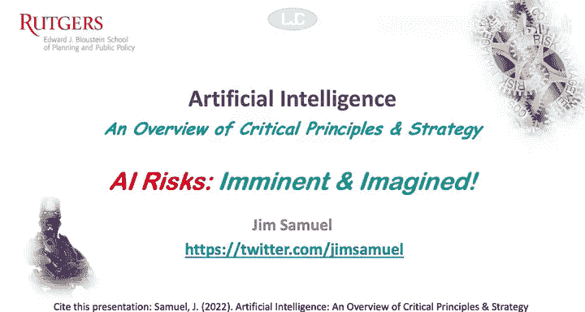
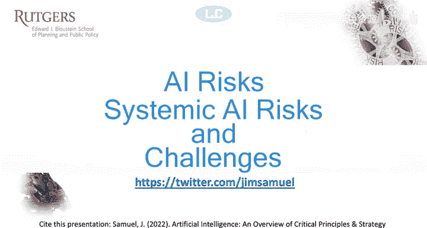

# 14：系统性AI风险与挑战 🧠⚡

在本节课中，我们将要学习AI风险的第三个也是最后一个组成部分——系统性AI风险。我们将探讨其定义、表现形式以及它与其他类别风险的根本区别。

上一节我们介绍了系统性风险的具体层面，本节中我们来看看在生态系统规模上可能发生的、更具灾难性的风险类别。

## 什么是系统性AI风险？

系统性AI风险是指**在生态系统规模上，大范围AI失效的可能性**。这意味着失效发生在全球层面，跨越各大洲，其后果是灾难性的。例如，全球AI系统的崩溃可能影响人类文明的进程，甚至可能威胁到消灭部分或全部人类。尽管这听起来可能很遥远，但它属于一种“肥尾事件”，即发生概率低但影响巨大的事件。

系统性AI风险**不是**指单个应用程序、单一系统或甚至某个特定公司一类系统的失效可能性，除非该公司是控制全球AI系统的唯一主导者。

## 系统性AI风险的表现形式

正如我们分析系统性风险时从物理、社会和心理等角度切入一样，深入探讨系统性AI风险的类型和表现形式也很重要。以下是几种主要的系统性AI风险：

*   **AI技术崩溃**：例如，人工智能硬件或与技术中心相关的网络可能失效。这可能是由异常的太阳耀斑等事件导致超级计算网络崩溃。
*   **AI网络崩溃**：随着公司和政府开发更多人工智能，并将其部署在车辆、飞机、军事用途、自主武器，以及教育系统、电网、供水和供应链中，这些由不同公司和国家开发的AI系统开始交互。随着AI采用率的提高和系统复杂性的增加，AI算法、技术和系统之间的交互点会出现。数据或输入中的异常可能导致不可预测的事件或后果。例如，极端的AI交互可能导致全球AI驱动的供应链系统崩溃，突然之间我们可能买不到产品，食物短缺并非因为缺乏食物，而是因为管理它的AI系统失效了。
*   **自主AI超级智能的风险**：未来我们可能开发出量子计算方法和对人类心智的新数学模型，从而创造出更接近“奇点”或具有自我意识的超级智能。有观点认为，超级智能将远超过最聪明的人类，甚至超过集体人类智能。这里存在一个逻辑问题：如果我们声称要创造一个在各方面都远超个体乃至集体人类智能的超级智能，那么根据定义，我们就不应担心告诉它该做什么。因为第一，它将能够自我反思和改变自身，任何我们预设的程序都可能被其覆盖；第二，声称我们用当前的智力水平创造一个超级智能，然后需要用我们（相对低等的）智力去指导它，这是不合逻辑的。如果我们定义它为超级智能，就意味着我们目前智力较低，因此我们应该准备好并愿意与超级智能共存。当然，这涉及技术和逻辑上的担忧。目前，这类技术出现的时间无法预测，可能是在2050、2100或2200年。只有当某些基础发生变化时，我们才需要重新评估这些概念的可能性。

## 管理AI风险的核心

在AI风险方面，我们真正需要理解的是，我们需要在系统性和系统性两个层面进行管理。

对于系统性风险，我们至少需要关注三个层面的后果，并以不同方式剖析和处理，找到根源并解决如何管理它们。

对于系统性风险，管理起来则困难得多。但通过讨论和提高认识，应该能帮助我们相对更好地进行管理。再次强调，如果是像“奇点”这类事件，我们能做的准备有限。如果它真的到来，那时我们需要凭借更丰富的知识体系来应对。或许“紧急停止开关”的整个概念——即尽管根据定义超级智能更聪明，但人类保留可以关闭这种智能的开关——是一个思考方向。

## 管理AI风险需要多角度思考

除了这些关于AI风险的抽象和概念部分，我们还需要从其他角度思考。例如，以下是与企业相关的AI风险：

*   与业务相关的AI风险。

---

本节课中，我们一起学习了系统性AI风险的概念，它指的是全球范围内AI生态系统大规模失效的灾难性可能性。我们探讨了其三种主要表现形式：技术崩溃、AI交互网络崩溃以及未来超级智能带来的逻辑挑战。最后，我们认识到管理AI风险需要在系统性和系统性两个层面进行，并需要结合技术、逻辑、商业等多角度进行综合思考与应对。