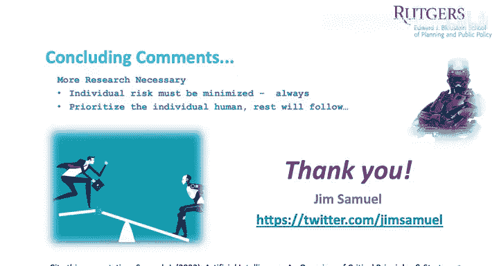
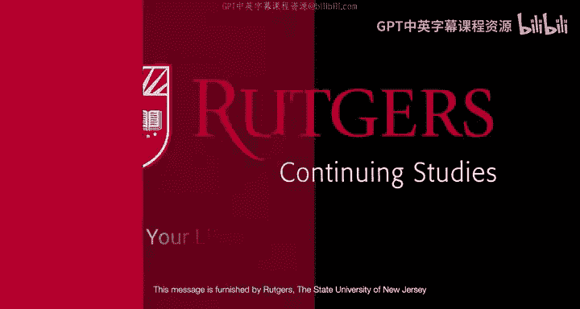

# 15：AI风险的务实观点与总结思考 🤖⚖️

在本节课中，我们将探讨关于人工智能风险的务实观点，并总结相关的思考。我们将从商业和政府两个主要角度分析AI风险，并强调制定前瞻性政策的重要性。

## 概述

本节内容旨在超越AI风险的抽象概念，从商业运营和政府治理的务实层面进行剖析。我们将讨论不采用AI的风险、采用AI可能出错的风险，以及政府在采纳AI时需考虑的可持续性、战争应用和政策制定等关键问题。

## 商业视角下的AI风险

上一节我们介绍了AI风险的宏观概念，本节中我们来看看企业在实际运营中面临的具体AI风险。企业需要从多个维度评估AI带来的机遇与挑战。

### 不采用AI的风险

企业必须评估不采用人工智能可能带来的风险。如果一家公司能确信不采用AI毫无风险，那么至少在短期内它无需采纳AI。然而，对于意识到存在“不采用AI风险”的公司，则需要从根本层面进行思考。

以下是评估“不采用AI风险”的几个关键方面：

*   **根本性效率与竞争优势**：例如，一家制造滚珠轴承的工厂需要评估：使用AI是否会提高制造效率？如果我的公司不采用AI，而我的竞争对手采用了，对手将获得多大的竞争优势？
*   **品牌价值概念**：可能根本性差异并不大。公司A使用AI制造滚珠轴承，公司B选择沿用旧技术而不使用AI。两者在成本或根本层面上可能没有显著差异。然而，在向消费者营销时，如果消费者对与AI关联的品牌在质量或其他方面更有信心，那么公司A可能仅凭通过AI提升的品牌价值就能增加销售额和市场份额。

### 采用AI并出错的风险

采用AI后出现问题所带来的风险也必须被考虑。对企业而言，重要的是记住这不仅仅是AI技术本身的失败。

它不仅仅是我们在过去几分钟简要提及的系统性和系统性风险。它也可以被归入系统性风险，即与特定AI应用和特定AI系统相关的风险，但这并非关于技术本身。

以下是几个具体的商业风险维度：

*   **财务风险**：例如，如果你为业务投资1000万或1亿美元用于采用人工智能，那么投资回报率是多少？如果该人工智能在一年内就过时或被淘汰，而你的计划是使用五年，那么你将获得负的投资回报。技术本身运行良好，人工智能从技术角度并未内在失败，但它在财务上不可行。
*   **法律风险**：技术运行良好，但新政策出台，或基于判例法或法官对适用于信息系统、数据、技术乃至人工智能的特定法律有了新的解释，这突然就给业务带来了法律风险。
*   **运营风险**：AI的实施可能带来运营流程上的挑战和不确定性。

评估企业AI风险的另一个重要方法是分别审视短期和长期。一家公司的人工智能实施可能在短期内没有风险，但从长期来看对公司可能风险很大。

正如一开始提到的，这些观点并非详尽无遗。我提出这些思考的目的是为了激发进一步的讨论和思考，并促进开发更正式的管理AI风险不同维度的框架。

## 政府视角下的AI风险

当世界各国政府以越来越快的速度采纳AI时，AI风险的整体概念就显得尤为重要。在讨论政府采用人工智能时，我认为首要的衡量标准或概念应该是人类与人工智能的互动以及人类福祉的优先性。

### 可持续性与整体规划

当政府，尤其是国家政府采纳人工智能时，思考可持续性也非常重要。因为除了财务成本，还涉及巨大的环境成本、社会成本和技术成本。政府在实施人工智能时，必须审视所有可能的可持续性措施，并采取长期视角。

如果政府采取孤立、零散的方式来采纳人工智能，例如允许一个实体为特定目的采用特定的AI应用，又允许其他N个机构根据各自需求采用人工智能，然后期望由来自不同公司、以孤立方式运行的不同人工智能组成的整个生态系统能够神奇地实现可持续性，这是困难的。这种临时性的方法很可能导致混乱、结果次优化，并增加政府使用AI的风险。

### 人工智能与战争

当我们谈论政府时，国家政府的一项重要职责是保护其边界、国家和国家利益。因此，我们今天看到人工智能被广泛用于战争，在概念上被用于冷战，也被用于热战的准备，从集群化的武装无人机到人工智能驱动的导弹和支持战争的人工智能驱动技术。政府需要特别关注全球人工智能驱动战争这一整个领域。

### 政策制定的挑战：前瞻性思维

政府还需要确定需要多少AI，这个问题与企业需要问自己的问题类似。当涉及人工智能研究实验室和大学时，存在开发任何和每一种AI技术的趋势，这在那些实验室和背景下是重要且必须的。但当涉及到采用这些新技术、这些人工智能时，问题仍然是：一个政府需要采纳多少AI？以及在何时、何地、以何种方式采纳？我们需要具备优化思维、可持续性思维和长期视角。

在制定政策时，政府需要考虑社会层面，即个人和集体人类的福祉。这常常与商业需求形成对比或冲突。例如，企业可能希望较弱的隐私法，而当我们谈论AI的推广时，政府可能希望确保比过去更强大的隐私法，以保障个人和集体人类的安全与自由。

在识别和主动管理AI风险的背景下，我认为非常相关且我不断重复的一点是**创造性前瞻政策的挑战**。

我强调，在政策制定方面，我们不能沿用过去对待其他技术和信息系统的方法。对于其他技术，并行处理政策甚至在技术实施、被公司采用并开始使用后事后制定政策（即事后政策）是可以的。但对于AI，AI发展如此迅速、强大且变化飞快，如果我们沿用事后或甚至并行制定政策的方法，将会发生的情况是：等到政策确立并作为法律或指南生效时，技术已经继续向前发展了，这个循环将持续下去。

这意味着，如果你以10年为跨度，假设每年年底实施一项政策，但每年技术都在变化。那么，假设政策在第11个月实施，该政策在实际意义上大约只生效一个月。在10年期间，假设政策每年更新，你只有10个月的有效政策期，而剩下的110个月（11个月/年 * 10年）政策无法覆盖技术（AI技术）的发展。这只是一种概念性说明。

解决这个问题的方法是**创建前瞻性政策**。这意味着，一旦理解了人工智能的哲学和概念基础，我们就可以制定涵盖人工智能未来范围及其后果的政策。也就是说，如果对人工智能有更清晰、明确的哲学和概念理解，并基于这些概念理解、哲学基础和AI构建模块来制定政策，那么我们今天创建的政策将在更长的时间内适用，而不是在技术开发和采用后才事后制定政策。

## 总结与呼吁

本节课中我们一起学习了关于AI风险的多角度思考。最后，关于AI风险的思考这个主题，首先，我们坚信有必要进行更多研究。关于人工智能、人工智能风险和人工智能风险管理有很多讨论。围绕AI以及AI风险和AI风险管理存在大量炒作。然而，炒作的存在以及该领域可能正在形成一些泡沫的事实，绝不减少对稳健、基础、哲学上合理的人工智能研究和AI风险研究的需求。

**AI风险必须优先考虑个人人类和集体人类，其余自会随之解决。**

我们在今天的课程中所做的是，试图强调人工智能风险的重要性，并尝试对AI风险进行一些分类和分组。因为如果我们不这样做，我们将无法用同一标准管理如此多样化的风险集，或者无法将相同的解决方案应用于例如系统性风险与系统风险。即使在系统性风险内部，我们也无法为整个系统性风险制定框架、解决方案和缓解机制。但如果我们像今天课程中那样按后果进行分类，我们就能更好地管理它。系统性风险也是如此，如果我们能够更详细地了解可能的系统性风险种类，那将有助于我们在某些方面做好准备。因此，当我们到达那个点时，如果到达那个点，我们将能够更好地应对。

带着这些思考以及对这一主题进行更多研究的呼吁，我要感谢大家。希望本节课帮助您从领导力视角更好地理解了AI风险。谢谢。