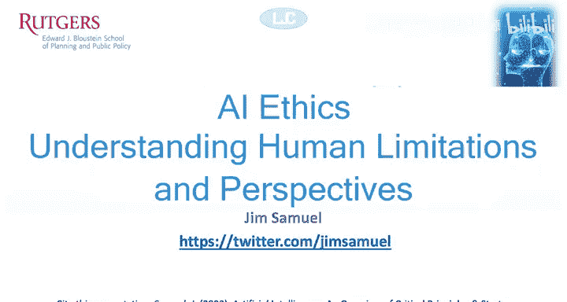
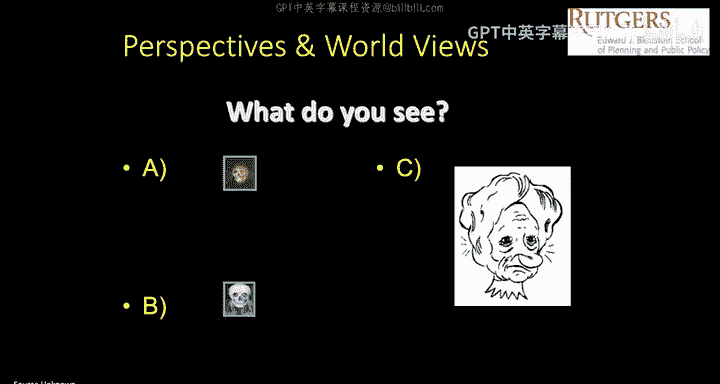

# 16：理解AI伦理 🧭

在本节课中，我们将探讨人工智能伦理这一关键主题。我们将了解AI伦理的核心挑战、不同的分析维度以及未来的发展方向。课程旨在激发思考，而非提供具体解决方案。

## 引言：AI与伦理的复杂性

人工智能技术正在快速发展。它是一系列模仿人类智能（特别是认知和逻辑功能）的技术集群。例如，AI可以“看”（计算机视觉）、“听”（语音识别）、“说”（自然语言生成），并解决复杂的逻辑与优化问题（如围棋或物流路径规划）。

**公式：AI ≈ 模仿（人类认知 + 人类逻辑）**

在AI能力日益强大甚至在某些方面超越人类的背景下，理解其伦理影响变得至关重要。本课程面向未来的领导者与管理者，旨在从概念层面阐述AI伦理，而非深入特定技术或领域（如金融、医疗）。

## 视觉启示：认知的局限与多重视角

在深入探讨之前，让我们通过几个视觉练习来理解人类认知的某些特点。我们的感知和判断常常受到固有思维模式的影响。

以下是几个需要你观察的图像：

*   **图A**：初看可能像一个骷髅，但放大后会发现是一位对镜自照的女士。这提醒我们，第一印象可能并非真相。
*   **图B**：同样，初看像骷髅，实则是餐桌旁的一对夫妇。这强调了探寻“何为正确”比“谁是正确的”更重要。
*   **图C**：正看是一位老妇人，倒过来看则是一位年轻女士。这说明了对于同一事物，可能存在多个同样正确的视角，就像“盲人摸象”的故事一样。

这些练习表明，我们的大脑存在“预编程”的认知模式，这可能会限制我们客观理解现实的能力，而这种认知惯性也会影响我们对伦理问题的看法。

此外，我们需要区分**客观**与**主观**：
*   **客观**：基于确定事实（如 `2 + 2 = 4`）。
*   **主观**：基于个人或文化偏好（如颜色喜好、交通规则）。

## AI伦理的三维框架

上一节我们认识到理解复杂事物需要多角度。本节中，我们来看看如何从三个维度系统性地审视AI伦理。这个框架基于对人类智能与人工智能交互的研究。

AI伦理可以从以下三个相互关联的维度进行理解：

1.  **个体维度**：关注AI对单个人的影响。例如，算法决策是否公平地对待每一个用户？AI推荐系统是否创造了“信息茧房”？
2.  **组织维度**：关注企业在开发、部署AI时应遵循的伦理准则。例如，如何确保算法透明、可问责？如何管理AI带来的隐私和数据安全风险？
3.  **社会维度**：关注AI对更广泛社会结构的影响。例如，自动化导致的就业市场变化、算法偏见可能加剧的社会不平等，以及AI在军事等领域的应用边界。

## 当前AI伦理面临的主要挑战

理解了分析框架后，我们来看看现实中AI伦理领域具体面临哪些棘手的问题。以下是当前的一些核心挑战：

*   **偏见与公平性**：训练数据中的社会偏见会被AI系统学习和放大，导致歧视性结果。
*   **透明度与可解释性**：许多先进AI模型（如深度学习）是“黑箱”，其决策过程难以理解，影响了问责。
*   **问责制**：当AI系统做出错误或有害决策时，责任应由谁承担（开发者、部署公司还是用户）？
*   **隐私**：AI对海量数据的分析和使用，对个人隐私保护构成了巨大挑战。
*   **安全与控制**：如何确保强大的AI系统安全、可靠，且其目标与人类价值观对齐？
*   **就业与经济影响**：自动化可能取代大量工作岗位，需要思考如何实现公正的经济转型。

## AI伦理的哲学基础与缺失

尽管针对上述挑战的研究众多，但一个根本性的问题在于：**AI伦理缺乏坚实的哲学基础**。

过去几年，AI科学与应用飞速发展，但与之配套的、关于AI在社会中应扮演何种角色的哲学思考却相对滞后。我们迫切需要建立一套指导原则，来回答一些根本问题：AI发展的终极目标是什么？何为“善”的AI？如何在多元价值观中寻求共识？

## 总结与前行之路

本节课我们一起学习了AI伦理的基本概念。我们首先通过视觉案例认识到认知的局限性和多视角的重要性。接着，我们介绍了一个从**个体、组织到社会**的三维分析框架。然后，我们列举了当前AI伦理在**偏见、透明度、问责、隐私、安全**和**就业**等方面面临的主要挑战。最后，我们指出了当前讨论中一个关键缺失——**坚实的哲学基础**。

最终的挑战与目标是：我们必须致力于发展和应用AI，确保其服务于**人类的共同福祉**。这需要技术专家、伦理学家、政策制定者和公众的持续对话与共同努力。

---
**课程总结**：本节课探讨了AI伦理的复杂性、多维分析框架、现实挑战以及奠定其发展所需的哲学基础的重要性，旨在引导思考如何负责任地发展和运用人工智能。