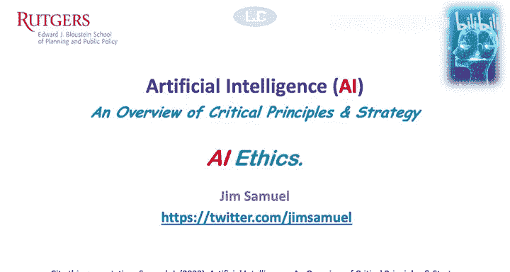
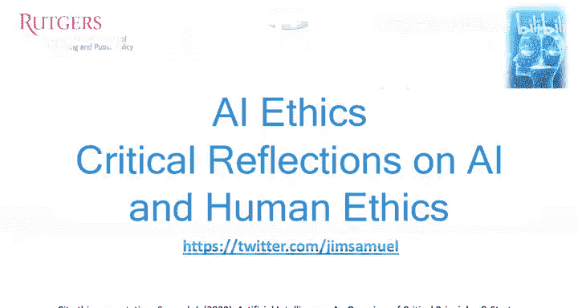

# 17：AI伦理的批判性反思 🤔

在本节课中，我们将探讨人工智能伦理这一复杂而重要的议题。我们将从理解“伦理”本身的多元定义出发，分析构建AI伦理所面临的挑战，并审视AI在法律与司法系统等现实领域中的应用及其潜在风险。

---

## 什么是伦理？

上一节我们提到了人类思维的局限性，这为我们理解伦理问题提供了背景。本节中，我们来看看“伦理”这个词本身意味着什么。

社会学家雷蒙德·鲍姆哈特曾询问人们“伦理对你意味着什么”，并得到了多种不同的回答。以下是其中一部分观点：

*   **基于感受**：伦理与我的感受告诉我什么是对错有关。如果我感觉某事是对的，它就是对的。
*   **基于宗教信仰**：对世界上许多人来说，伦理与他们的宗教信仰紧密相连。
*   **基于法律**：对一些人来说，伦理是机械的，意味着做法律要求的事。只要我遵守法律，我就是道德的。
*   **基于社会规范**：伦理包含我们社会接受的行为标准。这是一种规范性的伦理观，认为如果每个人都做某件事，那它一定是正确的，因此也是道德的。
*   **漠不关心**：也有人采取“我真的不明白伦理这个词是什么意思，我只是遵守规则，我不在乎伦理意味着什么”的态度。

从这个简单的练习中我们可以看到，要完全、彻底地就“伦理是什么”达成一致并不容易。由于对伦理本身的构成缺乏完美共识，要快速找到关于AI伦理构成的共同点和一致意见就变得困难。

## 定义AI伦理的挑战

认识到定义伦理本身的困难后，我们现在可以审视AI伦理这个主题，并尝试对其进行细分和更好理解。

在承认这些挑战的同时，我们仍需找到前进的道路，以确保在我们可以达成共识的客观伦理领域，我们能够理解并实施AI伦理，从而保障人类的福祉和可持续性。

关于本页幻灯片的总结性思考：
*   AI伦理可以是一套信奉的价值观。
*   伦理也可以被视为一种可接受的社会行为准则。
*   伦理本身并非宗教，但与宗教相关的抽象原则和价值体系可以形成伦理准则，或用于指导伦理信念。
*   伦理不是法律，但可以与之关联。因为在许多情况下，违反法律就是不道德的。但这并非完美匹配，总会出现一些场景，例如为了拯救生命而超速驾驶，在伦理上是正确的，但却违反了法律。

## AI伦理的学习困境

这就引出了一个挑战：如果AI能够学习伦理，无论是通过专家系统编程输入，还是从数据中学习，那么问题就出现了：AI应该遵循哪种伦理？

*   AI应该遵循与宗教相关的伦理吗？（一些国家或地区的人可能倾向于此）
*   AI应该遵循与法律相关的伦理吗？
*   AI应该被训练成遵循与个体用户感受或社会群体感受相关的伦理吗？
*   人工智能应该基于美国伦理吗？但即使在美国或西方内部，对于什么构成伦理也存在显著分歧，在许多核心问题、基础以及伦理本身的哲学性质上存在显著两极分化。

## AI在法律与司法系统中的应用

尽管我们不会深入任何特定的领域应用，但我想简要介绍一下AI在法律和法庭中的应用，目的是强调人工智能已经在影响司法实践和法律应用的方式。

以下是AI在司法领域的一些应用实例：

*   **电子取证**：使用预测模型对法律文本进行分类。
*   **文档汇编软件**：在一定程度上准备文档的变体，减少准备法律文书的人力。例如，律师使用该软件可能只需10小时完成原本需要20小时的工作。
*   **复杂自然语言处理任务**：AI能够审查法庭判决及相关数据，帮助预测法律从业者的行为。
*   **法律研究支持**：在新加坡、中国等地，人工智能被用于支持法律研究。
*   **辅助法庭流程**：AI被用于帮助法官，甚至在处理轻微违法行为时，直接介入处理而无需人类干预。

## 使用AI的利弊与风险

为什么司法系统要使用人工智能？因为它降低了人为错误的可能性。例如，在统计与某类案件历史相关的关键词或关键短语并进行某种语言分析时，人工智能比人类更准确、更快速。

然而，这也引入了AI错误的风险。有些明显的事情人类永远不会错过，但人工智能可能会遗漏。目前的流程通常包含一层低强度的人工干预，即在人工智能完成大部分工作后进行人工审查。

使用人工智能的总体效果是节约成本和提高效率。但也可能提高准确性，不过我不想过分强调这一点，因为它是一把双刃剑。当使用基于自然语言处理的AI来提高效率时，其效果取决于数据质量。如果数据质量高、结构良好且与算法兼容，它就能良好工作。然而，如果数据质量或词语的语义含义发生变化，而AI无法捕捉到，就可能导致重大错误。

因此，尽管总体成本节约和效率提升至关重要，但基于我对自然语言处理AI的理解，我认为最终决策必须有人工层和人工干预，人工审查是必要的。

## 必要的谨慎与未来展望

律师和法庭正越来越多地采用人工智能，但保持谨慎是必要的，原因非常明显。

首先，自然语言处理技术已多次被证明存在性别和种族偏见等挑战。尽管有方法可以减轻这种偏见，但问题随之而来：谁在调整这些算法？只要数据流入一个透明的NLP AI系统，这没问题。但一旦我们说“输入进来，AI完成工作，然后我们将调整它以获得可接受的输出范围”，那么问题就出现了：谁在进行调整？谁来决定什么是对错？这种操纵层是不可取的，在当前某些情况下是必要的，但我们还需要更多工作才能在接受它在法庭中用于伸张正义的背景下使用它。

此外，我们距离赋予任何人工智能或一组人工智能对人类行使司法权力还非常遥远。基于现有的AI技术、现有的自然语言理解和自然语言生成工作，在我可见的未来里，没有任何东西能让我对拥有对人类行使司法权力的自主人工智能产生信心。我们离那还很远，我们不应该考虑它。

---

**本节课总结**

本节课中，我们一起学习了AI伦理的复杂性。我们探讨了“伦理”定义的多元性，理解了构建普适AI伦理框架的挑战。通过分析AI在法律司法领域的实际应用，我们看到了其提升效率、降低成本的优势，同时也深刻认识到其中潜藏的偏见、错误风险以及对透明度和人类监督的迫切需求。最终，我们明确了在可预见的未来，人工智能应作为辅助工具，而非取代人类判断的自主决策者。